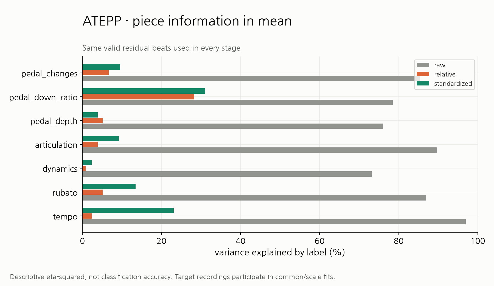

# ATEPP Feature normalization 및 각 Feature 분석

ATEPP 연주 피처의 공통 패턴 제거·표준화·14차원 embedding과 결측 안정성·검색 역할을 분석한다.

## 데이터와 계산 조건

ATEPP-1.2의 품질 승인 DualDTW 연주 2,714개에서 233개 동일 작품/악보 그룹, 2,692개 연주를 정규화했다. 전체 모집단 상태와 input/code SHA256은 [provenance.json](provenance.json)에 있다. 단독 연주와 정확한 공통 score 구간이 없는 그룹은 [cohort_audit.csv](cohort_audit.csv)에 이유를 남긴다. 서로 다른 악보는 파일 SHA256으로 나눈다. 연주 ID의 앞자리 0을 보존한다.

ASAP의 수동 beat annotation/robust match 대신 DualDTW 자동 note alignment 품질 승인을 사용한다. 악보 quarter-note 위치의 **정확한 교집합**을 사용하며 보간하지 않는다. 반복·박자 종류는 ATEPP 자동 grid에 따로 주어지지 않으므로 regular beat `b`로 취급한다. Tempo 기준은 기존 ATEPP 코드와 동일한 120 BPM(quarter note 0.5초)이다. 이는 악보의 실제 지시 빠르기라고 해석하지 않는다. MIDI에서 CC64가 없으면 세 페달 채널을 결측 처리한다. MIDI velocity·note-off·CC64는 전사 데이터이며 실제 음압·잔향·페달 센서 측정과 구분해야 한다.

```text
D/A/P common[i] = median(valid performances at same score position), support >= 2
relative[p,i] = raw[p,i] - common[i]
Tempo relative = existing individual_tempo_sequence
Rubato raw = Tempo - own median Tempo; relative = raw - common Rubato
standardized = relative / per-work channel scale
MAD: 1.4826 * median(abs(R - median(R))); IQR: (q75-q25)/1.3489795003921634
SD: std(R, ddof=0); MAD degeneracy: IQR -> SD -> unit; no values -> NaN/mask=False
```

Tempo/Rubato/Dynamics/Articulation은 MAD, 세 Pedaling 지표는 각각 SD를 쓴다. [후보 scale](feature_normalization/piece_scale_candidates.csv), [작품별/전체 scale tail 비교](feature_normalization/policy_comparison.csv), [실제 scale/fallback](feature_normalization/piece_scales.csv), [전체 분포](feature_normalization/distributions.csv)에서 ATEPP의 분포와 퇴화 여부를 확인할 수 있다. 재중앙화·clipping·winsorization은 없다. 단위가 다른 단계의 분포 곡선을 직접 같은 수치로 해석하지 않는다.

ATEPP에서 직접 측정한 scale 진단:

| 채널 | MAD=0 그룹 | IQR=0 그룹 | 실제 scale 중앙값 | MAD fallback 최대 절댓값 | SD 최대 절댓값 | 적용 정책 |
| --- | --- | --- | --- | --- | --- | --- |
| tempo | 0/233 | 0/233 | 0.14815 | 1.92e+03 | 24 | MAD |
| rubato | 0/233 | 0/233 | 0.080057 | 1.64e+03 | 31.5 | MAD |
| dynamics | 0/233 | 0/233 | 0.048155 | 52 | 11.4 | MAD |
| articulation | 0/233 | 0/233 | 0.29412 | 286 | 24.4 | MAD |
| pedal_depth | 1/233 | 1/233 | 0.12487 | 54 | 9.95 | STD |
| pedal_down_ratio | 47/233 | 36/233 | 0.31191 | 5.37e+03 | 9.25 | STD |
| pedal_changes | 116/233 | 64/233 | 1.6674 | 247 | 53.4 | STD |

MAD는 중심부의 편차를 맞추지만 긴 꼬리가 남는다. 페달은 경계값·exact zero·정수 count가 많아 MAD가 퇴화하거나 양수여도 작아질 수 있다. 표의 tail 비교로 해당 문제를 확인하며 SD는 작품 내 전체 spread를 반영한다. 선택한 표준화 정책을 ATEPP 데이터에서 평가한다. 큰 표준화값은 삭제하지 않으며 원자료 재추출과 정렬 확인 대상으로 남긴다. 극단값의 재추출 일치는 음악적으로 타당한 해석이라는 판정과 구분한다.

## 다섯 피처의 추출·공통 제거 전후·연주 차이

대표 작품은 **Piano Sonata No. 9 in D, K.311: 3. Rondeau (Allegro)**, 13개 연주다. 적격 그룹 중 연주 수의 중앙값에 가장 가까운 그룹을 piece key 순으로 결정했고, Tempo 편차의 25/50/75백분위 연주 05353, 05360, 05354를 표시했다. 평균/변화 폭과 pair 검사는 해당 작품의 모든 연주를 사용한다. 상세 CSV에 artist와 MIDI ID를 대응시킨다.

| 피처 | 추출값 | 분석 |
| --- | --- | --- |
| [Tempo](tempo/README.md) | log2(0.5초 / 실제 quarter-note 시간) | 실제 beat 시간 대조, 공통/편차/표준화, 빠르기와 연주 쌍 차이 |
| [Rubato](rubato/README.md) | 자기 전체 Tempo 중앙값을 뺀 국소 변화 | 공통 변화 제거, 변화 폭, 전체 1.2배 속도 불변성 |
| [Dynamics](dynamics/README.md) | note-on velocity/127의 beat 평균 | note→beat, 공통/편차/표준화, 평균 강약/변화 폭 |
| [Articulation](articulation/README.md) | log2(key-held / tempo-map 기대 음 길이) | 실제/기대 음 길이, note→beat 중앙값, 연결/분리 성향 |
| [Pedaling](pedaling/README.md) | CC64 시간 평균 깊이·on 비율·전환 횟수 | 실제 CC64, 세 하위 지표 각각 공통 제거/SD/연주 차이 |

[example_beat_features.csv](example_beat_features.csv)는 네 단계 값·mask·support·score 위치·연주 시각을 보존한다. [source_midi](source_midi/README.md)의 note/CC64 및 재추출 검산과 [극단값 검산](feature_normalization/extreme_source_checks.csv)을 함께 읽는다. Rubato 전체 속도 불변성 최대 오차는 6.71e-13다.

## 공통 제거와 단위 맞춤 결과

모든 같은 작품 연주 쌍의 같은 유효 beat에서 `raw_A-raw_B = relative_A-relative_B` 최대 오차는 **1.78e-15**, 표준화 관계 오차는 **2.27e-13**다. 원래 차이가 있던 연주 쌍의 붕괴는 **0개**다. 마스크와 유효 beat 수가 보존되는 것을 검사했다. [pair_preservation.csv](feature_normalization/pair_preservation.csv).

연주별 평균값의 작품 설명력 η²(0–1):

| 채널 | raw | relative | standardized |
| --- | --- | --- | --- |
| tempo | 0.9698 | 0.0234 | 0.2312 |
| rubato | 0.8688 | 0.0514 | 0.1343 |
| dynamics | 0.7325 | 0.0084 | 0.0235 |
| articulation | 0.8961 | 0.0387 | 0.0925 |
| pedal_depth | 0.7601 | 0.0512 | 0.0385 |
| pedal_down_ratio | 0.7853 | 0.2826 | 0.3103 |
| pedal_changes | 0.8547 | 0.0665 | 0.0959 |



평균 설명력 감소를 작품 정보의 완전 제거로 해석하지 않는다. 변화 폭·작곡가의 설명력 및 label shuffle 100회는 [identity_variance.csv](feature_normalization/identity_variance.csv)에 있다. common과 scale은 대상 연주를 포함해 fit하므로 독립 일반화 결과가 아니다.

## 결측 안정성과 통합 embedding

161개 작품/grid·2,489개 연주에서 모든 후보×7채널의 공통 유효 beat를 사용한다. 작품당 최소 5개 연주, 최소 32개 공통 beat, 공통 coverage ≥ 50%를 적용한다. mask/count/duration은 embedding에 넣지 않는다.

7채널×(signed mean, p95−p5)의 14좌표이며 Rubato의 첫 좌표만 median(abs)다. Tempo·Rubato·Dynamics·Articulation·Pedaling 다섯 묶음은 같은 가중치이고 Pedaling의 6좌표는 묶음 내 평균한다. 결측이 생겨도 common/scale/gallery를 재fit하지 않는다.

원본 복구 실험은 무결측, 무작위 5/10/20/40% 결측, 연속 20% 결측, 조건당 20회다. feature 단독/제외, 성향만, D/A 변화 폭 제외를 모두 비교한다. 무작위 10% 결측의 전체 feature 작품 macro Top1은 **98.74%** (작품 bootstrap 95% 구간 98.34%–99.04%, 무작위 기대 9.10%)다.


[_embedding_validation](_embedding_validation/README.md)의 9개 그림, 조건별 요약·연주별 embedding·작품별 결과·paired ablation·거리 기여 CSV를 제공한다. 같은 녹음의 beat 일부가 빠진 경우의 복구이며 새로운 녹음/청취 선호의 정확도와는 다르다.

## 다른 작품 검색에서 feature별 역할

동일한 후보 gallery로 full 14좌표와 성향만 7좌표를 비교했다. 개별 feature 단독/제외와 Tempo+Rubato 제외, Dynamics+Articulation 제외를 모두 분석한다. 동일 작품/악보 후보는 제외한다. nearest 동점은 집합 포함 여부, 순위는 midrank, Top5 경계는 fractional membership으로 처리한다.

| 제외 조건 | 최근접 후보 변경률(작품 macro) | bootstrap 95% 구간 |
| --- | --- | --- |
| without_Articulation | 65.73% | 63.41–68.08% |
| without_Dynamics | 68.26% | 65.39–71.00% |
| without_Dynamics_Articulation | 86.15% | 84.46–87.88% |
| without_Pedaling | 69.86% | 67.36–72.44% |
| without_Rubato | 56.61% | 53.84–59.20% |
| without_Tempo | 75.49% | 73.34–77.62% |
| without_Tempo_Rubato | 90.20% | 88.81–91.62% |


검색에서 제외한 feature로 후보의 같은 작품 내 다른 연주와 비교해 heldout 일치도를 계산한다(동점=0.5, 무작위 기준=0.5). [heldout_agreement.csv](_feature_search_roles/heldout_agreement.csv), [summary.csv](_feature_search_roles/summary.csv), 대표 및 중간 사례 figure를 제공한다. 이 지표는 feature 간 일치이며 음악적 정답 판정이 아니다. 작품 macro bootstrap 2000회이며 후보 작품이 겹치는 의존성이 남는다.

[다른 작품 A/B/C 사례](_interpretation_embedding/cross_work/README.md)는 A와 전체 다른 작품 후보의 최근접 B, B 작품 내 가장 먼 C를 성향·폭·거리 기여로 비교한다. 백분위 profile은 표시용이며 검색 입력은 원래 14좌표다. C는 의도적으로 먼 대조 사례다.

## 재현

저장소 루트 PowerShell:

```powershell
.venv/Scripts/python.exe classicfy-ai/scripts/validate_atepp_normalization.py
$env:PYTHONPATH = "classicfy-ai/src"
.venv/Scripts/python.exe -m unittest discover -s classicfy-ai/tests -q
```

기본 입력 `classicfy-ai/analysis/atepp_research/midi_audit.csv`, 원본/정렬 cache `../ATEPP_dataset/features/dual_dtw/raw`, `../ATEPP_dataset/alignments/dual_dtw`를 사용한다. `--root`, `--audit`, `--out`, `--normalized-cache`, `--seed`, `--trials`, `--bootstrap-samples`, 최소 모집단 조건을 지정할 수 있다. `--stages`로 normalization/features/embedding/search만 다시 실행할 수도 있다. 파일 경로는 script 위치를 기준으로 하므로 CWD와 무관하다.

네 단계 전체 cache는 저장소 밖 `C:\Users\정세린\Desktop\capstone_classicfy\ATEPP_dataset\features\dual_dtw\atepp_standardized.npz`에 저장된다. `np.load(..., allow_pickle=False)`의 manifest record index와 `i/raw_values`, `i/raw_mask`, `i/common_values`, `i/common_support`, `i/relative_values`, `i/standardized_values` 등을 대응시킨다. 입력 raw/정렬 cache를 덮어쓰지 않는다. source hash와 생성 artifact hash는 [provenance.json](provenance.json), [artifact_manifest.csv](artifact_manifest.csv)에 기록한다.

공통값·scale은 corpus 내 기술 분석이다. 독립 평가/새 연주에서는 reference와 scale을 학습 집합에 fit해 고정해야 한다. 자동 정렬 오류, note 밀도, 전사 편향, 작품당 연주 수, 극단값, 중복 MIDI의 영향이 남을 수 있다. 검색 후보 변경과 녹음 복구율은 추천의 정확도나 사용자 선호 예측을 증명하지 않는다.
