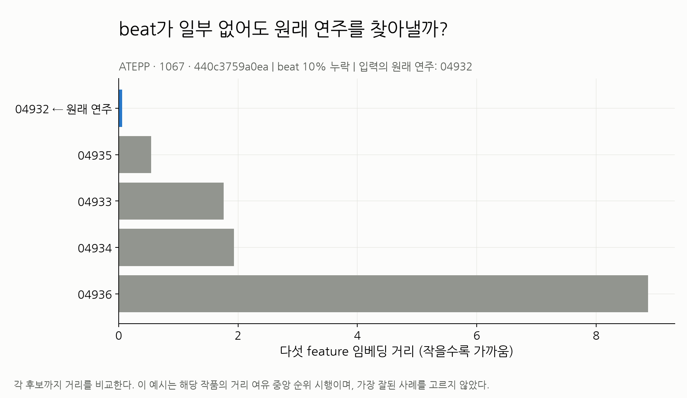
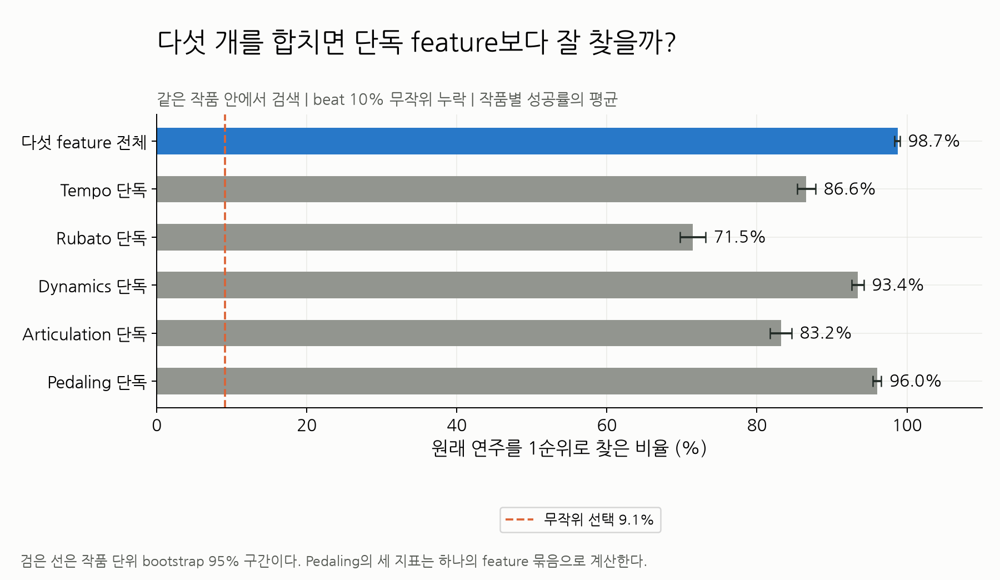
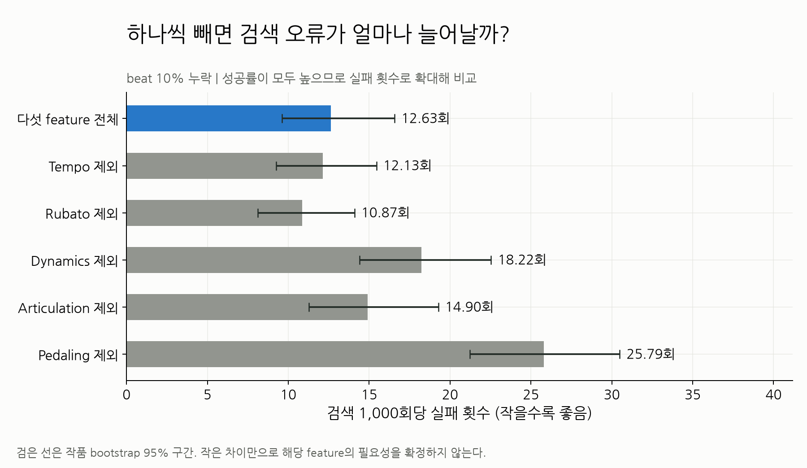
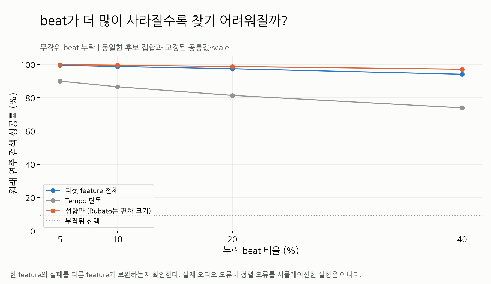
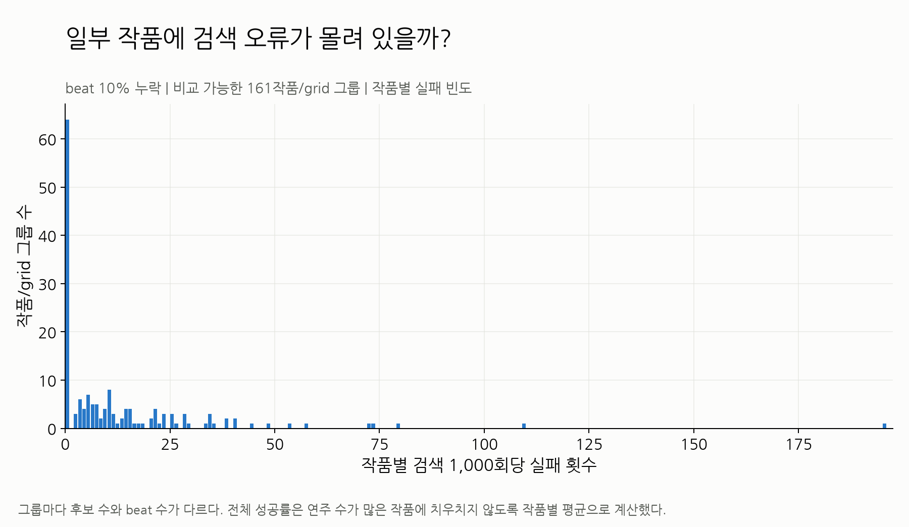
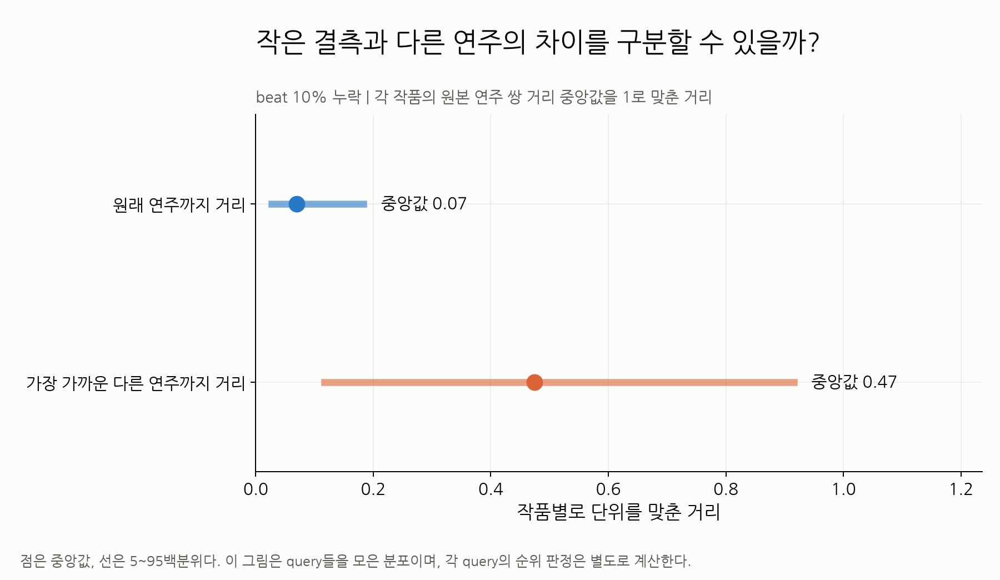
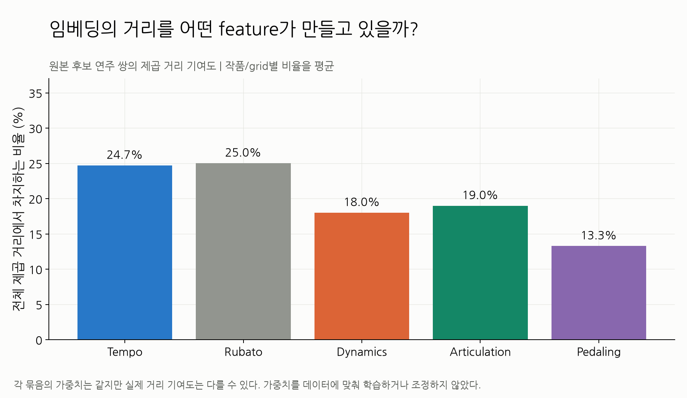
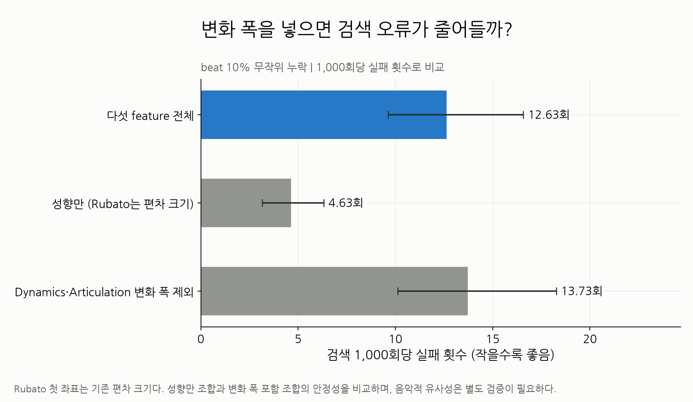
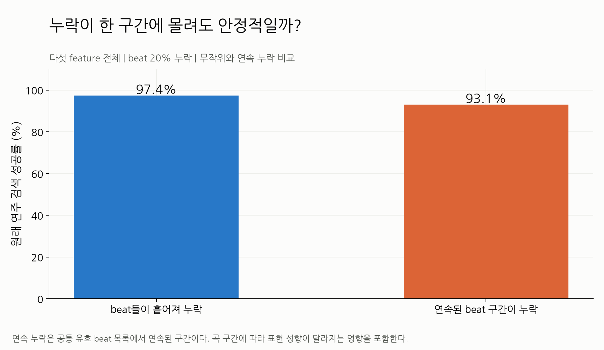

# ATEPP _embedding_validation

01 예시·02 단독 비교·03 제외 비교·04 무작위 결측·05 작품별 복구·06 자기/다른 거리·07 기여도·08 요약 선택·09 연속 결측의 9개 figure와 CSV를 제공한다. 전체 녹음에서 common/scale을 fit한 후 beat 일부를 삭제하는 동일 녹음 복구 분석이다.

전체 조건과 재현은 [상위 보고서](../README.md).

