# ATEPP _feature_search_roles

14좌표와 성향만 포함한 7좌표의 검색 결과를 비교한다. search_changes.csv: 후보 변경·기존 후보 순위·Top5 유지. heldout_agreement.csv: 검색에서 제외한 feature로 B 작품 내 다른 연주와 비교(동점=0.5). source work/grid macro 및 bootstrap. 제거마다 scale을 재fit하지 않는다.

전체 조건과 재현은 [상위 보고서](../README.md).

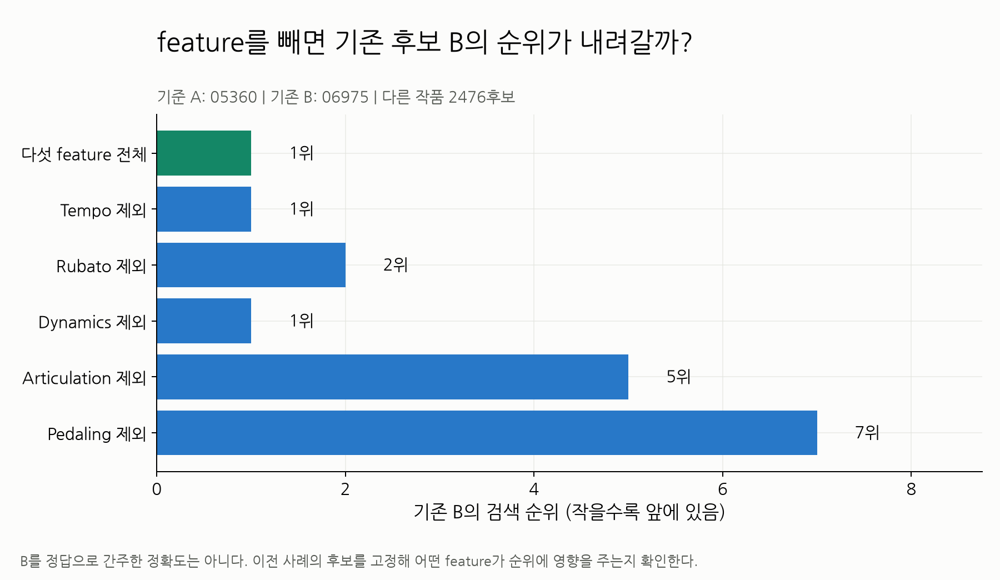

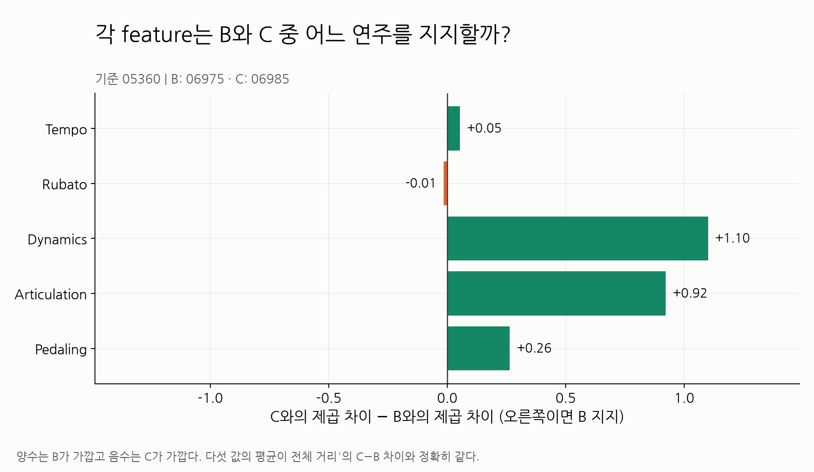

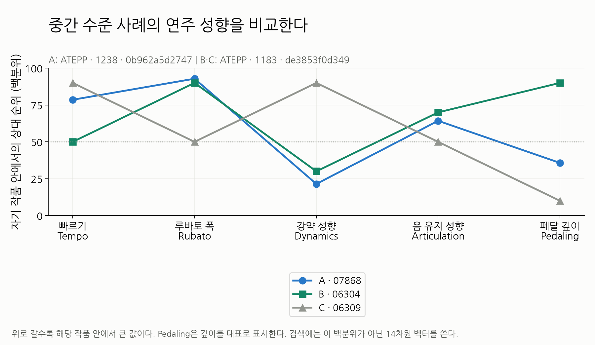

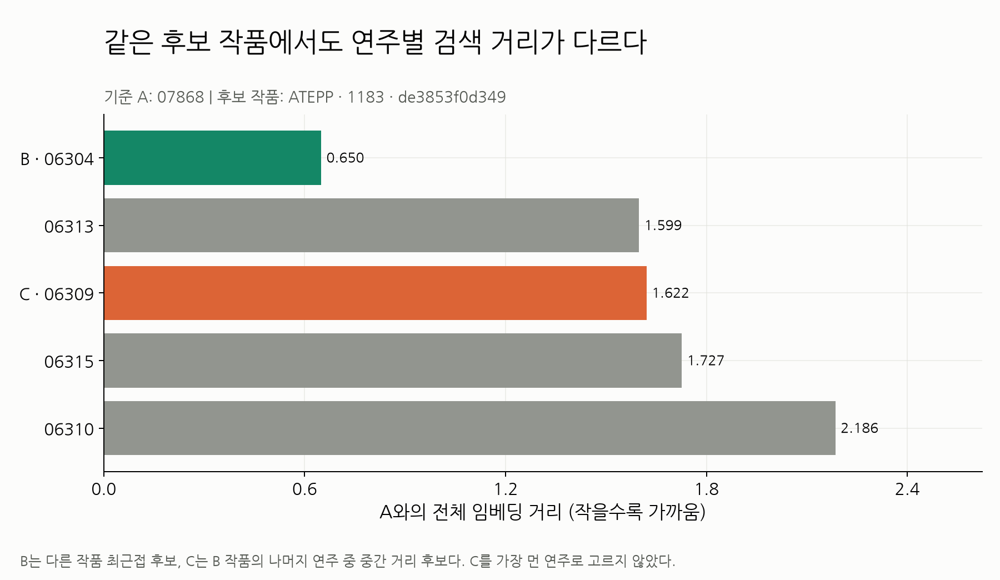

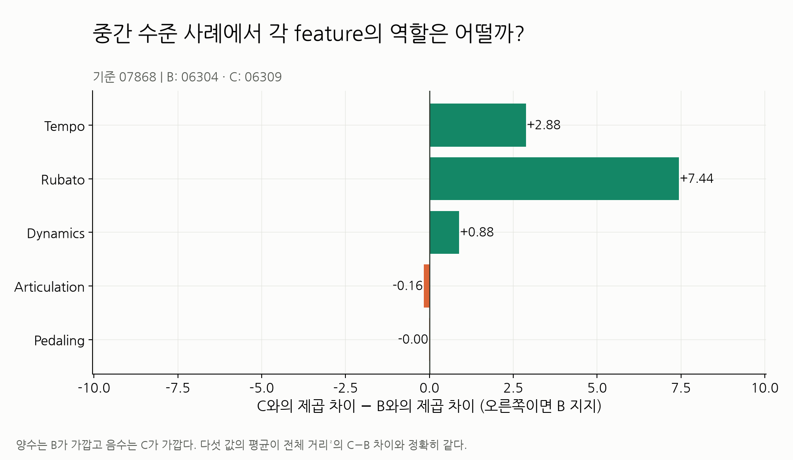

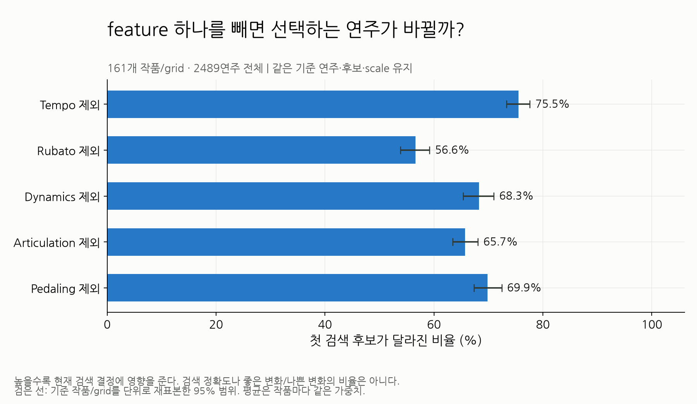

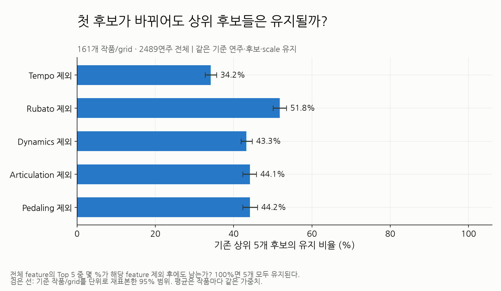

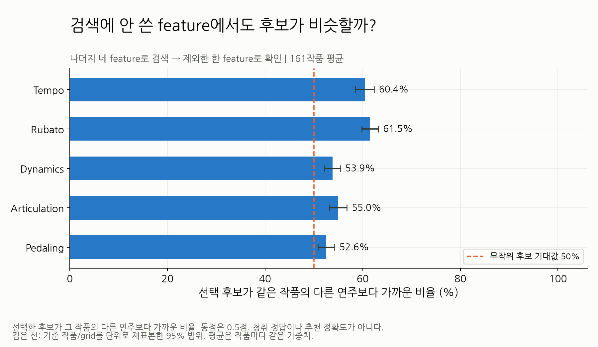

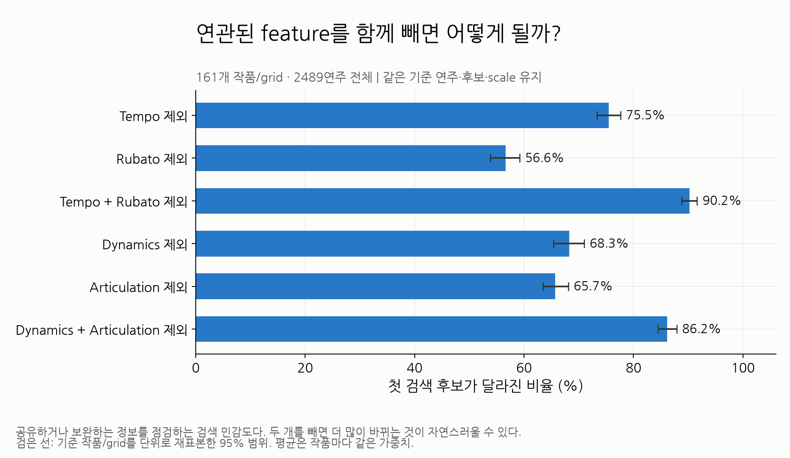

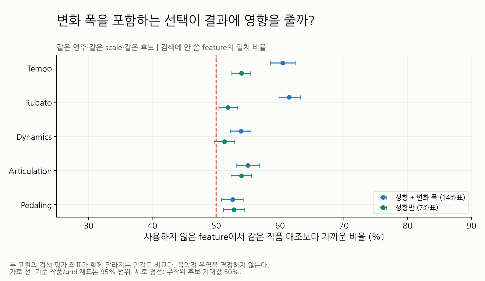

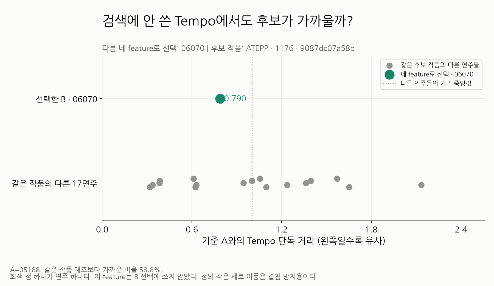

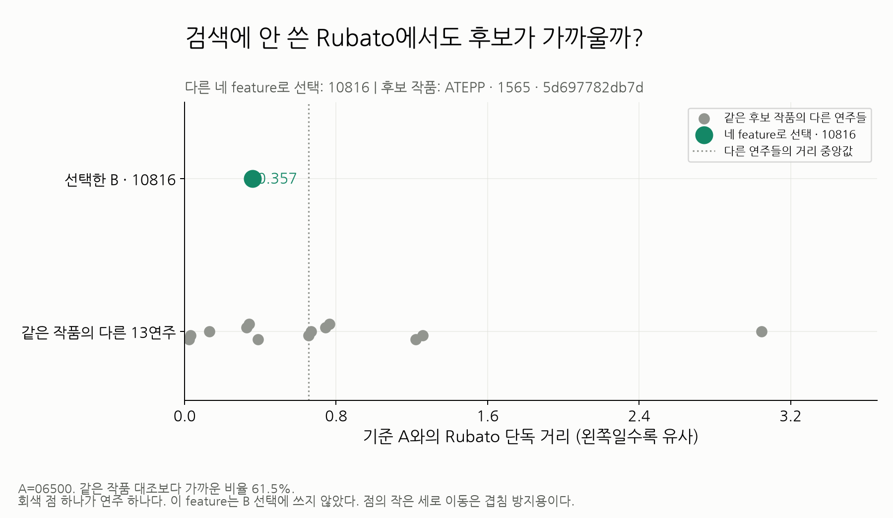

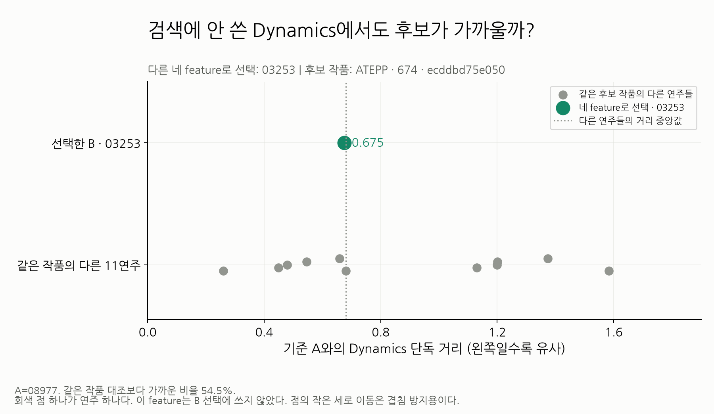

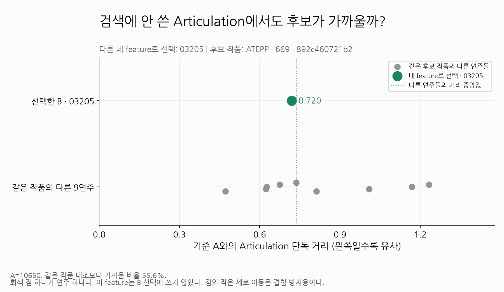

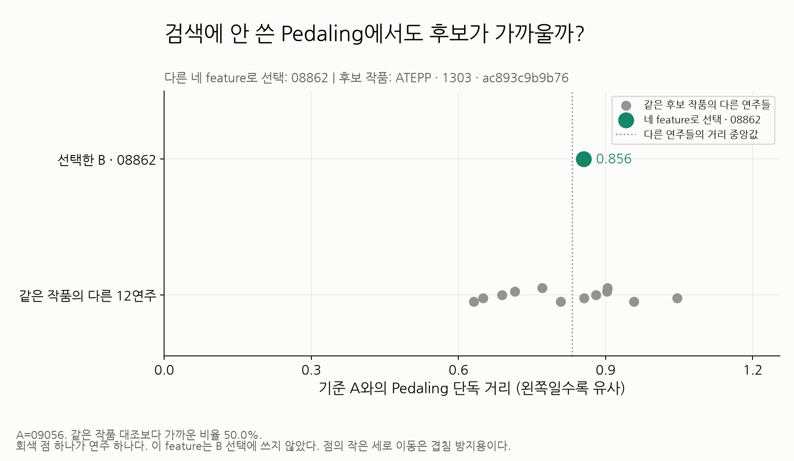
