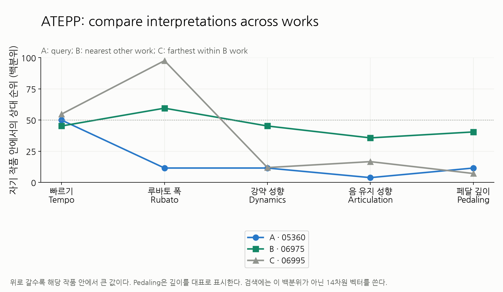
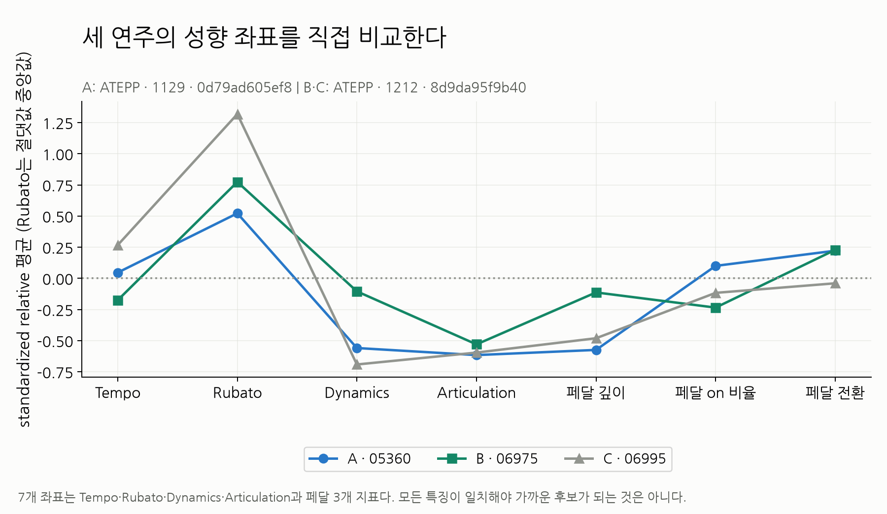
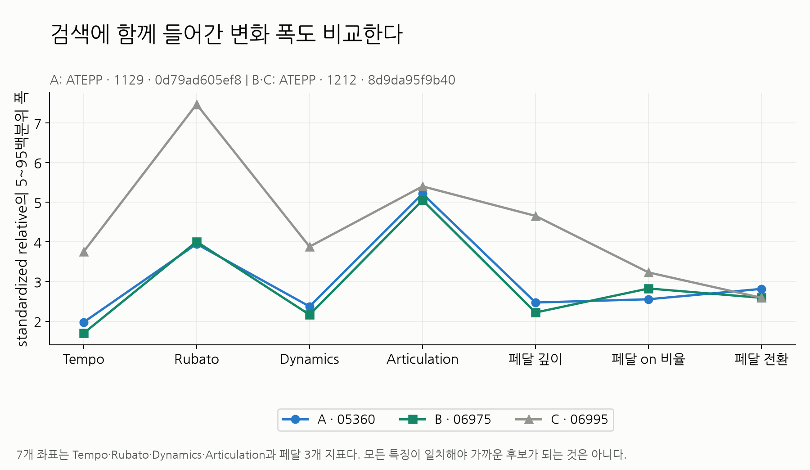
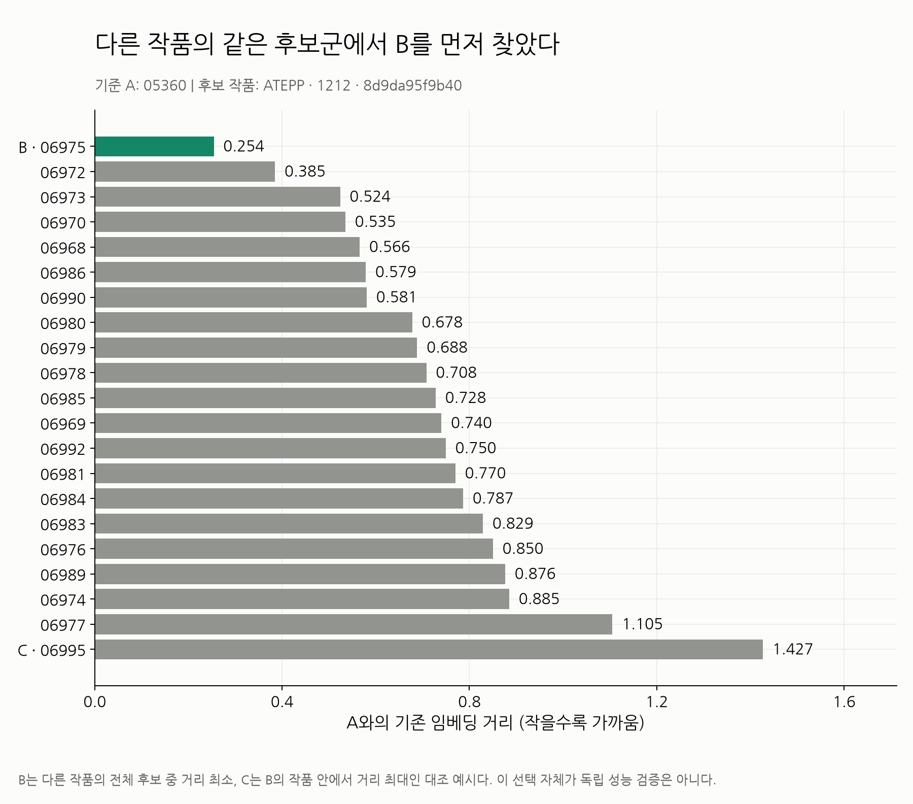
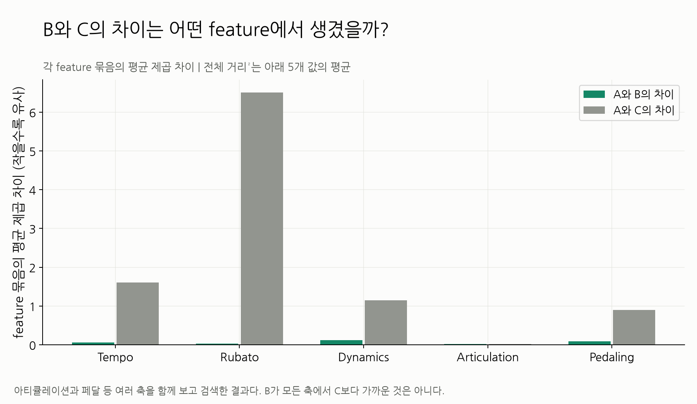

# ATEPP _interpretation_embedding/cross_work

A는 대표 작품의 Tempo 중앙 연주, B는 전체 다른 작품 후보의 거리 최소, C는 B의 작품 내 거리 최대. 01 profile은 자기 작품 내 백분위 표시용, 02 성향, 03 변화 폭, 04 B 작품 후보의 거리, 05 feature 거리 기여. 검색 입력은 14차원 원값이다. 자세한 후보는 retrieval_candidates.csv.

전체 조건과 재현은 [상위 보고서](../../README.md).

