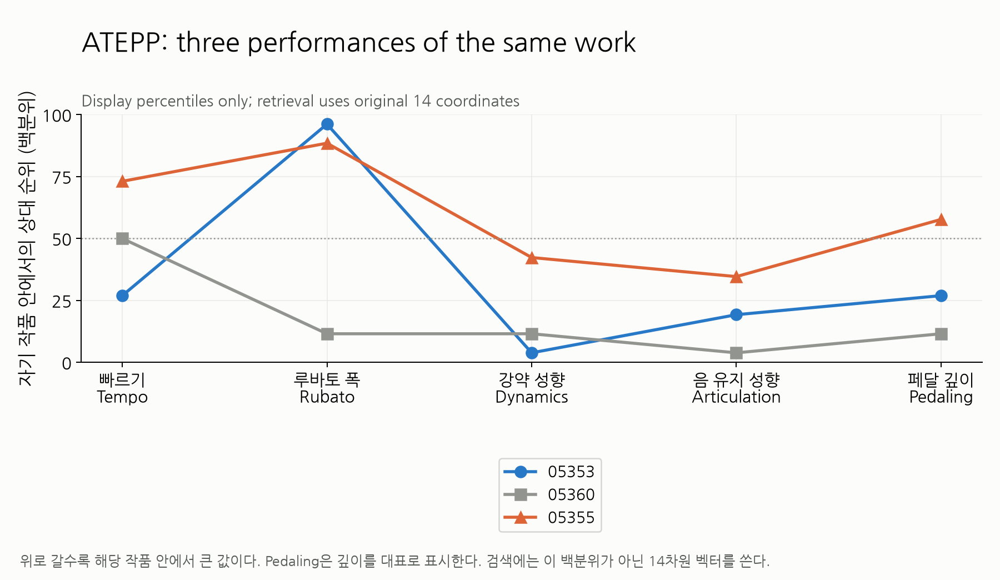

# ATEPP _interpretation_embedding/same_work

같은 작품의 Tempo 성향 25/50/75백분위 연주 3개의 profile이다. 백분위는 표시용이고 profiles.csv에 실제 14좌표를 제공한다. 개별 raw/common/relative/standardized 곡선은 상위 다섯 feature 폴더에서 확인한다.

전체 조건과 재현은 [상위 보고서](../../README.md).

