# ATEPP feature_normalization

작품별 MAD/IQR/SD 후보·pooled global scale·tail·분포·mask·연주 쌍 보존·작품/작곡가 mean/range η²를 분석한다. 그림의 중앙 표시 제한은 데이터 clipping이 아니다.

전체 조건과 재현은 [상위 보고서](../README.md).

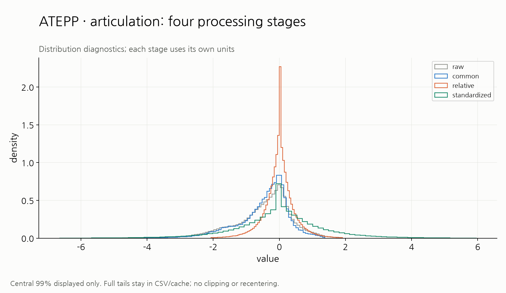

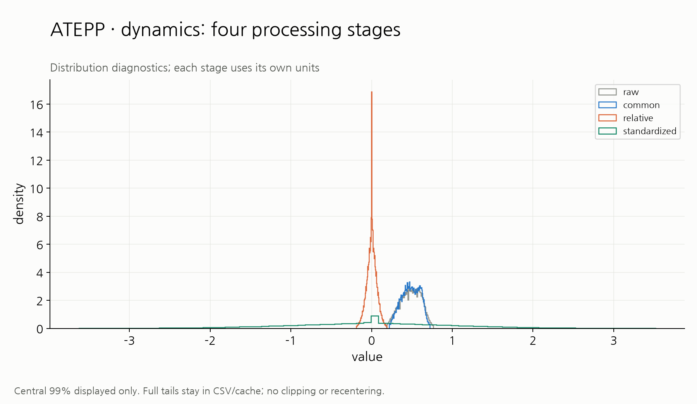

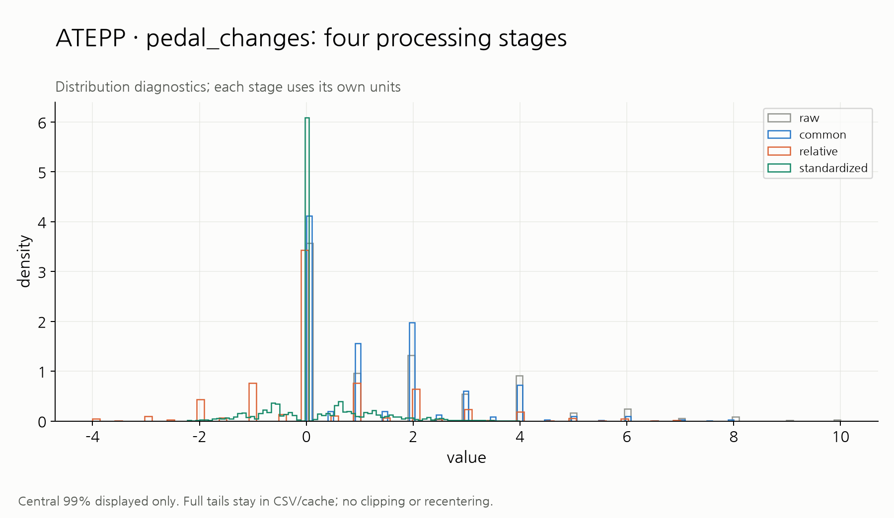

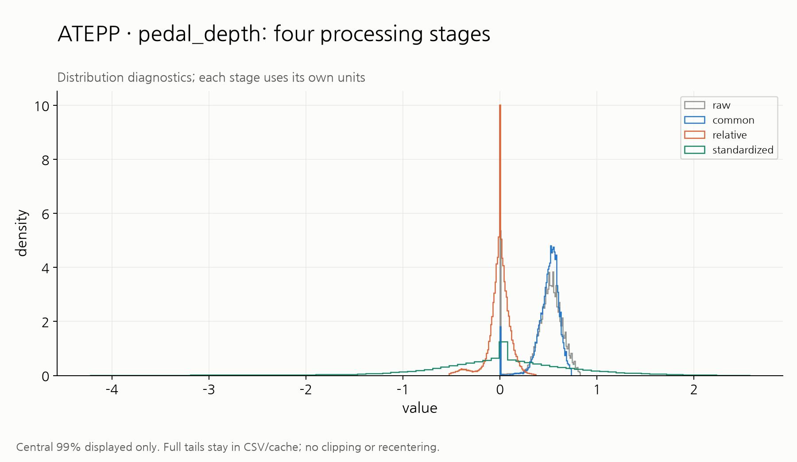

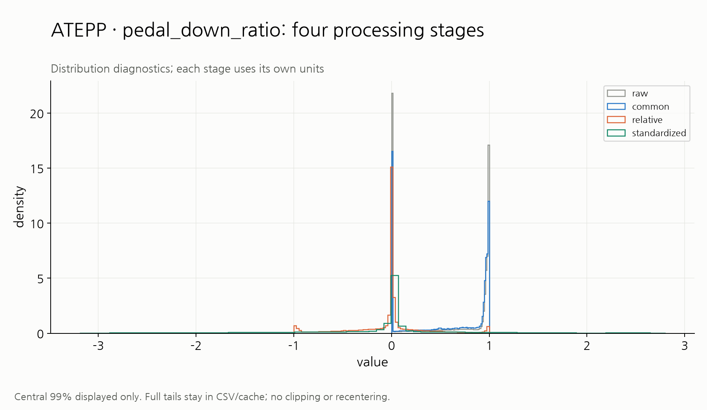

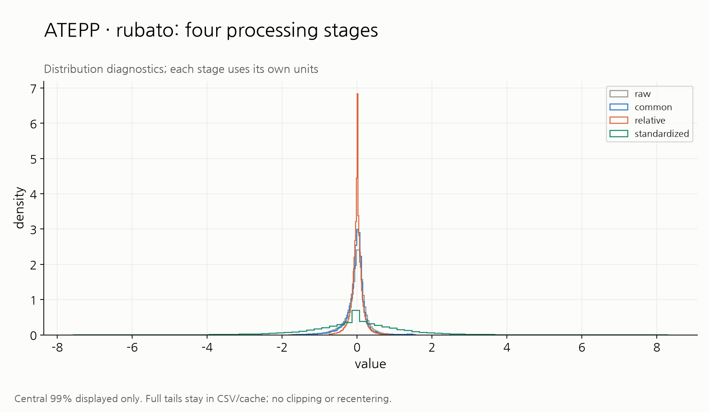

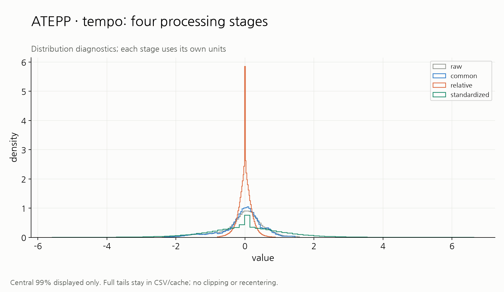

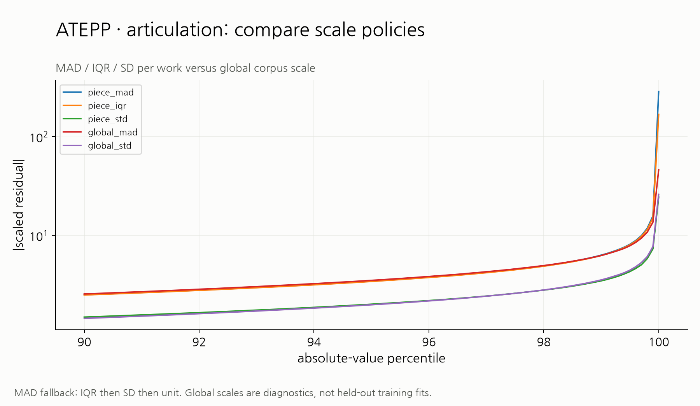

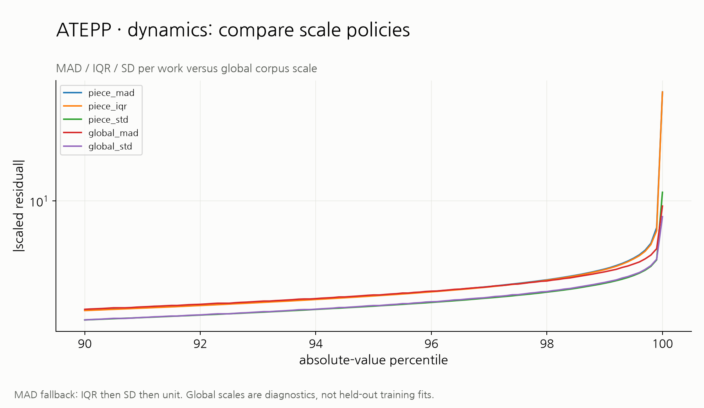

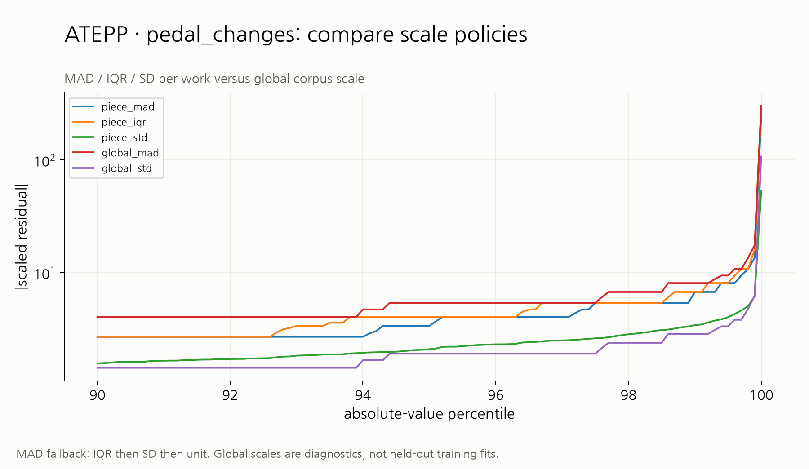

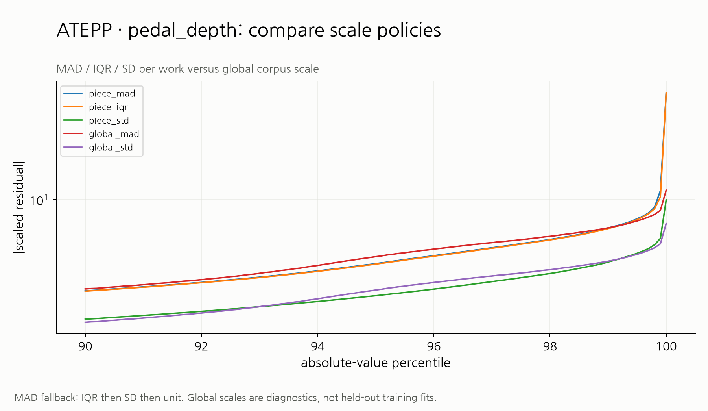

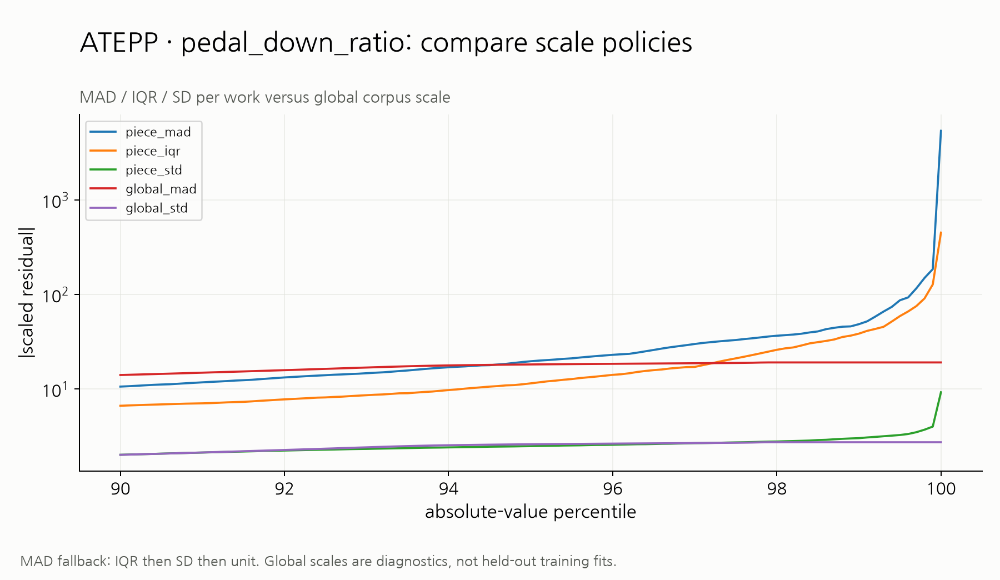

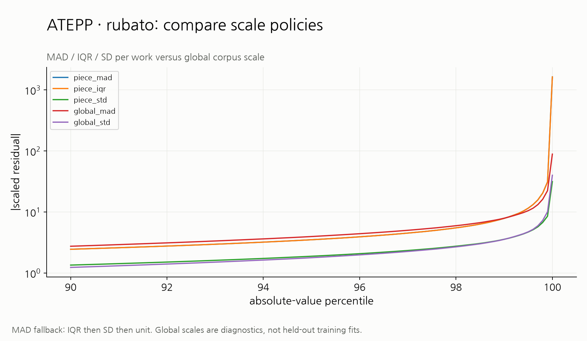

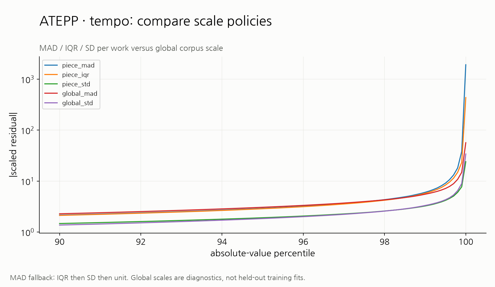

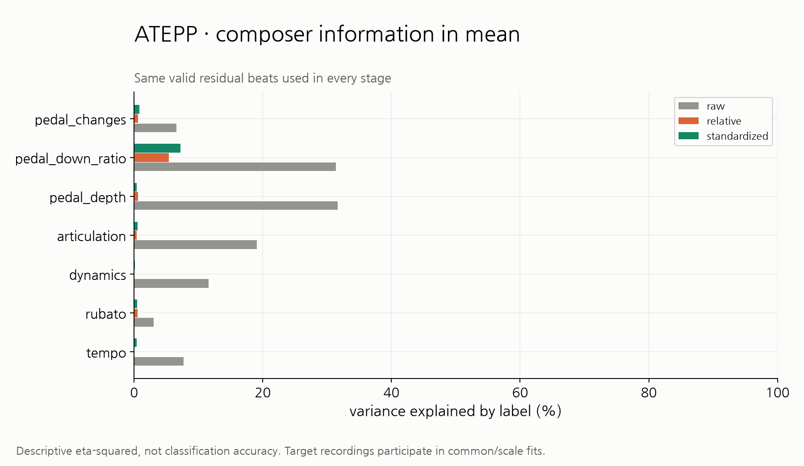

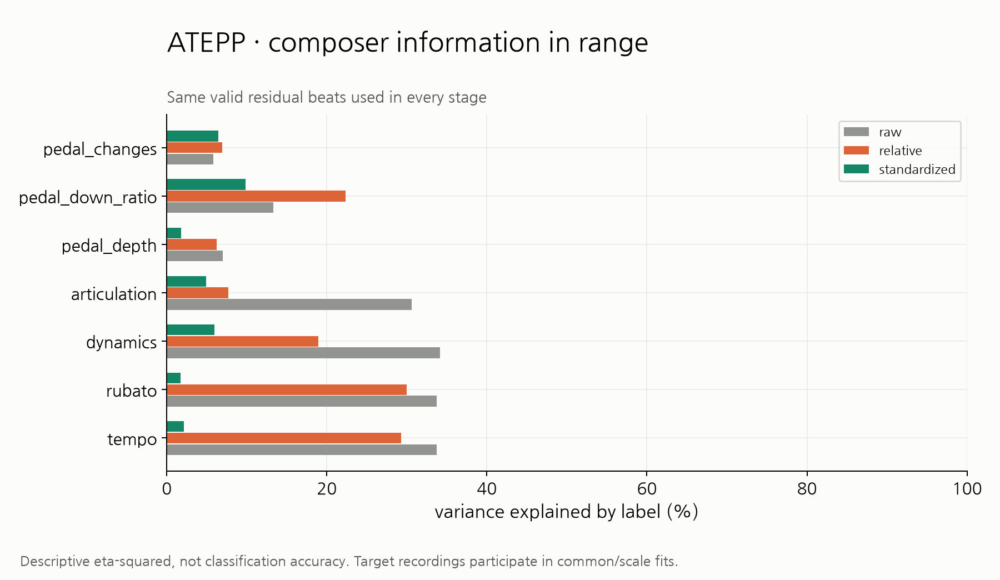

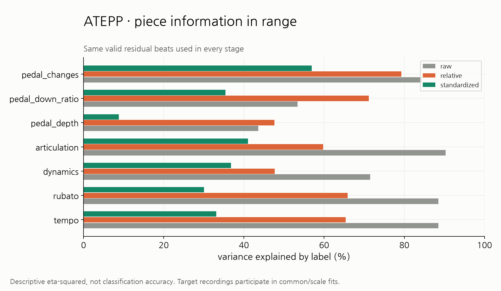

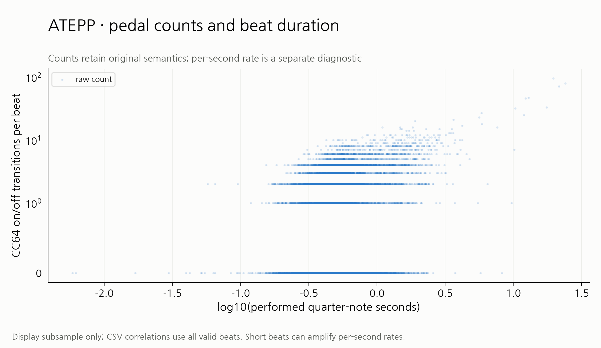
