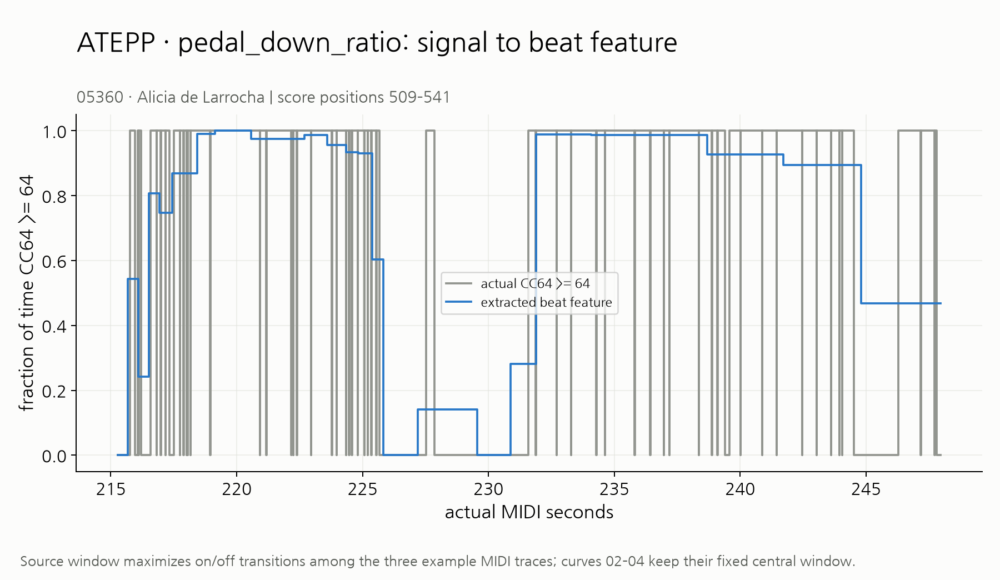
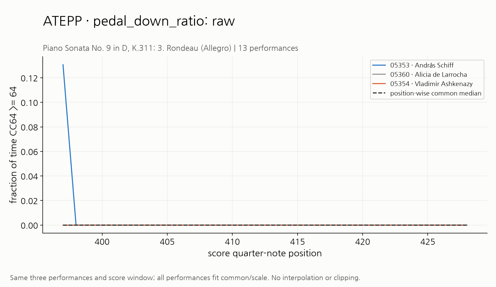
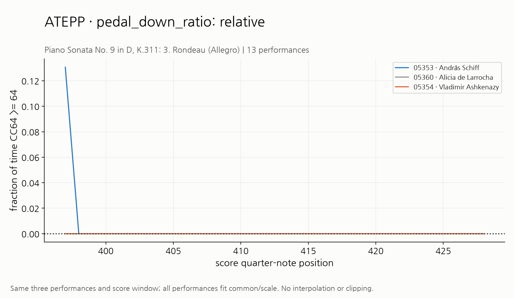
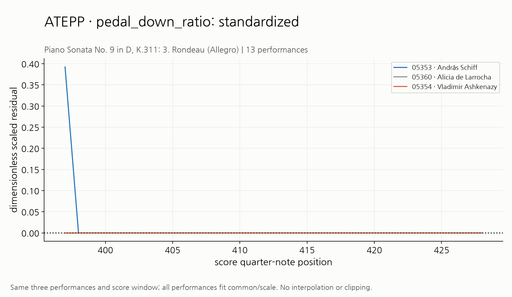

# ATEPP pedal_down_ratio

대표 작품: Piano Sonata No. 9 in D, K.311: 3. Rondeau (Allegro) (13연주). 선택 연주: 05353, 05360, 05354.
원본 단위: `fraction of time CC64 >= 64`. 좌표는 악보 quarter-note 위치다. 02~04는 동일한 연주/구간이며 모든 연주로 공통값과 scale을 fit한다.

1. `01_extraction.png`: 실제 MIDI/정렬 원자료에서 추출값으로 가는 과정. Articulation은 실제/기대 note 길이, Dynamics는 개별 velocity와 beat 평균, Pedaling은 CC64 신호(세 하위 지표의 raw 산출값은 02와 beat CSV).
2. `02_raw.png`: 원본과 작품 위치별 공통값. 상대 feature를 해석하려면 먼저 이 두 곡선을 비교한다.
3. `03_relative.png`: 공통값을 뺀 연주별 편차. 양수/음수는 해당 위치 공통값보다 크거나 작다.
4. `04_standardized.png`: 편차를 작품별 scale로 나눈 값. 단위 없는 비교값이며 같은 숫자가 원본에서 같은 절대 크기를 뜻하지 않는다.
5. `05_performance_mean.png`: 모든 연주의 평균 성향. 단계별 단위가 다르므로 세 단계의 숫자 크기를 곧바로 비교하지 않는다.
6. `06_performance_range.png`: 모든 연주의 p95−p5 변화 폭. 작품 정보가 여기에는 남을 수 있다.
7. `07_pair_preservation.png`: 같은 유효 위치의 연주 쌍 차이. 대각선은 공통 제거 전후 수치 보존을 뜻한다.

원자료 검산은 [source_midi](../../source_midi/README.md), 전부의 beat 값·mask·support는 상위 `example_beat_features.csv`, scale/fallback은 `feature_normalization/piece_scales.csv`를 확인한다. 원본 재추출 일치는 자동 정렬의 음악적 정확성 보장이 아니다.

01 추출 그림은 선택한 세 연주의 모든 32-beat 창 중 실제 on/off 전환이 가장 많은 창을 사용한다(동점은 MIDI ID/앞선 위치 순). 이는 신호→beat 집계 과정을 보여주기 위한 선택이다. 02~04의 중앙 고정 창과 구분하며 `source_midi/pedal_source_window.csv`에 정확한 시각과 위치를 기록한다.
