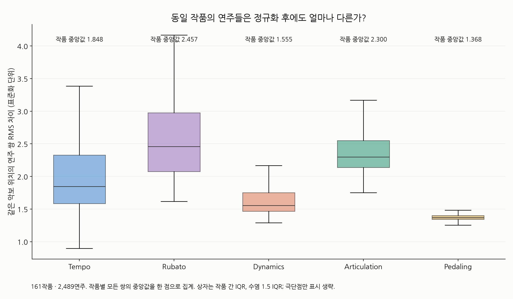
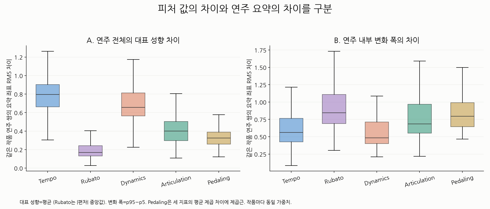
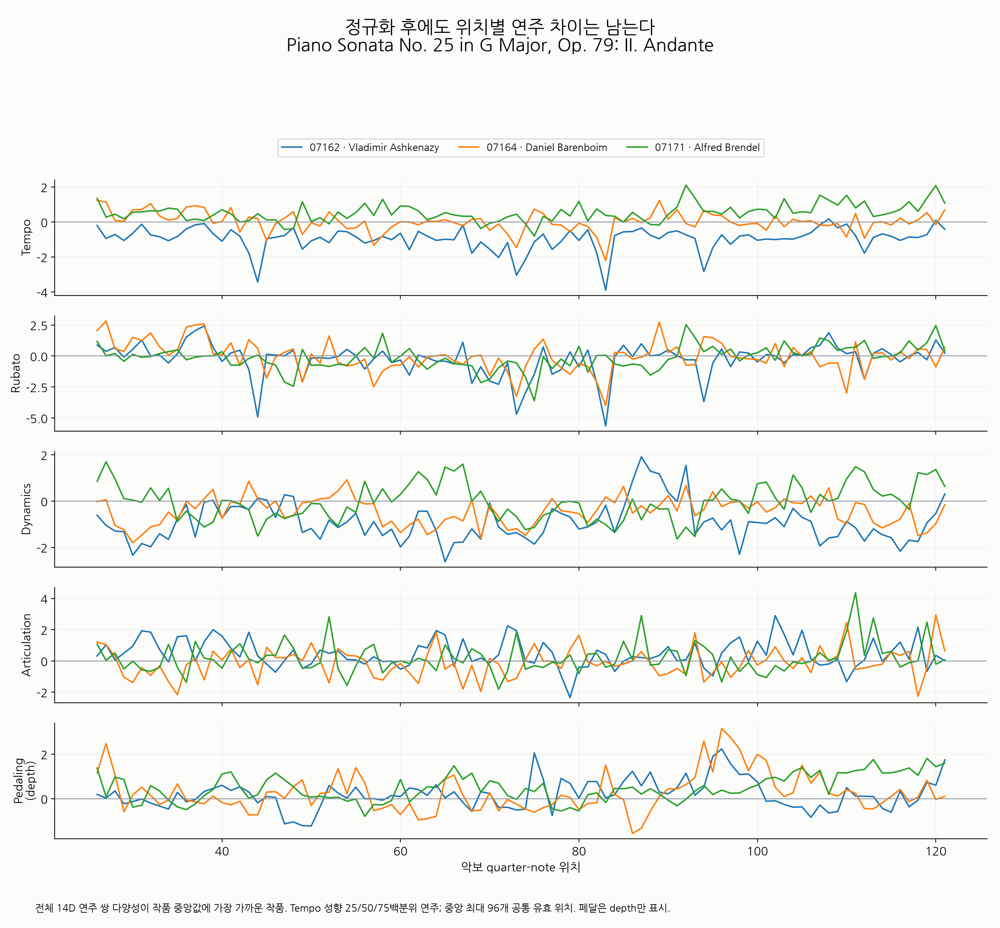
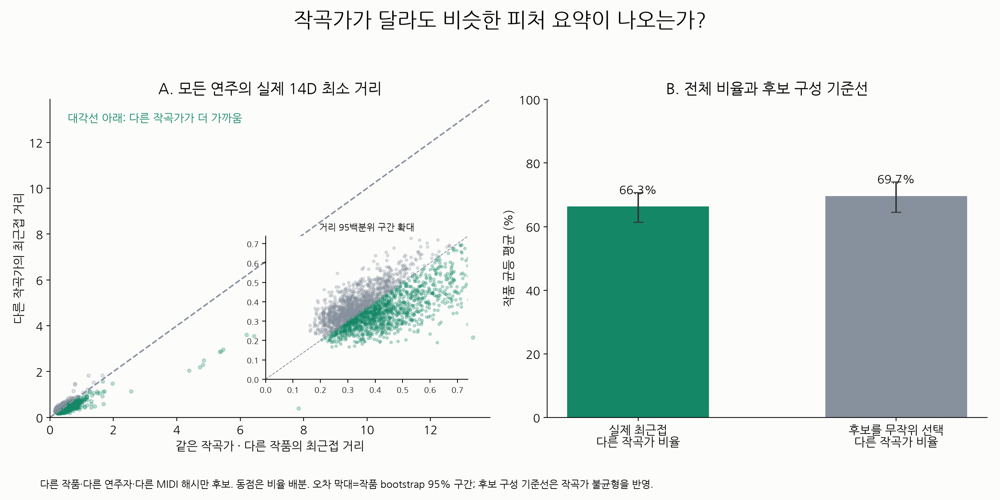
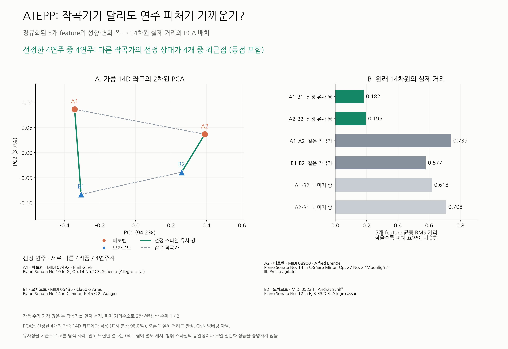
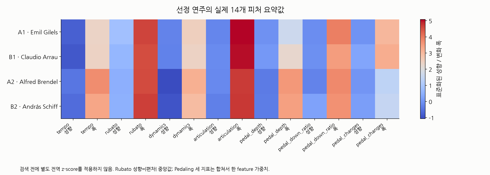

# ATEPP 정규화 후 연주 다양성과 작곡가 간 피처 유사성

## 동일 작품 내 다섯 feature 차이

품질 승인·정규화 후 5개 이상 연주, 32개 이상 공통 유효 beat, 공통 coverage 50% 이상인 161작품·2,489연주를 분석했다. 모든 채널/연주가 함께 유효한 동일 악보 위치만 비교했다. 저장 cache에서 다시 계산한 14차원 요약을 기존 export와 전부 대조했다.

| Feature | 위치별 연주 쌍 RMS 차이 | 대표 성향 차이 | 변화 폭 차이 |
| --- | --- | --- | --- |
| Tempo | 1.8481 | 0.7969 | 0.5639 |
| Rubato | 2.4574 | 0.1688 | 0.8463 |
| Dynamics | 1.5554 | 0.6566 | 0.4864 |
| Articulation | 2.2997 | 0.4015 | 0.6858 |
| Pedaling | 1.3684 | 0.3266 | 0.7965 |

표는 작품 안 모든 연주 쌍의 중앙값을 구한 뒤 작품 간 중앙값을 취한다. 성향=평균, Rubato만 절대값 중앙값; 변화 폭=p95−p5. 위치별 RMS는 정규화된 동일 위치 값의 제곱 차이를 beat와 채널에 걸쳐 평균한 제곱근이다. Pedaling의 depth/down ratio/changes는 평균 제곱 차이로 하나의 feature로 묶는다. 작품 내 변동성으로 scale을 fit했으므로, feature 간 RMS 차이를 음악적 표현의 절대 다양성 순위로 해석할 수 없다. 표준화 단위에서 남아 있는 편차를 나타낸다. 원래 단위와 scale은 [정규화 보고서](../atepp_normalization/README.md)를 확인한다. 작은 모집단·불완전 채널 그룹은 이 비교에서 제외했다.

[작품별 결과](within_work_diversity.csv), [모든 연주 쌍](within_work_pair_distances.csv), [대표 작품 위치별 값](same_work_example_sequences.csv).

## 다른 작곡가라도 가까운가?

기존 14차원 정규화 feature 요약에서 다섯 feature의 평균 제곱 거리를 균등 평균한 제곱근을 사용했다. Pedaling 6좌표는 한 묶음으로 평균하므로 세 배 가중되지 않는다. 추가 전역 표준화나 L2 정규화는 적용하지 않는다. 실제 ATEPP CNN 임베딩 파일이 없어 이 결과는 **feature 요약 거리**다.

다른 작품·다른 연주자(메타데이터 이름 정규화)·다른 MIDI 해시만 후보로 삼았다. 같은 작곡가의 다른 작품 후보와 다른 작곡가 후보를 모두 비교했다. 전체 연주 평균의 다른 작곡가 최근접 비율은 53.15%, 작품 균등 평균은 **66.30%** (작품 bootstrap 95% 구간 61.37%–71.39%)다. 후보를 균등 무작위 선택할 때의 다른 작곡가 비율은 69.65%다. 작곡가별 후보 수가 불균등하므로 높은 비율 자체만으로 작곡가 영향 제거를 주장하지 않는다. 최근접 동점은 균등 비율 배분; CSV에 표시한 단일 후보 ID는 export 순서로 결정한다. bootstrap은 작품을 표본 단위로 쓰지만 여러 query가 후보를 공유하는 의존성은 남는다.

첨부 예시와 같은 4연주 그림은 거리와 무관하게 먼저 작품 수가 가장 많은 두 작곡가를 선택하고, 피처 거리가 작은 순서로 4개의 서로 다른 작품·연주자를 선택했다. 선정 상대가 4개 중 최근접인 연주는 4/4개다. **가까운 쌍을 고른 탐색 사례이며 전체 성능 검증이 아니다.** PCA는 선정한 4개의 가중 좌표에만 fit했다. PCA 그림은 분산 일부만 보이므로 원래 14차원 실제 거리로 판정한다. 청취 스타일의 동일성이나 CNN의 작곡가 독립성을 검증한 결과가 아니다.

[전체 query 결과](cross_composer_queries.csv), [작품 균등 집계](cross_composer_work_summary.csv), [선정 연주](selected_performances.csv), [여섯 쌍 거리와 feature별 차이](selected_pairwise_distances.csv). 모든 그림은 PNG와 PDF로 저장한다.

## 재현

저장소 루트에서 `.venv/Scripts/python.exe classicfy-ai/scripts/analyze_atepp_style_diversity.py`를 실행한다. `--analysis`, `--out`, `--seed`를 지정할 수 있다. 원본 정규화 cache 해시를 확인하고 결과 수치·입력 SHA256을 [stats.json](stats.json)에, 산출물 해시를 [artifact_manifest.csv](artifact_manifest.csv)에 저장한다.
