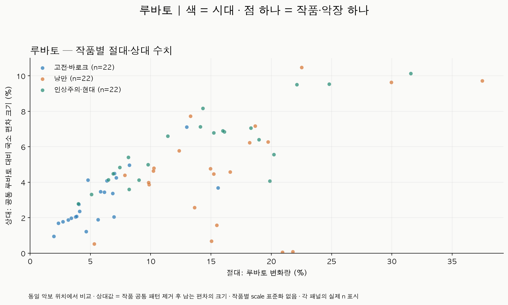
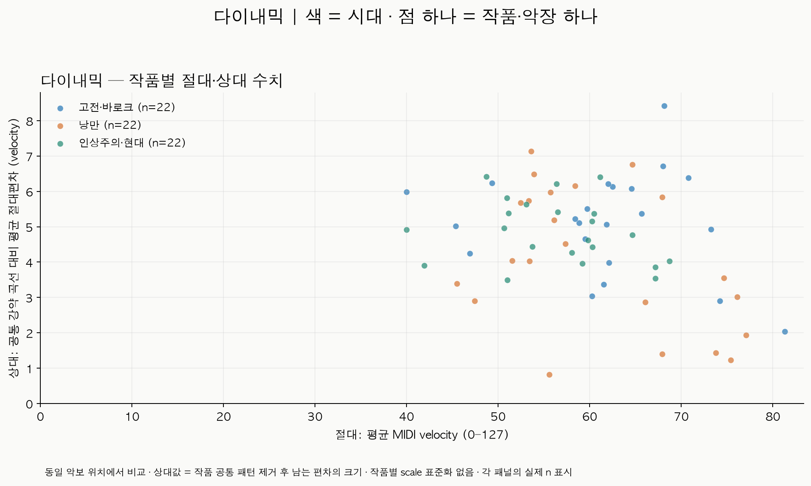
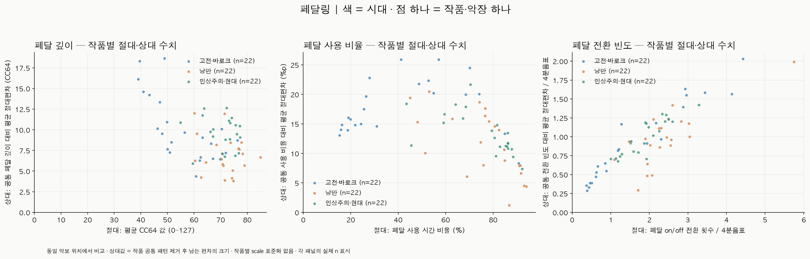

# 시대별 루바토·다이내믹·페달링의 절대·상대 수치

ATEPP_refine 전체 10,699연주·1,511작품/악장에서 현재 확보된 정렬을 조사했다.
앞서 뽑은 300작품으로 제한하지 않았다. 정확한 원본 MIDI/악보 입력이 대응되는
DualDTW 정렬 2,821연주·247작품을 기반으로 raw 값을 다시 추출했다.

**현재 세 feature 모두의 절대·상대 값을 확보한 공통 후보는 고전·바로크 160개,
낭만 46개, 인상주의·현대 22개다.** 따라서 시대별 30개씩은 확보되지 않았다.
우선 보여주는 그림은 **시대별 22개씩, 동일한 총 66작품**으로 수를 맞춘 결과다.

## 먼저 볼 그림: 동일한 66작품

색은 시대, 점 하나는 작품·악장 하나다. x축은 작품 공통값 제거 전의 대표값,
y축은 공통값 제거 후 남는 **국소 편차의 크기**다. 상대값을 작품별 scale로 나누지 않았다.
이전 tempo 분석의 상대값인 '연주별 signed 대표값의 IQR'과는 다른 요약이다.

- [루바토 절대–상대 산점도](rubato_absolute_relative_balanced22.png) · [PDF](rubato_absolute_relative_balanced22.pdf)
- [다이내믹 절대–상대 산점도](dynamics_absolute_relative_balanced22.png) · [PDF](dynamics_absolute_relative_balanced22.pdf)
- [페달링 절대–상대 산점도](pedaling_absolute_relative_balanced22.png) · [PDF](pedaling_absolute_relative_balanced22.pdf)







시대별 분포를 직접 비교하는 별도 그림도 있다. 위 행은 절대값, 아래 행은 상대값이다.

- [루바토 시대별 분포](rubato_era_distributions_balanced22.png)
- [다이내믹 시대별 분포](dynamics_era_distributions_balanced22.png)
- [페달링 시대별 분포](pedaling_era_distributions_balanced22.png)

## 작품별 값의 정의

| 요소 | 공통값 제거 전: 연주별 절대 대표값 | 공통값 제거 후: 연주별 상대 대표값 | 표시 단위 |
| --- | --- | --- | --- |
| 루바토 | log2(QPM)에서 해당 연주의 분석 구간 중앙값을 뺀 뒤 절댓값 중앙값 | 같은 악보 위치의 공통 루바토를 뺀 뒤 절댓값 중앙값 | 로그 배율 편차를 %로 환산 |
| 다이내믹 | quarter별 평균 velocity/127의 구간 평균 | quarter별 공통 강약 값을 뺀 뒤 평균 절대편차 | 원래 MIDI velocity 단위 |
| 페달 깊이 | quarter 내 CC64/127의 시간 평균을 quarter 간 평균 | quarter별 공통 깊이를 뺀 뒤 평균 절대편차 | 원래 CC64 단위 |
| 페달 사용 비율 | quarter에서 CC64≥64인 시간 비율을 quarter 간 평균 | quarter별 공통 사용 비율을 뺀 뒤 평균 절대편차 | 절대 %, 상대 %p |
| 페달 전환 빈도 | quarter 내 on/off 전환 횟수의 평균 | quarter별 공통 빈도를 뺀 뒤 평균 절대편차 | on/off 전환 횟수/quarter |

공통값은 같은 악보 위치에서 사용 연주들 값의 중앙값이다. 작품의 대표 절대값과
상대값은 각각 위 연주별 대표값들의 중앙값이다. 연주·작품별 상세 다섯 숫자도 저장했다.

루바토 표시값은 `100*(2**amount-1)`이며, 양방향 빠르기 변화의 로그 거리를 빠른 쪽
배율의 %로 표현한다. 느려짐/빨라짐의 방향이나 초 단위 지연을 나타내는 값은 아니다.
Dynamics/depth는 기존 `/127` 정의를 사용해 계산하고, 그림에는 127을 곱해 원래 단위로 표시한다.

절대 Dynamics는 음표 전체를 단순 평균한 값이 아니라 **quarter별 평균을 다시 평균**한 값이다.
페달도 quarter 안에서는 시간 가중, quarter 사이에서는 동일 가중으로 집계한다.
MIDI velocity는 실제 음압(dB)이 아니고, CC64는 실제 페달 센서 측정이 아닌 전사 결과다.

상대값에 절댓값을 쓰는 이유는 같은 작품에서도 강약/페달 곡선이 교차할 수 있기 때문이다.
signed 평균만 쓰면 큰 국소 차이가 상쇄되어 0에 가까워질 수 있다.
signed 상대 대표값은 버리지 않고 `performance_feature_values.csv`와 상세 표에 보존했다.

## 같은 위치·결측 처리

- 같은 composition_id와 동일 canonical-score 좌표를 가진 연주들끼리 비교한다.
  악보판이 여럿이면 가장 큰 동일 score SHA 그룹을 사용하고 개수를 기록한다.
- 각 채널에서 **모든 사용 연주가 함께 유효한 동일 quarter 위치**만 사용한다.
  >=32 quarter, 가장 긴 개별 지도 대비 공통 coverage >=50%를 요구한다.
  불리한 연주를 하나씩 빼서 coverage를 높이는 방식은 사용하지 않았다.
- quarter 길이가 [0.08, 5]초 범위인 정렬 구간만 사용한다.
- Dynamics는 해당 quarter에 음표 시작이 하나 이상 있어야 한다.
- CC64가 없으면 무페달 0으로 해석하지 않는다. 첫 CC64 이벤트 이전의 상태도 미확인이다.
  깊이/비율은 quarter 시작 시점에 상태가 알려진 경우만 사용한다.
  전환 빈도는 첫 이벤트에서 직전 미확인 상태의 전환을 추정하지 않도록 그 경계 구간도 제외한다.
- 유효 연주가 1개이면 절대값만 허용하고 상대값은 결측으로 남긴다.
- z-score, 작품별 scale 나눗셈, clipping, 결측 대체는 하지 않았다.

Dynamics와 Pedaling의 원래 추출 자체는 연주 MIDI만으로 가능하다. 이번 분석은 다른 연주와
**같은 악보 위치의 공통 패턴을 비교**하기 위해 정렬 기반으로 범위를 통일했다.
정렬이 없는 작품의 모든 음표 velocity/초 단위 페달 평균을 섞어 범위를 늘리지는 않았다.

## 전체 산출 가능 범위

아래는 각 채널에서 절대/상대가 모두 있는 작품 수다. 괄호는 절대값만 허용했을 때의 수다.

| 요소 | 고전·바로크 | 낭만 | 인상주의·현대 |
| --- | ---: | ---: | ---: |
| 루바토 | 162 (167) | 46 (54) | 22 (26) |
| 다이내믹 | 162 (167) | 46 (54) | 22 (26) |
| 페달 깊이 | 160 (165) | 46 (54) | 22 (26) |
| 페달 사용 비율 | 160 (165) | 46 (54) | 22 (26) |
| 페달 전환 빈도 | 160 (165) | 46 (54) | 22 (26) |

고전·바로크의 페달 2작품은 상태를 알 수 있는 공통 구간이 부족했다.
전체 산출 가능 작품을 모두 쓴 그림은 파일명에서 `_balanced22`를 뺀 버전이다.

- [전체 루바토](rubato_absolute_relative.png) · [전체 시대별 분포](rubato_era_distributions.png)
- [전체 다이내믹](dynamics_absolute_relative.png) · [전체 시대별 분포](dynamics_era_distributions.png)
- [전체 페달링](pedaling_absolute_relative.png) · [전체 시대별 분포](pedaling_era_distributions.png)

## 22개씩 뽑은 기준과 해석 범위

모든 다섯 채널에서 두 값이 모두 있는 작품의 교집합에서 시대별 최대 30개를 목표로 삼되,
가장 적은 시대가 22개여서 각 22개로 맞췄다. 각 시대 안에서는 작곡가별 후보 작품 수에
비례해 자리를 배분하고 작곡가당 최소 1개를 보장했다. seed 20261106의 SHA256 순서로
추출했으며 feature 값으로 선별하지 않았다. 선택한 작품 내 녹음과 공통 reference는 그대로다.

정확한 [66개 작품 목록](balanced_work_ids.csv), [작곡가별 할당](balanced_composer_allocation.csv),
[330개 작품×채널 값](balanced_work_values.csv)을 함께 제공한다.
고전·바로크 5명, 낭만 6명, 인상주의·현대 2명 작곡가의 표본이며, 인상주의·현대는
드뷔시·라벨에 한정된다. 베토벤은 고전, 라흐마니노프·스크랴빈은 낭만으로 둔 기존 분류를 유지했다.

이는 관측된 작품들의 분포를 살펴보는 그림이다. 시대별 곡 성격, 작곡가, 악보 제공,
전사/정렬 품질, 작품 내 연주 수가 영향을 줄 수 있다. reference에 비교 대상 자신도 포함된다.
특히 연주 수가 작으면 상대 편차가 작게 나타날 수 있다. 작품 수를 맞춘 것이 작곡가 수나
연주 수까지 같게 만든 것은 아니다. 최초 그림 생성 이후 같은 66작품으로 수행한
탐색적 검정 결과는 아래와 같다. 검정의 유의성과 세 시대의 명확한 분류 가능성은 다르다.

## 같은 66작품의 시대 차이 검정

작품 단위 Kruskal–Wallis 검정으로 5채널×절대/상대, 총 10개 비교를 수행하고
Holm 보정했다. 보정 p<0.05를 유의 기준으로 사용한다. 이는 작품을 독립 관측값으로
보는 탐색 결과이며, 같은 작곡가의 작품·악장이나 같은 연주자의 녹음 간 의존성이 남는다.

| 지표 | 절대 보정 p | 상대 보정 p | 절대/상대 순위 효과량 |
| --- | ---: | ---: | ---: |
| 루바토 | 0.00000309 | 0.00107 | 0.444 / 0.247 |
| 다이내믹 | 0.422 | 0.463 | 0.031 / 0.015 |
| 페달 깊이 | 0.0000289 | 0.00251 | 0.370 / 0.215 |
| 페달 사용 비율 | 0.0000567 | 0.00367 | 0.345 / 0.197 |
| 페달 전환 빈도 | 0.0668 | 0.463 | 0.098 / 0.009 |

순위 효과량은 `max(0, (H-k+1)/(N-k))`, k=3, N=66이다. 분류 정확도나
원래 수치의 분산 설명률로 해석하지 않는다. 유의하지 않다는 결과는 동일함의 입증도 아니다.

차이의 실제 규모를 보면, 고전·바로크 / 낭만 / 인상주의·현대 순서로 작품 중앙값은
절대 루바토 **5.21 / 15.13 / 14.22%**(로그 배율 편차 환산), 절대 페달 깊이
**51.20 / 71.50 / 72.04 CC64**, 페달 사용 비율 **29.46 / 77.49 / 81.48%**다.
절대 루바토와 페달 사용량에서는 고전·바로크와 나머지 두 시대의 차이가 주로 나타난다.
낭만과 인상주의·현대가 모든 지표에서 서로 구분되는 결과는 아니다.

세 시대 쌍별 Mann–Whitney 검정도 10지표×3쌍 전체 30개에 Holm 보정했다.
절대 루바토·깊이·사용 비율에서 고전·바로크와 나머지 각 시대의 차이가 유의했다.
낭만과 인상주의·현대 사이에는 상대 페달 깊이만 유의했다(p=0.0134).
이는 연주 간 국소 편차가 낭만에서 더 작았다는 뜻이며, 더 약하게 페달을 밟았다는 뜻은 아니다.

작곡가별 작품 중앙값 하나씩으로 줄인 보조 분석은 고전·바로크 5명 / 낭만 6명 /
인상주의·현대 2명을 사용했다. 작은 작곡가 수에 chi-square 근사를 적용하지 않고,
그룹 크기를 유지한 **36,036개 작곡가 배치 전수 순열**로 H의 상측 확률을 계산했다.
이 10개 검정도 별도로 Holm 보정했다.

| 지표 | 작곡가 단위 절대 보정 p | 작곡가 단위 상대 보정 p |
| --- | ---: | ---: |
| 루바토 | 0.0180 | 0.0552 |
| 다이내믹 | 0.331 | 0.806 |
| 페달 깊이 | 0.0237 | 0.0266 |
| 페달 사용 비율 | 0.0213 | 0.0744 |
| 페달 전환 빈도 | 0.00167 | 0.0599 |

따라서 **절대 루바토, 절대 페달 깊이·사용 비율, 상대 페달 깊이**는 두 분석에서
모두 유의했다. 상대 루바토·사용 비율은 작곡가 단위에서 유의하지 않았고,
절대 전환 빈도는 오히려 작곡가 단위에서만 유의하여 집계 단위에 민감했다.
다이내믹은 현재의 절대 평균 수준/상대 편차 요약에서 차이의 근거가 부족했다.

작곡가 중앙값 분석은 작곡가당 작품 수의 가중치를 바꿔 보는 민감도 분석이다.
시대와 작곡가 효과를 분리해 통제한 모형이 아니며, 작곡가들의 교환 가능성을 가정한다.
인상주의·현대가 드뷔시·라벨뿐이라는 한계도 그대로다. 작품 내 연주 수 고정,
연주자 의존성 조정, 다른 작품의 시대 분류 정확도 검증은 이번에 수행하지 않았다.
작품별 사용 연주 수의 시대별 중앙값은 7.5 / 7 / 9다.

- [전체 검정 및 효과량](significance_omnibus.csv)
- [시대별 중앙값·사분위수](significance_era_descriptives.csv)
- [시대 쌍별 검정·Cliff's delta](significance_pairwise.csv)
- [작곡가별 대표값](significance_composer_values.csv)
- [검정 방법·한계·입출력 해시](significance_protocol.json)

검정 정의는 [SciPy Kruskal–Wallis 문서](https://docs.scipy.org/doc/scipy/reference/generated/scipy.stats.kruskal.html)와
[정확 순열검정 문서](https://docs.scipy.org/doc/scipy/reference/generated/scipy.stats.permutation_test.html)를 확인했다.
순위합 공식과 SciPy의 H값, 직접 쌍 비교와 Cliff's delta를 대조했다.

```bash
../diagnostics/atepp_note_training/run01/runtime/bin/python classicfy-ai/scripts/analyze_era_expression_statistics.py
```

## 값·검증·재현

- [전체 1,511작품×5채널 값/미산출 상태](work_feature_values.csv)
- [루바토](rubato_work_values.csv), [다이내믹](dynamics_work_values.csv),
  [페달 깊이](pedal_depth_work_values.csv), [사용 비율](pedal_down_ratio_work_values.csv), [전환 빈도](pedal_changes_work_values.csv)
- [연주별 대표값](performance_feature_values.csv), [작품별 녹음/악보 그룹](cohort_works.csv),
  [실제 입력과 정렬 목록](alignment_catalog.csv), [coverage](coverage.csv)
- [방법·입력/코드 해시](protocol.json), [독립 검증 결과](verification.json)

저장소 루트에서 실행한다.

```bash
../diagnostics/atepp_note_training/run01/runtime/bin/python classicfy-ai/scripts/analyze_era_expression.py
```

큰 raw cache와 공통 위치 배열은 저장소 밖 `diagnostics/era_expression_refine`에 저장한다.
처음에는 원 MIDI에서 추출하고 이후 실행에서는 해시가 같은 cache만 재사용한다.
원본/refine/기존 tempo figure·정렬·훈련 cache는 수정하지 않았다.

전용 수치/선정/결측 테스트 13개와 기존 Rubato 8개·Dynamics 8개·Pedaling 10개, 총 39개가 통과했다.
독립 계산으로 1,229개 유효 작품×채널 요약과 14,084개 연주×채널 대표값을 검산했고,
원 quarter cache와 8,043,440개 값을 대조했다. 시대별 4개씩 총 12개 원 MIDI에서는 음표를
직접 binning하고 CC64 구간 6,000개를 독립 적분해 확인했다. 전체 suite와 청취 평가는 미실행이다.
