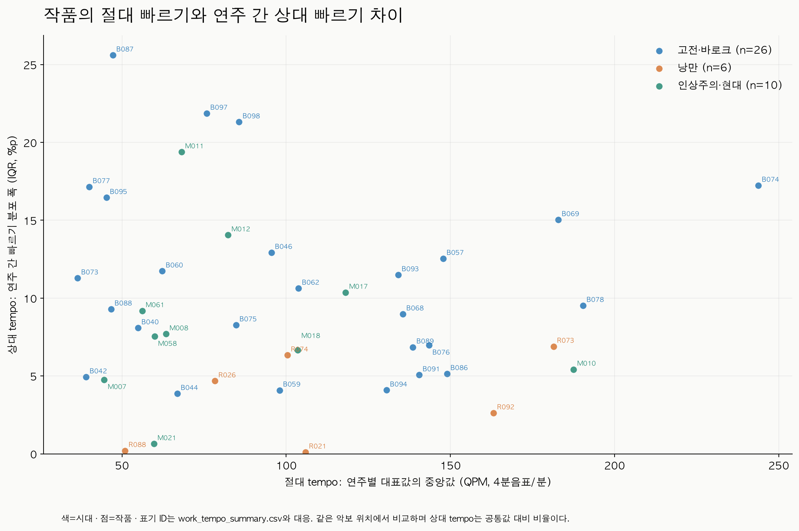

# 작품별 절대·상대 tempo와 시대 라벨 figure

입력은 사용자가 지정한 **ATEPP_refine의 고정된 300개 작품·악장, 1,864개 연주**다.
산출 실패 작품을 다른 작품으로 대체하지 않았다. 각 작품의 ID, 제목, 시대, 산출값과
미산출 상태는 [간단한 작품별 값 목록](work_tempo_values.csv) 300행에서 확인한다.

**절대 tempo는 46개 작품, 상대 tempo 분포 폭은 42개 작품에서 산출했다.**
나머지는 빈 값과 사유를 남겼다. 300개 모두에서 tempo를 확보한 분석이 아니다.

| 시대 | 선정 작품 | 절대 산출 | 상대 산출 | 사용 연주 | 산출된 작품 절대값 중앙값(QPM) | 산출된 작품 상대 폭 중앙값(%p) |
| --- | ---: | ---: | ---: | ---: | ---: | ---: |
| 고전·바로크 | 100 | 27 | 26 | 374 | 97.97 | 10.07 |
| 낭만 | 100 | 7 | 6 | 78 | 100.37 | 3.65 |
| 인상주의·현대 | 100 | 12 | 10 | 110 | 65.75 | 7.62 |
| 합계 | 300 | 46 | 42 | 562 | — | — |

## 먼저 볼 figure

1. [300개 작품별 절대·상대 tempo 나열](01_all_300_work_tempo.png) · [PDF](01_all_300_work_tempo.pdf).
   위는 작품의 절대 tempo, 아래는 상대 tempo의 연주 간 분포 폭이다.
   파랑=고전·바로크, 주황=낭만, 초록=인상주의·현대. 회색 ×는 미산출이며 0이 아니다.
   위 그래프의 세로선은 그 작품 연주들의 대표 절대 tempo Q1–Q3다.
2. [시대별 분포](02_era_distributions.png) · [PDF](02_era_distributions.pdf).
   점 하나가 작품 하나이며 실제 산출 수를 각 시대에 표시한다.
3. [작품 ID와 시대를 표시한 절대–상대 tempo 산점도](03_labeled_tempo_scatter.png) · [PDF](03_labeled_tempo_scatter.pdf).
   두 값이 모두 있는 42작품을 표시한다. B001–B100, R001–R100, M001–M100은
   작품별 CSV의 `display_id`와 대응한다.
4. [선정 표본 대비 산출 범위](04_tempo_coverage.png) · [PDF](04_tempo_coverage.pdf).



## 작품마다 가지는 값의 정의

실제 연주 시각과 악보의 quarter 위치를 대응시킨 자동 DualDTW tempo map을 사용한다.
QPM은 **4분음표/분**이며 박자표에 따라 사람이 느끼는 박 단위의 BPM과는 구별된다.
MIDI 헤더의 기본 120 BPM을 측정된 연주 tempo로 사용하지 않았다.

```text
BPM[p,b] = 60 / (performance_seconds[p,b+1] - performance_seconds[p,b])
absolute_performance[p] = median_b(BPM[p,b])
absolute_work = median_p(absolute_performance[p])

common[b] = median_p(log2(BPM[p,b]))
relative[p,b] = log2(BPM[p,b]) - common[b]
relative_performance[p] = median_b(relative[p,b])
relative_percent[p] = 100 * (2**relative_performance[p] - 1)
relative_work = Q75_p(relative_percent[p]) - Q25_p(relative_percent[p])
```

작품의 대표 절대값은 `absolute_tempo_qpm`, 대표 상대값은
`relative_tempo_iqr_pp`다. 상대값은 **상대 빠르기의 연주 간 분포 폭**으로, 단위는
퍼센트포인트다. 상대값의 signed 중앙값은 0 부근에 모이므로 시대 비교의 대표 상대값으로
사용하지 않고 상세 표에 보존했다. 어떤 연주가 공통값보다 대체로 빠른지는
`performance_tempo_summary.csv`의 `relative_tempo_pct`에서 확인한다.

이 값은 곡 안의 순간적인 tempo 변동이나 rubato의 크기와 다르다. 각 연주에서
구간별 편차를 먼저 중앙값으로 줄이므로, 빠르고 느린 구간이 교차하면 연주 간
국소 차이가 있어도 상대 대표값과 그 IQR이 0에 가까울 수 있다.
IQR=0을 모든 연주 곡선이 동일하다는 뜻으로 해석하지 않는다.

각 작품에서 같은 악보 quarter 구간을 공유하는 연주들만 같은 위치에서 비교한다.
모든 사용 연주의 seconds/quarter가 유한하고 [0.08, 5]인 공통 위치를 사용하며,
최소 32개 quarter와 가장 긴 개별 지도 대비 50% 이상을 요구한다.
기존 연구 정렬 품질 gate를 통과한 지도만 사용했다. 같은 작품에 다른 악보판이 있으면
가장 큰 동일 canonical-score 그룹을 사용하도록 정의했지만, 실제 산출 46작품은
모두 악보판 그룹이 하나였다. 유효 연주가 1개인 4작품은 절대값만 계산했다.

**작품별 scale 나눗셈, z-score, clipping, 결측 대체는 없다.** 위치별 작품 공통값
제거는 요청한 상대 tempo의 정의에 해당하며, 절대값에는 적용하지 않는다.

## 확보 범위와 미산출 사유

원본 MIDI SHA256과 악보/좌표 출처를 확인한 기존 DualDTW 결과 444개를 재사용했다.
기존 실행에서 품질 라벨 때문에 시도하지 않았던 151연주를 별도로 정렬했고,
118개가 동일한 정렬 gate를 통과했다. 품질 라벨 자체로 추가 제외하지 않았다.
원본, refine, 기존 훈련 결과/캐시를 변경하지 않고 새 정렬은 diagnostics에 저장했다.

| 연주 상태 | 개수 |
| --- | ---: |
| 공식 악보 없음 | 1,067 |
| 현재 XML reader로 악보 펼치기 불가 | 170 |
| 정렬 품질 gate 미달 | 65 |
| tempo 산출에 사용 | 562 |
| 합계 | 1,864 |

작품 기준으로는 악보 없음 242개, 악보 해석 불가 10개, 모든 연주 정렬 미달 2개로
254작품의 절대값이 미산출이다. 나머지 46작품 중 연주 하나만 유효한 4개는
상대값이 미산출이다. 전체 연주 상태는 [recording_status.csv](recording_status.csv)에 있다.
관측 가능한 작곡가는 9명(고전·바로크 3, 낭만 4, 인상주의·현대 2)이다.

## 시대별 차이의 탐색 결과

그림에서 세 시대는 겹치는 영역이 크다. **현재 결과는 시대별로 작품을 명확히
구분할 수 있다는 증거가 아니다.** 악보/정렬을 확보한 제한된 작품군에서 상대
tempo 분포 폭에 그룹 차이 신호가 관찰된다.

| 지표 | 작품 단위 Kruskal–Wallis p (Holm 보정) | 작곡가 중앙값 단위 라벨 순열 p (Holm 보정) |
| --- | ---: | ---: |
| 절대 tempo | 0.6042 | 0.1801 |
| 상대 tempo 분포 폭 | 0.0133 | 0.0396 |

작품 단위 검정은 같은 작곡가의 작품들이 독립이라는 가정을 충족하지 않을 수 있어
탐색 결과로만 보고한다. 보조 검정은 작곡가별 작품 값의 중앙값을 한 관측치로 만들고,
시대별 작곡가 수를 유지한 라벨 순열 9,999회로 eta-squared의 기준 분포를 구했다.
두 지표의 p값은 각 검정 방식 안에서 Holm 보정했다. 시대와 작곡가가 서로 얽혀 있으므로
이 보조 검정도 독립적인 시대 효과나 원인 관계를 확인하는 검정이 아니다.
검정 정의는 [SciPy Kruskal–Wallis 문서](https://docs.scipy.org/doc/scipy/reference/generated/scipy.stats.kruskal.html)를 참고했다.

연주 수의 영향을 점검하기 위해 유효 연주가 5개 이상인 32작품(19/5/8)에서
매번 5연주를 비복원 추출하고 공통값을 다시 계산하는 200회 보조 분석도 했다.
각 작품의 200회 값 중앙값으로 비교했을 때 상대 폭의 작곡가 단위 보정 p는 0.0248이었다.
절대값은 이 축소 표본의 작품 단위 p=0.3472, 작곡가 단위 p=0.0392로 결과가 달라져
표본 구성과 가중 기준에 민감하다. 주 분석과 보조 분석을 선택적으로 섞어 시대의
구분력을 주장하지 않는다. 이 반복 추출의 구간은 신뢰구간이 아니다.

공통 tempo는 비교 대상 연주 자신도 포함한 기술적 기준이다. 새 연주에 대한 독립
평가가 아니며, 보간과 자동 전사의 오류가 남을 수 있다. 작품별 유효 연주 수,
메타데이터의 연주자 중복/녹음 중복, 악보 제공 편향도 해석에 영향을 줄 수 있다.
위 p값을 원래 선정한 시대별 100작품 전체에 일반화할 수 없다.

## 값 파일과 재현

- [작품마다 절대·상대 대표값 300행](work_tempo_values.csv)
- [작품별 상세 다섯 숫자와 coverage](work_tempo_summary.csv)
- [고전·바로크](classical_baroque_work_tempo.csv), [낭만](romantic_work_tempo.csv), [인상주의·현대](impressionist_modern_work_tempo.csv)
- [연주별 대표값 562행](performance_tempo_summary.csv)
- [산출 범위](coverage.csv), [시대별 통계](era_statistics.csv)
- [5연주 고정 보조 작품 값](n5_work_sensitivity.csv), [보조 통계](n5_era_statistics.csv)
- [방법·해시·버전](protocol.json), [독립 검증](verification.json)

저장소 루트에서 현재 사용한 runtime으로 재현한다.

```bash
../diagnostics/atepp_note_training/run01/runtime/bin/python classicfy-ai/scripts/prepare_era_tempo_alignments.py
../diagnostics/atepp_note_training/run01/runtime/bin/python classicfy-ai/scripts/analyze_era_tempo.py
```

정렬 audit와 새 cache, 공통 beat 배열은 저장소 밖 `diagnostics/era_tempo_refine`에 있다.
기존 원본 입력과 훈련 캐시는 읽기만 했다. 다른 기기에서는 해당 입력·정렬 cache를
준비해야 하며, 일부 입력 경로는 현재 기기의 절대 경로다.
전용 수치 테스트 7개와 기존 tempo 테스트 11개가 통과했다. 독립 scalar 계산으로
원 정렬 시간에서 모든 562연주·46작품의 절대/상대값과 다섯 숫자를 검산하고,
별도 출력 폴더 재실행의 CSV 및 packed 배열을 대조했다. 전체 suite는 실행하지 않았다.
