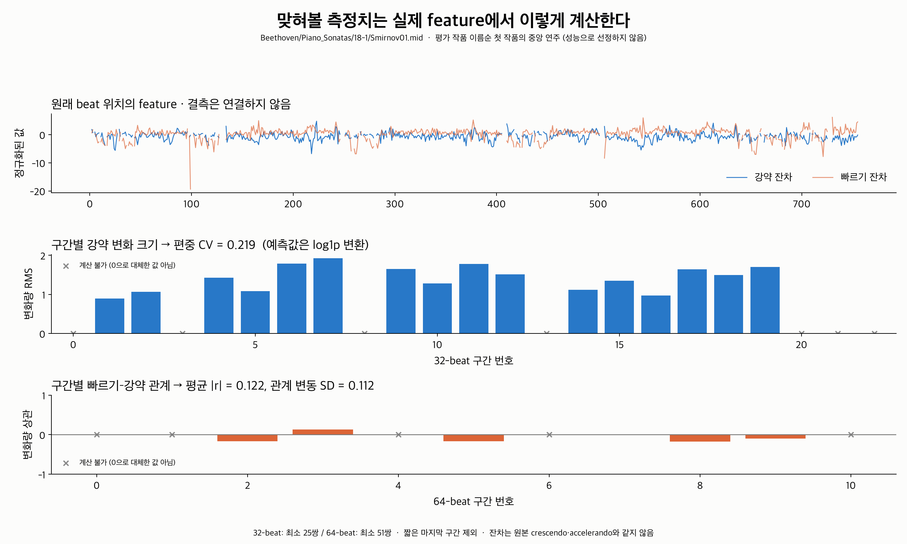
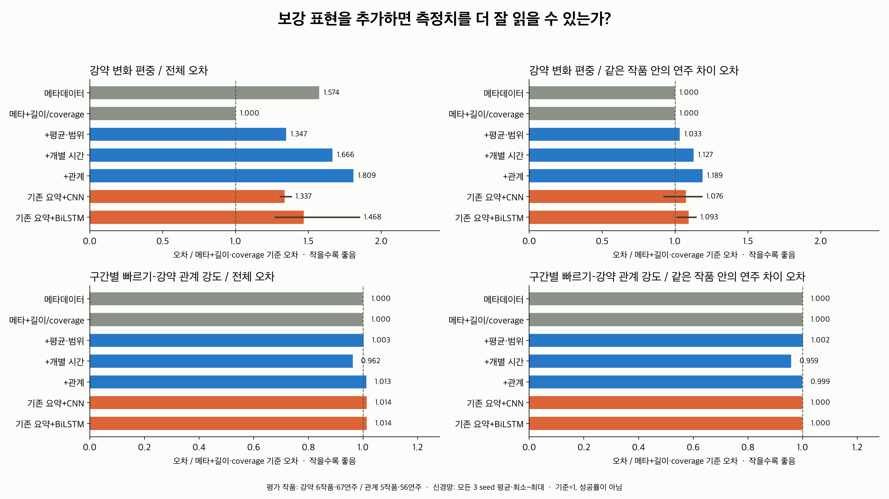
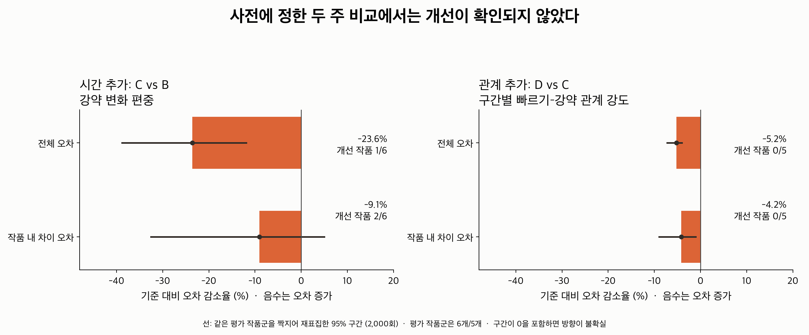
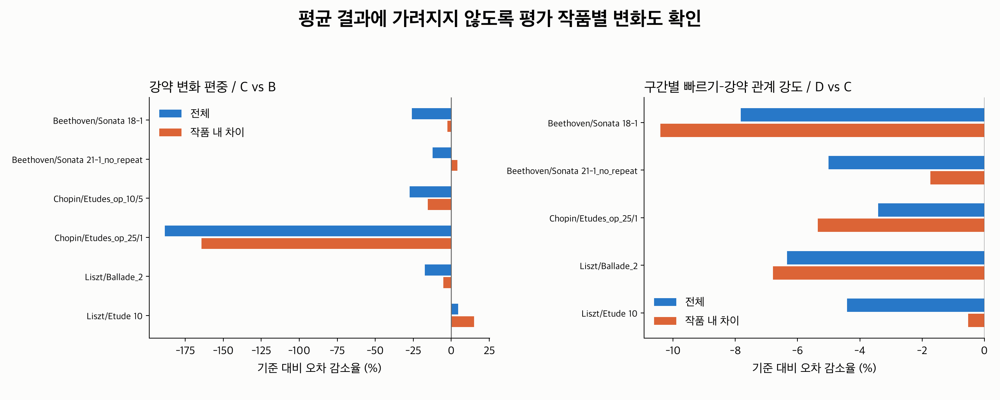
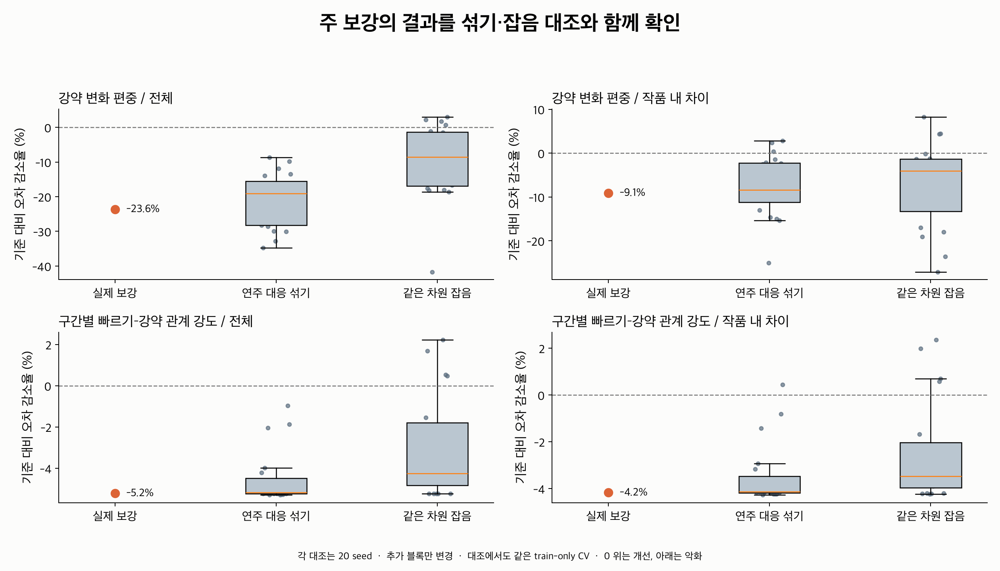

# 고정한 측정치로 확인한 메타데이터 이상의 연주 정보

**실험을 완료했지만, 사전에 정한 두 주 비교에서 안정적인 추가 설명력은 확인되지 않았다.**
강약 변화 편중에서 시간 통계 추가는 평가 전체 오차를 23.6% 늘렸고,
구간별 빠르기–강약 관계 강도에서 관계 정보 추가는 오차를 5.2% 늘렸다.
같은 작품 안의 연주 차이에 대한 오차도 각각 9.1%, 4.2% 늘었다.

별도로 **개별 시간 통계가 공동 변화 강도를 읽는 데 기여한 작은 test 개선**은 있었다.
이것은 시간 추가의 사전 주 측정치인 강약 편중의 성공이나, 관계 추가의 성공으로 대체하지 않았다.
validation에서는 같은 개선이 없어서 범위를 제한해 보고한다.

## 어떤 질문을 확인했는가?

[고정한 설계](../metadata_information_design/README.md)의 목적은 다음 세 가지다.

1. 메타데이터에 기존 연주 요약을 더하면, 정의한 연주별 측정치를 더 잘 읽을 수 있는가?
2. 시간/공동 변화 지식을 더하면 기존 요약보다 추가 정보가 읽히는가?
3. 개선이 곡 평균만 맞힌 효과가 아니라 같은 작품 안의 연주 차이에도 나타나고,
   연주 대응 섞기·같은 차원 잡음 대조보다 뚜렷한가?

유사 후보 순서의 유지율 대신 **실제 feature에서 계산한 측정치의 예측 오차**를 평가했다.
입력 좌표를 그대로 정답으로 복사하지 않고, 기존 입력에 그대로 포함되지 않은 구간별 측정치를 사용했다.
작품별 reference가 있는 기존 정규화 조건, 고정된 전곡 임베딩과 선형 예측기에서의 결과다.

## 측정치와 표본



| 측정치 | 정의 | eligible train / validation / test |
|---|---|---|
| Y1 강약 변화 편중 · 주 | 32-beat 구간별 Dynamics 변화량 RMS의 SD/평균, log1p 변환 | 361 / 67 / 67연주, test 6작품 |
| Y2 공동 변화 강도 · 주 | 64-beat 구간별 Pearson(ΔTempo, ΔDynamics)의 절댓값 평균 | 358 / 67 / 56연주, test 5작품 |
| Y3 공동 변화의 구간 간 변동 · 보조 | 같은 구간 상관계수의 SD | Y2와 동일 |

모든 조건은 한 측정치 안에서 정확히 같은 연주를 사용한다.
train/validation/test에 걸친 작품군을 제외하고 원래 인코더 split을 유지했다.
조건을 보고 구간 길이, 입력 좌표, 표본 또는 주 측정치를 바꾸지 않았다.

위 사례는 평가 작품 이름순 첫 작품 Beethoven/Piano_Sonatas/18-1의 중앙 eligible 연주,
`Smirnov01.mid`다. 성능 결과로 고르지 않았다.
회색 ×는 정의되지 않은 구간이며 값 0으로 대체한 것이 아니다.
원래 시퀀스에서 사례의 세 측정치를 다시 계산해 frozen target과 10⁻¹² 이내로 대조했다.

## 조건과 공정한 비교

| 조건 | 제공한 정보 |
|---|---|
| A0 | 작곡가·작품 유형·그 조합 one-hot |
| A1 | A0 + 원래 beat 수·유효 coverage |
| B | A1 + 기존 평균·범위 14D |
| C | B + 개별 시간 통계 57D |
| D | C + 전곡 지연 관계 119D |
| E-CNN / E-BiLSTM | B + 저장 모델의 전곡 128D, 모든 3 seed |

각 입력에서 별도의 weighted ridge를 fit했다. 인코더는 고정했다.
규제 강도 8개 후보를 train 작품군 5-fold CV로 선택했고,
좌표 평균·SD·메타데이터 어휘도 해당 학습 fold에서만 계산했다.
세 측정치는 별도로 강도를 선택하며 예측값을 clipping하지 않았다.
같은 구간 정보 행렬을 공유하는 Y2/Y3도 예측 계수·강도는 독립적으로 선택했다.

시간 T는 train에서 95% 이상 계산 가능한 비상수 좌표만 남긴 고정 57D다.
평가 조건에서 T/R 결측을 0으로 채우지 않았고, common complete cohort만 사용했다.
자료가 많은 연주에 치우치지 않도록 작품군→작품→연주 순으로 같은 비중을 주었다.

## 전체 예측 결과



그림은 A1 오차를 1로 맞췄다. **작은 값이 좋다.**
CNN/BiLSTM은 모든 3 seed 평균과 최소~최대이며, 범위는 신뢰구간이 아니다.
표의 값은 실제 family-balanced MSE다. Y1은 log1p 공간의 오차다.

| 조건 | Y1 전체 | Y1 작품 내부 | Y2 전체 | Y2 작품 내부 |
|---|---:|---:|---:|---:|
| A0 메타데이터 | 0.0017925 | 0.0008909 | 0.0015530 | 0.0014691 |
| A1 +길이/coverage | 0.0011390 | 0.0008909 | 0.0015524 | 0.0014691 |
| B +평균·범위 | 0.0015346 | 0.0009205 | 0.0015564 | 0.0014720 |
| C +개별 시간 | 0.0018970 | 0.0010042 | 0.0014940 | 0.0014088 |
| D +관계 | 0.0020607 | 0.0010588 | 0.0015720 | 0.0014676 |
| E-CNN · seed 평균 | 0.0015228 | 0.0009584 | 0.0015735 | 0.0014694 |
| E-BiLSTM · seed 평균 | 0.0016721 | 0.0009741 | 0.0015739 | 0.0014698 |

메타데이터 A0 대비 B는 Y1 전체 오차를 약 14.4% 줄였다.
하지만 길이·coverage를 넣은 A1이 더 낮은 오차를 냈고, B의 작품 내부 오차는 개선되지 않았다.
따라서 이 전체 개선만으로 연주별 추가 정보가 확인됐다고 해석하지 않는다.
메타데이터가 같은 작품에서는 같은 값이 예측되므로 A0/A1의 작품 내부 예측 편차는 0이다.

## 사전에 정한 주 비교

`오차 감소율 = 100 × (1 − 보강 조건 MSE / 기준 조건 MSE)`다.
음수는 오차가 늘었다는 뜻이다. 성공률이나 무작위 선택의 50%와 비교하는 지표가 아니다.



| 비교 / 측정치 | test 전체 오차 감소율 | test 작품 내부 오차 감소율 | 개선 작품 수 (전체 / 내부) |
|---|---:|---:|---:|
| B vs A1 / Y1 | −34.7% [−61.3, −8.0] | −3.3% [−9.4, +4.2] | 2/6 · 2/6 |
| B vs A1 / Y2 | −0.3% [−2.1, +1.0] | −0.2% [−2.3, +1.6] | 4/5 · 3/5 |
| **C vs B / Y1 · 시간 주 비교** | **−23.6% [−38.8, −11.9]** | **−9.1% [−32.6, +5.0]** | **1/6 · 2/6** |
| **D vs C / Y2 · 관계 주 비교** | **−5.2% [−7.2, −4.0]** | **−4.2% [−8.9, −1.0]** | **0/5 · 0/5** |

괄호는 같은 평가 작품군을 짝지어 bootstrap 2,000회 재표집한 percentile 95% 구간이다.
평가 작품군이 6개/5개뿐이므로 모든 작품별 결과도 함께 확인한다.
validation은 4작품군으로 구간을 표시하지 않는다.

validation의 C vs B/Y1은 전체 +6.5%, 작품 내부 +1.4%였지만 test에서는 악화됐다.
D vs C/Y2는 validation 전체 −1.8%, 작품 내부 +2.0%로 방향이 섞였으며 test에서는 둘 다 악화됐다.
주 가설을 뒷받침하는 안정적인 보강 효과를 확인하지 못했다.



## 대조군 결과



같은 작품+grid와 split 안에서 추가 블록의 연주 대응만 섞었고,
별도로 추가 블록과 같은 차원의 Gaussian 잡음도 넣었다.
두 대조 각각 20 seed에서 같은 train-only CV를 다시 수행했다.

| 주 비교 / 전체 오차 감소율 | 실제 보강 | 연주 대응 섞기 범위 | 같은 차원 잡음 범위 |
|---|---:|---:|---:|
| C vs B / Y1 | −23.6% | −34.8~−8.6% | −41.7~+3.0% |
| D vs C / Y2 | −5.2% | −5.3~−1.0% | −5.2~+2.2% |

실제 보강은 두 주 비교에서 양의 개선을 만들지 못했고, 대조 범위와도 겹쳤다.
입력 좌표 수가 늘어난 효과나 특정 seed만으로 주 가설의 성공을 보고하지 않는다.
대조 seed는 독립 평가 작품을 추가한 것이 아니며 이 범위 자체를 신뢰구간이나 p-value라고 부르지 않는다.

## 범위를 제한해 보고할 긍정 관찰

**C vs B에서 Y2 공동 변화 강도는 test 전체 오차가 4.0%, 작품 내부 오차가 4.3% 줄었다.**
test의 5작품 모두 개선됐고, 각각의 paired 95% 구간은 [+0.8,+9.0], [+1.0,+8.3]이다.
섞기 20회와 잡음 20회 각각의 결과보다 개선율이 높았다.

| C vs B / Y2 | 실제 | 섞기 범위 | 잡음 범위 |
|---|---:|---:|---:|
| test 전체 | +4.0% | −3.7~+2.3% | −1.4~+1.8% |
| test 작품 내부 | +4.3% | −4.7~+2.0% | −0.9~+1.5% |

이는 개별 시간 통계가 공동 변화 강도를 읽는 데 도움을 준 **test 한정의 작은 추가 정보 관찰**이다.
다만 validation은 전체 −2.0%, 작품 내부 −2.0%로 개선되지 않았다.
시간 보강의 사전 주 측정치는 Y1이고, 공동 변화 보강의 주 비교는 D vs C였으므로
이 관찰로 주 가설이 성공했다고 바꾸지 않는다.

보조 Y3에서 D vs C는 test 전체 +2.9%였지만 작품 내부 −0.6%였고,
bootstrap 구간과 대조 범위가 0/실제 결과를 포함했다. 보조 결과로도 주 결론을 대체하지 않는다.

## 저장된 학습 임베딩

E 조건은 B에 인코더 전곡 벡터를 추가한 비교다. 아래는 B 대비 test 오차 감소율의
모든 seed 평균과 최소~최대다. 가장 좋은 seed만 선택하지 않았다.

| 추가 표현 | Y1 전체 | Y1 작품 내부 | Y2 전체 | Y2 작품 내부 |
|---|---:|---:|---:|---:|
| CNN128 | +0.8% (−2.5~+2.9) | −4.1% (−14.6~+10.4) | −1.1% (−1.1~−1.1) | +0.2% (+0.2~+0.2) |
| BiLSTM128 | −9.0% (−37.3~+5.4) | −5.8% (−10.7~+1.6) | −1.1% (−1.1~−1.1) | +0.2% (+0.1~+0.2) |

Y1의 개선 방향은 seed마다 다르다. Y2의 작품 내부 개선은 매우 작고, 전체 오차 개선은 없다.
따라서 이 전곡 표현에서 안정적인 추가 정보가 확인됐다고 판단하지 않는다.

## 확인된 점과 아직 구분하지 못한 점

- 이번 측정치와 비교 범위에서 사전에 정한 두 주 보강 효과는 지지되지 않았다.
- 개별 시간 통계는 test의 공동 변화 강도에서 작은 추가 정보를 보였지만 validation에서 재현되지 않았다.
- 입력에 있는 정보가 선형 예측기로 읽히기 어려운지, 이 구간 분포 측정치에 적합하지 않은지 등
  가능한 원인은 이번 결과만으로 구분하지 못했다.
- 결과는 이번 측정치와 선형 예측 조건의 범위다. 모든 시간 정보가 사라졌거나 음악적 지식 자체가
  잘못됐다는 결론으로 확대하지 않는다.

구체적으로 Y2에서 D/CNN/BiLSTM의 선택 alpha는 1000이었다. 강한 규제 아래 예측이 평균에
가까워지는 결과가 관찰됐다. test를 보고 alpha를 낮추거나 비선형 예측기·직접적인 정답 좌표를 추가하지 않았다.
기존 구간 프로브의 ‘16-beat 평균 변화가 읽힌다’는 결과와 이번 전곡 표현·구간 통계 분포의 검사는 대상이 다르다.

## 재현과 수치 검증

```bash
MPLCONFIGDIR=/tmp/classicfy-matplotlib VECLIB_MAXIMUM_THREADS=2 \
  .venv/bin/python classicfy-ai/scripts/run_metadata_information_experiment.py

MPLCONFIGDIR=/tmp/classicfy-matplotlib VECLIB_MAXIMUM_THREADS=2 \
  .venv/bin/python classicfy-ai/scripts/verify_metadata_information_experiment.py

MPLCONFIGDIR=/tmp/classicfy-matplotlib VECLIB_MAXIMUM_THREADS=2 \
  .venv/bin/python classicfy-ai/scripts/report_metadata_information_experiment.py

MPLCONFIGDIR=/tmp/classicfy-matplotlib VECLIB_MAXIMUM_THREADS=2 \
  .venv/bin/python -m unittest discover \
  -s classicfy-ai/tests/unit/embedding -p 'test_information_probe.py' -v
```

수치 계산에는 NumPy/SciPy를 사용했다. weighted ridge는 각 alpha에서 공통인 행렬 분해를
재사용하지만, 출력별 계수와 alpha 선택은 독립적으로 계산한다.
가중 목적함수·규제·fold·측정치는 원래 설계에서 변경하지 않았다.

- 실행한 입력 조건은 182개이며 출력별 예측기는 273개다.
- 주 예측 16,027행, 대조 예측 116,560행을 저장했다.
- 별도의 확장 최소제곱으로 273개 예측기를 재계산했고 예측의 최대 절대 차이는 약 2.3×10⁻¹⁵이다.
- 주 조건 CV의 1,320개 선형 방정식을 다른 해법으로 재계산했고 최대 예측 차이는 약 1.0×10⁻¹¹이다.
- 273개 alpha 선택, 819개 오차 행, 60개 test bootstrap 구간과 132,587개 예측 행을 대조했다.
- 대용량 입력·예측기·대조 예측은 `datasets/metadata_information_run01`에 저장했다.
  Git 보고서에는 주 예측·CV·오차·bootstrap·대조 집계를 저장했다.

`execution.json`에 원래 설계와 코드·입력·각 예측기의 hash,
`verification.json`에 독립 재계산 결과를 기록했다.
예측은 `predictions.csv`, 집계는 `metrics.csv`, 작품별 결과는 `per_work_metrics.csv`,
대조 집계는 `controls.csv` / `control_effects.csv`, 선택 기록은 `cv_results.csv`에 있다.
모델과 그림의 seed·범위를 남겨 CSV로 확인할 수 있도록 했다.
