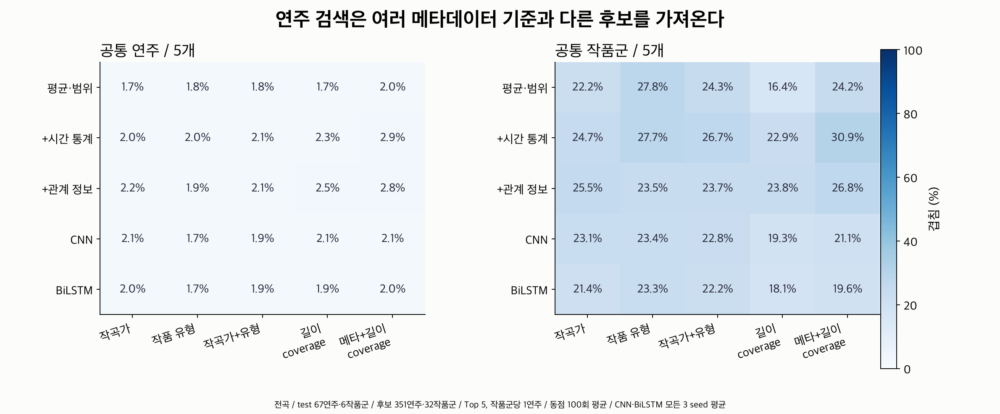
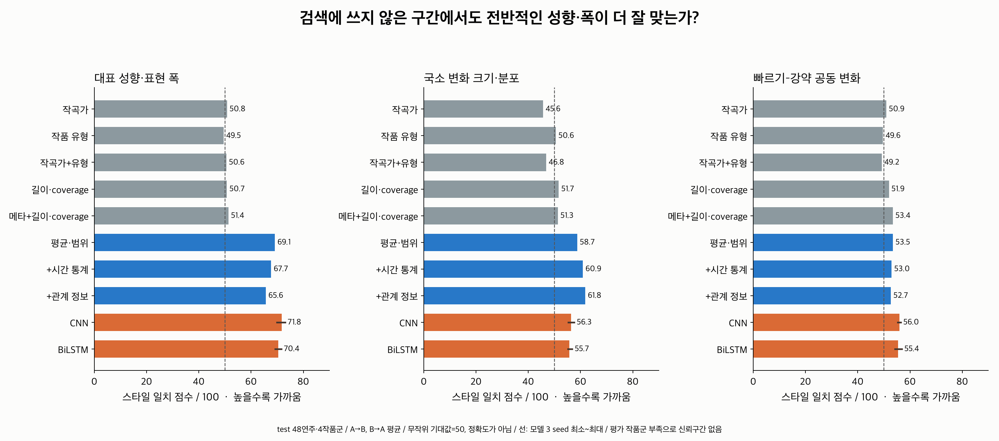
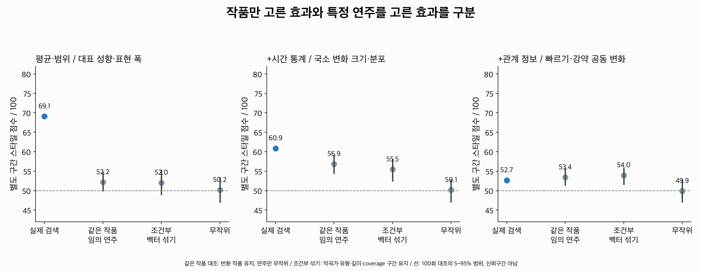
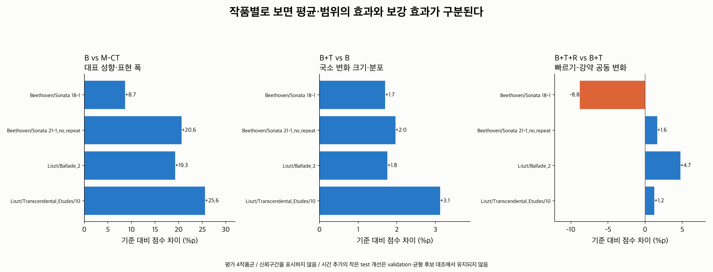
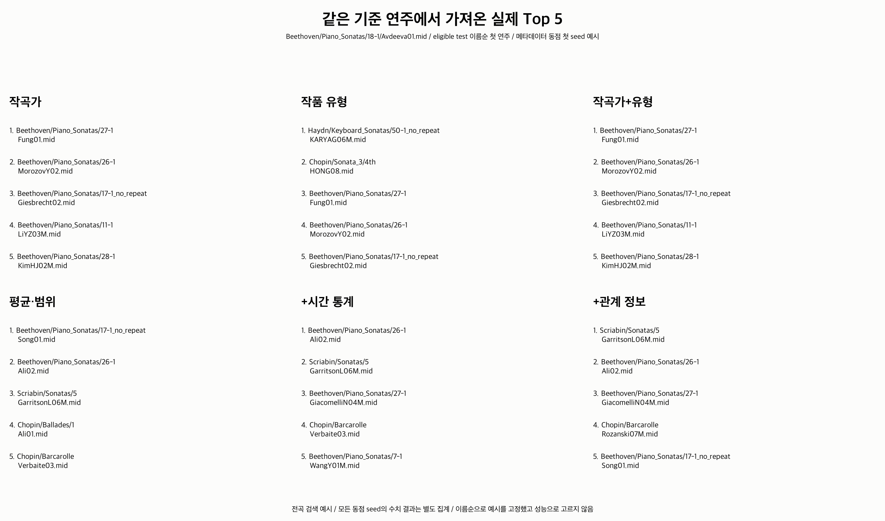
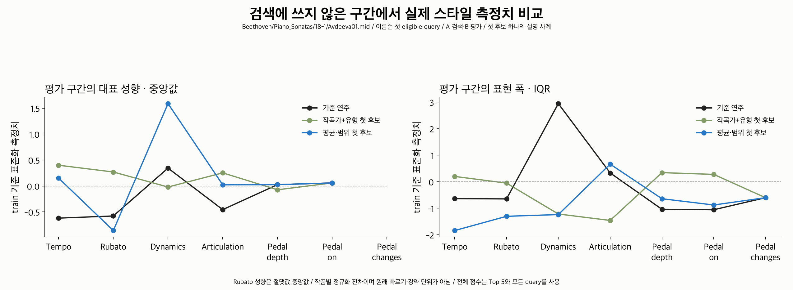

# 다른 작품 검색에서 메타데이터와 구분되는 연주 스타일 축

**평균·범위 검색은 메타데이터와 다른 작품/연주를 가져오면서, 별도 구간에서도
전반적인 성향·표현 폭이 더 잘 맞는 탐색적 결과를 보였다.**
시간 통계의 추가 효과는 작고 후보 수 대조에서 유지되지 않았으며,
관계 정보 추가의 주 평가에서는 평균 개선이 없었다.

[실행 전 설계](../metadata_retrieval_design/README.md)의 구간 조건·K·거리·주 비교를 바꾸지 않았다.
구간 평가를 통과한 test는 **48연주·4작품군**이라, 최소 5작품군이라는 설계 규칙에 따라
신뢰구간과 확증 판정은 하지 않는다. 현재 표본에서 관찰한 차이와 대조 결과를 보고한다.

## 1. 무엇을 비교했는가?

같은 기준 연주에서 **다른 작품군의 연주 Top 5**를 가져온다. 작품군마다 최대 1연주를 반환한다.
메타데이터의 작곡가, 작품 유형, 둘의 조합과 연주 표현을 비교했다.
길이·coverage 및 메타데이터+길이 조건도 보조 기준으로 추가했다.
ASAP 작품 유형은 기존 title/folder 규칙에서 파생한 분류이며, 실제 스트리밍 서비스의 추천 모델을 재현한 것은 아니다.

| 조건 | 담는 정보 |
|---|---|
| M-C / M-T / M-CT | 작곡가 / 작품 유형 / 둘의 동일 가중 불일치 거리 |
| Q / M-CTQ | beat 수·coverage / 메타데이터와 길이 정보의 거리 결합 |
| B | 기존 평균·범위 14D, 다섯 feature 묶음 동일 가중 |
| B+T | B + 개별 시간 통계 57D |
| B+T+R | B/T + 비파생 17채널 쌍의 7 lag 관계 119D |
| CNN / BiLSTM | 저장된 128D 표현, 각각 고정 checkpoint의 모든 3 seed |

T/R 표준화와 블록 거리 크기 보정은 train gallery에서만 계산한다.
메타데이터 동점은 100 seed에서 해소하고, 같은 우선순위를 모든 방법에 적용했다.
인코더 추가 학습, 평가 결과에 따른 가중치·구간 길이 변경, 좋은 seed 선택은 없다.

## 2. 표본과 평가 경계

| 실험 | train gallery | validation query | test query |
|---|---|---|---|
| A · 기존 전곡 벡터 검색 | 351연주·33작품·32작품군 | 67연주·4작품군 | 67연주·6작품군 |
| B · 구간 분리 검색/평가 | 258연주·25작품·24작품군 | 56연주·4작품군 | 48연주·4작품군 |

실험 B의 test는 Beethoven 소나타 27연주, Liszt 에튀드 15연주·발라드 6연주다.
Chopin의 두 test 작품은 구간 지원이 부족해 제외됐다. 일부 다른 작품의 연주도
분리한 구간의 T 좌표가 정의되지 않아 제외됐다. 이는 결과를 보고 고른 제외가 아니다.
[cohort.csv](cohort.csv)에 포함 여부와 모든 불가 좌표 블록을 저장했다.

같은 query/후보를 모든 방법에 사용했다. 갤러리 각 작품/grid에는 최소 3연주가 있다.
query 작품군 전체를 후보에서 제외하고 기존 모델의 split을 가로지르는 query 작품군도 제외했다.
기존에 확인했던 split을 재사용한 후속 탐색 결과이며 새로운 최종 검증 세트는 아니다.

## 3. 메타데이터와 얼마나 다른 후보를 가져왔는가?



아래는 **실험 A의 전곡 Top 5**, query 작품군 동일 가중 평균이다.
CNN/BiLSTM은 모든 3 seed 평균이다.

| 검색 | 작곡가+유형 추천과 같은 연주 | 작곡가+유형 추천과 같은 작품군 |
|---|---:|---:|
| 평균·범위 B | 1.8% | 24.3% |
| B+시간 T | 2.1% | 26.7% |
| B+T+관계 R | 2.1% | 23.7% |
| CNN | 1.9% | 22.8% |
| BiLSTM | 1.9% | 22.2% |
| 메타데이터 목록끼리 동점만 다르게 해소 | 6.3% | 73.3% |

평균·범위는 메타데이터 추천과 약 **75.7% 다른 작품군**을 가져왔다.
메타데이터 목록끼리도 연주 겹침은 작으므로, ‘98.2% 다른 연주’만으로 차별성을 주장하지 않는다.
작품군 겹침과 동점 내부 대조를 함께 보면 구분되는 검색 방향이 관찰된다.

메타데이터 M-CT의 후보 중 같은 작곡가는 80.0%, 같은 유형은 90.0%였다.
B에서는 각각 30.1%, 42.4%였다. 특정 작품군/연주를 골랐다는 의미는 다음 스타일 검사와 함께 판단한다.
여기서 겹침은 정확도나 50% 무작위 선택과 비교하는 지표가 아니다.

## 4. 다른 결과가 스타일에서도 의미 있었는가?

64-beat 완전 블록을 번갈아 A/B로 나눴다. A 구간에서 검색하고 B 구간에서 평가한 뒤 방향을 바꿨다.
각 연주는 자기 작품 안에서 나누며 다른 작품의 같은 beat 위치를 맞추지 않는다.
B/T/R은 검색 구간만으로 다시 만들었고, 모델도 검색 구간만 고정 checkpoint로 인코딩했다.
결측·블록 경계는 변화량, run, lag 계산에서 연결하지 않았다.

- **성향·폭 E-L:** 평가 구간의 중앙값·IQR. Rubato 성향만 절댓값 중앙값이다.
- **국소 변화 E-T:** 32-beat 구간별 변화량 RMS의 q25/q50/q75를 log1p 변환한다.
- **공동 변화 E-R:** 64-beat Tempo–Dynamics 변화량 상관의 q25/q50/q75와 SD다.

평가 측정치 거리를 gallery 분포에서 백분위로 바꿨다. 후보가 무작위 연주보다 가깝게 위치하는 정도이며,
동점은 절반으로 센다. 아래는 100점으로 환산한 **Top 5 평균 스타일 일치 점수**다.
**무작위 기대값은 50점, 큰 값이 더 잘 맞는다. 69점은 정확도 69%가 아니다.**



| 검색 | 성향·폭 | 국소 변화 | 공동 변화 |
|---|---:|---:|---:|
| 작곡가 M-C | 50.8 | 45.6 | 50.9 |
| 작품 유형 M-T | 49.5 | 50.6 | 49.6 |
| 작곡가+유형 M-CT | 50.6 | 46.8 | 49.2 |
| 길이·coverage Q | 50.7 | 51.7 | 51.9 |
| 메타+길이 M-CTQ | 51.4 | 51.3 | 53.4 |
| 평균·범위 B | **69.1** | 58.7 | 53.5 |
| B+T | 67.7 | **60.9** | 53.0 |
| B+T+R | 65.6 | 61.8 | 52.7 |
| CNN · 3 seed 평균 | 71.8 | 56.3 | 56.0 |
| BiLSTM · 3 seed 평균 | 70.4 | 55.7 | 55.4 |

**B의 성향·폭 점수는 M-CT보다 18.5점 높고, test 4작품 모두 같은 방향이었다.**
validation에서도 B 68.1점 vs M-CT 47.1점으로 4작품 모두 높았다.
Top 10에서도 test B 68.4점 vs M-CT 49.8점으로 비슷한 방향이었다.
메타데이터 목록에 없던 새 후보만의 성향·폭 점수도 69.2점이었다. 이는 전체 점수 대신 택한 주 지표가 아니라 보조 집계다.

이 수치는 구간 분리 cohort에서 다시 검색한 결과다. 전곡 실험 A의 모든 반환 후보를 직접 검증한 것은 아니다.

## 5. 작품을 고른 효과인가, 연주를 고른 효과인가?



| 주 표현 / 평가 축 | 실제 검색 | 같은 작품에서 연주만 무작위 | 메타·길이 조건부 벡터 섞기 |
|---|---:|---:|---:|
| B / 성향·폭 | **69.1** | 52.2 | 52.0 |
| B+T / 국소 변화 | 60.9 | 56.9 | 55.5 |
| B+T+R / 공동 변화 | 52.7 | 53.4 | 54.0 |

같은 작품 대조는 반환 작품/grid를 유지하고 그 안의 연주를 균등하게 다시 고른다.
원래 고른 연주도 선택 가능하다. B의 경우 작품은 그대로인데 성향·폭 점수가 크게 내려가므로
**특정 연주를 고른 효과**도 관찰된다. 선택 연주와 같은 작품의 다른 연주를 하나씩 비교한
성향·폭 일치 비율은 test 69.3%, validation 68.2%였다. 이 비교의 무작위 기대값은 50%다.

조건부 섞기는 작곡가×유형×길이 quartile×coverage 구간 안에서 gallery의 전체 결합 벡터를
연주 key에 재배정한 뒤 검색을 다시 한다. 모든 gallery 연주가 교환 가능한 구간에 속했다.
구간 분리 gallery의 46.1%는 같은 작품 내 교환만 가능한 strata에 속했다. 완전한 작품 구조 제거라고 해석하지 않는다.
그림 선은 100회 반복의 5~95 percentile이며 신뢰구간이 아니다.

후보 녹음 수 효과를 보기 위해 작품군당 3연주인 gallery 20개로 반복했다.
B 성향·폭은 65.9점 vs M-CT 50.2점으로 방향을 유지했다.

## 6. 시간·관계 지식의 보강 효과



| 사전 주 비교 | test 점수 변화 | validation 점수 변화 | test 후보 수 균형 대조 |
|---|---:|---:|---:|
| B vs M-CT / 성향·폭 | +18.5점 · 4/4작품 개선 | +21.0점 · 4/4 | +15.7점 |
| B+T vs B / 국소 변화 | +2.1점 · 4/4 | −0.1점 · 3/4 | **−0.4점** |
| B+T+R vs B+T / 공동 변화 | −0.3점 · 3/4 | −0.3점 · 1/4 | +0.3점 |

시간 정보는 원래 test gallery에서 작은 추가 효과가 있지만 validation과 균형 gallery에서 유지되지 않았다.
관계 정보는 세 test 작품에서 조금 좋아졌지만 한 작품의 악화가 커 평균은 내려갔다.
관계 검색은 같은 작품 무작위/조건부 섞기보다도 주 공동 변화 점수가 높지 않았다.
따라서 **시간/관계 보강의 안정적인 추가 효과를 확인했다고 말하지 않는다.**

CNN의 성향·폭은 모든 seed에서 test 69.9~73.0점, validation 70.5~71.5점이었다.
BiLSTM은 test 69.3~71.6점, validation 69.9~70.3점이었다.
이 고정 모델도 성향·폭 검색의 경향을 보였지만 4작품군 결과로 최종 모델 우열을 확정하지 않는다.

## 7. 고정한 실제 추천 사례



예시는 eligible test의 작품·key 이름순 첫 연주 `Beethoven/Piano_Sonatas/18-1/Avdeeva01.mid`다.
성공률이나 가장 큰 개선을 보고 고르지 않았다. 메타데이터 첫 동점 seed의 목록은 하나의 설명 사례다.
집계는 100회 동점과 모든 query를 포함한다. [neighbors.csv](neighbors.csv)에 전체 예시 Top 10이 있다.



두 번째 그림은 구간 A에서 검색한 첫 후보의 구간 B 측정치를 보여준다.
입력 평균·p95−p5를 복사한 그림이 아니라 평가 구간 중앙값·IQR을 train 기준으로 표준화한 것이다.
첫 후보 한 개의 설명 사례이며 Top 5 전체 성능의 대체가 아니다. 값은 [example_profiles.csv](example_profiles.csv)에 저장했다.

## 8. 해석 범위와 이전 결과의 관계

이번에는 **평균·범위가 메타데이터를 보완하는 연주 구분 축이 될 수 있다는 탐색 근거**가 있다.
검색 결과의 차이뿐 아니라 별도 구간의 성향·폭 일치, 같은 작품 연주 대조,
길이/coverage 기준과 후보 수 균형 대조를 함께 확인했다.

앞선 [정보 예측 실험](../metadata_information_results/README.md)은 전곡 벡터로 시간 측정치를
선형 예측하는 문제였다. 이번 성향·폭 검색의 관찰은 그 실패를 뒤집은 결과가 아니라 다른 질문의 답이다.
시간/관계 지식 보강의 불확실성은 이번에도 남는다.

평가 작품군이 4개라 사전 확증 구간 규칙을 충족하지 못했다. query 48개나 seed 반복을 독립 작품 48개/100개로 세지 않는다.
작품별 공통 패턴 제거와 scale은 기존 전곡 catalog reference를 유지했다. 따라서 구간이 겹치지 않아도
전처리까지 완전히 독립인 것은 아니며, reference가 없는 새 작품 온라인 추천으로 확대하지 않는다.
측정한 스타일은 정규화된 상대적 feature이며 원래 음원의 빠르기·강약·음색이나 청취 선호 정답은 아니다.

## 9. 재현·저장·검증

저장소 루트에서 다음 순서로 실행한다.

```bash
MPLCONFIGDIR=/tmp/classicfy-matplotlib VECLIB_MAXIMUM_THREADS=2 \
  .venv/bin/python classicfy-ai/scripts/prepare_metadata_retrieval_experiment.py
MPLCONFIGDIR=/tmp/classicfy-matplotlib VECLIB_MAXIMUM_THREADS=2 \
  .venv/bin/python classicfy-ai/scripts/run_metadata_retrieval_experiment.py
MPLCONFIGDIR=/tmp/classicfy-matplotlib \
  .venv/bin/python classicfy-ai/scripts/archive_metadata_retrieval_tables.py
MPLCONFIGDIR=/tmp/classicfy-matplotlib VECLIB_MAXIMUM_THREADS=2 \
  .venv/bin/python classicfy-ai/scripts/verify_metadata_retrieval_experiment.py
MPLCONFIGDIR=/tmp/classicfy-matplotlib \
  .venv/bin/python classicfy-ai/scripts/report_metadata_retrieval_experiment.py
MPLCONFIGDIR=/tmp/classicfy-matplotlib \
  .venv/bin/python -m unittest discover \
  -s classicfy-ai/tests/unit/embedding -p 'test_retrieval_probe.py' -v
```

집계는 [summary.csv](summary.csv), 작품별 주 비교는 [per_work_metrics.csv](per_work_metrics.csv)에 저장했다.
큰 query별 표와 모든 seed의 후보 index·거리·균형 gallery·분리 구간 벡터는
`Classicfy/datasets/metadata_retrieval_run01/`에 두었다.
[storage_manifest.json](storage_manifest.json)에서 표의 위치와 hash를 확인할 수 있다.
표를 옮길 때 내용이나 실험 조건은 바꾸지 않았다. 전체 query의 첫 seed 검색 목록은 같은 디렉터리의 `neighbors.csv`에 있다.
저장소에는 주요 집계·고정 사례·출처/검증 기록과 PNG/SVG/PDF 6종 그림을 남겼다.

독립 검증에서는 기존 #14의 원래 구현으로 분리 구간 T/R 1,140행을 다시 계산했고,
별도의 명시적인 beat 순회로 평가 측정치 3,420행을 다시 계산했다.
주 검색 순위 109,440건과 후보 수 균형 대조 순위 27,360건을 다른 정렬 구현으로 대조했고,
저장된 주 후보 index 9,576,000개의 범위·작품군 제외를 확인했다.
스타일 점수 34,944행, 대조 47,424행, 새 후보 11,232행, 균형 후보 점수 349,440행,
전체 집계 4,812행을 대조했다. 겹침 표는 37행마다 고정 표본 5,546행을 검사했다.
수치 차이의 최대값은 약 5.3×10⁻¹⁵이며, 새 단위 테스트 8개도 통과했다.
[verification.json](verification.json)에 전체 검사와 표본 검사의 범위를 명시했다.

진행 결과와 프레이즈·조성 긴장도에 따른 반응 표현의 다음 비교 방향은
[후속 정리](FOLLOWUP.md)에 기록했다. 구조 추출과 후속 실험은 아직 실행하지 않았다.
