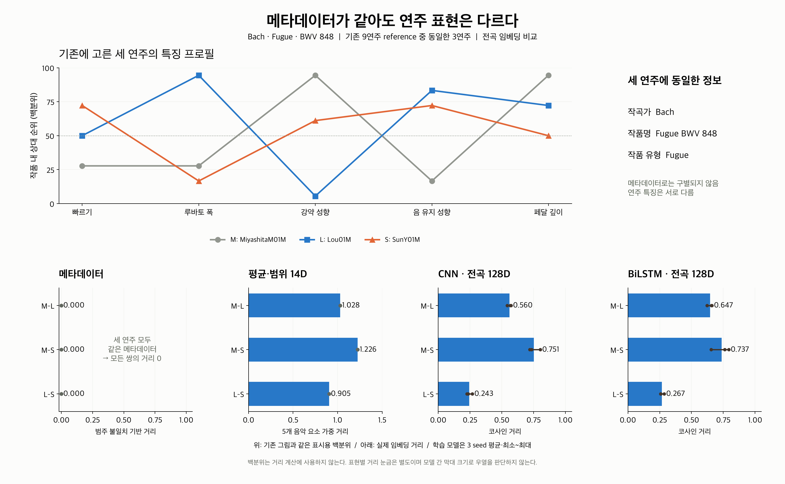

# 같은 메타데이터 안에서 연주 임베딩이 구별하는 차이

기존 BWV 848의 세 연주를 그대로 사용해 **메타데이터·평균/범위·CNN·BiLSTM 거리**를 추가했다.
세 연주의 작곡가·작품명·작품 유형은 모두 같아서 메타데이터 거리는 0이다.
연주 표현에서는 세 쌍 모두 거리가 0보다 크고, 가까운 쌍과 먼 쌍이 구분된다.



- 발표용 한 장: [PNG](same_work_metadata_overview.png) · [SVG](same_work_metadata_overview.svg) · [PDF](same_work_metadata_overview.pdf)
- 거리만 따로: [PNG](same_work_metadata_distances.png) · [SVG](same_work_metadata_distances.svg) · [PDF](same_work_metadata_distances.pdf)
- 기존 연주 곡선·선정 근거: [BWV 848 세 연주 보고서](../_interpretation_embedding/README.md)

## 읽는 방법

위쪽은 기존 그림과 동일한 연주 특징 프로필이다. 작품 내 9연주 reference에서의 상대 순위이며,
실제 거리 계산에 이 백분위를 쓰지는 않는다. Rubato는 변화 폭, Pedaling은 깊이를 대표로 표시한다.

아래쪽은 같은 세 연주 사이의 실제 거리다. M=MiyashitaM01M, L=Lou01M, S=SunY01M이다.
학습 모델의 막대는 3 seed 평균, 선은 최소~최대, 점은 각 seed 값이다. 선은 신뢰구간이 아니다.

| 연주 쌍 | 메타데이터 | 평균·범위 14D | CNN 전곡 128D | BiLSTM 전곡 128D |
|---|---:|---:|---:|---:|
| M–L | 0.000 | 1.028 | 0.560 (0.542~0.573) | 0.647 (0.622~0.661) |
| M–S | 0.000 | 1.226 | 0.751 (0.719~0.802) | 0.737 (0.655~0.793) |
| L–S | 0.000 | 0.905 | 0.243 (0.225~0.269) | 0.267 (0.256~0.286) |

**Lou–Sun은 기존 14D와 CNN·BiLSTM의 모든 seed에서 가장 가까운 쌍이었다.**
가장 먼 쌍은 14D와 CNN 3개 seed, BiLSTM 2개 seed에서는 M–S이고,
BiLSTM seed 20261008에서는 M–L이다. 평균만 표시해 이런 차이를 감추지 않았다.

거리의 단위와 표현이 다르므로, 14D의 1.226과 CNN의 0.751을 비교해
어느 모델이 차이를 더 잘 담았는지 판단하지 않는다. 각 표현 안에서 쌍의 상대 순서를 읽는다.
이 사례는 메타데이터만으로 구별되지 않는 연주들을 연주 표현이 구별한다는 근거다.
프로필은 다섯 개 표시 좌표이고 거리는 모든 입력 좌표를 사용하므로,
프로필 선 사이의 간격과 거리가 그대로 일치하는 그림은 아니다.

## 고정한 자료와 거리 정의

- 기존에 선택한 Bach · Fugue · BWV 848의 MiyashitaM01M/Lou01M/SunY01M을 재사용한다.
  이번 거리 결과를 보고 연주를 다시 선정하지 않았다.
- 세 연주 모두 동일 score/grid의 train 연주다. 프로필 reference는 기존의 해당 작품 9연주 전체다.
- 메타데이터는 감사된 composer/title/work_type을 사용한다. work_type은 작품명·폴더에서 분류한 라벨이다.
  연주 파일명이나 recording ID를 메타데이터 임베딩에 넣지 않는다.
- 메타데이터 세 범주를 one-hot으로 결합해 `sqrt(2×범주 수)`로 나눈다.
  따라서 거리는 `sqrt(서로 다른 범주 수 / 전체 범주 수)`와 같고, 범주별 비중은 동일하다.
  전체 감사 cohort의 어휘를 사용하지만 같은 라벨의 거리 0은 어휘 크기와 무관하다.
- 14D는 기존 공통 패턴 제거·정규화 후 대표값과 p95−p5다. 대표값은 Rubato만 절댓값 중앙값이며
  나머지는 평균이다. Tempo/Rubato/Dynamics/Articulation/Pedaling 5요소가 같은 비중을 갖는다.
- CNN64/BiLSTM64는 확대 예산에서 검증 오차로 선택한 저장 checkpoint를 사용한다.
  seed 20261006/07/08 전체를 표시한다. 별도의 학습·checkpoint 선택은 하지 않았다.
- 학습 거리는 64D 구간 벡터의 평균+표준편차로 만든 **전곡 128D 벡터의 코사인 거리**다.
  이 세 연주는 각각 6개 구간을 갖는다. 거리용 export는 앞선 분석에서 검증·재추출한 파일이다.

## 검증과 재현

기존 프로필의 42좌표와 작품 내 백분위를 현재 export에서 확인했다.
원래 벡터의 최대 절대 차이는 0이다. 감사된 메타데이터와 기존 14D, 저장 모델의 score/grid가 일치하는지,
6개 모델 export의 SHA-256이 재추출 manifest와 일치하는지도 확인했다.

메타데이터 거리는 범주 불일치 수로, 14D는 좌표별 명시 가중치로,
CNN/BiLSTM은 벡터 내적과 norm으로 다시 계산했다. 24개 연주 쌍 거리의 최대 절대 오차는 10⁻¹² 미만이다.
원자료는 수정하지 않았고 figure의 글자·축·범례·수치도 확인했다.

```bash
MPLCONFIGDIR=/tmp/classicfy-matplotlib \
  .venv/bin/python classicfy-ai/scripts/plot_same_work_metadata_distances.py
```

재추출된 모델 파일은 `datasets/metadata_temporal_exports_run01`에 있어야 한다.
다른 출력 경로는 `--out`으로 지정할 수 있다.

`selected_performances.csv`에 metadata/identity, `pair_distances.csv`에 seed별 거리,
`pair_summary.csv`에 평균·최소·최대, `profile_display.csv`에 기존 표시 좌표를 저장했다.
`protocol.json`과 `verification.json`에 모델 출처·입력/코드 hash·검증 결과를 기록했다.

## 발표에서 설명할 수 있는 범위

> 작곡가·작품명·작품 유형이 모두 같은 세 연주는 메타데이터 표현에서 동일하다.
> 연주 특징을 사용하는 표현에서는 서로 다른 거리로 구별되며,
> 이 사례의 가장 가까운 연주 쌍은 기존 요약과 CNN·BiLSTM의 모든 seed에서 일치한다.

고정한 세 연주의 사례이므로 전체 작품의 결과로 일반화하지 않는다.
거리가 0보다 크다는 것만으로 모든 음악적 지식이 의도대로 반영됐음을 확정하지 않는다.
특징 차이의 크기와 임베딩 거리의 관계를 여러 작품에서 확인하는 실험과,
사전 지식의 추가 기여를 보는 제거·보강 비교는 별도로 진행할 수 있다.
여기서 동일하다고 통제한 메타데이터는 작곡가·작품명·작품 유형이며 연주자 정보는 포함하지 않는다.
