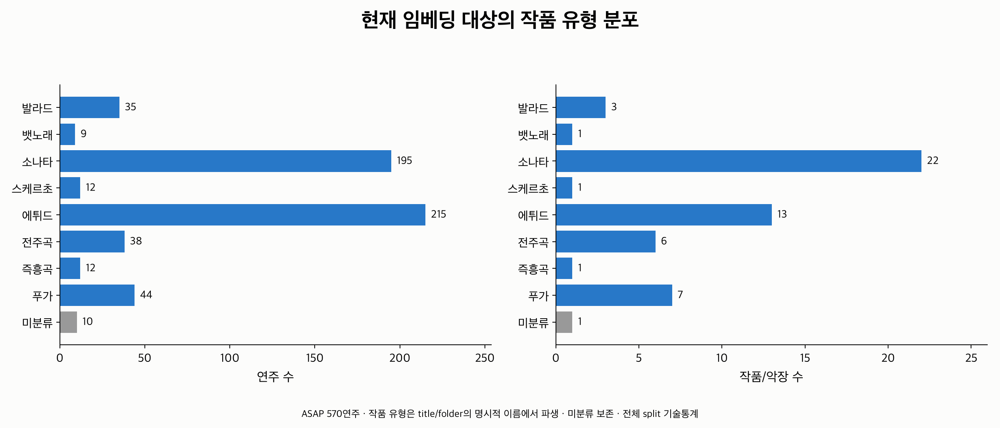
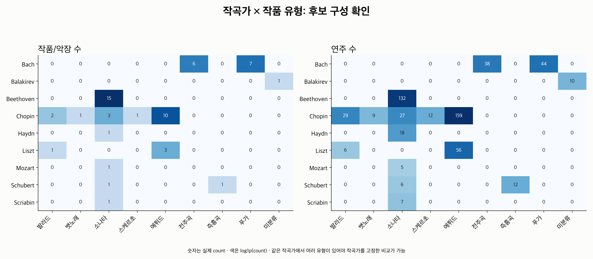

# 15번: 작품 유형 메타데이터와 비교 후보 구성

**첫 단계인 메타데이터 연결·작품 유형 분류·후보 수 점검을 완료했다.**
현재 저장된 CNN 임베딩의 570연주 모두 ASAP 메타데이터와 연결된다.
이름에서 유형을 분류할 수 있는 연주는 560개이고, `Islamey` 10연주는 미분류로 보존했다.

작곡가를 고정하고 같은 작품군을 제외한 양방향 파일럿은
**쇼팽 발라드–에튀드**부터 시작하는 것이 적절하다. Train에 발라드 2작품·29연주,
에튀드 6작품·106연주가 있어 135개 기준 연주의 메타데이터 후보 구성이 가능하다.
후보 수를 기준으로 골랐으며 feature/CNN의 거리나 성공 사례를 보고 고르지 않았다.

이 단계에서는 거리 비교, 스타일 일치 비율, 새 모델 학습을 수행하지 않았다.
다음 단계의 B/C가 실제로 feature-close/feature-far 조건을 만족할 수 있는지는 별도 확인해야 한다.

## 대상과 입력 연결

- ASAP 원본 metadata.csv: 1,067연주. 그중 현재 임베딩에 포함된 것은 570연주다.
- 현재 임베딩 대상: 9작곡가·55작품/악장·45개 보수적 작품군.
- split: train 395연주, validation 93연주, test 82연주.
- 기준 run: 저장소 밖 `datasets/temporal_embedding_cluster_run01`의 CSV/NPZ/dataset manifest.
- 기존 14D feature CSV와 CNN CSV의 연주 key 집합·piece·grid가 모두 일치한다.
- ASAP의 `midi_performance`로 정확히 연결하며 score identity와 split도 검사했다.
  임의 파일명 alias로 누락을 숨기지 않는다.
- 임베딩 밖 497행은 [outside_embedding_cohort.csv](outside_embedding_cohort.csv)에 따로 기록했다.

`works`는 ASAP의 `(composer,title)`로 센 작품/악장 단위다. 소나타의 여러 악장은
작품 행으로 각각 남기지만, 후보 제외에서는 하나의 작품군으로 묶는다.
같은 BWV 번호의 Bach Prelude/Fugue도 보수적으로 같은 작품군에서 제외한다.
Chopin op.10의 서로 다른 에튀드처럼 같은 작품집에 속한 독립 번호를 모두 합치지는 않는다.
이 grouping은 운영상 제외 규칙이며 모든 음악적 작품 관계를 해결한 식별자는 아니다.

## 작품 유형 분류

ASAP에는 별도 genre/type 컬럼이 없다. `title`과 `folder`의 두 번째 구성요소에
나타나는 명시적인 유형 이름을 규칙으로 정리했다. 새 시대·분위기·연주자 label은 붙이지 않았다.

| 유형 | 이름에서 인정한 예 |
|---|---|
| 소나타 | Piano_Sonatas, Keyboard_Sonatas, Sonata_3, Sonatas_5 |
| 에튀드 | Etudes_op_10/25, Transcendental_Etudes, Gran_Etudes_de_Paganini |
| 전주곡 | Prelude |
| 푸가 | Fugue |
| 발라드 | Ballades, Ballade_2 |
| 즉흥곡 | Impromptu |
| 스케르초 | Scherzos |
| 뱃노래 | Barcarolle |

두 출처가 다른 유형을 가리키면 미분류로 남기고 conflict를 기록한다.
한 출처만 인식되면 해당 출처와 상태를 보존하며 검토 목록에 넣는다.
현재 54작품은 title/folder가 같은 유형을 가리키고, 1작품은 둘 다 명시적 유형이 없다.
`Islamey`의 음악적 형식을 외부 정보 없이 추측하지 않았다.

이 분류는 데이터셋 이름을 정리한 파생 label이다. 독립적으로 검수된 형식 분석이나
스트리밍 서비스의 장르 태그와 동일한 것으로 간주하지 않는다.



| 유형 | 작품/악장 수 | 연주 수 |
|---|---:|---:|
| 소나타 | 22 | 195 |
| 에튀드 | 13 | 215 |
| 푸가 | 7 | 44 |
| 전주곡 | 6 | 38 |
| 발라드 | 3 | 35 |
| 즉흥곡 | 1 | 12 |
| 스케르초 | 1 | 12 |
| 뱃노래 | 1 | 9 |
| 미분류 | 1 | 10 |
| 합계 | 55 | 570 |

## 작곡가와 유형이 겹치는 문제



베토벤 132연주는 모두 소나타다. 바흐 82연주는 전주곡/푸가이며,
쇼팽은 에튀드·발라드·소나타·스케르초·뱃노래를 포함한다.
따라서 “소나타와 푸가”를 그대로 비교하면 작곡가 차이까지 함께 비교하게 된다.
주 파일럿에서는 **A/B/C의 작곡가를 동일하게 두고** 유형의 일치 여부를 비교한다.

작곡가를 고정했을 때의 후보 조건은 다음과 같다.

- A: 유형이 분류된 기준 연주.
- B: A와 다른 유형인 후보.
- C: A와 같은 유형인 후보.
- A/B/C는 모두 다른 보수적 작품군에 속해야 한다.
- 주 파일럿은 train만 사용한다. 전체 split 집계는 데이터 구성 설명용이다.
- 이 단계에서는 B가 특징상 가깝거나 C가 멀다는 조건을 아직 적용하지 않는다.

| 후보 구성 | 전체 split | Train만 |
|---|---:|---:|
| 기준 연주 수 | 570 | 395 |
| 위 메타데이터 후보가 있는 기준 연주 | 326 | 191 |
| 유형 미분류 | 10 | 10 |
| 같은 작곡가의 다른 유형 후보 없음 | 132 | 107 |
| 같은 유형의 다른 작품군 후보 없음 | 102 | 87 |

위 숫자는 메타데이터 지원 수이며 임베딩의 성공률이 아니다.
후보 B/C가 서로 같은 작품군에 속하는 조합도 제외해, 바흐의 같은 BWV Prelude/Fugue를
독립적인 두 대조 작품으로 사용하는 것을 피했다.

## 첫 파일럿 선정

각 유형에 train 작품군이 2개 이상이고, 두 방향 모두 기준 연주에 후보가 있어야 한다.
이 조건을 만족한 조합 중 지원 연주 수가 가장 많은 것을 먼저 선택했다.
동점은 작곡가·유형 이름순으로 결정한다.

| 파일럿 | 유형별 train 작품/악장 수 | 유형별 train 연주 수 | 지원 query |
|---|---|---|---:|
| **Chopin 발라드 ↔ 에튀드** | 2 / 6 | 29 / 106 | **135** |
| Bach 푸가 ↔ 전주곡 | 6 / 3 | 38 / 18 | 56 |

처음 제안했던 소나타–에튀드 비교는 현재 데이터에서 주 양방향 파일럿으로 쓰기 어렵다.
쇼팽 소나타 3번의 여러 악장은 한 작품군이므로 소나타 A에 대해 같은 유형의 다른 작품군 C가 없다.
베토벤은 에튀드 후보가 없다. Liszt의 발라드도 한 작품뿐이라 반대 방향의 대조가 부족하다.

후속 작업은 사용자 요청에 따라 먼저 [평균·범위 14D 파일럿](../metadata_summary_embedding/README.md)으로
진행했다. 대표값 7D에서 B/C를 고정하고, 14D와 선정에 미사용인 범위 좌표를 비교했다.
이 결과는 CNN 거리 검증이나 독립 청취 정답 평가와 구분한다.

## 저장 run과 평가 경계의 확인 사항

현재 로컬 checkpoint/NPZ SHA256은 기존 `temporal_neighbors/stats.json`의 run 기록과 다르다.
이는 곧 벡터가 잘못됐다는 판정은 아니다. 이번 작업에서는 현재 CSV와 NPZ의
벡터·key 순서·identity manifest가 일치하는지 검사했고 최대 벡터 차이는 0이었다.
새로운 run의 입력 hash를 별도로 기록했으며 이전 보고서의 cosine 결과를 옮겨 쓰지 않았다.
**후속 CNN 거리 평가 전에 현재 checkpoint와 벡터의 연결을 재검증해야 한다.**

보수적 작품군 6개가 기존 split을 가로지른다. Bach BWV 848/854/857/860,
Beethoven 소나타 31번, Chopin 소나타 3번이다.
모델의 기존 split은 유지했지만 음악적 작품군까지 완전히 분리된 일반화 실험이라고
말할 수 없다. [families.csv](families.csv)에 해당 정보가 있다.
이번 train-only 후보 구성에서 같은 작품군을 제외하는 것과 모델의 가중치 학습 경계는 구분한다.

## 산출물·재현

| 파일 | 내용 |
|---|---|
| [performances.csv](performances.csv) | 570연주의 원본 메타데이터·유형·분류 근거·split·작품군 |
| [works.csv](works.csv), [families.csv](families.csv) | 작품/악장 및 보수적 작품군 집계 |
| [type_distribution.csv](type_distribution.csv), [composer_type_counts.csv](composer_type_counts.csv) | 유형 및 작곡가×유형 분포 |
| [split_type_counts.csv](split_type_counts.csv) | split별 유형 분포 |
| [classification_review.csv](classification_review.csv) | 미분류·불일치·단일 출처 등 검토 항목 |
| [candidate_availability.csv](candidate_availability.csv) | all/train의 query별 후보 수·제외 이유 |
| [directed_type_candidates.csv](directed_type_candidates.csv), [pilot_options.csv](pilot_options.csv) | 유형별 후보 방향과 train 파일럿 지원 수 |
| [outside_embedding_cohort.csv](outside_embedding_cohort.csv) | 원본 metadata에만 있고 현재 임베딩 밖인 연주 |
| [summary.json](summary.json), [protocol.json](protocol.json), [verification.json](verification.json) | 집계·규칙·출처·제한 사항·검증 기록 |

저장소 루트에서 실행한다. 기존 run 이름을 사용하는 환경에서는 `--run`을 지정한다.
원본 데이터나 모델을 변경하지 않고 출력 디렉터리의 CSV/그림/JSON을 재생성한다.

```bash
MPLCONFIGDIR=/tmp/classicfy-matplotlib \
  .venv/bin/python classicfy-ai/scripts/audit_asap_metadata.py

MPLCONFIGDIR=/tmp/classicfy-matplotlib \
  .venv/bin/python classicfy-ai/scripts/audit_asap_metadata.py \
  --run ../datasets/temporal_embedding_run01 \
  --out /tmp/classicfy-metadata-audit

MPLCONFIGDIR=/tmp/classicfy-matplotlib PYTHONPATH=classicfy-ai/src \
  .venv/bin/python -m unittest discover \
  -s classicfy-ai/tests/unit/features -p 'test_asap_metadata.py' -v
```

ASAP revision 및 해당 commit의 metadata 원문 byte 일치를 확인했다.
570행의 원본 메타데이터와 유형을 고정된 subgroup 목록으로 독립 대조했고,
965개 query 행의 후보 수와 31개 대표 query의 B/C 조합을 별도 계산했다.
다른 출력 경로에 재실행한 **11개 CSV hash가 일치**했다.
분류 충돌·미분류·작품군 제외·작곡가 통제·split·CSV/NPZ identity를 다루는
신규 **10개 테스트 통과**, 두 그림의 시각 검토를 완료했다.
