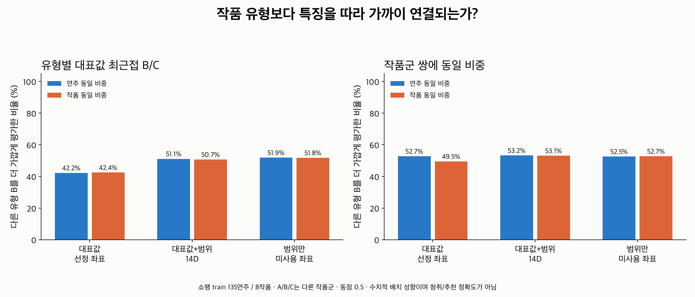
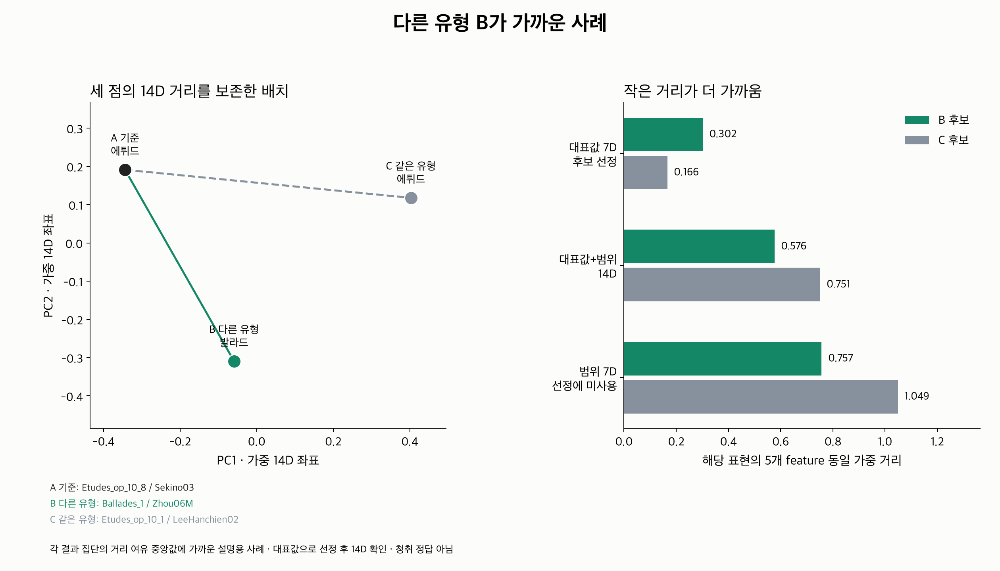
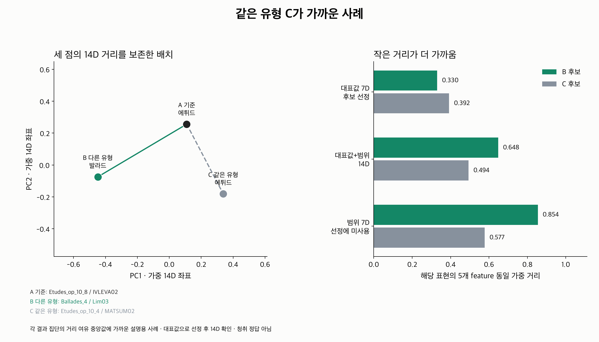

# 15번 첫 비교: 평균·범위 임베딩과 작품 유형

**쇼팽 발라드·에튀드 train 135연주에서 기존 14D 대표값+범위 임베딩을 비교했다.**
다른 유형 B가 더 가까운 경우는 69/135(51.1%), 같은 유형 C가 더 가까운 경우는
66/135(48.9%)였다. 작품별 동일 비중으로는 B 선호 50.7%다.
현재 결과로 메타데이터보다 연주 스타일을 더 잘 표현한다고 결론내리지는 않는다.

이번에 확인한 핵심은 **범위 좌표가 현재 14D 거리의 대부분을 설명한다는 점**이다.
대표값만의 순서는 범위 추가 후 64/135개에서 뒤집혔고, 14D와 범위만의 순서는
134/135개에서 같았다. 대표값에서 B가 가까웠던 57개 중 14D에서도 B가 가까운 경우는
31개(54.4%)였다. 이 결과는 수치적 거리 특성에 대한 진단이며 청취 유사성/추천 정확도가 아니다.

## 무엇을 비교했나

앞선 [메타데이터 점검](../metadata_style_validation/README.md)에서 거리 결과를 보지 않고
선정한 Chopin 발라드 2작품·29연주, 에튀드 6작품·106연주를 재사용했다.
같은 작곡가를 고정하고 A/B/C의 작품군을 서로 다르게 둔다.
후보 pool, 공통 패턴, scale과 5개 feature 가중치는 그대로 유지했다.
CNN이나 checkpoint는 이번 비교에 사용하지 않았다.

평가 표현은 기존 14차원 벡터다.

| 요소 | 대표 좌표 | 범위 좌표 |
|---|---|---|
| Tempo | 평균 잔차 | p95−p5 |
| Rubato | 절댓값 중앙값 | p95−p5 |
| Dynamics | 평균 잔차 | p95−p5 |
| Articulation | 평균 잔차 | p95−p5 |
| Pedaling | depth/down_ratio/changes 각각 평균 잔차 | 세 채널 각각 p95−p5 |

“평균+범위”는 기존 정책의 대표값+범위를 뜻한다. **Rubato는 산술 평균이 아니라
기존 절댓값 중앙값**을 유지했다. 범위는 max−min이 아니라 95–5백분위 폭이다.
작품 공통 패턴 제거·MAD/SD 정규화 잔차를 요약하며 절대 BPM·음량의 일치를 뜻하지 않는다.

각 음악 요소의 좌표별 제곱차를 평균한 뒤 다섯 요소를 동일 비중으로 평균하고
제곱근을 취한다. Pedaling 6좌표도 하나의 요소다. 좌표를 추가로 L2 정규화하거나
평균/범위별 scale을 새로 fit하지 않았다.

## 후보 선정과 순환 평가의 범위

14D로 가까운 B/먼 C를 고르고 같은 14D로 결과를 평가하면 선택 기준에 의해
결과가 정해진다. 그래서 **대표값 7좌표만으로 후보를 고정한 뒤** 세 표현을 비교했다.

- A: 기준 연주, 모든 135연주가 한 번씩 A가 된다.
- B: 다른 유형 후보 중 대표값으로 가까운 연주.
- C: 같은 유형 후보 중 대표값으로 가까운 연주. 일부러 가장 먼 대조를 고르지 않는다.
- 공동 선정 비용은 `d_rep(A,B)+d_rep(A,C)` 최소다. 세 작품군이 달라야 한다.
- 선정 비용의 동점은 가능한 최소 pair 모두를 평가하고 평균한다. 파일명 첫 순서는 그림용이다.
- 비교 거리의 동점은 0.5점이다. tolerance는 1e−12다. 현재 135개 비교에는 선정/평가 동점이 없다.

다음 세 표현에 **동일하게 고정한 B/C**를 넣는다.

1. 대표값 7D: 선정 기준의 결과.
2. 대표값+범위 14D: 사용자가 요청한 비교 표현.
3. 범위만 7D: 후보 선정에 쓰지 않은 좌표의 대조.

14D는 선정에 사용한 대표값을 절반 포함한다. 따라서 14D 결과도 완전히 독립적인
스타일 검증은 아니다. 범위는 선정에 미사용이지만 같은 녹음에서 계산되어 대표값과
통계적으로 연관될 수 있다. 사람의 유사성 label 없이 두 수치 요약의 관계를 조사한 실험이다.
유형만의 메타데이터 affinity는 모든 경우 같은 유형 C를 지지하지만, 이것을 정답률로 세지 않는다.

## 전체 결과



| 표현 | 다른 유형 B가 가까운 수 / 135 | 연주 동일 비중 | 작품 동일 비중 |
|---|---:|---:|---:|
| 대표값 7D | 57 | 42.2% | 42.4% |
| **대표값+범위 14D** | **69** | **51.1%** | **50.7%** |
| 범위만 7D | 70 | 51.9% | 51.8% |

이 비율은 B/C 중 수치적으로 누가 가까운지 나타낸다. 검색/추천 성공률이 아니며
50%를 넘었다는 사실만으로 의미 있는 개선이나 통계적 유의성을 주장하지 않는다.
후보 수가 유형/작품마다 다르고, 가까운 후보를 선정했으며, 8작품과 후보 녹음이 반복된다.

14D에서 기준 A가 발라드인 경우 B(에튀드) 선호는 12/29(41.4%),
A가 에튀드인 경우 B(발라드) 선호는 57/106(53.8%)였다.
두 방향의 데이터 구성과 결과를 따로 확인해야 한다.

### 후보 작품 수의 차이를 줄인 대조

큰 유형 pool에는 더 극단적으로 가까운 후보가 나올 기회가 많다.
보조 분석에서는 모든 B 작품군×C 작품군을 각각 비교한다.
각 작품군 안에서 대표값 최근접 녹음을 고른 뒤 작품군 pair에 동일 비중을 주고,
query 평균 → 작품 평균 순서로 집계했다. 총 1,234개 pair 비교가 있다.

| 표현 | 작품군 pair 대조: 연주 동일 비중 | 작품군 pair 대조: 작품 동일 비중 |
|---|---:|---:|
| 대표값 7D | 52.7% | 49.5% |
| **대표값+범위 14D** | **53.2%** | **53.1%** |
| 범위만 7D | 52.5% | 52.7% |

14D의 약한 B 선호 경향이 남지만, 작품군 pair 안에서도 녹음 수가 많으면 최근접 선택에
유리할 수 있다. 작품군 pair들은 독립 표본이 아니며 후보 녹음 수 효과를 완전히 제거하지 않았다.

## 범위가 거리에서 차지하는 비중

같은 pair에 대해 다음 관계가 성립한다.

```text
d_14D² = (d_대표값² + d_범위²) / 2
범위의 거리 제곱 비중 = d_범위² / (d_대표값² + d_범위²)
```

고정된 A–B pair에서 범위 비중 평균은 **90.94%**, 중앙값은 **93.04%**다.
A–C에서는 평균 **90.95%**, 중앙값 **94.85%**다.
이는 선택된 대표값 최근접 후보에서의 비중이며 전체 corpus의 모든 pair에 대한 비중은 아니다.
대표값 기준으로 가까운 후보를 골랐으므로 대표값 거리가 작아지는 선정 효과도 포함한다.

다섯 feature와 두 좌표에 같은 수식 가중치를 주더라도 실제 관측된 거리 기여는 같지 않다.
현재 후보에서 14D와 범위-only 판단이 134/135개 일치한 것도 이 비중과 일관된다.
임의로 범위 가중치를 수정해서 B 선호 비율을 높이지 않았다.
평균과 범위의 균형을 바꾸는 표현은 별도 설정으로 비교하고 청취/선호 기준으로 평가해야 한다.

## 두 방향의 설명용 사례

각 14D 결과 집단에서 거리 여유의 중앙값에 가장 가까운 query를 하나씩 골랐다.
선정은 전체 집계 후의 설명용이며 성능 추정에 쓰지 않는다.

### 다른 유형 B가 가까운 사례



- A: Chopin 에튀드 op.10/8 · `Sekino03`
- B: Chopin 발라드 1번 · `Zhou06M`
- C: Chopin 에튀드 op.10/1 · `LeeHanchien02`

| 거리 | A–B | A–C |
|---|---:|---:|
| 대표값 7D | 0.302 | 0.166 |
| **대표값+범위 14D** | **0.576** | **0.751** |
| 범위만 7D | 0.757 | 1.049 |

대표값만 보면 C가 가깝지만, 범위를 함께 보면 B가 가까워진다.
다른 유형의 연결이 발생하는 사례지만 대표값의 선호가 보존된 사례는 아니다.

### 같은 유형 C가 가까운 사례



- A: Chopin 에튀드 op.10/8 · `IVLEVA02`
- B: Chopin 발라드 4번 · `Lim03`
- C: Chopin 에튀드 op.10/4 · `MATSUM02`

| 거리 | A–B | A–C |
|---|---:|---:|
| 대표값 7D | 0.330 | 0.392 |
| **대표값+범위 14D** | **0.648** | **0.494** |
| 범위만 7D | 0.854 | 0.577 |

이 사례에서는 대표값으로 B가 가까워도, 범위를 포함하면 C가 가까워진다.
각 그림의 왼쪽은 세 점에만 적용한 가중 14D 좌표의 PCA다. 세 점 사이 거리를
2D에서 보존한다. 전체 corpus의 배치를 나타내지 않으며 판단은 원래 14D 거리에 따른다.

## 현재 판단과 다음 검증

작품 유형이 달라도 수치 특징으로 가까워지는 사례는 확인했다. 이번 파일럿은
“대표값의 가까움이 14D에서도 유지되는가”와 “범위가 어떤 순서를 바꾸는가”를 분석했다.
기존 메타데이터 추천보다 효과적이라는 결론은 아직 없다.

작품 유형의 일치 여부만으로 이번 수치적 거리 관계를 모두 설명할 수는 없다.
다만 대표값만의 유사성을 전체 스타일의 정답으로 놓을 수도 없다.
후속 평가에서는 대표값과 범위의 기여를 확인하고, 독립적인 청취 유사성·선호 또는
별도 관측 구간을 기준으로 표현들을 비교해야 한다.

## 재현·검증

기존 14D export 두 개의 570연주 key/piece/grid와 수치가 일치하는지 확인했다.
원본 raw cache hash, ASAP/nASAP revision, 기존 provenance와 메타데이터 audit의
feature export hash도 대조했다. 새로운 feature나 정규화는 fit하지 않았다.

좌표별 가중치를 별도로 만든 18,225개 14D 거리 cell과 대표값/범위 제곱거리 분해를 검증했다.
대표값 최근접/작품군 제외/동점 평균/범위에 따른 순서 반전/PCA 거리 보존 등
신규 **8개 테스트 통과**. 1,369개 후보·결과 행과 18개 집계 행을 별도 계산으로 대조했다.
서로 다른 출력 경로의 **7개 기존 CSV hash가 세 실행에서 일치**했고, 세 그림을 시각 검토했다.

```bash
MPLCONFIGDIR=/tmp/classicfy-matplotlib \
  .venv/bin/python classicfy-ai/scripts/compare_metadata_summary_embedding.py

MPLCONFIGDIR=/tmp/classicfy-matplotlib \
  .venv/bin/python classicfy-ai/scripts/compare_metadata_summary_embedding.py \
  --out /tmp/classicfy-metadata-summary

MPLCONFIGDIR=/tmp/classicfy-matplotlib PYTHONPATH=classicfy-ai/src \
  .venv/bin/python -m unittest discover \
  -s classicfy-ai/tests/unit/features -p 'test_metadata_summary_embedding.py' -v
```

| 파일 | 내용 |
|---|---|
| [pilot_profiles.csv](pilot_profiles.csv) | 135연주의 14D 좌표와 메타데이터 |
| [query_comparisons.csv](query_comparisons.csv) | 고정 B/C와 세 표현의 거리·순서·tie·후보 수 |
| [family_comparisons.csv](family_comparisons.csv), [balanced_queries.csv](balanced_queries.csv) | 작품군 pair별 비교 및 query별 균형 집계 |
| [summary.csv](summary.csv), [work_results.csv](work_results.csv) | 전체/유형별/작품별 집계 |
| [feature_contributions.csv](feature_contributions.csv), [distance_balance.csv](distance_balance.csv) | feature별 제곱거리 기여와 대표값/범위 비중 |
| [selected.json](selected.json) | 결과 집단별 설명용 사례 선정 |
| [protocol.json](protocol.json), [verification.json](verification.json) | 계산·선정 기준·출처·제한 사항·검증 기록 |

입력은 per-work cohort reference를 사용한 기존 잔차이며, 작품 구조·beat 정의·정렬 영향이 남는다.
연주자 identity는 검증/통제하지 않았다. 한 작곡가의 8작품을 사용한 train-only 분석이다.
