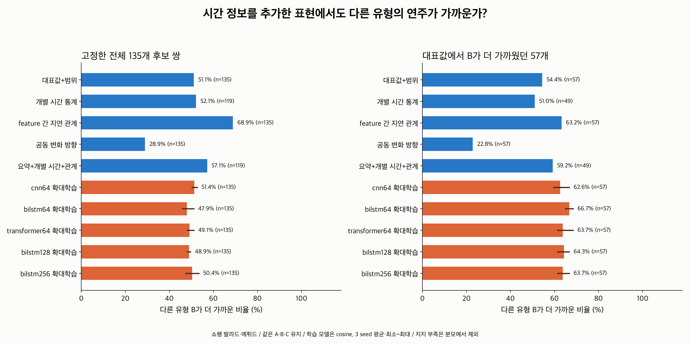
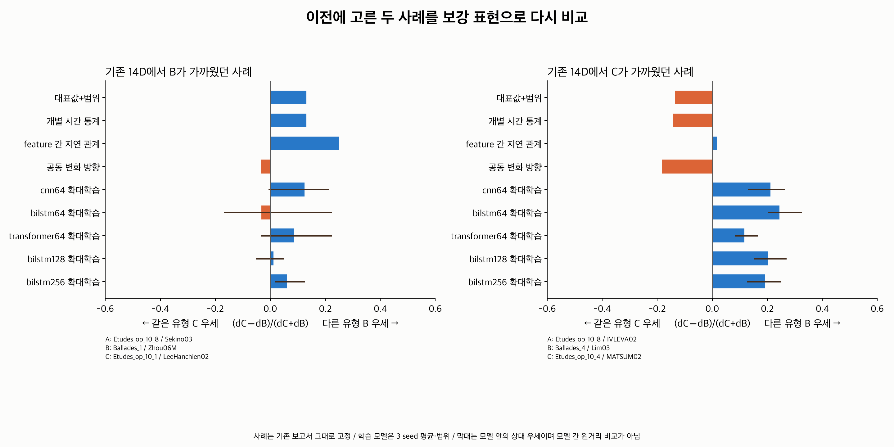

# 시간 통계·보강 학습 임베딩의 작품 유형 비교

평균·범위 이후의 표현도 **같은 연주 후보**에 적용했다. 대표값에서 다른 유형의 연주가
가까웠던 57개 사례 중, 평균·범위는 31개(54.4%)에서 그 순서를 유지했다.
확대 학습 BiLSTM 64D는 seed 평균 38개(66.7%), feature 간 지연 관계는 36개(63.2%)에서 유지했다.
반면 공동 변화 방향 비율은 13개(22.8%)만 유지했다. 시간 정보를 추가하는 방식에 따라
배치가 달라지며, 정보를 추가하거나 차원을 늘리는 것만으로 대표값의 가까움을 더 잘 보존하지는 않았다.

이 비율은 **대표값 거리 순서의 유지율**이다. 사람이 비슷하게 듣는 연주를 맞힌 정확도가 아니다.
대표값 자체가 스타일의 정답도 아니므로, 유지율이 높다는 이유만으로 더 좋은 임베딩이라고 판단하지 않는다.



## 무엇을 고정했는가?

이전 [평균·범위 파일럿](../metadata_summary_embedding/README.md)의 쇼팽 train 135연주·8작품을 그대로 사용했다.

- A: 비교의 기준 연주.
- B: 같은 작곡가, 다른 작품 유형의 연주. A가 에튀드이면 B는 발라드.
- C: 같은 작곡가, 같은 작품 유형의 연주. A가 에튀드이면 C도 에튀드.
- A/B/C는 서로 다른 작품군이다. B와 C 모두 대표값으로 가까운 후보를 고르고 이후 변경하지 않았다.
- 전체 135개와, 대표값에서 B가 C보다 가까웠던 57개를 따로 집계했다.
- 후보 작품군 수의 영향을 줄이는 기존 1,234개 작품군 쌍 비교도 동일하게 재사용했다.

새 임베딩마다 B/C를 다시 고르면 후보가 바뀐 효과와 표현이 바뀐 효과가 섞인다.
이번에는 고정된 후보의 거리 순서가 어떻게 달라지는지 확인했다.
현재 파일럿의 선정 동점은 없다. 동점이 생긴 다른 입력은 이 CLI에서 중단하며 별도의 동점 평균 평가가 필요하다.

## 비교한 표현

| 표현 | 담는 정보 | 연주당 좌표 수 |
|---|---|---:|
| 기존 대표값 / 대표값+범위 / 범위 | 7채널의 대표값·p95−p5 | 7 / 14 / 7 |
| 개별 시간 통계 | 큰 변화 비율·거칠기·상승/반전·양/음 수준 지속·값/변화량 자기상관 | 70 |
| feature 간 지연 관계 | 정의상 연결된 쌍을 제외한 17개 채널 쌍의 변화량 상관, lag −4/−2/−1/0/1/2/4 | 119 |
| 공동 변화 방향 | 같은 beat에서 두 채널의 하강/유지/상승 9조합 비율 | 153 |
| 요약+개별 시간 | 14D와 70D의 거리 결합 | 최대 84 |
| 요약+개별 시간+관계 | 14D·70D·119D의 거리 결합 | 최대 203 |
| CNN / BiLSTM / Transformer 64D | 학습한 64-beat 구간의 64D 표현을 전곡 평균+표준편차로 요약 | 128 |
| 확대 학습 BiLSTM 128D / 256D | 구간 압축 차원을 늘린 표현의 전곡 평균+표준편차 | 256 / 512 |

시간 통계의 원래 계산·수치 검증은 #14 브랜치의 결과를 재사용했다.
**이번에 만든 시간 통계 벡터와 결합 표현은 새 탐색 baseline**이며, 이미 성능이 검증된 제품 임베딩은 아니다.
지속 통계는 #14에서 20개 이상 run이 있을 때의 log1p 평균을 재사용한다.
여기서 run은 같은 상대 수준이 연속해서 이어지는 구간이다.

Tempo–Rubato와 페달 내부 채널처럼 정의상 연결된 4개 쌍은 관계 벡터에서 제외했다.
남은 쌍들이 통계적으로 독립이라고 가정하는 것은 아니다.
다른 작품의 같은 beat를 맞대지 않고, 각 연주 내부의 관계를 계산한 요약치를 비교한다.

학습 모델은 20 epoch 내 최선 3종 × 3 seed와 확대 예산 최선 5종 × 3 seed,
**총 24개 저장 checkpoint**를 사용했다. 확대 예산은 최대 80 epoch와 조기 종료이며,
실제 선택 epoch는 모델·seed별로 18~63이다. 메타데이터 비교 결과로 모델을 고르거나 재학습하지 않았다.

## 거리와 결측 처리

시간 통계는 전체 train 395연주에서 좌표별 IQR/1.349를 계산하고, IQR이 0이면 SD를 사용했다.
유효 값이 10개 미만이거나 일정한 좌표는 비활성으로 남긴다. 결측을 0으로 채우지 않는다.

A/B/C 모두 유효한 **동일 좌표·그룹**으로 두 거리를 계산한다. 한쪽 거리만 더 많은 좌표를 사용하는 것을 막았다.
그룹 내 활성 좌표의 80% 이상이 필요하다. 개별 통계는 모든 채널 그룹을 요구하고,
관계는 17개 쌍 중 80% 이상을 요구한다. 개별 통계는 기존의 다섯 음악 요소를 같은 비중으로 반영하며
페달 세 채널이 한 요소의 비중을 나눠 갖는다. 관계는 17개 쌍을 같은 비중으로 반영한다.

결합 표현은 각 성분의 거리를 train의 서로 다른 작품 쌍에서 얻은 유효 거리 중앙값으로 나눈 뒤,
제곱 거리의 동일 비중 평균에 제곱근을 취한다. 선정된 135개의 가까운 후보 쌍만으로 비중을 맞추지 않았다.
결합 표현은 누락 좌표 때문에 항상 하나의 완전한 유클리드 공간으로 해석할 수 있는 것은 아니다.

학습 임베딩은 기존 검색과 같은 **cosine 거리**가 주 분석이고, 좌표 재표준화 없이
RMS 유클리드 거리도 민감도 분석으로 계산했다. 모델끼리 원래 거리의 크기를 비교하지 않는다.

## 전체 및 대표값 가까움 유지 결과

학습 모델은 모든 3 seed의 평균이며 괄호는 최소~최대다. 신뢰구간이 아니다.
`n`은 실제 계산 가능한 연주 수이며, 제외된 사례는 분모와 별도로 기록했다.

| 표현 | 전체에서 B가 가까움 | 대표값에서 B가 가까웠던 사례의 유지율 |
|---|---:|---:|
| 대표값 | 42.2% (57/135) | 100% (57/57, 선정 기준) |
| 대표값+범위 | 51.1% (69/135) | 54.4% (31/57) |
| 범위 | 51.9% (70/135) | 54.4% (31/57) |
| 개별 시간 통계 | 52.1% (62/119) | 51.0% (25/49) |
| 지연 관계 | 68.9% (93/135) | 63.2% (36/57) |
| 공동 변화 방향 | 28.9% (39/135) | 22.8% (13/57) |
| 요약+개별 시간 | 51.3% (61/119) | 51.0% (25/49) |
| 요약+개별 시간+관계 | 57.1% (68/119) | 59.2% (29/49) |
| CNN, 20 epoch | 51.1% (50.4~52.6), n=135 | 62.6% (59.6~66.7), n=57 |
| BiLSTM 64D, 20 epoch | 46.7% (45.9~47.4), n=135 | 65.5% (63.2~68.4), n=57 |
| Transformer, 20 epoch | 41.5% (36.3~44.4), n=135 | 54.4% (50.9~57.9), n=57 |
| CNN, 확대 학습 | 51.4% (50.4~52.6), n=135 | 62.6% (59.6~66.7), n=57 |
| BiLSTM 64D, 확대 학습 | 47.9% (45.9~51.1), n=135 | 66.7% (64.9~68.4), n=57 |
| Transformer, 확대 학습 | 49.1% (48.1~51.1), n=135 | 63.7% (61.4~68.4), n=57 |
| BiLSTM 128D, 확대 학습 | 48.9% (48.1~49.6), n=135 | 64.3% (61.4~66.7), n=57 |
| BiLSTM 256D, 확대 학습 | 50.4% (47.4~53.3), n=135 | 63.7% (61.4~66.7), n=57 |

대표값의 가까움을 유지하는 경향은 확대 BiLSTM 64D에서 평균·범위보다 강했다.
128D·256D로 늘려도 그 유지율은 계속 높아지지 않았다.
Transformer는 확대 학습에서 54.4%→63.7%로 바뀌었고, CNN은 62.6%로 같았다.
이는 이 후보 집합에서의 변화이며 학습 예산의 일반적인 효과를 증명한 결과는 아니다.

지연 관계와 공동 변화 방향의 결과는 크게 다르다. 전자는 변화가 얼마나 선형으로 맞물리는지,
후자는 두 변화 방향의 조합이 얼마나 자주 나오는지를 요약한다.
따라서 공동 변화의 어떤 측면을 비교할지에 대한 선택이 필요하며, 이번 수치만으로 하나를 청취 정답으로 선택할 수는 없다.

## 분모·작품 수·거리 선택을 바꿔도 같은가?

개별 시간 통계는 전체 16개, 대표값 B 가까움 집합에서는 8개가 지지 부족이었다.
모든 수작업 표현을 계산할 수 있는 **같은 119연주 / 조건부 49연주**로 다시 비교했다.

| 표현 | 공통 119개에서 B 가까움 | 공통 조건부 49개 유지 |
|---|---:|---:|
| 대표값+범위 | 61/119 = 51.3% | 28/49 = 57.1% |
| 개별 시간 통계 | 62/119 = 52.1% | 25/49 = 51.0% |
| 지연 관계 | 82/119 = 68.9% | 32/49 = 65.3% |
| 공동 변화 방향 | 37/119 = 31.1% | 12/49 = 24.5% |
| 요약+개별 시간+관계 | 68/119 = 57.1% | 29/49 = 59.2% |

같은 분모에서도 관계 추가 결합의 조건부 유지는 평균·범위보다 **1개 더 많다**.
한계가 큰 탐색 결과이며 큰 개선으로 표현하지 않는다.

작품군 쌍에 동일 비중을 준 전체 query 평균은 평균·범위 53.2%, 지연 관계 67.3%,
공동 변화 방향 36.1%였다. 확대 CNN/BiLSTM64/Transformer는 각각 55.4%/53.6%/54.3%였다.
개별 통계와 결합은 모든 작품군 쌍이 유효한 100개 query만 집계한다.
누락된 작품군 쌍만 빼고 나머지 비중을 다시 맞추지 않았다.

작품 동일 비중의 전체 결과는 지연 관계 64.5%, 확대 BiLSTM64 46.0%였다.
전체에서 다른 유형 B를 자주 선택하는 것과, 대표값에서 B가 가까웠던 경우를 유지하는 것은 서로 다른 질문이다.
또한 후보 수가 비대칭이고 후보를 대표값으로 선정했으므로 50%를 성공·실패의 기준으로 사용하지 않는다.

확대 BiLSTM64의 조건부 57개 중 33개만 모든 seed에서 B가 더 가까웠고, 14개는 모든 seed에서 C가 가까웠다.
나머지 10개는 seed에 따라 순서가 바뀌었다. 조건부 57개×3 seed의 171개 비교 중 38개는
cosine과 유클리드가 다른 순서를 냈다. 개별 사례의 안정성과 거리 정의도 함께 봐야 한다.

## 기존 두 사례의 재비교



이전 보고서의 두 사례를 그대로 사용했다. 이번 결과를 보고 유리한 사례로 바꾸지 않았다.
막대는 `(dC−dB)/(dC+dB)`이며, 오른쪽이면 B가, 왼쪽이면 C가 더 가깝다.
학습 모델은 3 seed 평균·최소~최대다. 0을 가로지르는 범위는 seed별 판단이 다를 수 있음을 보여준다.
이는 모델 안에서의 상대 우세를 표시하며 서로 다른 모델의 원래 거리 크기를 비교하는 그림은 아니다.

## 검증과 재현

- #13의 원래 학습 코드와 feature 수집 코드가 기록된 source hash/Git 원본과 같은지 확인했다.
- 원래 raw cache·데이터 revision·정규화 scale·split을 확인해 570연주·8,408구간을 복원했다.
- 24개 checkpoint를 학습 기록의 SHA-256과 대조하고 모든 연주를 다시 인코딩했다.
- 기존 20 epoch 9개 export와 재추출한 값의 최대 절대 차이는 **0**이다.
- #14의 3개 CSV를 기존 검증 hash로 확인하고, 파일럿 대표값·범위도 현재 export와 대조했다.
- 독립 재계산으로 76,664개 비교의 후보 조건, 학습 거리 65,712개, 기본 거리 4,107개,
  시간/관계 거리 4,107개, 결합 거리 2,738개, train scale 342개, 요약 504행을 검증했다.
- 학습 거리의 독립 재계산 최대 절대 차이는 약 2×10⁻¹⁵이다.
- 단위 테스트는 train-only scale, 공동 좌표 지지, 페달 비중, 결측 보존, 거리 정의 차이,
  조건부 분모, 작품 동일 비중과 엄격한 작품군 쌍 지원 처리를 검증한다.
- 메타데이터 감사·평균/범위·보강 표현 관련 **26개 테스트가 모두 통과**했다.

저장 모델을 다시 추출하려면 #13/#14 Git 객체와 `datasets`의 기존 학습 결과가 필요하다.
새 임베딩·상세 작품군 비교는 `datasets/metadata_temporal_exports_run01`에 저장하며 Git에 넣지 않는다.

```bash
MPLCONFIGDIR=/tmp/classicfy-matplotlib \
  .venv/bin/python classicfy-ai/scripts/extract_metadata_temporal_embeddings.py

MPLCONFIGDIR=/tmp/classicfy-matplotlib \
  .venv/bin/python classicfy-ai/scripts/compare_metadata_temporal_embeddings.py

MPLCONFIGDIR=/tmp/classicfy-matplotlib \
  .venv/bin/python classicfy-ai/scripts/verify_metadata_temporal_embeddings.py

MPLCONFIGDIR=/tmp/classicfy-matplotlib \
  .venv/bin/python -m unittest discover \
  -s classicfy-ai/tests/unit/features -p 'test*metadata*.py' -v
```

`comparisons.csv`는 135개 고정 후보의 모델별 거리·판단·지원 상태,
`summary.csv`는 전체/조건부/작품군 균형/공통 지원 집계,
`stability.csv`는 seed 합의와 거리 정의의 불일치를 담는다.
`model_sources.json`, `protocol.json`, 두 verification JSON에 모델 출처·계산 조건·검증 수치를 기록했다.
figure는 PNG·SVG·PDF를 함께 저장했다.

## 해석 범위

이번 결과는 **작품 유형이 달라도 수치 특징을 따라 연결될 수 있으며, 어떤 특징을 담느냐에 따라 그 연결이 달라진다**는 관찰이다.
한 작곡가의 두 유형·8작품, 이미 학습에 사용한 train 집합의 기술 분석이다.
독립 작품 일반화, 청취 유사성, 사용자의 추천 만족도를 입증하지 않는다.
작품별 공통 패턴과 scale에는 후보 연주도 포함되며, 연주자·악곡 구조·음악적 맥락을 통제하지 않았다.
잔차의 상승을 원본 crescendo 등으로 바로 해석하지 않는다. 지연 관계는 인과관계가 아니다.
학습 모델의 전곡 평균+SD 요약은 구간 전체의 순서를 잃는다.
시계열 인코더의 필요성이나 최종 모델을 이 결과만으로 확정하지 않는다.
