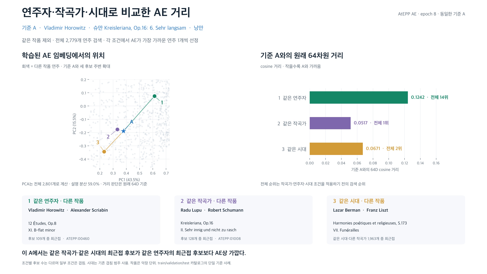

# 같은 A에서 연주자·작곡가·시대 조건별 AE 최근접 비교



A는 기존과 동일한 Horowitz의 슈만 《Kreisleriana》 6번 (`ATEPP:00957`)이다.
앞서 고정한 epoch 8 체크포인트 및 2,801개 녹음의 전체 full-window pooled 64D 임베딩을 그대로 재사용했다.
재학습·체크포인트 재선정·feature 기반 후보 선정은 하지 않았다.

같은 작품을 제외한 전체 2,779개를 먼저 검색하고 세 조건에서 각각 cosine 거리 최소 후보를 골랐다.

| 조건 | 연주자 | 작곡가 | 전체 순위 | AE cosine 거리 | 조건 후보 수 |
|---|---|---|---:|---:|---:|
| 같은 연주자 | Vladimir Horowitz | Alexander Scriabin | 14 | 0.1242 | 109 |
| 같은 작곡가 | Radu Lupu | Robert Schumann | 1 | 0.0517 | 128 |
| 같은 시대 | Lazar Berman | Franz Liszt | 2 | 0.0671 | 1963 |

같은 연주자는 artist_id로 판단하며 다른 작곡가도 허용한다. 같은 작곡가는 연주자를 제한하지 않는다.
같은 시대 조건은 이전 그림처럼 작곡가는 다르게 하되 기존 시대 범주가 하나 이상 겹쳐야 한다.
일부 후보는 조건 여러 개에 속할 수 있다. 선택한 세 녹음은 서로 다르다.
전체 후보 수와 조건부 후보 수가 다르므로 각 그룹의 최소 거리를 이용해 메타데이터 영향의 크기를 인과적으로 비교할 수는 없다.

왼쪽 PCA는 전체 2,801개 AE 벡터로 한 번 계산했다. A의 벡터는 앞 그림의 원본을 그대로 사용한다.
설명 분산은 59.0%이며 A와 세 후보 주변을 확대했다. 회색 배경은 같은 작품을 제외한 후보들이다.
배경 중 확대 범위 밖의 점은 보이지 않는다. 세 후보만으로 PCA를 다시 학습하지 않았다.
오른쪽 거리와 전체 순위는 투영 전 원래 64차원 기준이다.

이 기준 A에서는 같은 작곡가·같은 시대의 최근접 후보가 같은 연주자의 최근접 후보보다 AE상 가깝다.
단일 기준 사례이며 전체 데이터의 경향이나 청취 유사성 검증은 아니다.
기존 work_id는 악장 단위여서 같은 작곡가 후보는 《Kreisleriana》의 다른 악장(2번)이다.
train/validation/test를 합친 카탈로그 검색이며 독립적인 heldout 성능 평가가 아니다.
시대 분류는 앞선 cross_work_checkpoint/protocol.json과 동일하며 베토벤 등은 겹치는 범주를 허용한다.

검증: 모든 2,779개 저장 거리를 원본 벡터로 재계산, 전체 순위 정렬과 조건별 최소값,
선정 3개 벡터의 scalar dot product, 같은 A·체크포인트 hash를 확인했다.

PNG / SVG / PDF는 ae_metadata_comparison 이름으로 저장했다. selected.csv는 선택된 후보와
연주자·작곡가·시대 일치 여부, projection.npz는 좌표·선택 벡터, provenance.json은 입력과 검증을 담는다.

```sh
capstone-2026-2-classicfy/.venv/bin/python presentation/create_ae_metadata_comparison.py
```
