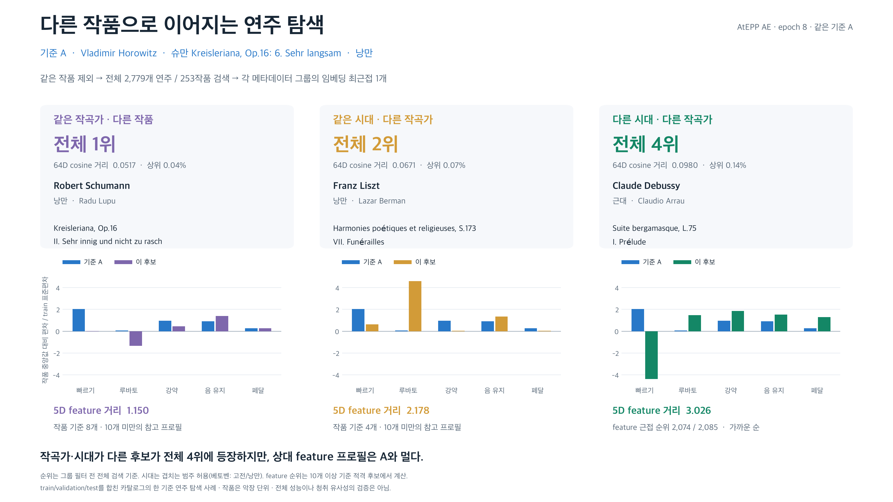

# 메타데이터 조건과 별개로 다른 작품을 검색하는 단일 기준 사례



## 검색 범위

앞 그림과 정확히 같은 A(Horowitz `ATEPP:00957`, 슈만 《Kreisleriana》 6번) 및 epoch 8 snapshot을 사용했다.
검증 후 적격 AtEPP 2,801개 녹음의 모든 67,542 full 8마디를 CPU에서 추론했다.
원본 AtEPP 전체가 아닌, 현재 전처리와 모델 입력이 준비된 corpus 전체다.
동일 work_id와 동일 recording_id를 제외한 **2,779개 연주 / 253작품**을
작곡가·시대·feature 조건 없이 64D cosine 거리순으로 먼저 정렬했다.
그 뒤 각 메타데이터 그룹에서 처음 등장하는 후보를 선택했다. 세 후보 모두 그룹의 실제 임베딩 최근접이며
feature가 더 잘 맞는 후보로 교체하지 않았다. 동률은 performance_id 순이다.

| 그룹 | 연주 | 전체 순위 | 64D 거리 | 5D 거리 | feature 근접 순위 |
|---|---|---:|---:|---:|---:|
| 같은 작곡가 · 다른 작품 | Robert Schumann · Radu Lupu · ATEPP:01008 | 1 | 0.0517 | 1.150 | 참고 프로필 n=8 |
| 같은 시대 · 다른 작곡가 | Franz Liszt · Lazar Berman · ATEPP:00315 | 2 | 0.0671 | 2.178 | 참고 프로필 n=4 |
| 다른 시대 · 다른 작곡가 | Claude Debussy · Claudio Arrau · ATEPP:03082 | 4 | 0.0980 | 3.026 | 2074/2085 |

**작곡가·시대가 다른 후보가 전체 4위에 등장하지만, 상대 feature 프로필은 A와 멀다.**

## 계산과 분류

- 구간 unit e를 전곡의 모든 full 8마디에 대해 균등 평균하고 L2 정규화했다. tail은 제외한다.
- 검색 A는 앞 그림에 저장된 원래 벡터를 그대로 사용했다. batch 크기를 바꾼 재추론과도 오차 2e-6 이내에서 일치했다.
- 5D는 앞 그림과 동일한 전곡 feature 정의·작품/악보/반복 경로 중앙값·train residual SD를 재사용했다.
  네 연주의 현재 run02 R에서 summary를 재계산했다. 기존 적격 프로필인 A와 드뷔시 후보는 앞 그림의 run01 값과 일치했다.
  슈만 2번과 리스트 후보는 기준 녹음이 각각 8개와 4개여서 기존 10개 이상 적격 프로필에는 없다.
  이 둘은 동일한 summary·cohort 중앙값·train scale 공식으로 참고 프로필을 계산하고 그림에 표본 수를 명시했다.
  검색 후보를 다른 연주로 교체하거나 기존 적격 기준을 변경하지 않았다.
- feature 순위는 상대 프로필 적격 **2,085개 다른 작품 연주**에서 계산한다.
  전체 임베딩 검색 분모와 다르다. 표본 10개 미만인 두 참고 프로필에는 근접 순위를 부여하지 않았다.
  feature 거리와 64D 거리는 서로 다른 단위다.
- 시대는 설명용의 거친 작곡가 범주이며 corpus에 원래 있던 필드가 아니다. 겹치는 범주를 허용한다.
  베토벤·슈베르트는 고전/낭만, 라흐마니노프·스크랴빈은 낭만/근대로 처리했다.
  슈만의 낭만 범주와 하나라도 겹치면 같은 시대 그룹에 넣는다. 베토벤을 다른 시대로 세어 주장을 유리하게 만들지 않았다.
  매핑은 임베딩 추론 전에 protocol.json에 고정했다.
- 시대 구분 참고: [음악 시대 교육 자료](https://www.classicsforkids.com/musical-genres/),
  [Eastman: 베토벤의 과도기적 위치](https://www.esm.rochester.edu/beethoven/transitional-composer-and-heroic-objective/).
  겹침을 허용하는 구현은 이 사례의 명시적 분류 관례다.

## 해석 범위

이는 한 A가 전체 카탈로그를 검색하는 사례다. train/validation/test를 모두 포함하며 독립적인 heldout 성능 평가가 아니다.
각 split의 후보 수는 {'train': 2070, 'validation': 314, 'test': 395}다. A는 test 작품이다.
기존 work_id는 악장 단위이므로 《Kreisleriana》 다른 악장도 다른 작품 후보로 남긴다.
다른 시대 상위 후보가 나온 것만으로 음악적 유사성이나 metadata 영향의 제거를 증명하지 않는다.
프로필 순위는 별도의 수치적 비교이며 사람의 청취 판단은 검증하지 않았다.
figure의 '상위' 결론은 임베딩 순위 상위 10%, 프로필 가까움은 feature 순위 상위 20%라는
설명용 기준으로 작성했다. 순위·거리 원값을 함께 표시하며 유의성 검정이나 사전 등록한 성능 기준이 아니다.

## 산출물 / 재현

PNG / SVG / PDF: cross_work_checkpoint. 같은 이름의 확장자로 저장했다.
all_ranked_candidates.csv는 A와 전체 검색 순위, selected.csv는 선정된 연주와 5D 값이다.
catalogue_embeddings.npz에는 전체 2,801개 벡터, chunks/에는 재개 가능한 구간 캐시가 있다.
retrieval.json에 순위·후보수·검증, protocol.json에 입력 hash·시대 분류를 보존했다.

```sh
capstone-2026-2-classicfy/.venv/bin/python presentation/create_cross_work_checkpoint_figure.py
```
앞 그림의 checkpoint.pt를 사용하므로 진행 중인 학습의 best.pt가 갱신되어도 같은 모델을 유지한다.
