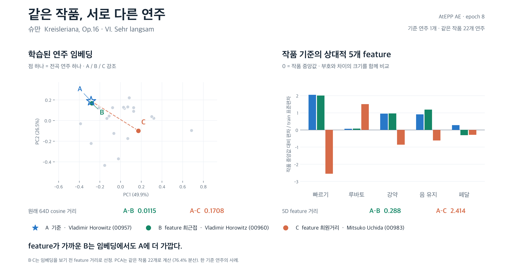

# 같은 작품의 연주 차이: 전체 적격 AtEPP 학습 중간 체크포인트



PNG / SVG / PDF를 같은 이름으로 저장했다. 기준 A는 이전 사례의 Horowitz `ATEPP:00957`로 고정했다.
같은 작품·악보·반복 경로의 적격 22개 녹음을 모두 표시한다. B는 5D feature 최근접, C는 최원거리이며
선정 결과를 `selection.json`에 기록한 다음 모델을 읽었다. 임베딩 결과에 맞춰 사례나 B/C를 바꾸지 않았다.

전체 적격 AtEPP 2,801개 녹음 / 254작품 중 train 2,070개 / 185작품으로 학습 중인 모델의
**epoch 8 best validation 체크포인트**를 별도로 복사해 CPU에서 이 작품만 추론했다.
학습은 중단하거나 수정하지 않았다. 원본 전체 AtEPP가 모두 학습에 쓰였다는 의미는 아니다.
`checkpoint.pt`를 고정하므로 이후 학습이 진행되어도 재실행 결과를 유지한다.

| 대상 | 연주자 · ID | feature 거리 | 64D cosine 거리 |
|---|---|---:|---:|
| A | Vladimir Horowitz · ATEPP:00957 | 0.000 | 0.0000 |
| B | Vladimir Horowitz · ATEPP:00960 | 0.288 | 0.0115 |
| C | Mitsuko Uchida · ATEPP:00983 | 2.414 | 0.1708 |

거리 순서 일치: **True**. 왼쪽 PCA는 22개 전부로 계산했고 설명 분산은 76.4%다.
판단은 2D 점 간격 대신 원래 64D cosine 거리를 사용한다. 오른쪽 막대는 부호 있는 상대 프로필이다.
프로필 정의와 train 스케일은 기존 `diagnostics/work_relative_5d/run01`과 같다. 0은 작품 cohort 중앙값이며,
작품별 SD로 다시 나누지 않았다. 5D 거리는 다섯 축 차이의 RMS다. 페달은 발음 시점 sustain 깊이만 나타낸다.

각 녹음의 full 8마디 unit `e`를 균등 평균한 뒤 L2 정규화했다. feature는 전곡 요약이라 마지막 tail의
포함 범위가 다르다. 이 그림은 기준 연주 하나의 표현 차이 사례이며, 전수 성능·청취 유사성·연주별 군집 분리의
검증 결과가 아니다. 다른 작품 탐색 주장은 별도 사례가 필요하다.

검증: 체크포인트와 corpus 계약·입력 tensor hash, 22개 원본 R hash와 feature 재계산 일치,
고유 녹음·동일 cohort, 모든 full window 사용, pooled 벡터 단위 길이, B/C feature 최소·최대 여부.

재현:
```sh
capstone-2026-2-classicfy/.venv/bin/python presentation/create_checkpoint_same_work_figure.py
```
새 체크포인트는 `--checkpoint PATH --out NEW_DIRECTORY`로 지정한다. `performances.csv`에는 전체 후보와
거리·feature·PCA 좌표, `example.npz`에는 원래 벡터, `window_embeddings.npz`에는 구간 벡터가 있다.
`provenance.json`에는 체크포인트 hash·epoch·검증·제약을 기록했다.
