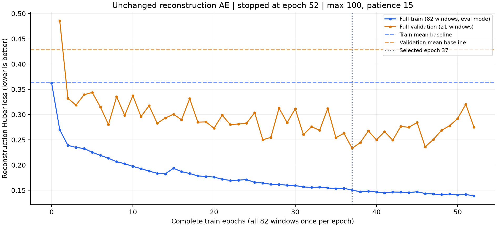

# 전체 순회 복원 전용 AE

기존 ScoreEncoder/AE 구조, 복원 Huber loss, optimizer/lr/scaler/seed를 유지하고 처음부터 학습했다. Triplet과 평균 보조 head/loss는 사용하지 않았다.

## 실행 전 고정한 조건

- 최대 100회 전체 순회, batch size 4, seed 2026, 학습/validation 배치 수 제한 0.
- Validation 복원 loss가 유의미한 최저값보다 0.0001 초과 개선되지 않는 상태가 15회 연속이면 종료.
- patience와 별개로 실제 최저 validation loss의 checkpoint를 선택. Test는 선택 파일을 저장한 뒤 한 checkpoint에서 한 번만 평가.
- 같은 수정된 데이터와 work split, train 82구간/30연주/7작품, validation 21구간, test 27구간. 전체 ATEPP 데이터셋을 사용한 실험은 아니다.

## 실제 학습량과 커버리지

- 종료: **52회 전체 순회**, 사유 `validation_early_stopping`.
- 선택 모델: epoch **37**, **777** update, **3034**개 구간 노출.
- 전체 실행: **1092** update, **4264**개 구간 노출.
- 모든 epoch에서 82개 ID가 정확히 한 번씩 학습됐다. 매회 21개 배치(4개짜리 20개 + 2개짜리 1개), skip 0. Epoch별 원본 ID/count는 reconstruction/training.json에 있다.

## 선택 모델과 동일한 평가 방식의 평균값 baseline

| Split | 평균값 baseline | AE | 개선율 |
|---|---:|---:|---:|
| train | 0.364063 | 0.150417 | +58.68% |
| validation | 0.428355 | 0.233292 | +45.54% |
| test | 0.278185 | 0.236512 | +14.98% |

모두 eval 모드로 전체 split을 읽었다. 같은 scaler/mask, beat당 한 번, 묶음 및 구간 균등 평균의 동일 복원 loss다. Baseline은 표준화 R=0(학습 채널별 평균)이다.

## Test feature별 복원 loss

| Feature | 평균값 baseline | AE | 개선율 |
|---|---:|---:|---:|
| tempo | 0.074833 | 0.049496 | +33.86% |
| onset | 0.178412 | 0.179302 | -0.50% |
| velocity | 0.194118 | 0.126283 | +34.94% |
| articulation | 0.553489 | 0.505887 | +8.60% |
| pedal | 0.390076 | 0.321594 | +17.56% |

## Test 실제 단위 오차

| 항목 | 평균값 baseline | AE |
|---|---:|---:|
| Tempo 상대 MAE (%) | 18.786695 | 15.783417 |
| Onset 편차 MAE (ms) | 19.954411 | 21.118182 |
| Velocity MAE | 7.757336 | 6.044542 |
| Articulation 상대 MAE (%) | 181.100063 | 114.300411 |



Validation 선택 기록은 validation_selection.json, 상세 평가와 한계는 summary.json, 전체 학습 로그는 reconstruction/training.json, 숫자 곡선은 curves.csv에 있다. 원본 R와 코드 해시는 실행 전후 동일함을 검증했다.

한 seed, train 7작품/test 2작품, 자동 정렬의 제한이 있다. 조기 종료는 validation 기준이며 train 수렴을 증명하지 않는다. 과거에 확인한 test split을 재사용하므로 새 독립 평가셋으로 간주할 수 없다. 이번 실행의 test 값으로 설정을 변경하거나 재시작하지 않았다.

## 저장소에서 실행

[실행 설정](../../configs/note_ae_full_reconstruction.json)을 사용한다. 별도로 준비한 동일 split의 window manifest를 지정한다.

```sh
.venv/bin/python scripts/train_note_autoencoder.py train --windows /path/to/windows.json --config configs/note_ae_full_reconstruction.json --out runs/note-ae-full
```

이 폴더는 평가 요약과 곡선만 보관한다. 원본 데이터, R 캐시, checkpoint와 전체 실행 로그는 workspace의 `diagnostics/full_epoch_reconstruction/run01/`에 보존한다. 고정 scaler와 정확한 실행 프로토콜도 해당 실행 폴더의 `protocol.json`에 있다.
