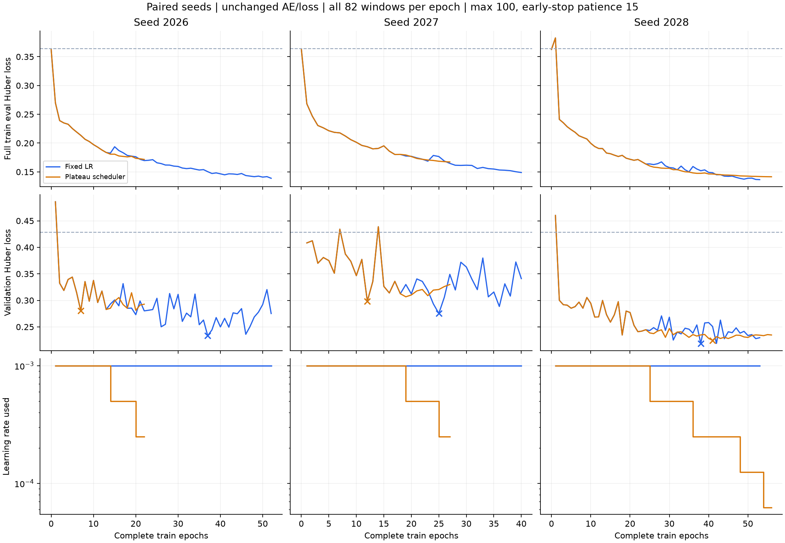

# 고정 LR / validation plateau scheduler 비교

기존 복원 전용 AE의 구조·loss·optimizer·초기 LR·데이터·scaler를 유지했다. 같은 seed 2026/2027/2028에서 고정 LR과 ReduceLROnPlateau를 짝지어 비교했다.

## 실행 전에 고정한 조건

- 모든 epoch에서 train 82개 ID를 정확히 한 번씩 사용했다(21개 배치, 마지막 2개 포함).
- 각 실행 최대 100 epoch, validation early stopping patience=15 / min_delta=0.0001.
- Scheduler: mode=min, factor=.5, patience=5, threshold=.0001, threshold_mode=abs, min_lr=.00001. Validation 후 호출하며 다음 epoch에 적용.
- LR 감소 때 early stopping counter를 초기화하지 않았다. 두 설정의 학습 예산과 종료 기준은 같다.
- 각 seed의 최소 validation 복원 loss checkpoint를 선택하고, 3개 seed의 평균으로 설정을 비교했다. Scheduler 평균이 0.0001 이상 낮을 때만 채택하고 그 외에는 기존 설정을 유지하도록 사전 결정했다.
- Test는 6개 학습과 설정 선택이 끝난 뒤, 선호 설정의 고정된 3개 seed만 평가했다. Seed를 추가 선택하거나 test를 보고 설정을 변경하지 않았다.

## Validation 결과

| 설정 | 평균 최소 validation loss | Seed 간 표본 표준편차 |
|---|---:|---:|
| baseline | 0.242438 | 0.029457 |
| plateau | 0.267729 | 0.038497 |

| Seed | 고정 LR | Scheduler | Scheduler − 고정 LR |
|---|---:|---:|---:|
| 2026 | 0.233292 | 0.280209 | +0.046917 |
| 2027 | 0.275383 | 0.298438 | +0.023054 |
| 2028 | 0.218640 | 0.224540 | +0.005899 |

사전 선택 기준의 선호 설정: **baseline**. Scheduler가 더 낮은 seed는 **0/3**이다. 표준편차는 seed 변동이며 신뢰구간이나 데이터 분할에 대한 불확실성 추정치가 아니다.

## 실제 학습량 및 LR 감소

| 설정 | Seed | 선택 epoch | 종료 epoch | LR 감소 epoch | 마지막 LR |
|---|---:|---:|---:|---|---:|
| baseline | 2026 | 37 | 52 | 없음 | 0.001 |
| baseline | 2027 | 25 | 40 | 없음 | 0.001 |
| baseline | 2028 | 38 | 53 | 없음 | 0.001 |
| plateau | 2026 | 7 | 22 | 13, 19 | 0.00025 |
| plateau | 2027 | 12 | 27 | 18, 24 | 0.00025 |
| plateau | 2028 | 41 | 56 | 24, 35, 47, 53 | 6.25e-05 |

각 seed 쌍은 첫 LR 변경 전까지 train/validation loss가 일치했다. Seed 2026의 고정 LR 모델은 이전 전체 순회 실험의 마지막 가중치와 정확히 일치했다. 모든 epoch의 82개 구간 단일 노출을 검사했다.

## Validation feature별 복원 loss

| Feature | 고정 LR 평균 | Scheduler 평균 |
|---|---:|---:|
| tempo | 0.176405 | 0.218437 |
| onset | 0.186309 | 0.188549 |
| velocity | 0.164754 | 0.172645 |
| articulation | 0.329065 | 0.390388 |
| pedal | 0.355659 | 0.368625 |

## 선택한 설정의 최종 Test 확인

| Seed | AE 복원 loss | 평균값 baseline |
|---|---:|---:|
| 2026 | 0.236512 | 0.278185 |
| 2027 | 0.267828 | 0.278185 |
| 2028 | 0.245226 | 0.278185 |

선호 설정의 Test loss: **0.249855 ± 0.016163** (seed 평균 ± 표본 표준편차). 고정 평균값 baseline은 **0.278185**이다.

두 설정의 Test를 짝지어 비교한 실험은 아니다. 설정 간 효과 판단은 위의 validation 비교를 사용한다. Test 결과로 선호 설정을 뒤집거나 새 hyperparameter를 탐색하지 않았다.

한 split/3 seed, train 7작품·test 2작품, 자동 정렬이라는 제한이 있다. 과거에 확인했던 test split을 재사용했다. 현재 결과를 다른 작품·판본·데이터셋에서의 개선 보장으로 해석할 수 없다.

상세 수치는 summary.json, 학습 곡선 숫자는 curves.csv, 사전 설정은 protocol.json이다. 원본 R·코드 해시가 실행 중 유지됐음을 확인했다. Checkpoint와 전체 epoch별 ID·scheduler 상태는 workspace의 diagnostics/plateau_multiseed/run01/에 보관한다.
