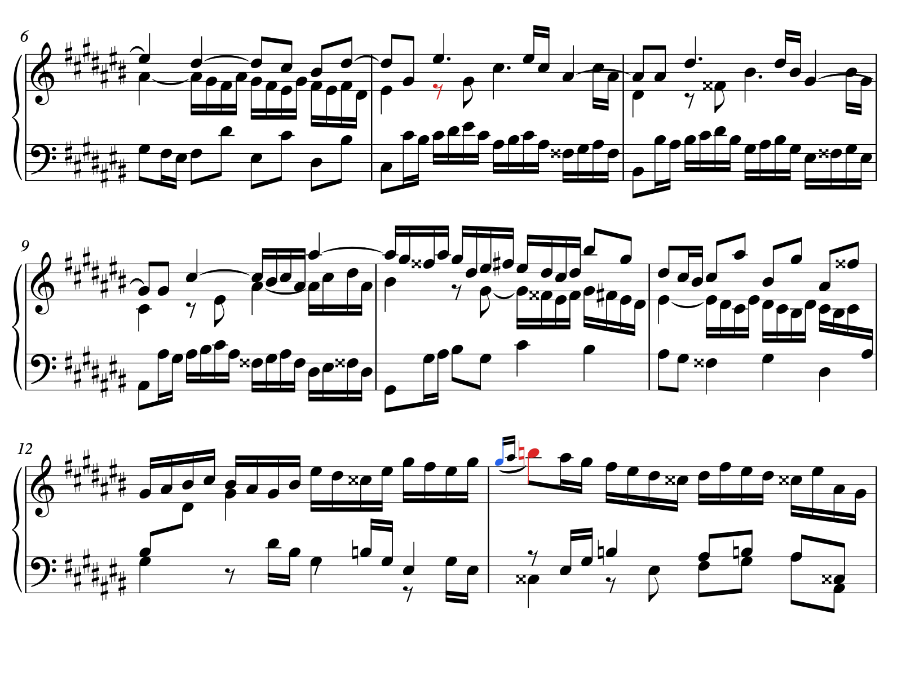
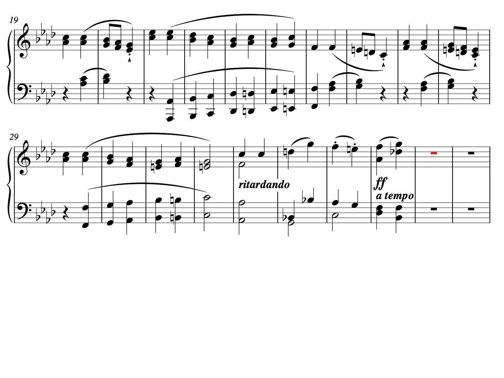

# 악보 기반 프레이즈 경계 후보와 첫 검수

2026-10-13, `feat/#16-structure-conditioned-style-embedding`.

쓰인 악보에서 slur·쉼·종결형 화음 진행 등의 **경계 근거**를 추출하고, 실제 악보에서
그 근거가 어느 성부와 어느 크기의 묶음에 해당하는지 확인하는 첫 baseline이다.
55개 악보의 후보 생성, 고정 3작품·20연주의 원래 beat 연결, 검수용 악보와 계산 검증을 완료했다.
18,044개는 기호에서 생성한 후보 수다. 실제 프레이즈 수 또는 프레이즈 인식 정확도가 아니다.
확정한 프레이즈와 임베딩에 활성화한 경계는 현재 모두 0개다.

## 결과

| 항목 | 결과 |
|---|---:|
| 기존 고정 대상의 악보/grid | 55개 |
| 경계 후보 / 개별 근거 | 18,044 / 19,543개 |
| pilot 작품 / 연결 연주 | 3 / 20개 |
| pilot 후보→연주 내 방문 위치 | 3,645행 |
| 원래 interval 경계 / interval 내부 / grid 밖 | 3,205 / 355 / 85행 |
| 악보 시각 검수 | 14항목, 서로 다른 작품·위치 12곳, 악보 7페이지 |
| 확정 프레이즈 / 활성 임베딩 경계 | 0 / 0개 |

| 고정 pilot | 연주 수 | 경계 후보 | 양의 onset 길이로 짝지은 slur |
|---|---:|---:|---:|
| Bach Fugue BWV 848 | 9 | 93 | 0 |
| Beethoven Sonata 31-2 | 6 | 158 | 69 |
| Mozart Sonata 8-1 | 5 | 294 | 57 |

세 작품과 검수 선정 규칙은 feature·임베딩 거리를 보기 전에 고정했다. 근거 종류별 첫 후보와
처리할 수 없는 첫 slur를 선정했다. 전체 대표성이나 성공률을 추정하는 표본은 아니다.
Bach의 slur 1개는 꾸밈음에서 본음으로 이어지며 두 XML onset이 같아 별도 진단으로 보존했다.
pilot slur 그룹 127개 중 양의 onset 길이 쌍은 126개다.

## 생성 규칙과 해석 범위

- slur는 XML 문서 순서의 `part + number`로 연결한다. 성부·보표를 건너는 slur를 보존하며,
  중복 start나 짝 없는 stop을 가장 가까운 음으로 임의 연결하지 않는다. 끝 음의 표기 종료 위치를
  후보로 저장하고, 그 음의 시작 위치와 slur 양끝 원본 ID를 함께 남긴다.
- 동일 성부에 표기된 1/2 quarter 이상의 쉼을 찾는다. 같은 성부의 유지음과 겹치면 제외한다.
  성부 진입·퇴장 전후의 쉼, 내부 쉼, 모든 part의 표기상 쉼을 구분한다.
- fermata·breath mark·caesura와 구분선도 저장한다. 반복·ending은 이동 경계 근거이며
  프레이즈 근거로 바로 확정하지 않는다.
- 종결형 화음 힌트는 악보의 수직 음 집합에서 완전한 장3화음 V와 장/단3화음 I,
  근음 베이스 5→1, 도착의 마디 첫 위치 또는 긴 표기 음가를 확인한다. 다른 음이 더 있을 수 있다.
  반종지·전위·전조·비화성음 환원이나 문장 끝 판단은 구현하지 않았다.
- XML mode가 없으면 조표의 장조·단조 가설을 이름과 함께 남긴다. 전곡 조성이나 국소 조성을
  확정하지 않는다. 도착음이 앞 문장 끝과 다음 문장 시작을 겸할 수 있어, 화음 도착 onset부터
  도착음의 마지막 표기 offset까지 경계 위치의 불확실성 범위로 저장한다.
- `review_priority`는 겹치는 근거 종류로 정한 검수 순서다. 정답 확률이나 음악적 신뢰도가 아니다.

후보 생성은 악보 음·기호·조표만 사용한다. 연주 feature나 검색 결과로 경계를 선택하지 않는다.
좌표 단위는 정확한 `Fraction`의 **4분음표 길이(quarter)**이며 ASAP beat 번호와 다르다.
scope의 staff/voice는 악보의 편집상 구분이다. 자동으로 주선율 역할을 부여하지 않는다.

## 악보에서 확인한 내용

[색으로 표시한 악보 전체](score_review.html)를 브라우저에서 연다. 파랑은 시작/단일 근거,
빨강은 해당 사례의 마지막 근거 음이다. 색은 정답 경계 표시가 아니다.
원본 XML을 직접 조판한 PNG/SVG이며 원본의 제목·출처 표기를 유지한다.

| 사례 | 시각 검수 결과 | 다음 판단 |
|---|---|---|
| Bach case_01, Beethoven case_05, Mozart case_10 | 한 성부의 쉼 동안 다른 성부는 계속된다 | 성부별 국소 근거로 보존 |
| Bach case_04 | 장식음→본음의 짧은 slur, XML onset 동일 | 표기는 보존하고 프레이즈 길이로 사용하지 않음 |
| Beethoven case_06, Mozart case_11 | legato 묶음과 짧은 두 음 동기가 보인다 | articulation·작은 묶음과 큰 프레이즈 계층 구분 필요 |
| Beethoven case_07, Mozart case_12 | 모든 보표의 쉼과 뒤 구간의 재시작이 보인다 | 큰 구분 후보로 보존, 계층 검토 필요 |
| Bach case_02·03, Beethoven case_08·09 | 같은 위치에 화음 도착과 별도 기호가 겹친다 | 중복 위치를 독립 프레이즈로 세지 않음 |
| Mozart case_13 | 화음 도착에서 도입 동기도 시작한다 | q32–33 범위에서 끝/시작의 경계 배치 검토 |
| Mozart case_14 | 짧은 slur와 쉼이 겹치지만 다른 성부는 이어진다 | 근거가 두 종류여도 전곡 경계로 확정하지 않음 |

개별 위치·scope·관찰·후속 판단·본 PNG 해시는 [review_decisions.csv](review_decisions.csv)에 있다.
이는 Codex의 기호·성부·문맥 시각 검수이며 전문가 프레이즈 정답 annotation이 아니다.
`review_cases.csv`와 원래 후보 JSON의 pending 상태는 생성 당시 기록으로 유지하고,
검수 overlay를 별도 저장했다. 시각 검수를 완료했다는 것과 음악적 프레이즈를 확정했다는 것을 구분한다.

## 원래 beat와 연결

각 후보를 그 기호가 속한 쓰인 마디의 **방문별** 위치로 변환하고 원래 edge/interval index를 저장했다.
Beethoven의 쓰인 q4 slur 끝은 반복 방문에서 원래 edge 4와 20에 각각 연결된다.
연주 간 같은 beat 위치를 대응시키거나 원래 index를 압축하지 않는다.
grid 안의 후보도 pending이므로 현재 `eligible_for_embedding=False`다.
85개 grid 밖의 위치를 안쪽 경계로 강제 이동하지 않는다.
Bach의 마지막 화음/fermata 후보 q220은 feature grid 마지막 q218 밖인 사례다.

`phrase_position(start, stop, q)`는 **명시적으로 제공한 구간**에 대한 상대 위치와 start/middle/end
3분할을 반환한다. 현재 후보 사이를 자동으로 문장으로 연결하거나 계층을 추정하지 않는다.
확인한 문장의 시작·끝과 역할을 정한 뒤 이 구간 안에서 연주 반응을 추출하는 단계가 남아 있다.

## 검증

- 신규 합성 단위 테스트 14개, 실제 pilot 통합 테스트 3개: 통과, skip 0.
- 재사용 MusicXML 로더 14개·마디 연결 9개: 통과, skip 0. 관련 합계 40개이며 전체 suite 결과와 구분한다.
- [독립 검산](verification.json): 원본 XML을 별도 파서로 읽고, slur·쉼·화음 집합과 베이스,
  키 가설 및 원래 MIDI/annotation 좌표를 재계산했다. 55악보의 18,044후보·19,543근거,
  pilot 연결 3,645행의 수치 98,211개가 일치했다. 최대 오차 0.
- 입력·생성 코드·산출물 SHA-256은 [provenance.json](provenance.json), 조건은 [protocol.json](protocol.json)에 있다.
  검산 도구는 생성 함수와 XML/bridge 로더를 호출하지 않는다.
- `pretty_midi`의 non-zero track 메타 이벤트 경고가 있었다. 검사에서 사용하는 원래 위치는
  tempo map과 raw tick/PPQ를 대조했으며 이 경고를 음악적 정답 검증으로 해석하지 않는다.

이 검증은 규칙의 구현·좌표 계산이 재현된다는 증거다. 후보가 실제 음악적 문장인지,
구조 보강 임베딩이 기존 검색보다 유용한지는 후속 평가다.

## 산출물과 이어가기

- [작품별 집계](works.csv), [slur 그룹](slur_groups.csv), [방문별 경계 연결](boundary_occurrences.csv),
  [마디 방문](pilot_measure_visits.csv), [검수 요약](review_summary.json).
- [전체 55악보 후보 JSONL 압축 데이터](all_scores/all_scores.jsonl.gz),
  [Bach JSON](bwv_848_Bach_candidates.json), [Beethoven JSON](31-2_Beethoven_candidates.json),
  [Mozart JSON](8-1_Mozart_candidates.json).
- [다른 기기에서 이어가기 및 재현 명령](HANDOFF.md).

## 규칙을 정할 때 참고한 자료

slur의 start/stop/continue와 겹치는 번호는 [MusicXML 공식 명세](https://www.w3.org/2021/06/musicxml40/musicxml-reference/elements/slur/)에 따라 보존했다.
국소 경계는 여러 단서를 검토할 문제라는 점은 [ISMIR 2020의 경계 검출 연구](https://archives.ismir.net/ismir2020/paper/000226.pdf)를 참고했다.
V–I 화음 이동만으로 문장 끝을 확정할 수 없다는 해석은 [Open Music Theory의 cadence 설명](https://viva.pressbooks.pub/openmusictheory/chapter/intro-to-harmony/)을 참고했다.
여기의 규칙·가설·검수 우선순위는 자체 baseline이며 해당 연구의 알고리즘이나 정답 annotation을 재현한 것은 아니다.
