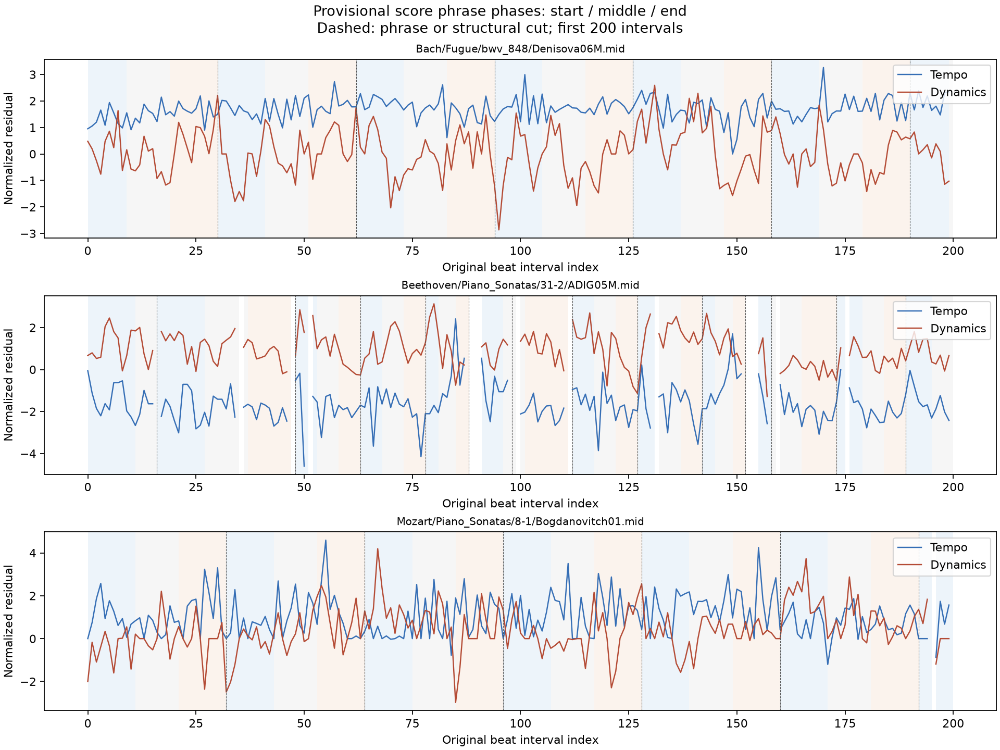
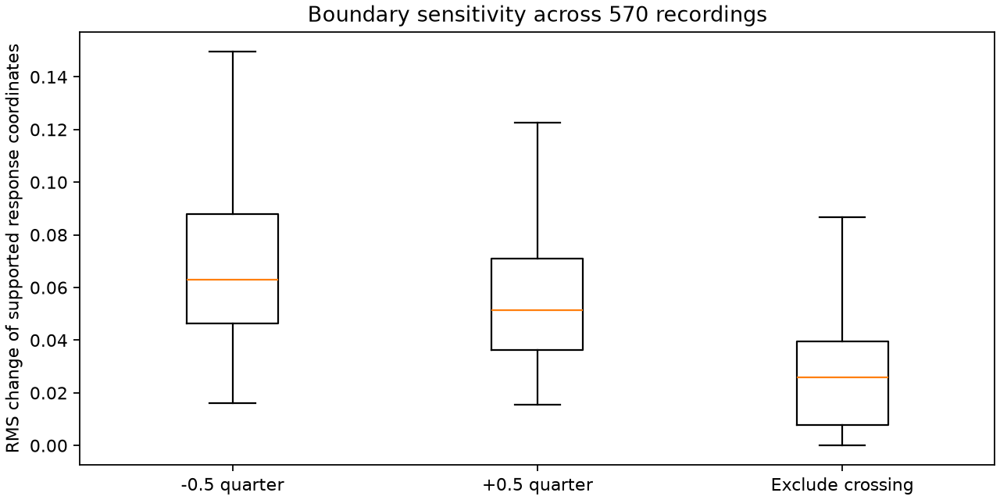

# 프레이즈 가설 안에서의 연주 반응

2026-10-14. 고정 55악보·570연주에서 악보만으로 구간 가설을 만들고,
원래 beat의 7채널 잔차가 시작·중간·끝에서 어떻게 달라지는지 계산했다.
**1,814개는 분석용 구간 가설이며 전문가가 확정한 프레이즈가 아니다.**
기존 후보 JSON의 pending/임베딩 활성 상태는 바꾸지 않았다.

| 항목 | 결과 |
|---|---:|
| 악보 / 연주 | 55 / 570 |
| 구간 가설 | 1,814 |
| 원래 beat interval | 287,885 |
| 구조·feature 공통 유효 interval | 268,606 |
| 유효 interval의 구간 상대 위치 연결 | 268,606 |
| 전곡 66D 반응을 계산한 연주 | 570 |
| 전문가 확정 프레이즈 | 0 |

## 구간 정의

첫 printed part를 기준으로 모든 보표의 쉼, fermata, 같은 scope에서 4 quarter 이상인
slur의 도착 onset을 경계 제안으로 쓴다. 짧은 제안은 건너뛰어 최소 간격 4 quarter를 유지하고,
32 quarter보다 긴 간격은 `fixed_length_cap`으로 명시해 나눈다. 마지막 짧은 구간은 보존한다.
계층·주선율 역할·국소 종지를 확정하지 않는다. scope별 slur 끝을 part 구간화에 사용하는 것은
실험용 가설이며, 성부 하나의 articulation을 전곡의 음악적 문장으로 인증한 것이 아니다.
첫 part에 대한 문맥에서 **연주 전체의 feature 반응**을 읽는다. 성부별 연주 feature가 아니다.

종료 근거는 cap 477, 악보 끝 55, 전 보표 쉼 461, fermata 59, 긴 동일 scope slur 766이다.
여러 근거가 같은 위치에 겹칠 수 있으므로 근거 수는 구간 수와 다르다.
특히 Bach처럼 slur 근거가 적은 작품은 고정 길이 fallback의 영향이 크다.
이 한계를 고정 구간 대조와 구조 대응 섞기로 후속 비교한다.

## 좌표와 측정치

기존 검증된 마디 bridge의 쓰인 quarter 위치에 interval 중점을 배정한다.
반복 방문은 원래 index에서 구분하며, 경계를 가장 가까운 beat로 옮기지 않는다.
상대 위치를 세 등분해 시작·중간·끝으로 나눈다. bin마다 다음 22개를 계산한다.

- 7채널 평균 잔차: 기존 작품 공통 반응 대비 연주 차이.
- 7채널의 인접 변화 평균과 변화 RMS: 원래 beat interval 사이 변화이며 초당 변화율이 아니다.
- Tempo·Dynamics 변화량 곱의 평균: 공동 변화 모멘트이며 상관계수가 아니다.

유효 beat 8개·유효 pair 4개 미만인 bin은 해당 좌표를 NaN으로 남긴다.
결측·미검증·반복/ending·좌표 점프·bR 주변·다른 가설·다른 bin은 pair를 끊는다.
검색/평가용 A/B는 완전한 64-original-beat 블록을 번갈아 사용하며 끝의 짧은 블록을 버린다.
두 view 사이에는 beat가 겹치지 않고 블록을 가로지르는 차분도 없다.
같은 악보 문맥이나 반복된 동일 구간이 양쪽에 나타날 수 있으므로 새로운 작품에 대한 평가가 아니다.

## 경계 민감도

내부 경계를 ±0.5 quarter 옮긴 결과와 경계를 가로지르는 interval을 제외한 결과를 계산했다.
66D 중 양쪽에서 지원되는 좌표의 RMS 차이는 아래와 같다. 다른 scale의 좌표가 섞인
원시 반응 좌표 차이이므로 검색 점수·오차율·유용성 판정으로 해석하지 않는다.

| 조건 | 중앙값 | 95백분위 |
|---|---:|---:|
| −0.5 quarter | 0.06305 | 0.13551 |
| +0.5 quarter | 0.05139 | 0.10625 |
| 경계를 가로지르는 interval 제외 | 0.02586 | 0.06939 |





## 재현과 검증

원본 raw cache `feature_normalization_raw.npz`는 이전 실험 입력 SHA와 일치한다.
이 기기에 없는 중간 collector commit을 대체하기 위해 원본 `20a4168`을 git archive로
별도 프로세스에서 실행하고 `temporal_embedding_run01/dataset.json`의 모든 scale 및 기존
source provenance와 일치를 요구한다. 구조에 맞춰 공통값이나 scale을 새로 fit하지 않는다.
독립 검산은 이전 전체 연결 보고서의 **570개 feature digest 모두**와 유효 interval 수를 대조한다.
원본 XML의 마디 시작, 관측 방문을 통한 quarter 투영, phase 배정 및 scalar 반응 산술을 확인한다.
관측 downbeat 길이가 XML encoded extent와 항상 같다는 가정은 하지 않는다.
반복 경로 자체의 정확성은 기존 bridge의 독립 검증을 재사용한다.

```bash
MPLCONFIGDIR=/tmp/classicfy-matplotlib .venv/bin/python \
  classicfy-ai/scripts/calculate_phrase_response.py \
  --out /tmp/phrase-new --artifacts /tmp/phrase-arrays-new
.venv/bin/python classicfy-ai/scripts/verify_phrase_response.py \
  --out /tmp/phrase-new --artifacts /tmp/phrase-arrays-new
MPLCONFIGDIR=/tmp/classicfy-matplotlib .venv/bin/python \
  classicfy-ai/scripts/report_phrase_response.py \
  --out /tmp/phrase-new --artifacts /tmp/phrase-arrays-new
```

입력은 기존 고정 55 nASAP XML·score MIDI·match·annotations·raw cache 및 로컬 정규화 reference다.
빈 출력 폴더만 받는다. 외부 배열은 `datasets/phrase_response_run02/`에 저장하고 원본은 변경하지 않았다.
[protocol](protocol.json)에 후속 비교의 표본·구간·주 지표·K·대조·가중치를 결과 전에 고정했다.
[구간 가설](phrase_hypotheses.csv), [반응](responses.csv), [coverage](coverage.csv),
[경계 민감도](boundary_sensitivity.csv), [독립 검산](verification.json), [해시](provenance.json)를 제공한다.

다음은 조성 긴장도의 세 지표를 계산한 뒤, 같은 cohort에서 고정 구간·프레이즈·긴장도 조건을 비교하는 것이다.
