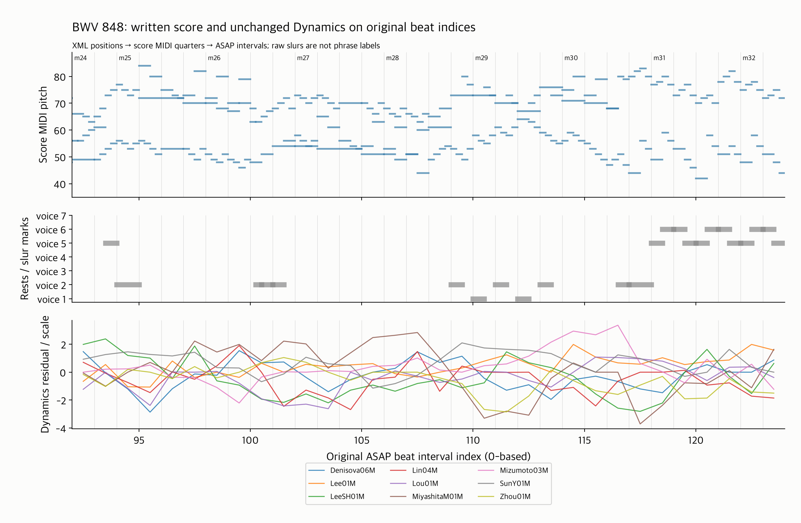
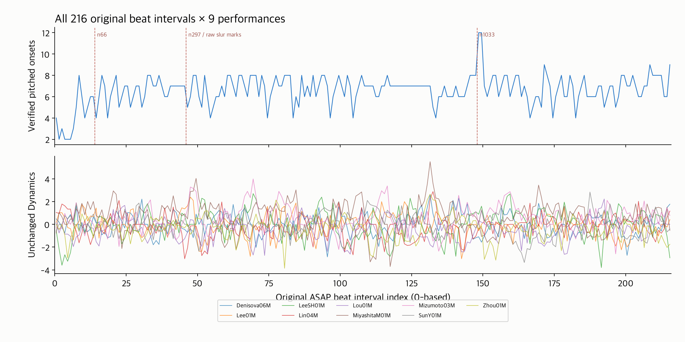

# BWV 848 악보 구조와 기존 beat 연결

16번 작업의 첫 연결 단위다. 반복 없는 **Bach Fugue BWV 848의 고정 9연주**에서
nASAP MusicXML → match의 악보 음 → score MIDI → 원래 ASAP beat interval을 연결했다.
기준은 기존 [악보 입력 목록](../score_structure_inputs/README.md)의 동일 9연주·grid다.

**216개 원래 beat 좌표를 연주마다 모두 유지했다. 음표별 검증의 예외는 별도 상태로 남긴다.**
기존 [Dynamics](../dynamics/README.md)의 normalized CSV 1,944개 값과 mask를 그대로 결합했다.
새로운 정렬 학습, 반복 펼치기, 프레이즈·긴장도 추출 또는 검색 평가는 수행하지 않았다.

## 무엇을 연결했는가

| 좌표 | 단위·의미 | 이번 작품의 확인 |
|---|---|---|
| 쓰인 MusicXML 위치 | part별 4분음표 단위 `Fraction` | 시작 0, 끝 220 |
| match 악보 음 위치 | XML 음 ID에 대응하는 악보 위치 | 비꾸밈음 1,433개 시작 위치·음높이 일치; offset 0 |
| score MIDI 위치 | MIDI tick / PPQ | PPQ 480, tempo map을 이용해 초 → quarter 변환 |
| ASAP beat 경계 | score MIDI 초 | 217개 경계의 quarter 위치는 2…218 |
| 원래 feature index | `[beat[i], beat[i+1])` 구간 | 0…215, 총 216개 |
| 연주 시각 | performance MIDI 초 | 원래 ASAP annotation을 그대로 사용 |

quarter 위치를 beat index로 바로 취급하지 않는다. 첫 beat가 quarter 2이므로 처음 두 quarter와
끝부분의 일부 음은 이번 feature 구간 밖이다. XML 이벤트 10개의 onset이 이 범위 밖에 있으며
`beat_index`를 비워 `outside_beat_range`로 저장했다. 음표·쉼표 이벤트를 합친 수다.

연주 타이밍으로 악보 구조를 맞추지 않는다. match의 **악보 쪽 정보와 deletions도** ID·위치 대조에
포함한다. score MIDI의 음높이·시작 위치로 연결 근거를 추가한다. 연주 onset의 구간 배정은 별도 진단이다.
마디 표기 `0`을 포함한 원본 번호를 보존하며, 이 작품에서는 원래 번호를 보정하지 않아도 실제 악보 좌표가 맞는다.

## 연결 결과와 남긴 예외

아래 수는 한 연주 기준이며 9연주에서 동일하다. XML 구조와 score MIDI는 공유하고,
각 연주의 match 파일을 따로 대조했다.

| 상태 | 이벤트 수 | 의미 |
|---|---:|---|
| `verified` | 1,379 | XML/match의 음높이·시작·타이를 합친 길이와 MIDI 시작·길이 대조 통과 |
| `verified_onset_duration_differs` | 51 | XML/match는 일치하고 MIDI 시작 위치도 맞지만 MIDI 길이는 다름 |
| `tie_continuation_verified` | 52 | 앞 음에 이어진 타이 연속음; 별도 MIDI note-on을 요구하지 않음 |
| `tie_head_unverified` | 1 | 앞 타이 음의 MIDI 시작이 미확인이므로 연속음도 확정하지 않음 |
| `missing_midi` | 3 | 해당 음높이의 정확한 score MIDI onset을 확인하지 못함 |
| `grace_unverified` | 3 | 꾸밈음 보존, 시간 연결 anchor로 사용하지 않음 |
| `rest_position_only` | 93 | 쉼표의 악보 위치를 보존; MIDI 음 매칭 대상으로 취급하지 않음 |
| 합계 | 1,582 | XML 음표·쉼표 전 이벤트 |

타이로 이어진 XML 음은 53개이며 match에서는 타이 머리 음의 길이에 합쳐져 있다.
길이를 단일 XML 음표와만 비교해서 오류로 판단하지 않는다.
MIDI 길이 비교의 허용 오차는 1 tick + match의 4자리 소수 정밀도(1e−4 quarter)다.
같은 track/channel/pitch의 겹친 note-on은 MIDI note-off 대응이 불명확할 수 있으므로 길이를
확정하지 않는다. 길이 0인 MIDI 꾸밈음은 보존하되 일반 음의 시작 위치 매칭 후보에서 제외한다.

**51개 길이 차이는 자동 수정하지 않았다.** 기존 score MIDI의 길이를 MusicXML 길이로 바꾸거나,
그 길이를 프레이즈·긴장도의 악보 음가로 대신 쓰지 않는다.

정확한 MIDI onset이 없는 세 음의 확인 결과:

| XML ID | 음높이 | XML/match onset | 가장 가까운 같은 음높이 MIDI onset | 차이 |
|---|---:|---:|---:|---:|
| n66 | 72 | 16 | 16.25 | +0.25 quarter |
| n297 | 83 | 48 | 48.25 | +0.25 quarter |
| n1033 | 80 | 150 | 150.125 | +0.125 quarter |

이는 근접 MIDI 음의 위치를 보여주는 진단이며 그 음을 정답 대응으로 선택했다는 뜻이 아니다.
`n1033`에는 inverted-mordent와 타이 시작이 있고, `n297`에는 slur 끝 표기가 있다.
단순히 가까운 onset으로 옮기지 않고 미대응 상태와 원래 표기를 유지했다.
[note_diagnostics.csv](note_diagnostics.csv)에 51개 길이 차이·세 미대응·타이 연속음 한 개를 저장했다.

각 beat의 검증된 pitched onset 지원 수는 최소 2개다. 216/216은 **좌표 구간 coverage**이며,
모든 음표의 MIDI 길이 또는 음악적 정렬이 완벽하다는 결과가 아니다.

## 그림과 기존 feature 보존



중앙 32개 원래 index `[92,124)`를 feature 값과 무관하게 고정했다. 위는 XML의 실제 pitch·표기 길이,
중간은 성부별 쉼표와 해당 구간에 있는 slur 표기, 아래는 **9연주 전부의 기존 normalized Dynamics**다.
이 중앙 구간에는 slur 시작/끝이 없다. 성부별 쉼표는 악보 전체의 침묵을 뜻하지 않는다.
음표 길이를 그린 상단도 MIDI 재생 길이가 아닌 XML 표기 길이다.



전체 그림은 216개 구간의 지원 수와 Dynamics를 보여준다. 붉은 점선은 정확한 MIDI onset이 없는
세 XML 음의 위치다. n295/n297의 원본 slur 시작·끝은 같은 XML quarter 48에 있으며 프레이즈로 확정하지 않았다.
부드러운 선은 별도 평활화가 아니라 beat 값의 시각적 연결이다. 결측 mask가 있으면 선을 끊는다.

- 기존 Dynamics raw 값·mask·음표 개수를 원본 performance MIDI에서 재추출해 1,944개 구간 모두 대조했다.
- standardized 값은 기존 CSV 문자열을 그대로 [feature_join.csv](feature_join.csv)에 복사했다.
  raw/common/scale 수식도 대조했으며 기존 정규화 기준을 다시 fit하지 않았다.
- 기존 feature 파일, raw/normalized cache, MIDI와 match를 덮어쓰지 않았다.
  고정 입력 해시와 일치하는 누락 XML 두 파일만 저장소 밖 ASAP/nASAP 데이터 폴더에 추가했다.

## 연주 onset 진단의 해석

각 match의 연주 onset도 원래 performance beat 구간에 배정해 악보 onset 구간과 비교했다.
MIDI 반 tick + annotation 0.5μs + float guard 1e−10초 안의 경계 사건은 `performed_boundary_uncertain`으로
표시하고 일치율 분모에서 제외한다. 경계에서 float 연산 순서만으로 구간이 달라지는 것을 판정에 쓰지 않는다.

9연주 합계로 경계 불확실 491개, 나머지 12,234개 중 같은 구간 10,421개·다른 구간 1,813개다.
실제 연주 음 시작 시각·화음 비동시성·기존 beat 주석의 영향을 함께 받을 수 있는 진단이며
그 원인을 자동 판별하지 않았다. **85.18%를 정렬 정확도로 해석하지 않는다.**
원래 beat 축과 기존 feature 값의 결합 검증, 각 연주 음의 엄밀한 음악적 위치 검증을 구분한다.
미일치 사건은 [note_links.csv](note_links.csv)에 원래 두 구간 번호와 시각을 남겼다.

추가 경계 점검에서 1,813개 불일치 중 1,790개는 바로 앞 beat, 2개는 바로 뒤 beat,
21개는 범위 안팎의 배정 차이였다. 앞 beat의 1,790개 중 1,787개는 악보상 정확히 beat 경계에 있는 음이다.
경계보다 이른 시각의 중앙값은 4.687ms, 95백분위는 15.625ms이며 해당 beat 길이 대비 각각
약 0.79%와 2.73%다. 1,759개는 25ms 이내, 1,782개는 50ms 이내였다.
100ms를 넘는 두 사례는 LeeSH01M의 n679(337.500ms), Lou01M의 n1470(122.005ms)이며 검토 대상으로 남긴다.

꾸밈음·타이 연속음을 제외한 1,433개 음표 머리 기준으로 정확한 MIDI onset 미확인은
3/1,433=0.21%, MIDI 길이 차이는 51/1,433=3.56%다. 이 비율과 연주 onset 구간 불일치 14.82%를
같은 종류의 정렬 오류로 합치지 않는다. XML/match의 악보 시작 위치·음높이는 1,433개 모두 일치했다.

**현재 예외는 후속 프레이즈·긴장도 분석을 막는 조건이 아니다.** 모든 음표의 onset/길이를
100% 맞추는 것을 선행 완료 조건으로 두지 않는다. 음악적 구간의 의미와 반응 측정치를 먼저 정의하고,
반응 특징을 구성할 때 경계 이동·경계 사건 포함/제외에 대한 민감도를 확인한다.
작은 경계 차이 전체를 수동 검수하기보다 미대응 세 음과 큰 시각 차이 두 사례를 표시해 처리한다.

## 검증과 재현

- 신규 단위 테스트 13개: 구간 경계·offset·deletions·타이·pitch/길이·중복/겹친 MIDI·꾸밈음·0폭/bR·원래 index·미지원 반복/ID 검증.
- 실제 9연주 pipeline 통합 테스트 1개: public API, XML ID 차이, 216개 원래 index와 Dynamics 원본 값/mask 검증.
- 기존 관련 테스트를 포함해 **61개 통과, skip 0**. 기존 `pretty_midi`의 non-zero track 메타 이벤트 경고가 있으며 실패는 없다. 전체 suite는 이번에 실행하지 않았다.
- [독립 verifier](../../scripts/verify_score_beat_bridge.py)는 bridge·XML 로더·match 로더·feature extractor를 import하지 않는다.
  원본 XML cursor, 정규식 match, `pretty_midi` tick 변환, scalar 구간 배정과 velocity 평균으로 검산했다.
- [verification.json](verification.json): 수치 **147,284개**, 최대 오차 **2.84e−14**, 입력 해시 28개 확인.
  전체 note 상태·마디·beat 지원 수·coverage·연주 진단·기존 값/mask 보존을 대조했다.

저장소 루트에서, 기존 결과를 보존하기 위해 새 디렉터리로 실행한다:

```bash
task_bridge_out=$(mktemp -d /tmp/classicfy-bwv848-bridge.XXXXXX)
MPLCONFIGDIR=/tmp/classicfy-mpl-cache .venv/bin/python \
  classicfy-ai/scripts/validate_score_beat_bridge.py --out "$task_bridge_out"
.venv/bin/python classicfy-ai/scripts/verify_score_beat_bridge.py --out "$task_bridge_out"

PYTHONPATH=classicfy-ai/src .venv/bin/python -m unittest discover \
  -s classicfy-ai/tests/unit/preprocessing -p 'test_score_beat_bridge.py' -v
PYTHONPATH=classicfy-ai/src .venv/bin/python -m unittest discover \
  -s classicfy-ai/tests/integration -p 'test_score_structure_pipeline.py' -v
```

두 CLI 모두 `--asap-root`, `--nasap-root`, `--inventory`, `--dynamics`로 입력 경로를 명시할 수 있다.
검증 CLI는 비어 있지 않은 출력 폴더를 거부한다. 입력 XML은 기존 inventory의 SHA-256과 일치해야 한다.
공식 XML 주소는 [protocol.json](protocol.json)에 저장했다. 해당 URL이 이후 달라져도 해시가 다르면 사용을 거부한다.

## 코드 사용과 지원 범위

```python
from preprocessing import (ASAPLoader, load_musicxml, load_match,
                           load_midi_score_timeline, build_score_beat_bridge)

sample = ASAPLoader(asap_root, nasap_root).get_sample("Bach/Fugue/bwv_848/Lee01M.mid")
bridge = build_score_beat_bridge(
    load_musicxml(nasap_root / "Bach/Fugue/bwv_848/xml_score.musicxml"),
    load_match(sample.note_alignment_path), load_midi_score_timeline(sample.score_path),
    sample.score_beats, sample.performance_beats, sample.score_beat_types,
)
# compact feature를 결합할 때에도 interval.index는 원래 번호를 유지한다.
selected = bridge.select_intervals(shared_indices)
```

현재는 단일 part·반복 없는 XML, 직접 XML ID 또는 검증된 단일 `-1` occurrence를 지원한다.
반복 표기·중복 occurrence·여러 part·비일정 XML/match 위치 차이는 명시적 오류로 알린다.
0폭 interval은 유지하고 mask를 끈다. bR은 원래 표기를 유지하며 synthetic 테스트로 확인했다.
실제 결과는 이 작품 하나에 대한 것이며 다른 작품·반복·변형의 검증으로 확대하지 않는다.

다음 단위는 반복/악보 변형 연결이다. 이번 세 onset 미대응과 길이 차이를 검토 항목으로 이어가며,
검증되지 않은 음의 onset/길이를 임의 보정해 프레이즈·긴장도 입력으로 사용하지 않는다.

산출물: [xml_notes.csv](xml_notes.csv), [note_links.csv](note_links.csv), [beat_map.csv](beat_map.csv),
[feature_join.csv](feature_join.csv), [coverage.csv](coverage.csv), [note_diagnostics.csv](note_diagnostics.csv),
[summary.json](summary.json), [protocol.json](protocol.json), [provenance.json](provenance.json),
[verification.json](verification.json), 그림 PNG 2개와 중앙 구간 PDF.
