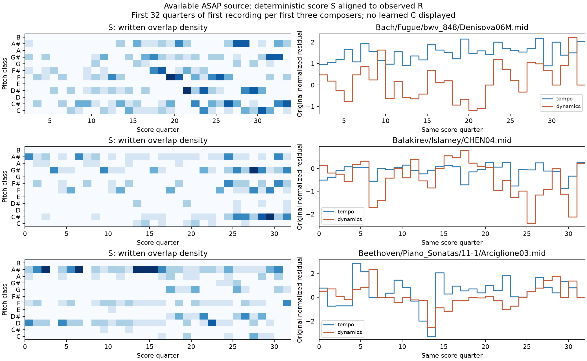

# 악보 S와 위치별 맥락 C의 첫 구현 검증

2026-10-29. **검증된 ASAP 인계 데이터로 새 adapter와 ScoreEncoder의 연결을 확인했다.**
실제 ATEPP 자료로 모델을 학습하거나 학습된 C를 생성한 결과는 아니다.
ATEPP 원본 score MIDI·DualDTW cache는 현재 이 기기에 없다.

## 결과

| 항목 | 결과 |
|---|---:|
| 실제 입력 연주 | 968 |
| 실제 score SHA / score-grid ref | 170 / 170 |
| 원래 quarter interval / score 지원 interval | 584,868 / 584,868 |
| score와 하나 이상 관측 R이 함께 있는 interval | 580,558 |
| 관측 chunk가 하나 이상 있는 연주 | 968 |
| 상한 64-quarter로 나눈 관측 chunk | 9,602 |
| 독립 raw MIDI/Fraction 수치 대조 | 7,680개 |
| 최대 절대 오차 | 7.9581e−13 |
| 무작위 초기 ScoreEncoder smoke | `[4,20,64,30] → [4,20,64,128]` |

모든 연주에서 기존 유효 R 값과 observation mask, q 경계가 원본과 정확히 일치했다.
score SHA는 기존 quarter 변환 audit의 값과 대조했다.
group 표시 문자열에서 경로를 추측하지 않고 원래 ASAPLoader가 선택한 score MIDI를 썼다.
반복판 표시가 붙은 group도 실제 alignment reference와 source SHA를 유지한다.

고정된 선택 규칙으로 score/grid ref 32개를 균등 간격으로 뽑고, 각 ref에서 지원 interval
최대 8개를 균등 간격으로 선택했다. 원본 MIDI의 ticks/PPQ를 별도로 읽고 Fraction으로
pitch-class onset·overlap·register·duration·silence를 scalar 재계산했다.
production score feature 함수의 결과끼리 비교한 것이 아니다.
전체 interval을 독립 재계산했다는 뜻은 아니며, 전체 record에서는 R/mask/q 보존을 확인했다.

ScoreEncoder는 유효 C가 finite이고 padding C가 0이며, 하나의 구간을 따로 인코딩한 결과와
연주 배치에 넣은 결과가 일치했다. 초기 가중치만 사용했고 checkpoint/C 벡터 cache는 저장하지 않았다.
이 검사는 의미 있는 음악 표현이나 추천 유용성을 증명하지 않는다.



그림은 manifest 순서에서 처음 등장하는 세 작곡가의 첫 연주, 처음 32개 quarter를 보여준다.
왼쪽은 악보의 pitch-class별 음 길이 밀도, 오른쪽은 기존 tempo/dynamics 값이다.

## MIDI 해석과 제한

170개 score에서 중복 제거 전 positive-duration note 516,205개, exact duplicate 1개,
zero-length note 13,142개를 기록했다. unclosed note와 orphan offset은 없었다.
0길이 음은 기존 ATEPP MIDI reader처럼 제외하며, 이를 전부 XML의 grace라고 단정하지 않는다.
마디·성부·tie·slur·grace 표기의 음악적 의미는 MIDI만으로 복원하지 않았다.

S는 1-quarter bin의 집계라 bin 안의 세부 음 순서까지 표현하지 않는다.
기존 R의 전체 catalog 정규화는 유지됐다. score scale 옵션의 train-only fitting과
R의 외부 작품/연주 reference 정책은 다른 문제다.

## 테스트

관련 53개 unit/integration 테스트 통과, skip 0. 신규 score 기능 검증은 31개다.

- 30D feature의 손계산, half-open 경계, 유지음/쉼, MIDI tempo·velocity 불변성,
  exact 중복 정책·범위 밖 mask·unclosed note 및 train score scale의 중복 가중 방지.
- 실제 ATEPP standardized 형식과 portable quarter 형식 연결, source score SHA,
  채널/q 일치, work/same-score split 격리, checksum, 덮어쓰기 방지, 관측된 0 보존.
- 가변 Ds·hidden·B/K/T, 원래 연주/구간 소속, time/segment padding 불변성,
  finite input과 prefix mask 검증, state 재로딩, test-only Huber decoder의 gradient 연결.
- 실제 ASAP score/R→batch→C, 합성 ATEPP native cache→export CLI→segment reader.
- 기존 MIDI/match reader·ATEPP 정규화·temporal embedding의 가까운 회귀 테스트.

전체 suite와 선택적 numba 정렬 engine은 이번에 실행하지 않았다.

```bash
PYTHONPATH=classicfy-ai/src MPLCONFIGDIR=/tmp/classicfy-matplotlib \
  .venv/bin/python -m unittest discover \
  -s classicfy-ai/tests/unit/features -p 'test_score_context.py' -v
PYTHONPATH=classicfy-ai/src MPLCONFIGDIR=/tmp/classicfy-matplotlib \
  .venv/bin/python -m unittest discover \
  -s classicfy-ai/tests/unit/embedding -p 'test_score_*.py' -v
PYTHONPATH=classicfy-ai/src MPLCONFIGDIR=/tmp/classicfy-matplotlib \
  .venv/bin/python -m unittest discover \
  -s classicfy-ai/tests/integration -p 'test_score_context_pipeline.py' -v
```

## 재현과 산출물

```bash
MPLCONFIGDIR=/tmp/classicfy-matplotlib .venv/bin/python \
  classicfy-ai/scripts/validate_score_context.py \
  --out /tmp/score-context-check --artifacts /tmp/score-context-arrays
MPLCONFIGDIR=/tmp/classicfy-matplotlib .venv/bin/python \
  classicfy-ai/scripts/report_score_context.py \
  --out /tmp/score-context-check --artifacts /tmp/score-context-arrays
```

실제 수치는 다음 자료에서 확인할 수 있다.

- [summary.json](summary.json): 범위·수치·모델 초기 상태와 미검증 항목.
- [coverage.csv](coverage.csv): 연주별 원래 길이, score/관측 지원 수, source/export R 해시.
- [independent_intervals.csv](independent_intervals.csv): 독립 검산의 고정 추출 구간.
- [provenance.json](provenance.json): 입력·코드·score SHA와 외부 산출물 해시.

외부 배열은 `Classicfy/datasets/score_context_validation_run02/`의
`score_map.csv`와 `joined/` 아래 `dataset.npz`, `manifest.json`, `integrity.json`에 있다.
원본 MIDI, LFS 입력 캐시 4개와 이전 실험 결과는 변경하지 않았다.
사용 API와 ATEPP 쪽 export 방법은 [구현 안내](../performance_autoencoder_plan/README.md)를 참조한다.
