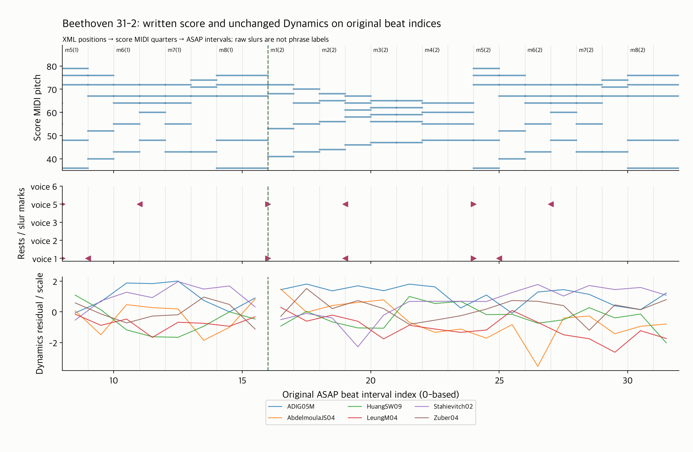
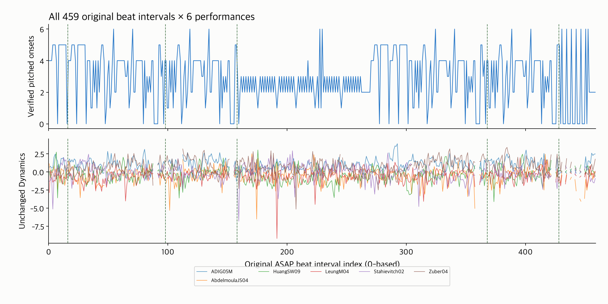

# 반복 악보의 구조와 원래 beat 연결 — Beethoven 31-2

16번의 두 번째 연결 단위다. 기존 네 반복 악보 중 match 음 수가 가장 작은
**Beethoven 소나타 31-2의 고정 6연주**를 첫 대상으로 삼았다.
입력은 [기존 목록](../score_structure_inputs/README.md)의 grid `16a5b8773bf1`이며,
반복 기호만으로 악보를 자동 펼치지 않고 기존 match·score MIDI의 실제 진행을 확인했다.

## 완료한 범위

- 쓰인 악보 **162마디·1,066개 음표/쉼표 이벤트**를 실제 진행의 **230개 마디 방문**으로 연결했다.
- 217개 마디 방문은 XML 음 ID·마디 안 위치와 score MIDI onset을 대조했다.
- 음표가 없는 9개 쓰인 마디는 반복을 포함해 13번 방문한다. 양쪽의 검증된 위치와 쉼표 마디 길이의 합이 일치할 때만 이를 포함했다.
- 모든 6연주에서 원래 **459개 beat interval**을 유지했다. 총 2,754개 구간의 구조 좌표가 연결되었다.
- 기존 Dynamics 캐시의 raw/common/standardized 값과 mask를 읽어서 보존했다. 유효 standardized 값 2,592개와 결측 162개를 그대로 유지했으며 정규화 기준을 다시 fit하지 않았다.
- 반복 점프 3곳, 1→2번 ending 전환 2곳을 표시하고 경계를 넘는 인접 변화의 pair mask를 제공했다.

이 작품에서는 `downbeats_score_map`이 비유한 값이라 마디 번호 대응표를 사용할 수 없다.
이번 연결은 그 표에 의존하지 않는다. match의 원래 ID·접미사는 보존하고 마디별 방문 번호를 실제 진행 순서로 따로 계산한다.
`n1-1`과 `n1-2`를 하나의 음으로 합치지 않는다. 뒤쪽의 첫 방문 마디는 접미사가 `1`이어도 전체 연주가 이미 여러 반복을 거친 상태다.

## 확인한 진행과 경계

마디 번호는 원본 XML 표기이며, 아래의 index는 기존 ASAP 구간의 0부터 시작하는 번호다.

| 원래 beat index | 전환 | 의미 |
|---:|---|---|
| 16 | 8마디 → 1마디 | 첫 구간 반복 |
| 98 | 41마디 → 10마디 | 첫 ending 후 반복 |
| 158 | 39마디 → 42마디 | 두 번째 진행에서 첫 ending 생략 |
| 368 | 146마디 → 115마디 | 뒤쪽 구간 반복 |
| 428 | 144마디 → 147마디 | 뒤쪽 두 번째 ending 진입 |

각 전환을 XML의 backward/forward repeat 및 1·2번 ending 기호와 대조했다.
원본 마디 번호·순서를 보존하며, 쓰인 위치와 진행 위치를 구분해 저장한다.
이후 시계열 반응 계산은 `adjacent_pair_mask()` 또는 `break_before`를 사용해야 한다.
기존 extractor를 수정하거나 이전 전곡 시계열 통계를 다시 계산하지는 않았다.

## 그림



첫 반복 경계 16의 앞 8개·뒤 16개 구간 `[8,32)`를 고정했다. `m5(1)`은 5마디의 첫 방문,
`m1(2)`는 1마디의 두 번째 방문이다. 녹색 점선은 반복 전환이다.
상단은 XML 음표·음가를 실제 진행 순서로 배치했고, 중간은 원본 성부별 쉼표/slur 표기,
하단은 기존 normalized Dynamics의 6연주 전부다. slur를 프레이즈 정답으로 취급하지 않는다.
반복 전환과 기존 결측에서 곡선을 연결하지 않았다. 원래 feature 값을 삭제하거나 보간한 것은 아니다.



전체 그림의 다섯 녹색 경계와 쉼표 마디의 구간을 확인할 수 있다.
음표 onset 지원 수가 0인 쉼표 마디도 좌표를 확인했으면 구조 mask는 유효하다.
그 위치의 Dynamics mask는 기존 결측 상태를 유지한다. 구조 유효성과 연주 feature 유효성을 구분한다.

## API와 좌표 사용

```python
from preprocessing import (ASAPLoader, load_match, load_musicxml,
                           load_midi_score_timeline, build_score_occurrence_bridge)

sample = ASAPLoader(asap_root, nasap_root).get_sample(
    "Beethoven/Piano_Sonatas/31-2/ADIG05M.mid")
result = build_score_occurrence_bridge(
    load_musicxml(nasap_root / "Beethoven/Piano_Sonatas/31-2/xml_score.musicxml"),
    load_match(sample.note_alignment_path), load_midi_score_timeline(sample.score_path),
    sample.score_beats, sample.performance_beats, sample.score_beat_types)

written_bounds = result.interval_written_quarters  # 원래 쓰인 XML 좌표
pair_mask = result.adjacent_pair_mask(feature_mask)  # i-1→i, 경계와 결측 제외
```

- `visits`: 쓰인 마디 index·번호, 방문 번호, 원본 occurrence label, 진행 quarter 범위, anchor 수와 상태.
- `note_occurrences`: 각 진행 음표의 고유 ID, 원래 음표 ID/XML ID·좌표 및 방문 정보.
- `interval_visits`: 원래 beat index별 방문 번호. 미확인 gap은 `None`이다.
- `interval_written_quarters`: beat를 **원본 쓰인 악보 위치**로 되돌린 범위. 조표·박자·slur·프레이즈·긴장도는 원래 구조와 이 범위를 연결해서 사용한다.
- `bridge`: 기존 bridge에 전달한 임시 진행 축의 결과. 이 객체의 `xml_*`는 펼친 임시 좌표이므로 원본 쓰인 위치로 혼동하지 않는다.
- `interval_break_before`와 `adjacent_pair_mask()`: 반복 점프·ending 생략·미확인 구간·feature 결측을 인접 변화 계산에서 구분한다.

score beat의 초 단위 주석은 MIDI tick으로 환산한 뒤 가장 가까운 tick으로 맞춘다(최대 반 tick).
소수 표현 때문에 정확한 음표/마디 경계가 앞 구간에 들어가는 것을 방지하기 위한 처리이며,
원본 annotation 초·feature 배열은 바꾸지 않는다.

## 검증과 예외의 해석

- 신규 합성 테스트 7개: 반복 음표 ID/순서, 원래 좌표, 쉼표 구간의 양쪽 근거, 첫/둘째 ending, 접미사와 방문 번호의 구분, 미확인 점프, 경계를 가로지르는 beat·0폭 구간 및 잘못된 입력.
- 실제 6연주 통합 테스트 1개: 반복·ending·원래 459개 구간과 두 음표 occurrence가 분리되는지 확인.
- 기존 테스트를 포함한 관련 **69개 통과, skip 0**. 전체 suite는 미실행이다.
- 기존 BWV 848 CSV 6개와 PNG 2개를 재생성해 원본과 byte 일치를 확인했다. 공통 그림 함수의 새 인자와 독립 match reader의 5.0 지원은 기존 기본 결과를 유지한다.
- 기존 cache의 raw Dynamics/mask를 원본 MIDI에서 재추출해 대조하고, common 중앙값과 저장된 scale 수식을 확인했다.
- 별도 [독립 verifier](../../scripts/verify_score_occurrence_bridge.py)는 production bridge/loader를 import하지 않는다.
  raw match의 **Bar:Beat 진행 순서**, raw XML 위치와 `pretty_midi` tick 변환으로 반복 경로·음표 occurrence·원래 beat·cache 값/mask·pair mask를 검산했다.
- [verification.json](verification.json): **78,708개 수치 검산**, 최대 차이 0. 1,380개 마디 방문·9,252개 음표 occurrence·2,754개 beat 행을 대조했다.

각 연주의 음표 상태는 전체 대조 1,082개, MIDI 길이 차이 262개, 타이 연속음 82개,
XML/match 길이 불일치 1개, 앞 타이 음 미확인 1개, 쉼표 114개다.
길이 불일치 `n296-1`과 `n300-1`의 타이 관계는 원문과 상태를 보존했다.
이 음별 예외를 구조 연결 전체의 실패로 취급하지 않으며, 모든 음 길이의 100% 일치를 선행 목표로 확대하지 않았다.
459개 구간 연결 결과도 모든 MIDI 길이 또는 사람의 음악적 정렬 정답을 보장하는 수치는 아니다.

현재 지원을 검증한 것은 **31-2 한 작품의 반복·첫/둘째 ending**이다.
모르는 전환은 데이터를 보존하고 `transition_unverified`/`occurrence_unverified`로 mask를 끈다.
마디 내 위치가 일정하게 연결되지 않거나 occurrence ID가 중복·불명확하면 명시적으로 실패한다.
중첩 반복, D.C./D.S./coda, 다른 악보 변형을 모두 해결한 것으로 보고하지 않는다.
나머지 세 반복 악보와 프레이즈·긴장도 계산은 다음 작업이다.

## 재현

저장소 루트에서 새 출력 폴더를 사용한다. 두 CLI는 같은 경로 인자를 지원한다.

```bash
task_repeat_out=$(mktemp -d /tmp/classicfy-31-2-repeat.XXXXXX)
MPLCONFIGDIR=/tmp/classicfy-mpl-cache .venv/bin/python \
  classicfy-ai/scripts/validate_score_occurrence_bridge.py --out "$task_repeat_out"
.venv/bin/python classicfy-ai/scripts/verify_score_occurrence_bridge.py --out "$task_repeat_out"

PYTHONPATH=classicfy-ai/src .venv/bin/python -m unittest discover \
  -s classicfy-ai/tests/unit/preprocessing -p 'test_score_occurrence_bridge.py' -v
PYTHONPATH=classicfy-ai/src .venv/bin/python -m unittest discover \
  -s classicfy-ai/tests/integration -p 'test_score_occurrence_pipeline.py' -v
```

경로 인자: `--asap-root`, `--nasap-root`, `--inventory`, `--cache`, `--out`.
기존 출력 폴더가 비어 있지 않으면 validator는 덮어쓰기를 거부한다.
원본/nASAP XML 두 파일은 기존 inventory SHA-256과 대조했다.
새 XML 두 파일만 저장소 밖 데이터 폴더에 추가했으며 원본 MIDI/match·cache·과거 보고서는 보존했다.

산출물: [xml_notes.csv](xml_notes.csv), [measure_visits.csv](measure_visits.csv),
[note_occurrences.csv](note_occurrences.csv), [beat_map.csv](beat_map.csv),
[feature_join.csv](feature_join.csv), [coverage.csv](coverage.csv),
[protocol.json](protocol.json), [summary.json](summary.json),
[provenance.json](provenance.json), [verification.json](verification.json), PNG 2개와 첫 반복 경계 PDF.
