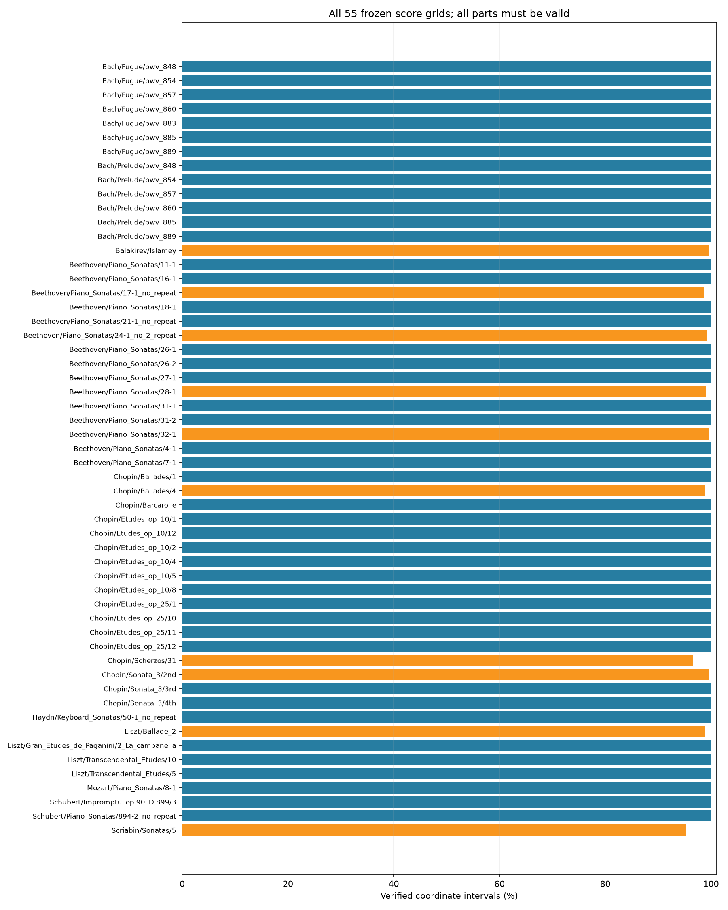
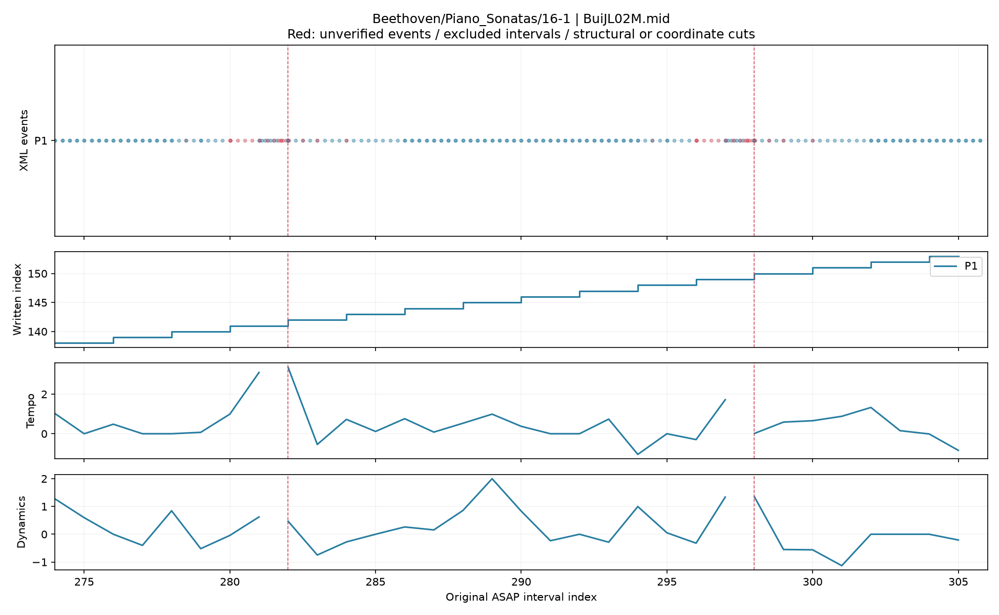
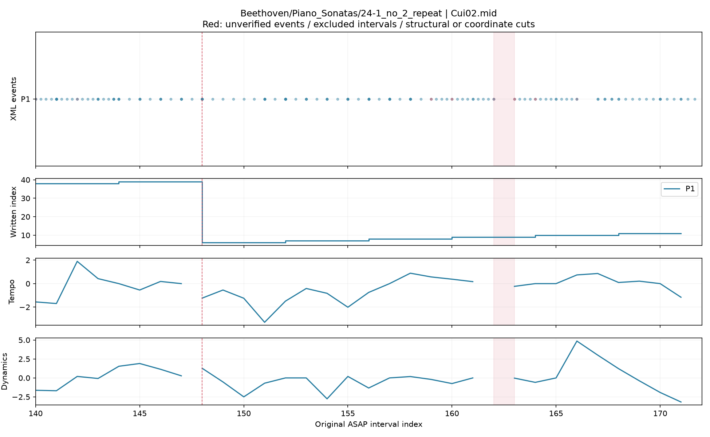
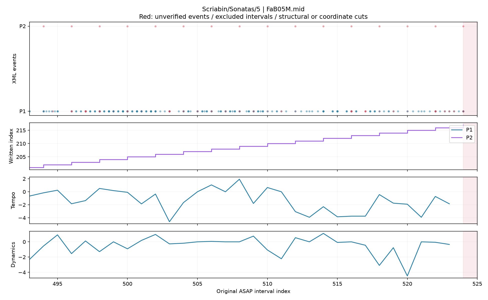

# 전체 악보 구조와 기존 연주 feature 연결

고정된 **55개 악보/grid·570연주 전체**에 연결을 적용했다. ASAP/nASAP XML **110개**의
입력 해시와 구조를 대조했다. 결과는 연결 경로 확보와 사용할 수 있는 구간의 공개이며,
프레이즈·조성 긴장도 추출 및 검색 실험은 다음 단계다.

Chopin Ballade 1의 nASAP XML에는 원본에 없는 tuplet notation 6개가 있다. 음높이·
위치·길이·성부·slur/tie 등 구조화 필드는 원본과 동일하며, XML 표기 차이는
`xml_audit.csv`에 별도로 기록했다. nASAP 기호를 원본과 완전히 같다고 가정하지 않는다.

| 항목 | 결과 |
|---|---:|
| 전체 구간이 연결된 연주 | 488 |
| 일부 구간이 제외된 연주 | 82 |
| 연결 실패 연주 | 0 |
| 원래 ASAP beat 구간 | 287,885 |
| 모든 part에서 좌표를 확인한 구간 | 286,208 (99.42%) |
| 기존 7채널 공통 mask의 유효 구간 | 269,183 |
| 구조와 기존 feature를 함께 사용할 구간 | 268,606 (99.79% 유지) |

**연주별 B−1개 원래 구간을 보존했다.** 부분 연결은 성공하지 못한 구간을 삭제하거나
0으로 채운 결과가 아니다. `feature_mask`, `bridge_mask`, `combined_mask`와
`adjacent_pair_mask`를 각각 저장한다. 모든 part가 확인돼야 결합 mask가 참이다.

## 연결 기준

1. 기존 마디 대응표를 쓰인 마디의 **0부터 시작하는 순서** 후보로 해석하고, XML 음높이·
   마디 안 위치를 score MIDI의 tick/PPQ와 대조한다. 출력 마디 번호는 원문 그대로 보존한다.
   번호 문자열 일치만으로 판단하지 않는다. 전체 matched 비꾸밈음 onset 지원이 90% 미만인
   일정은 거부한다. 이는 연결 후보를 검증하는 기준이며 정확도 점수가 아니다.
2. `124-125` 등의 결합 표기는 두 마디를 합치지 않는다. 앞뒤 downbeat 간격이 쓰인 두 마디
   길이의 합과 일치할 때만 사이 경계를 추론하고 MIDI 음 위치를 확인한다.
3. 반복 악보 4종·23연주는 match의 전체 occurrence ID와 악보 쪽 진행 순서를 이용한다.
   `24-1_no_2_repeat`의 짧은 마디 경계와 `32-1`의 못갖춘마디 경계는 downbeat가 한 개 적다.
   표기 길이·양쪽 경계 또는 못갖춘마디와 MIDI가 지지하는 유일한 후보만 추가한다.
4. `.match`의 beat는 항상 quarter가 아니다. 각 마디에서 가능한 고정 음악적 배율
   1, 2, 1/2, 4, 1/4과 시작점 차이를 대조하고, 좌표가 충돌하면 해당 마디를 제외한다.
   전곡에 하나의 배율을 강제로 적용하거나 임의의 시간 늘이기를 하지 않는다.
   시작 위치가 하나뿐인 마디는 박 배율을 확정하지 않고 `local_match_origin_only`로 저장한다.
5. MIDI tick 1개와 match 소수 정밀도 1e−4를 허용한다. score 초는 반 tick 이내에서 가장 가까운
   tick에 배정하며, 원본 score/performance 초와 기존 feature 값은 바꾸지 않는다.

score MIDI onset이 없는 장식음, 타이 길이 차이, grace 및 part별 미대응은 음별 상태로 남긴다.
`verified`는 이 단계의 XML/match pitch·마디 안 시작 관계 및 score MIDI 시작/길이 대조를 뜻한다.
원문 match duration은 별도의 beat 단위로 저장하며 quarter로 간주하지 않는다.
좌표 coverage와 모든 음표·길이의 완전한 대응은 구분한다.

## 원래 feature 보존

이 환경에는 pilot에서 사용한 별도 standardized Dynamics cache가 없다. 대신 #15의 검색 실험에서
사용한 **동일한 원본 raw cache, 고정 collector 커밋, 7채널 정규화 기준과 공통 mask**를 재구성한다.
기존 `shared_indices`를 원래 index로 복원한 float64 배열을 그대로 결합한다. 새 작품 공통값이나
scale을 구조 기준으로 다시 fit하지 않는다. 기존 자료의 저장 위치나 내용도 변경하지 않는다.

반복·ending 이동, 악보와 MIDI 사이 좌표 불연속, 결측·미검증 구간, `bR` 주변에서는 인접 차분을
차단한다. 음표·마디 연결에는 연주 feature 값이나 검색 성적을 사용하지 않는다.

## 그림



사례는 feature를 보기 전에 작품명과 첫 연주로 고정했다. 위쪽 두 패널은 원래 beat에 배정한
XML 이벤트와 쓰인 마디 순서다. 아래는 기존 Tempo·Dynamics 값이다. 빨간 영역은 결합 mask에서
제외한 구간, 점선은 구조 또는 좌표 경계다. 붉은 이벤트가 있다고 그 beat 전체가 실패한 것은 아니다.







## 산출물과 재현

- [coverage.csv](coverage.csv): 570연주별 원래 길이, 연결률, 기존/결합 mask 지원, part·음표·마디 상태
- [works.csv](works.csv): 전체 작품/grid별 집계
- [xml_audit.csv](xml_audit.csv): 110개 입력 해시·로딩·진단
- [summary.json](summary.json), [protocol.json](protocol.json), [provenance.json](provenance.json): 전체 수치·정책·입력/코드/산출물 해시
- 대용량 원래 index 연결표와 7채널 배열: `/Users/ihun-ui/Desktop/Classicfy/datasets/score_structure_full_run01`
  (`xml_notes.csv.gz`, `measure_visits.csv.gz`, `match_coordinates.csv.gz`,
  `note_occurrences.csv.gz`, `beat_map.csv.gz`, `feature_join.npz`). 저장소에는 집계와 그림만 둔다.

저장소 루트에서 새 출력 경로로 실행한다.

```bash
MPLCONFIGDIR=/tmp/classicfy-matplotlib .venv/bin/python \
  classicfy-ai/scripts/connect_score_structure.py \
  --out /tmp/classicfy-score-report --artifacts /tmp/classicfy-score-artifacts
.venv/bin/python classicfy-ai/scripts/verify_score_structure_full.py \
  --out /tmp/classicfy-score-report --artifacts /tmp/classicfy-score-artifacts
```

원본 XML·raw match·pretty_midi tick 좌표·원래 feature 배열을 이용하는 별도 검산은
[verification.json](verification.json)에 기록한다.
테스트와 상세 제외 유형은 [검증 결과](VALIDATION.md)에서 확인한다.

다음 단계에서는 이 결합 mask 안에서 프레이즈 후보와 조성 긴장도를 계산한다.
일부 구간을 제외한 작품은 같은 지원 범위로 기존 전곡 기준도 다시 계산해 비교해야 한다.
