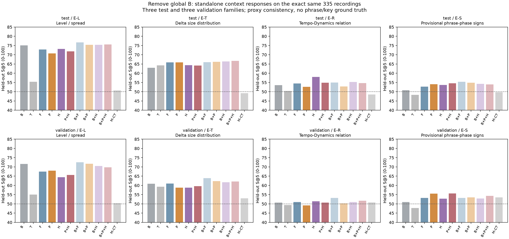
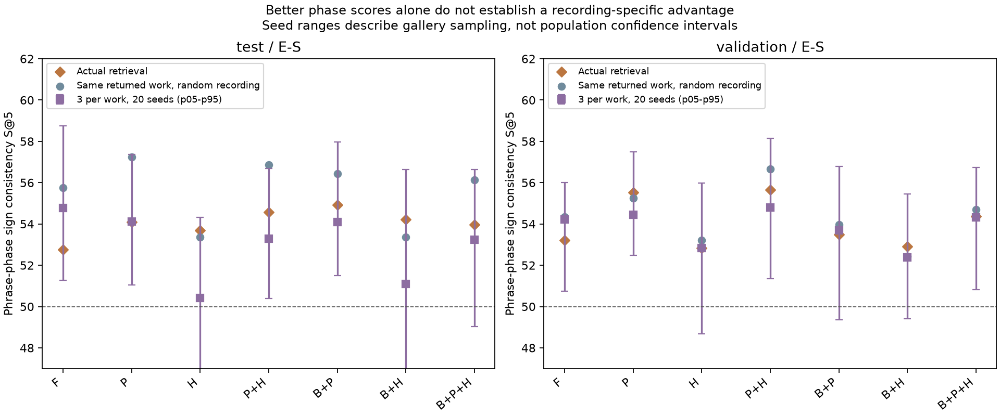

# 평균·범위를 뺀 프레이즈·긴장도 반응 검색

2026-10-14. 기존 16번 실험의 335연주·동일 gallery·동일 채점 기준에서,
전곡 평균·범위 B를 빼고 프레이즈 반응 P, 긴장 수준별 반응 H, P+H를 각각 검색했다.
대조로 시간 반응 T만, 고정 길이 구간 반응 F만 사용하는 조건도 추가했다.
**분리하면 모든 점수가 나빠지는 결과는 아니다. 프레이즈 반응 점수의 일부 개선은 있으나,
특정 연주를 더 잘 고르는 효과와 구조 포착의 정확성은 아직 확인되지 않았다.**

## 바꾼 것과 유지한 것

| 표현 | 내용 | 차원 |
|---|---|---:|
| B | 전곡 형태의 평균·범위를 검색 view에서 계산 | 14 |
| T | 문맥 없는 인접 변화 평균·RMS와 Tempo–Dynamics 공동 모멘트 | 15 |
| F | 원래 16beat 고정 구간의 시작·중간·끝별 반응 | 66 |
| P | 프레이즈 구간 가설의 시작·중간·끝별 반응 | 66 |
| H | 긴장도 3지표의 저·중·고 수준별 반응 | 198 |
| P+H | P/H 블록의 동일 가중 거리 결합 | 66+198 |

P/H의 각 문맥에는 7채널 평균 잔차·변화 평균·변화 RMS·Tempo–Dynamics 공동 모멘트가 있다.
따라서 **단독 표현은 별도 전곡 B 블록을 제거했다는 뜻**이다. 조건별 평균까지 제거한
순수 차분 표현이나 악보 구조 값만의 임베딩은 아니다. 모델을 새로 학습하지 않았다.
기존 57D/119D 시간·lag 표현 및 CNN/BiLSTM은 이번 단독 ablation의 범위에 포함하지 않았다.

- 이전 공통 cohort 그대로 train gallery 247연주·24악보·23작품군, test 45연주·3작품군,
  validation 43연주·3작품군이다. query와 gallery의 작품군은 겹치지 않는다.
- 원래 완전한 64beat 블록 A/B를 번갈아 사용하고, A검색→B평가와 B검색→A평가를 모두 계산한다.
  원래 index, 구조·결측·bR pair mask, 지원 최소값을 바꾸지 않았다.
- train 작품군 균등 가중 SD와 다른 train 작품군 거리 중앙값으로 블록 크기를 맞춘다.
  P/H 결합도 동일한 squared-distance 가중이며 평가 결과로 가중치를 고르지 않았다.
- 모든 조건에서 같은 후보, 작품군당 1연주 Top 5, 같은 동점 처리를 사용한다.
- 기존 B 기반 6조건과 M-CT의 1,232개 query/view 순위가 그대로 재현됐다.
  기존 query 점수의 최대 차이는 4.44e−16이다. [재구성 검증](reconstruction.json).

## 기존 네 채점 축의 결과

숫자는 다른 작품 gallery의 평가 거리 백분위에 따른 S@5를 0–100으로 표시한 값이다.
일반 무작위 기대값은 50이며 정확도·청취 성공률이 아니다.
아래 각 셀은 **test / validation** 순서다.

| 표현 | 성향·폭 E-L | 변화 크기 E-T | 공동 변화 E-R | 프레이즈 반응 E-S |
|---|---:|---:|---:|---:|
| B | 75.03 / 71.63 | 62.91 / 60.94 | 53.55 / 50.67 | 50.83 / 51.00 |
| T | 55.39 / 55.09 | 64.30 / 59.26 | 50.46 / 49.41 | 48.26 / 47.73 |
| F | 72.81 / 67.41 | 65.92 / 60.98 | 54.47 / 51.02 | 52.75 / 53.20 |
| P | 70.69 / 68.00 | 65.87 / 58.79 | 52.68 / 49.21 | 54.09 / 55.52 |
| H | 73.18 / 64.44 | 64.38 / 58.73 | 58.00 / 51.37 | 53.68 / 52.83 |
| P+H | 71.80 / 65.62 | 64.20 / 59.62 | 54.89 / 50.72 | 54.57 / 55.66 |



P와 P+H의 E-S는 F보다 양쪽 split에서 높다. P는 B+P의 54.91 / 53.49에 비해
54.09 / 55.52로 test에서는 낮고 validation에서는 높다.
P+H도 B+P+H의 53.98 / 54.36에 비해 54.57 / 55.66이다.
반면 E-T의 validation은 P/H/P+H 모두 B나 F를 넘지 못한다.
H의 test E-R은 58.00이지만 validation은 51.37이다. 한 축이나 split만 승리로 세지 않는다.
모든 조건과 작품군별 값은 [summary.csv](summary.csv), [per_family.csv](per_family.csv)에 있다.

E-S는 가설 프레이즈의 시작·중간·끝에서 Tempo/Dynamics의 양의 변화와 같은 방향 변화의 비율이
별도 view에서도 비슷한지를 측정한다. **긴장 상승·해소 episode에 대한 반응을 직접 채점하지 않는다.**
따라서 이번 H의 E-S 점수로 긴장 상황 대응의 정확성을 판단할 수 없다.

## 작품을 고른 효과와 연주를 고른 효과

반환 작품/grid를 고정하고, 그 작품 안의 연주를 균등하게 다시 뽑는 E-S 기대값과 비교했다.

| 표현 | test 실제 / 같은 작품 무작위 연주 | validation 실제 / 같은 작품 무작위 연주 |
|---|---:|---:|
| F | 52.75 / 55.74 | 53.20 / 54.34 |
| P | 54.09 / 57.24 | 55.52 / 55.24 |
| H | 53.68 / 53.37 | 52.83 / 53.21 |
| P+H | 54.57 / 56.87 | 55.66 / 56.65 |

P와 P+H는 test에서 같은 작품의 무작위 연주를 넘지 못한다. validation P의 차이는 +0.28점이며,
양쪽 split에서 안정적으로 특정 연주의 프레이즈 반응을 찾았다는 근거는 없다.
작품/grid마다 후보를 3연주로 맞춘 20seed의 E-S는 F 54.77 / 54.21,
P 54.11 / 54.46, H 50.40 / 52.83, P+H 53.28 / 54.80이다.
후보 수를 맞춘 뒤에도 P/P+H의 F 대비 개선 방향은 양쪽 split에서 유지되지 않는다.



## 구조를 제대로 포착했는가, 환경에 따른 제한인가

**입력 누락에 따른 대체 계산이나 실행 환경 때문에 규칙을 단순화한 상황은 아니다.**
55악보·570연주의 기존 feature/bridge join과 검증된 P/H CSV가 원래 provenance SHA와 일치한다.
이번 335연주의 feature digest와 이전 결과도 재현했다.
이 기기에 이전 phrase/tension NPZ가 없어도, 검증된 join과 CSV로 동일 비교를 재구성할 수 있었다.

그러나 **음악적으로 올바른 구조를 충분히 포착했다고 보장할 근거는 아직 없다**.

- P의 1,814구간은 전문가 확정 프레이즈가 아니다. 주선율 역할·계층을 확정하지 않고 첫 printed part,
  모든 part의 표기상 쉼, fermata, 동일 scope의 긴 slur를 사용한다. V–I 후보는 이번 구간화에 사용하지 않는다.
  477구간, 약 26.3%의 끝에는 32quarter의 `fixed_length_cap`을 쓴다. 음악적 문장 끝과 다를 수 있다.
- H는 Spiral Array의 3지표를 계산하지만 기준 조성은 조표 구간과 장단조 가설이다.
  122조표 구간 중 mode 명시 28·추정 82·미확정 12이며, 미확정 strain은 결측으로 둔다.
  조표에 나타나지 않은 국소 전조를 감지하지 않는다. 저·중·고 통계 구분은 형성→정점→해소 episode가 아니다.
- 악보 voice/staff를 음악적 역할로 확정하지 않는다. 반응은 정규화 잔차의 집계여서
  원본 연주의 ritardando·crescendo와 동일하게 자동 해석하지 않는다.

입력·산술의 재현과 음악적 정답을 구분한다. [capture_audit.json](capture_audit.json)에 건수를 저장했다.
다음은 소수 작품에서 문장 scope/계층·경계와 긴장 상승/해소 episode를 확인하고,
독립적인 상황별 반응 평가를 정의하는 것이다. 단독 점수의 하락만을 근거로 구조 정의를 바꾸지 않는다.

## 검증·재현

신규 4개와 재사용 7개, 관련 테스트 11개가 skip 없이 통과했다.
[독립 검산](verification.json)은 production 함수를 호출하지 않고 원래 index의 B/T/F/P·별도 view 평가,
검증된 H CSV·train scale·모든 거리/Top5·동일 작품 기대값·20seed 후보 균형·집계를 확인했다.
2,990,332개 수치가 일치했고 최대 절대 오차는 3.55e−15다. 그림 2개를 직접 확인했다.
별도 실행에서 수치 CSV/JSON 8개가 byte-identical로 재현됐으며, 기존 후보 수 균형 대조의
2,240개 집계도 최대 오차 3.33e−16으로 일치했다.
전체 suite는 실행하지 않았다. test/validation 각 3작품군, 이전 catalog 정규화와 64beat 분리의 한계를 유지한다.
모집단 신뢰구간은 제시하지 않는다. 단독 P/H의 구조 대응 섞기 대조는 이번에 추가하지 않았다.

```bash
MPLCONFIGDIR=/tmp/classicfy-matplotlib .venv/bin/python \
  classicfy-ai/scripts/compare_standalone_structure.py \
  --out /tmp/standalone-new --artifacts /tmp/standalone-arrays-new
.venv/bin/python classicfy-ai/scripts/verify_standalone_structure.py \
  --out /tmp/standalone-new --artifacts /tmp/standalone-arrays-new
MPLCONFIGDIR=/tmp/classicfy-matplotlib .venv/bin/python \
  classicfy-ai/scripts/report_standalone_structure.py --out /tmp/standalone-new
```

저장소 루트에서 실행한다. 외부 입력은 `datasets/score_structure_full_run01/feature_join.npz`와
`beat_map.csv.gz`, ASAP metadata/annotations다. 다른 기기에서는 [전체 연결 재현](../score_structure_full/README.md)으로
join을 준비한다. 이전 phrase/tension/comparison NPZ는 필요 없으며 저장된 반응 CSV를 사용한다.
`--data`·`--join`으로 경로를 지정할 수 있다. 결과 CSV·PNG/PDF는 저장소만으로 확인할 수 있다.
이번 외부 배열은 `datasets/standalone_structure_run01/standalone.npz`다.
[조건](protocol.json), [입력·코드·산출물 해시](provenance.json)를 제공한다.
