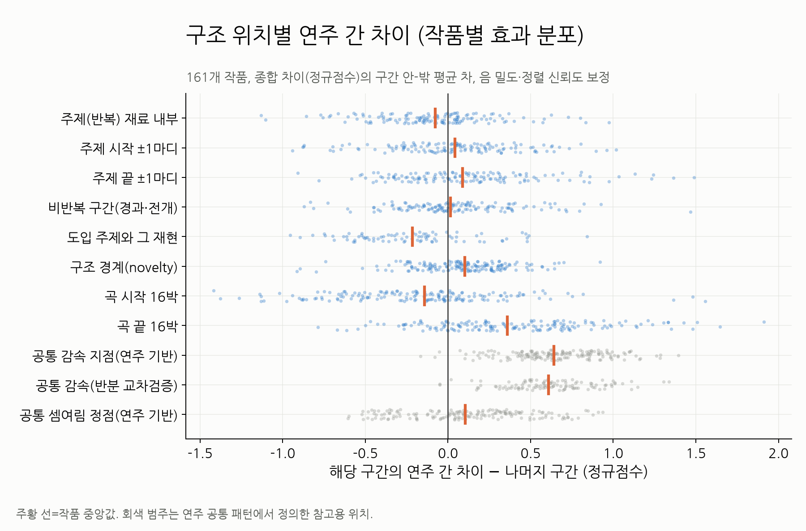
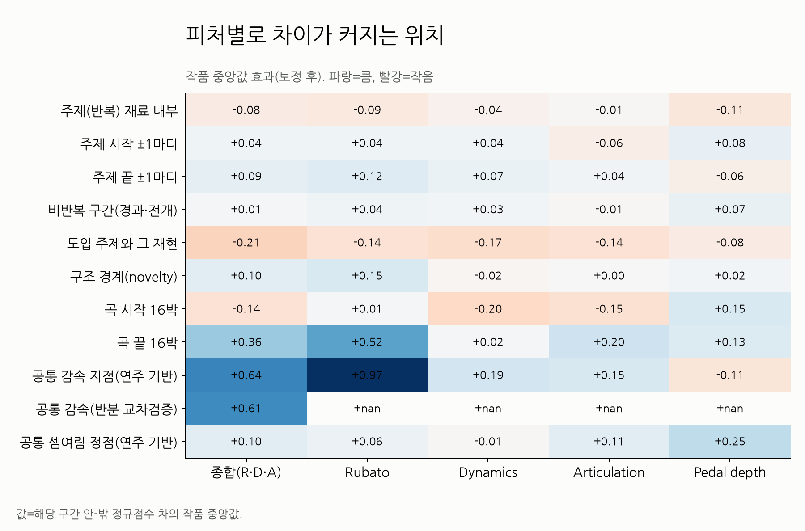
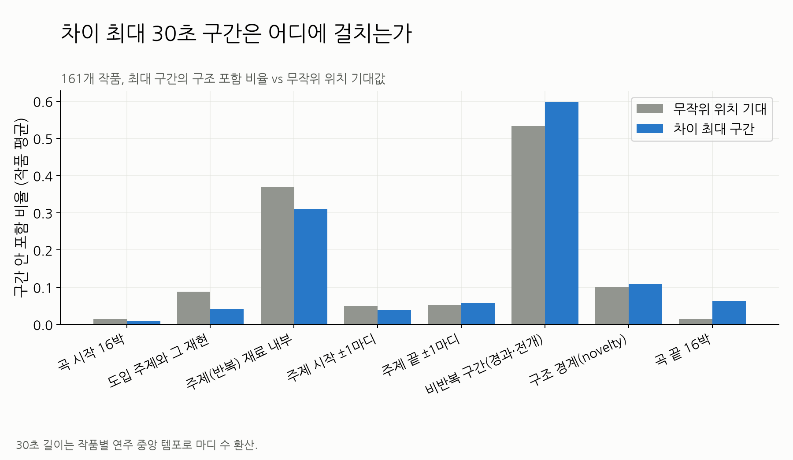
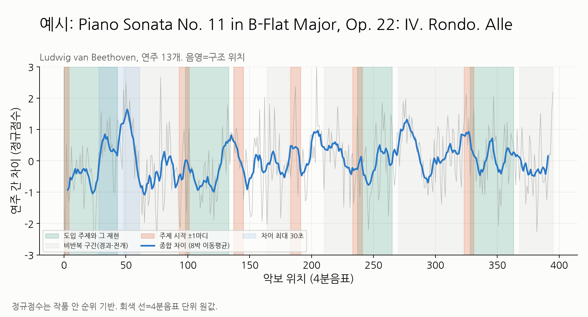

# 악보 구조와 연주 간 차이 위치

2026-11-02. 같은 작품의 여러 연주에서 **연주 스타일 차이가 큰 위치를 곡의 형식 구조로 설명할 수 있는지** 확인했다.
목적은 추천용 짧은 구간(미리듣기 구간)을 고르는 기준을 정하는 것이다.

> **주의: 이 문서의 "주제"는 자동으로 찾은 반복 재료다.** 실제 주제와 겹치는 정도가 무작위 수준이었다.
> 전문가 형식·종지 주석(BPSD 베토벤 1악장, DCML 모차르트)으로 다시 검증한 결과는 [annotated/README.md](annotated/README.md)에 있다.
> 그 결과를 정리하면 다음과 같다.
> - 실제 주제군 내부에서는 차이가 크지 않다.
> - 형식 경계(+0.26, 작품 83%), 코다, 완전정격종지(+0.27, 작품 96%)에서 차이가 크다.

## 결론

| 질문 | 결과 |
|---|---|
| 주제부에서 차이가 큰가? | **아니다.** 반복되는 주제 재료 내부와 도입 주제·그 재현은 오히려 차이가 **작다**. |
| 주제 경계에서 차이가 큰가? | 약하게만 그렇다. 주제 끝은 단독 비교에서 +0.09(작품 60%)였으나, 다른 위치를 함께 통제하면 유의하지 않다. |
| 일반화할 수 있는 위치가 있는가? | **공통 감속 지점(종지·프레이즈 끝)** 이다. 작품의 98%에서 차이가 크고, 효과가 가장 크며(+0.61), 반분 교차검증에서도 유지된다. 구조 경계(novelty)도 작지만 일관되게 크다(작품 66%). |
| 곡 안의 위치는? | 곡 뒤쪽으로 갈수록 차이가 커진다(시작→끝 +0.29~0.36, 작품 75%). 곡 시작 16박은 차이가 작다. |
| 구조로 얼마나 설명되는가? | 적다. 4분음표 단위 차이의 분산 중 음 밀도·정렬 보정이 13%, 악보 구조와 위치가 추가로 8%p, 공통 감속·정점이 다시 5%p를 설명한다. |

즉 연주 차이는 "주제"보다 **모두가 함께 늦추는 지점(주로 프레이즈 끝으로 추정)과 구간이 바뀌는 지점**에서 커진다.
공통 감속 지점이 곧 주제가 끝나는 곳은 아니다(아래 확인).
주제 자체는 연주자들이 비교적 비슷하게 치고, 주제를 어떻게 마무리하고 넘어가는지에서 해석이 갈린다.
Repp(1992)와 Todd(1992)가 말한 "표현 차이는 프레이즈 경계에 몰린다"는 관찰과 같은 방향이다.

### 공통 감속 지점은 주제가 끝나는 곳인가

아니다. 공통 감속 지점의 위치를 따로 확인했다([common_slow_locations.csv](common_slow_locations.csv), 작품 평균).

| 공통 감속 지점이 속한 곳 | 비율 | 무작위 기대 |
|---|---:|---:|
| 주제 끝 ±1마디 | 9% | 6% |
| 주제 끝·구조 경계·곡 끝 중 하나 | 30% | 19% |
| 곡 끝 16박 | 12% | 5% |
| 반복 재료 내부 | 35% | 42% |
| 새 음이 시작하지 않는 박(긴 음·쉼) | 10% | 4% |

- 경계와 곡 끝에 1.5~2.7배 몰리지만, 약 70%는 경계 밖에 있다. 주제 내부에도 35%가 있다.
- 16박 이상 이어지는 느린 구간은 거의 없다(작품 3%만 절반 이상). 대부분 짧게 늦췄다가 돌아오는 지점이다.
- 긴 음·쉼에서 2.3배 많다. 그래서 주제 단위보다 짧은 **프레이즈 끝(숨 쉬는 곳·종지)** 일 가능성이 높다.
  다만 프레이즈 표기가 없어 직접 확인하지 못했다.

따라서 "종지·프레이즈 끝"은 해석이고, 측정한 것은 "연주자 대부분이 함께 늦추는 지점"이다.

## 데이터와 계산

- 입력: [ATEPP 정규화](../atepp_normalization/README.md)의 `atepp_standardized.npz`. 연주 5개 이상인 **161개 작품, 2,489개 연주**.
  소나타 악장 102개, 베토벤 71개·모차르트 26개 작품이라 고전 소나타 비중이 크다.
- **연주 간 차이 D(q)**: 각 4분음표 위치에서 연주들의 표준화 값의 평균 쌍별 절대차.
  - Rubato는 자기 중앙 템포를 이미 뺀 값을 쓴다.
  - Dynamics·Articulation·Pedal depth는 연주별 중앙값을 빼서 전체 수준 차이를 없앤다.
  - log 후 작품 안 순위를 정규점수로 바꿔 작품끼리 비교한다.
  - 종합 = Rubato·Dynamics·Articulation 평균(페달은 전사 잡음이 커서 따로 본다).
- **보정 변수**: 음 밀도(4분음표 안 onset 수)와 정렬 신뢰도(악보 음 중 정렬된 비율). 음이 적거나 정렬이 약한 곳은 차이가 기계적으로 커지기 때문이다.
- **악보 구조(악보 MIDI만 사용)**:
  - 반복 재료: 16박 창의 음높이 분포가 다른 위치와 조옮김 포함 코사인 0.9 이상으로 같으면 주제(반복) 재료로 본다. Müller 등(2011)의 반복 구간 탐지와 같은 생각이다.
  - 주제 시작·끝: 반복 재료 구간의 시작·끝 ±4박.
  - 도입 주제와 그 재현: 곡 첫 32박의 반복 재료와 그것이 다시 나오는 위치. 80개 작품에서만 검출됐다.
  - 구조 경계: 자기유사도 행렬의 Foote novelty 상위 봉우리 ±4박.
  - 곡 시작·끝 16박.
- **참고용(연주에서 정의)**: 공통 감속 = 공통 Rubato 하위 10%, 공통 셈여림 정점 = 공통 Dynamics 상위 10%.
  같은 연주로 위치와 차이를 함께 재면 순환이 될 수 있어서, 연주 10개 이상인 108개 작품은 **연주를 반으로 나눠 한쪽으로 감속 위치, 다른 쪽으로 차이**를 따로 쟀다.
- **검정**:
  - 작품마다 구간 안-밖 평균 차이를 구하고, 라벨을 원형 이동한 null로 p를 구한다. 위치끼리 붙어 있는 자기상관을 유지하기 위해서다.
  - 작품 간에는 Wilcoxon 부호순위 검정을 쓴다.
  - 결합 회귀: 범주들이 겹치므로 작품마다 `D ~ 구조 범주들 + 위치 + 밀도 + 정렬`을 적합하고 계수를 작품 간에 모았다.

## 결과



보정 후 종합 차이, 단독 비교(작품 중앙값, 양수인 작품 비율):

| 위치 | 효과 | 양수 작품 | Wilcoxon p |
|---|---:|---:|---:|
| 공통 감속 지점 | +0.64 | 98% | <1e-4 |
| 공통 감속(반분 교차검증, 108작품) | +0.61 | 98% | <1e-4 |
| 곡 끝 16박 | +0.36 | 78% | <1e-4 |
| 공통 셈여림 정점 | +0.10 | 65% | 0.0003 |
| 구조 경계(novelty) | +0.10 | 66% | <1e-4 |
| 주제 끝 ±1마디 | +0.09 | 60% | 0.006 |
| 주제 시작 ±1마디 | +0.04 | 56% | 0.27 |
| 비반복 구간 | +0.01 | 53% | 0.24 |
| 주제(반복) 재료 내부 | −0.08 | 40% | 0.002 |
| 곡 시작 16박 | −0.14 | 34% | <1e-4 |
| 도입 주제와 그 재현(80작품) | −0.21 | 24% | <1e-4 |

결합 회귀(133작품, 비반복 구간 기준)에서는 다음과 같다.

- 다른 위치를 함께 넣어도 남는 효과:
  - 공통 감속 +0.61(98%)
  - 위치(시작→끝) +0.29
  - 구조 경계 +0.08(65%, p=0.0007)
  - 곡 끝 +0.08
- 사라지는 효과:
  - 주제 시작·끝(p>0.4)
  - 곡 시작: 위치를 넣으면 0이 된다. 곡 시작이 작아 보였던 것은 "곡 앞부분"이기 때문이다.
- 주제 내부: −0.06(p=0.11)으로, 크지 않지만 모든 설정에서 음수다.



피처별로 보면 다음과 같다.

- 감속 지점 효과는 대부분 **Rubato**에서 온다(+0.97). Articulation·Dynamics도 양수다.
- 셈여림 정점에서는 **Pedal depth**와 Articulation 차이가 크다.
- 곡 시작에서는 Dynamics 차이가 특히 작다.
- 세 피처의 차이 위치가 겹치는 정도는 약하다(8박 평활 Spearman 중앙값: R–D 0.18, R–A 0.24, D–A 0.12).



작품마다 연주 중앙 템포로 환산한 30초 창에서 종합 차이가 최대인 위치를 찾았다.

- 위치: 첫 30초에서 시작하는 작품은 **8%** 뿐이고, 곡 길이 기준 시작 위치 중앙값은 60%다.
- 무작위 위치 대비 더 많이 포함하는 것: 공통 감속(0.18 vs 0.09), 곡 끝, 비반복 구간
- 무작위 위치 대비 덜 포함하는 것: 도입 주제·재현(0.04 vs 0.09), 반복 재료
- 반복 강도와 차이의 상관은 작품 중앙값 −0.07이다.



베토벤 Op.22 론도 예시에서도 론도 주제가 돌아오는 구간(초록)은 차이가 낮다.
주제가 끝나고 경과로 넘어가는 곳에서 차이가 높아진다.

## 민감도

반복 임계값 0.85/0.95와 창 8박으로 바꿔도 결론은 같다.

| 설정 | 주제 내부(결합) | 구조 경계(결합) | 곡 끝(결합) | 도입 주제(단독) |
|---|---:|---:|---:|---:|
| 기본(0.9, 16박) | −0.04 | +0.11 | +0.24 | −0.21 |
| 임계 0.85 | −0.07 | +0.10 | +0.13 | −0.21 |
| 임계 0.95 | −0.15 | +0.10 | +0.27 | −0.26 |
| 창 8박 | −0.08 | +0.11 | +0.12 | −0.28 |

## 추천 구간 선택에 주는 의미

1. **"주제부 = 연주 차이가 큰 곳"이라는 가정은 이 데이터에서 성립하지 않는다.**
   주제부만 잘라 임베딩하면 연주 간 변별력은 오히려 평균보다 낮다.
2. **차이가 몰리는 위치는 일반화할 수 있다.**
   - 프레이즈·주제가 끝나는 종지(모두가 느려지는 곳)
   - 구간이 바뀌는 경계
   - 곡 후반
3. 따라서 구간은 **주제 하나를 처음부터 끝맺음(종지)까지 온전히 포함**하도록 잡는 것이 좋다.
   - 주제는 사용자가 알아보는 대표성을 주고, 종지·경계는 변별력을 준다.
   - 주제 중간에서 끊으면 차이가 가장 큰 끝맺음이 빠진다.
4. 곡 시작 30초는 사용자 청취 행동과 맞지만 연주 차이는 작다.
   시작부를 쓴다면 첫 주제가 끝나는 종지까지 늘리는 것을 권한다.

## 제한

- **이 문서의 "주제"는 음악학적 주제가 아니다.** 악보 음높이가 16박 동안 거의 그대로(코사인 0.9 이상, 조옮김 허용) 다시 나오는 부분을 자동으로 찾은 "반복 재료"다.
  - 변형되어 재현되는 주제나 제2주제는 놓칠 수 있다.
  - 반복되는 반주 음형이나 모방은 주제가 아닌데도 잡힐 수 있다.
  - "도입 주제"는 처음 32박이 거의 그대로 다시 나오는 경우만 잡혀서 80개 작품에서만 검출됐다.
  - 실제 형식 주석(BPSD 베토벤 1악장, DCML 모차르트 종지 주석)으로 재검증할 예정이다.
- 악보 MIDI에 페르마타·반복 기호·마디선 정보가 없다. 그래서 "종지" 대신 공통 감속을 썼다.
  공통 감속은 반분 교차검증으로 순환을 줄였지만, 악보만으로 정의한 위치는 아니다.
- 위치 효과(뒤로 갈수록 큼)는 정렬 오차 누적일 가능성을 배제하지 못했다. 정렬 신뢰도는 위치별로 보정했지만 누적 drift는 측정하지 않았다.
- 4분음표 단위 R²는 잡음 때문에 낮게 나온다. 구조의 설명력이 "작다"는 상대 비교로 읽어야 한다.
- 고전 소나타 비중이 크다. 장르별 결과([summary_by_genre.csv](summary_by_genre.csv))는 소나타 외 표본이 10~26개라 참고만 한다.
- 차이가 크다는 것은 해석이 갈린다는 뜻이다. 그 차이가 청자가 듣고 구별하는 차이인지는 청취 평가로 따로 확인해야 한다.

## 파일

- [piece_effects.csv](piece_effects.csv): 작품×피처×범주별 효과·p
- [summary.csv](summary.csv): 작품 간 요약
- [joint_coefficients.csv](joint_coefficients.csv), [joint_summary.csv](joint_summary.csv): 결합 회귀 계수·R²
- [top_windows.csv](top_windows.csv): 차이 최대 30초 창과 구조 포함 비율
- [correlations.csv](correlations.csv): 반복 강도·피처 간 상관
- [pieces.csv](pieces.csv): 작품 목록·반복 비율
- [stats.json](stats.json)

## 재현

저장소 루트 PowerShell:

```powershell
$env:PYTHONPATH = "classicfy-ai/src;classicfy-ai/scripts"
.venv/Scripts/python.exe classicfy-ai/scripts/analyze_structure_divergence.py
```

`--threshold`, `--window`, `--min-performances`, `--preview-seconds`, `--out`으로 설정을 바꾼다.
입력 캐시와 원본 데이터는 수정하지 않는다.
