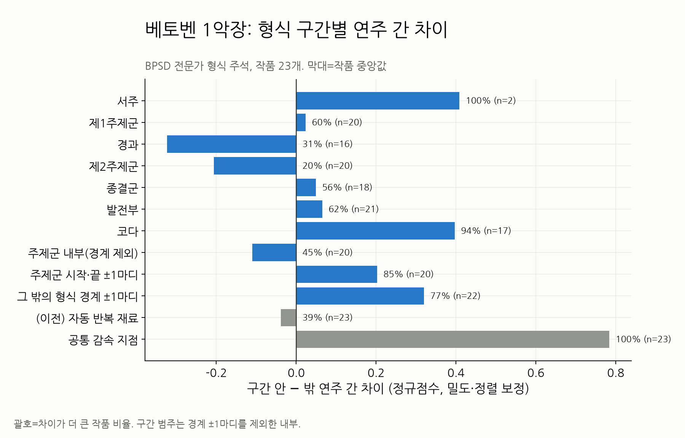
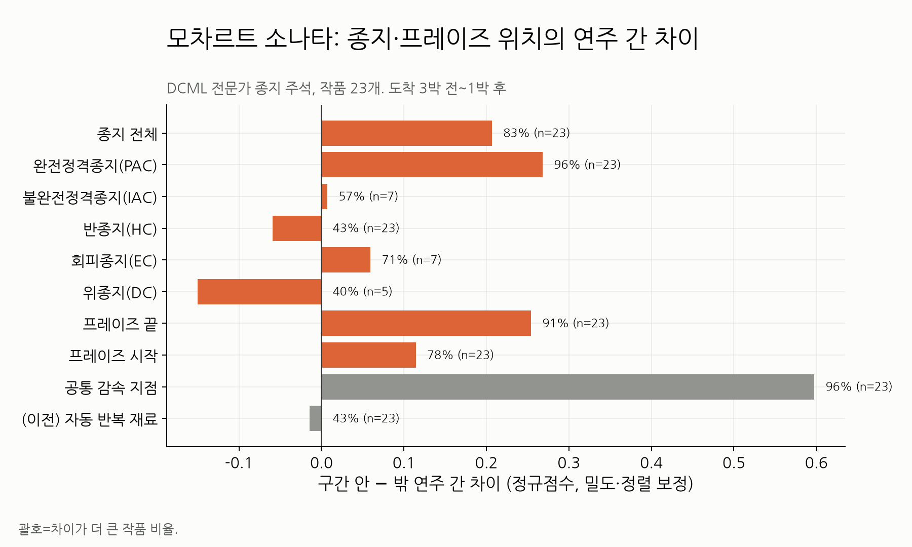
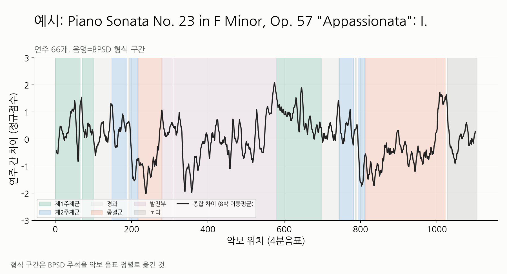

# 전문가 형식·종지 주석으로 재검증

2026-11-02. [상위 분석](../README.md)의 "주제"는 자동으로 찾은 반복 재료였다.
여기서는 **전문가가 붙인 실제 형식·종지 주석**으로 같은 질문을 다시 확인했다.

| 데이터 | 내용 | 우리 데이터와 겹침 | 라이선스 |
|---|---|---|---|
| [BPSD](https://zenodo.org/records/10847702) (Zeitler et al., 2024) | 베토벤 소나타 1악장의 제시부·발전부·재현부·코다와 제1·2주제군·경과·종결군 (Tovey 분석, 마디 단위) | 1악장 23개 (Op.26 변주곡 제외, 1개 정렬 미달) | CC BY 3.0 |
| [DCML Mozart](https://github.com/DCMLab/mozart_piano_sonatas) (Hentschel et al., 2021) | 모차르트 소나타의 종지(PAC·IAC·HC·EC·DC)와 프레이즈 시작·끝 (Caplin 분류, 4분음표 단위) | 악장 23개 (1개 정렬 미달) | CC BY-NC-SA 4.0 |

## 결론

1. **실제 주제군 내부에서는 연주 차이가 크지 않다.**
   - 제1주제군은 평균 수준(+0.02)이다.
   - 제2주제군은 오히려 작다(−0.21, 작품 80%에서 작음).
   - 이전 분석의 "주제 내부는 차이가 작다"는 방향은 실제 주석에서도 대체로 맞다.
2. **차이가 큰 곳은 형식 구간이 바뀌는 경계와 코다다.**
   - 주제군의 시작·끝 ±1마디는 +0.20(작품 85%), 그 밖의 형식 경계는 +0.32(77%)다.
   - 코다는 +0.40(94%)이다.
   - 결합 회귀에서도 경계 효과가 +0.29(91%)로 남는다.
3. **실제 종지에서 차이가 크다. 다만 종지 종류에 따라 다르다.**
   - 완전정격종지(PAC)는 +0.27(작품 96%), 프레이즈 끝은 +0.25(91%)다.
   - 반종지(HC)는 차이가 없다(−0.06).
   - 곡이나 구간을 "닫는" 종지에서 연주자마다 늦추는 정도가 갈린다는 뜻이다.
4. **공통 감속 지점은 종지·경계 쪽으로 몰리지만, 종지와 같지는 않다.**
   - 모차르트: 공통 감속 지점의 40%가 종지 부근이다(종지 부근이 곡에서 차지하는 비율 27%). 종지·프레이즈 끝까지 합치면 51%다(기대 33%).
   - 베토벤: 27%가 형식 경계 ±1마디 안에 있다(기대 12%).
   - 나머지 절반가량은 표기된 종지·경계 밖이다. 프레이즈 안의 표현적 늦춤으로 보인다.
5. **이전의 자동 "반복 재료"는 실제 주제의 대리 지표로 부적합했다.**
   - 자동 반복 재료 중 실제 주제군에 속한 비율은 53%였다. 무작위 기대가 43%라서 거의 차이가 없다.
   - 실제 주제군 중 자동으로 잡힌 비율도 52%뿐이다.
   - 상위 분석의 주제 관련 결과는 이 문서의 결과로 대체한다.

## 방법

- **위치 옮기기**
  - 주석의 마디·4분음표 위치를 ATEPP 악보 격자로 옮겼다. 두 악보의 음표 이벤트(같은 시점의 음높이 집합)를 갭 허용 전역 정렬(Needleman–Wunsch)로 맞췄다.
  - 한쪽만 반복을 펼친 경우에는 남은 긴 블록을 자유 끝 정렬로 한 번 더 맞췄다.
- **정렬 품질**
  - 음표 이벤트의 Jaccard ≥ 0.5 일치율이 베토벤 중앙값 0.96, 모차르트 0.94다.
  - 일치율 0.6 미만이거나 라벨이 붙은 4분음표가 80% 미만인 작품은 제외했다.
- **차이 측정**: 연주 간 차이 D, 정규점수, 밀도·정렬 보정, 원형 이동 검정은 상위 분석과 같다.
- **구간 정의**
  - 형식 구간 범주는 경계 ±4박을 뺀 내부다.
  - 종지는 도착 3박 전부터 1박 후까지로 잡았다. 접근 과정의 감속을 포함하기 위해서다.
- **결합 회귀(베토벤)**: 경과 구간을 기준으로 두고 `D ~ 구간 + 경계 + 위치 + 밀도 + 정렬`을 적합했다.

## 결과



| 베토벤 (작품 중앙값, 차이가 더 큰 작품 비율) | 효과 | 비율 | p |
|---|---:|---:|---:|
| 형식 경계 전체 ±1마디 | +0.26 | 83% | <0.001 |
| 주제군 시작·끝 ±1마디 | +0.20 | 85% | <0.001 |
| 코다 | +0.40 | 94% | <0.001 |
| 제1주제군 내부 | +0.02 | 60% | 0.31 |
| 발전부 | +0.07 | 62% | 0.26 |
| 종결군 | +0.05 | 56% | 0.61 |
| 제2주제군 내부 | −0.21 | 20% | 0.02 |
| 경과 내부 | −0.32 | 31% | 0.02 |
| 공통 감속 지점 | +0.78 | 100% | <0.001 |

결합 회귀(경과 기준)에서 코다는 +0.77, 발전부 +0.41, 제1주제군 +0.40, 제2주제군 −0.03, 경계 +0.29(91%)다.
경과 "내부"가 낮은 것은 빠른 음형 위주 구간이기 때문으로 보인다. 경과가 끝나는 경계 쪽은 높다.



피처별로 보면 다음과 같다([beethoven_summary.csv](beethoven_summary.csv), [mozart_summary.csv](mozart_summary.csv)).

- 경계·종지 효과는 대부분 **Rubato**에서 온다.
- Articulation은 종결군(+0.30)과 PAC(+0.23)에서 크다.
- Dynamics는 서주·코다를 빼면 형식 위치와의 관계가 약하다.



열정 소나타 1악장(연주 66개)에서도 같은 패턴이 보인다.

- 높은 곳: 발전부가 재현부로 넘어가는 경계(약 580박), 재현부 종결군에서 코다로 넘어가는 지점(약 1,000박)
- 낮은 곳: 제2주제군과 종결군 초반

## 미리듣기 구간 선택에 주는 의미

- **주제군 하나만 잘라내는 방식은 변별력이 낮다.** 특히 제2주제군 단독이 그렇다.
- **추천 구간: 주제 + 그 주제를 닫는 종지(PAC) + 다음 구간으로 넘어가는 경계까지.**
  주제는 사용자가 알아볼 수 있는 부분이고, 종지와 경계는 연주자 해석이 갈리는 부분이다.
- 예: 제1주제군 시작 → 경과를 거쳐 제2주제군에 들어서는 경계까지. 또는 재현부·코다 접합부를 포함한 구간.

## 제한

- 표본이 작다(각 23악장). 작곡가가 둘(베토벤 1악장, 모차르트 소나타)뿐이다. 낭만·근대 레퍼토리에 일반화하지 않는다.
- 서주(2작품), IAC·EC·DC(5~7작품)는 표본이 너무 작아 해석하지 않는다.
- 여러 범주를 동시에 검정했다. p값은 다중 비교 보정 전 값이다.
- 정렬로 옮긴 경계에는 몇 박의 오차가 있을 수 있다. ±1마디 창이 이를 일부 흡수한다.
- DCML 주석은 비상업 라이선스다. 연구 분석에만 쓰고, 서비스 데이터에는 넣지 않는다.

## 재현

```powershell
$env:PYTHONPATH = "classicfy-ai/src;classicfy-ai/scripts"
.venv/Scripts/python.exe classicfy-ai/scripts/analyze_annotated_structure.py
```

주석 데이터는 저장소 밖 `../annotations/`에 둔다.

- BPSD: Zenodo 압축 파일에서 `2_Annotations/ann_score_*`와 `0_RawData/score_midi`만 추출했다.
- DCML: `git clone https://github.com/DCMLab/mozart_piano_sonatas`

`--bpsd`, `--dcml`, `--min-match`로 경로와 기준을 바꾼다.
