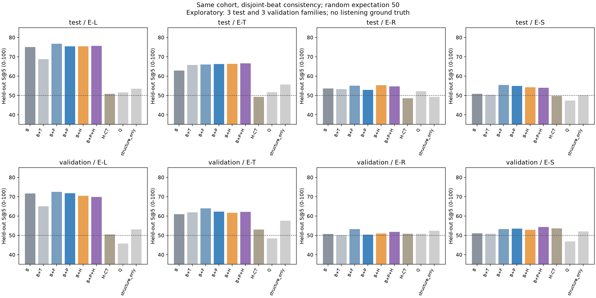
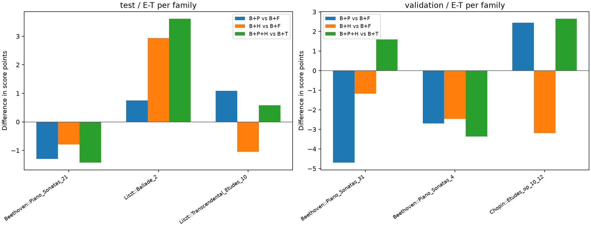
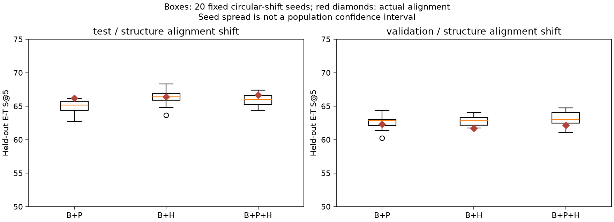

# 구조에 따른 연주 반응이 검색에 도움이 되는가?

2026-10-14. **이번 탐색 비교에서는 프레이즈·긴장도 조건이 고정 구간보다 추가로
유용하다는 근거를 확보하지 못했다.** 전곡 평균·폭보다 국소 시간 반응을 추가한 조건은
높은 변화 패턴 점수를 보였지만, 구조의 추가 이득은 validation·후보 수 균형 대조에서 유지되지 않았다.
이 결과가 프레이즈나 조성 긴장도가 일반적으로 쓸모없다는 뜻은 아니다.

## 같은 표본의 주 결과

전체 570연주에서 모든 입력·분리 구간 평가·20개 구조 섞기 조건의 지원이 있는 공통
335연주를 결과 전에 고정했다. gallery는 train 247연주·24악보·23작품군,
test query는 45연주·3작품군, validation은 43연주·3작품군이다.
같은 작품군이 query와 gallery 양쪽에 들어가지 않는다.

원래 beat를 완전한 64구간 블록으로 나눠 A/B를 번갈아 배정하고 A로 검색→B로 평가,
B로 검색→A로 평가했다. 원래 index와 모든 구조/결측 pair mask를 유지했다.
각 후보는 다른 작품군이며 Top 5에 작품군당 최대 1연주를 넣었다.

점수는 **검색에 쓰지 않은 구간의 변화량 RMS 분포 일치 E-T S@5**다.
gallery 작품군→작품→연주를 균등하게 뽑았을 때의 평가 거리 백분위로 정의한다.
0–100 표기에서 일반 무작위 기대값은 50이며 사람의 선호 성공률이 아니다.
query는 작품별 평균 후 작품군별 평균으로 집계한다.

| 검색 조건 | test E-T | validation E-T |
|---|---:|---:|
| B: 전곡 기준 형태의 평균·폭을 검색 view에서 재계산 | 62.91 | 60.94 |
| B+T: 문맥 없는 시간·공동 변화 요약 | 65.72 | 61.87 |
| B+F: 16-original-beat 고정 구간 시작·중간·끝 | 66.02 | **63.95** |
| B+P: 프레이즈 가설의 시작·중간·끝 | 66.20 | 62.30 |
| B+H: 긴장도 세 지표의 저·중·고 수준 | 66.38 | 61.67 |
| B+P+H: 프레이즈·긴장도 결합 | **66.64** | 62.16 |
| 작곡가+작품 유형 M-CT | 49.26 | 53.01 |
| 길이·coverage Q | 51.66 | 48.41 |
| 악보 구조 자체만 S | 55.59 | 57.49 |

굵은 수치는 각 split의 기술상 최대값이며 모델 선택·유의한 승리 표시가 아니다.
기존 다른 표본의 69.1점과 직접 비교하지 않는다.
T는 7채널 Δ평균·ΔRMS와 Tempo–Dynamics 공동 모멘트 **15D**다.
앞선 실험의 57D/119D lag 표현이나 CNN/BiLSTM을 재실행한 결과는 아니다.
F/P는 같은 66D 계산·pooling·지원 최소값을 쓴다. H는 지표 3개를 합친 198D이며
차원 증가를 숨기지 않는다. 새 신경망이나 가중치 선택은 하지 않았다.
각 추가 block은 train SD 및 다른 train 작품군 거리 중앙값으로 맞춘 뒤 동일 가중으로 결합한다.



## 구조의 추가 이득과 대조

- **고정 구간 대비:** test에서 P +0.18점, H +0.37점, 결합 +0.63점이다.
  validation에서는 각각 −1.65, −2.28, −1.79점이다.
- **후보 수 균형:** 작품/grid마다 정확히 3연주만 남기는 20개 고정 seed에서,
  test의 P−F는 −0.003점, H−F는 −0.83점, 결합−F는 −0.19점이다.
  validation에서도 고정 구간을 넘지 못했다. 큰 catalog의 최적 연주 선택 이점을 무시하지 않는다.
- **구조 대응 섞기:** 검색 블록 안에서 P phase/owner와 H label을 함께 circular shift한 뒤
  반응·train scale·검색을 다시 계산했다. feature와 평가 값은 그대로다.
  test H 실제 66.38점과 20-seed 평균 66.31점은 가깝다.
  P는 test에서 shift 평균보다 높지만 validation에서는 유지되지 않는다.
- **같은 작품의 연주 바꾸기:** 반환 작품/grid를 고정하고 연주만 바꾼 정확한 기대값과
  100-seed 범위를 기록했다. E-T에서 P 66.20 대 58.72, H 66.38 대 59.88로
  연주 선택의 일반 시간 패턴 효과는 있다. 다만 F도 66.02 대 59.75다.
- **프레이즈 반응 평가 E-S:** 입력의 Δ평균/RMS를 복사하지 않고 phase별 양의 변화 비율과
  두 변화의 같은 방향 비율을 별도 구간에서 평가했다.
  test P 54.91점은 같은 작품 연주 바꾸기 기대값 56.44점을 넘지 못했다.
  결합도 53.98 대 56.14이며 특정 연주의 프레이즈 반응을 더 잘 찾았다는 근거가 부족하다.
- **성향·폭과 공동 변화:** E-L/E-R도 공개한다. 시간 요약 T는 E-L을 낮췄고,
  H의 작은 E-R 이득도 validation에서 유지되지 않았다. E-T 한 축의 증가만 성공으로 세지 않는다.





test 작품군은 Beethoven Sonata 21, Liszt Ballade 2, Liszt Transcendental Etude 10이다.
각각 23/6/16연주이며 macro 집계에서는 작품군 가중치가 같다.
Liszt Ballade 2에서 H·결합의 이득이 크지만 다른 두 작품군에서는 같은 방향으로 유지되지 않는다.
test/validation 각각 3작품군이므로 모집단 신뢰구간을 제시하지 않았다.
seed 범위는 섞기/후보 선택의 변동이며 모집단 신뢰구간이 아니다.

## 해석 범위와 다음 판단

현재 P는 악보 기호와 길이 cap으로 만든 **provisional 구간**이다. 전문가 프레이즈,
문장 계층·주선율 역할을 확정한 조건이 아니다. H의 strain도 조표 구간의 명시/추정 mode에
대한 거리이며 조표에 나타나지 않은 국소 전조를 감지하지 않는다.
H는 긴장 **수준**별 반응이며 긴장 상승/완화 episode나 반응 지연을 별도로 모델링하지 않았다.

정규화의 작품 공통값·scale은 기존 전체 catalog를 사용한다. 따라서 분리 구간 결과는
겹치지 않는 beat의 일관성 검사이며 새 작품/새 reference의 완전히 독립된 검증이 아니다.
청취 유사성·사용자 선호 정답도 없다.

다음은 정확한 음 매칭을 100%로 만드는 작업이 아니라, 소수 작품에서 문장의 scope·계층과
긴장 상승/완화 episode를 검토하고 **반응의 방향·지연·지속**을 측정할 정의를 고정하는 것이다.
먼저 왜 F와 P/H가 비슷한지를 이 대응과 pooling 관점에서 확인한다.
그 근거 없이 전체 자동 후보를 정답으로 활성화하거나 신경망 크기·가중치를 결과에 맞춰 늘리지 않는다.

## 검증과 산출물

관련 54개 unit/integration 테스트 통과, skip 0. 전체 suite는 실행하지 않았다.
[독립 검산](verification.json)은 원래 배열의 B/T/F·별도 구간 평가, 이전 검증 P/H CSV,
두 고정 seed의 phase shift, train scale·기본/20-seed shift 거리, 모든 Top K·조건부 대조·
집계를 별도 코드로 확인했다. production retrieval 함수를 호출하지 않았다.
12,467,842개 수치 일치, 최대 절대 오차 1.999e−15이다.
다른 shift response 산술 및 보조 S/Q 입력은 unit test와 저장 입력을 사용하고,
그 거리와 순위는 모두 독립 검산했다. 계산 재현과 음악적 정답을 구분한다.

별도 실행의 9개 CSV/JSON은 byte-identical, 291개 배열은 정확히 재현됐다.
세 그림을 직접 확인했다. 입력/코드/산출물 hash는 [provenance](provenance.json)에 있다.

- [고정 조건](protocol.json), [공통 cohort](cohort.json), [제외/지원 기록](eligibility.csv).
- [query별 점수](scores.csv), [Top 5](rankings.csv), [주 결과](summary.csv), [작품군별 결과](per_family.csv).
- [대조 seed별 결과](controls.csv), [대조 집계](control_summary.csv), [차이](contrasts.csv), [train scales](scales.json).
- 외부 배열: `datasets/structure_response_comparison_run02/comparison.npz`. 원본 feature/cache는 변경하지 않았다.

## 다시 실행하기

기존 두 단계의 입력을 사용하는 비교만 재현하려면 저장소 루트에서 실행한다.

```bash
MPLCONFIGDIR=/tmp/classicfy-matplotlib .venv/bin/python \
  classicfy-ai/scripts/compare_structure_responses.py \
  --out /tmp/structure-compare-new --artifacts /tmp/structure-arrays-new
.venv/bin/python classicfy-ai/scripts/verify_structure_response_comparison.py \
  --out /tmp/structure-compare-new --artifacts /tmp/structure-arrays-new
MPLCONFIGDIR=/tmp/classicfy-matplotlib .venv/bin/python \
  classicfy-ai/scripts/report_structure_responses.py --out /tmp/structure-compare-new
```

다른 기기에서 외부 배열이 없으면 [프레이즈 재현](../phrase_response/README.md)으로 먼저 만든다.
원본 raw cache SHA는 `79ab737a08335c7fd7e9a912159de65b7c26795e1ef22e45114e5a8c6eb8ad2e`이고,
`temporal_embedding_run01/dataset.json`의 고정 scale/cohort reference가 필요하다.
원본 collector `20a4168`은 현재 브랜치 history의 ancestor이며 shallow clone은 해당 history가 필요하다.
55 XML과 원래 MIDI/match/annotations의 고정 해시는 프레이즈 provenance에 있다.

새 프레이즈 출력 `/tmp/phrase-new`, 배열 `/tmp/phrase-arrays-new`에서 이어갈 때는 긴장도 CLI에
`--phrases /tmp/phrase-new --source /tmp/phrase-arrays-new`를 주고,
새 긴장도 report와 배열 경로를 비교 CLI에 `--tonal-report`와 `--tension`으로 지정한다.
비교 CLI/verifier 모두 `--phrases`, `--tonal-report`, `--source`를 받는다.
빈 출력 폴더만 사용하고 원래 보고서를 덮어쓰지 않는다.
