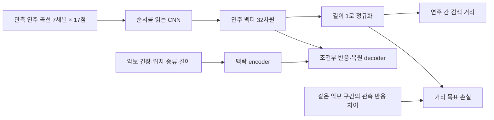

# 같은 악보 구간의 연주 차이를 학습하는 모델

2026-10-14. **설계·코드 골격·데이터 대응 검증·실제 학습 데이터의 1-step 실행까지 완료했다. 본학습과 새 검색 점수 비교는 아직 하지 않았다.** 직전 실험의 모델·결과는 보존했다.

목표는 같은 작품의 같은 구간에서 실제로 관측한 반응이 비슷하면 검색 벡터도 가깝고, 반응이 다르면 벡터 거리도 커지도록 만드는 것이다. 연주자를 맞히거나 악보에서 유일한 정답 연주를 생성하는 과제가 아니다.

## 이전 설계에서 달라지는 점

| 항목 | 이전 반응 모델 | 이번 주 모델 |
|---|---|---|
| 검색 벡터 입력 | 연주 곡선과 악보 맥락을 합침 | 연주 곡선·관측/가림 mask만 사용 |
| 악보 맥락 | 검색 벡터와 반응 head에 함께 영향 | 조건부 반응·복원 decoder에만 직접 입력 |
| 기본 학습 | 각 관측 구간의 가림 일관성과 반응 복원 | 기본 학습에 같은 구간의 연주 간 거리 목표 추가 |
| 가까운 쌍의 기준 | 같은 관측 구간의 두 가림 입력 | 이 기준을 유지하고, 다른 연주 간 관측 반응의 연속적인 차이도 학습 |
| 다른 연주자 | 정답/오답으로 분류하지 않음 | 동일. 연주자 ID로 쌍의 유사성을 결정하지 않음 |

주 모델의 데이터 흐름은 다음과 같다.



CNN은 기존과 같은 폭 32, dilation 1/2/4의 세 잔차 블록을 사용한다. 17개 위치를 순서대로 펼쳐 raw 32차원 벡터를 만들고 검색에는 단위 길이 벡터를 사용한다. decoder는 raw 벡터와 별도 맥락 벡터를 함께 받는다. 파라미터는 **94,673개**다. 폭이나 깊이를 늘리는 실험이 아니며, 분리한 조건부 decoder 때문에 이전 77,167개 모델과 총 파라미터 수는 다르다. 이번 네 비교 조건은 모두 동일한 파라미터 수와 모듈 초기화를 사용한다.

주 검색 encoder에는 작품/연주자/구간 ID, 악보 긴장 값, 구간 종류, 원래 길이를 직접 주지 않는다. ID는 데이터 대응·표본 추출·손실에서만 사용한다. `encode(x)`로 검색할 수 있다. 악보를 직접 주지 않아도 연주 곡선에서 작품을 추측할 가능성은 남으므로, 이 구조만으로 작품 정보가 완전히 제거된다고 주장하지 않는다.

## 무엇을 같은 구간으로 묶나

단순히 같은 작품이거나 17점으로 변환되었다는 이유로 묶지 않는다. 다음 항목이 일치해야 한다.

1. 동일한 train/validation/test 역할과 동일한 A/B 검색 view.
2. 동일한 작품, 원래 beat grid, 구간 종류 P/H0/H1/H2.
3. 해당 구간 전체의 주성부 악보 좌표 열: 반복 방문 `visit_index`, 마디 `measure_index`, 각 written quarter 시작·끝.
4. 모든 구간의 좌표가 `coordinate_verified`이고 유효함. written quarter는 1e−8 단위로 비교한다.
5. 대응된 악보 긴장 맥락의 값과 유효 여부도 일치함: 절대 오차 1e−6 이하.
6. 각 그룹에 서로 다른 연주가 최소 두 개 있어야 함. 같은 owner의 중복 대응은 제외함.

다른 grid는 이번에 연결하지 않는다. 반복 방문이 다르면 별도 구간으로 둔다. 입력은 이전에 고정한 329개 연주, 동일한 구간과 평균 제거 잔차를 재사용한다. 프레이즈의 17점은 written-quarter 위치, H의 17점은 원래 박 위치라는 기존 정의도 유지한다.

[alignment_audit.json](alignment_audit.json)의 실제 검사 결과는 다음과 같다. 모든 대응 그룹에서 좌표와 맥락을 확인했고, 미검증 좌표·중복 owner·맥락 불일치로 제외된 그룹은 없었다.

| 역할 | A 프레이즈 그룹 / 곡선 | A 긴장 그룹 / 곡선 | B 프레이즈 그룹 / 곡선 | B 긴장 그룹 / 곡선 |
|---|---:|---:|---:|---:|
| train | 254 / 2,750 | 476 / 5,035 | 215 / 2,248 | 454 / 4,599 |
| validation | 52 / 596 | 69 / 893 | 24 / 248 | 54 / 654 |
| 기존 test | 47 / 648 | 84 / 1,296 | 44 / 607 | 76 / 1,191 |

train 그룹당 대응 연주는 4~28개다. 그룹 목록, owner, 원래 곡선 행 번호와 전체 좌표 signature는 [passages.csv](passages.csv)에 있다. 이 확인은 음악적 프레이즈/긴장 해석의 정답 검증이 아니라, **같은 추정 구간을 서로 다른 연주에서 정확히 대응시켰는지**의 검증이다.

## 거리의 정답은 어떻게 만드나

연주자 이름을 쓰지 않고 **학습 search view에서 관측한 반응 차이**로 연속적인 목표를 만든다. 두 연주 i, j의 같은 구간에서 다음 블록을 비교한다.

| 블록 | 값 | 블록 가중치 |
|---|---|---:|
| 변화 모양 | 템포·음량 차분을 각 곡선/채널 RMS로 정규화한 16개 변화 값 | .6 |
| 변화량 | 템포·음량 차분 RMS의 log1p; train 평균/SD로 표준화 후 tanh | .2 |
| 긴장과의 시차 관계 | H 종류에 해당하는 악보 긴장과 템포·음량의 차분 상관; −4~+4 원래 박 | .2 |

각 블록은 두 연주 모두 유효한 좌표의 평균 제곱 차이를 계산한다. 없는 블록은 0점으로 채우지 않고 남은 블록의 가중치를 다시 합이 1이 되게 맞춘다. 프레이즈는 시차 블록이 없으므로 모양 .75, 변화량 .25가 된다. 변화가 없는 곡선의 정규화 모양은 정의되지 않으므로 비교에서 빼되, 변화량은 남긴다.

모양만 보존하면 작게 움직인 연주와 크게 움직인 연주가 같아질 수 있어 변화량을 별도 블록으로 남겼다. 이를 전체 연주의 평균·범위 요약으로 대체하지 않는다. 원래 특징의 스케일과 새 변화량 목표 스케일은 train 연주만으로 맞춘다.

사용 가능한 블록의 가중 평균 제곱 차이를 `d_target(i,j)`라 하면, 실제 데이터에서 이 값은 0~4 범위다. 단위 벡터의 제곱 유클리드 거리도 0~4 범위라서 다음과 같이 직접 학습한다.

```text
d_model(i,j) = ||z_unit(i) - z_unit(j)||²
L_metric = 같은 구간·다른 연주 쌍의 SmoothL1(d_model, d_target)
```

정답은 가리기 전 관측값에서 만들고 gradient를 끊는다. 두 개의 가림 입력 각각에서 거리 목표를 학습한다. 전체 쌍을 그대로 평균하면 연주 수가 많은 작품이 지배하므로, **그룹 안의 쌍 평균 → 표본 그룹 간 평균** 순서로 집계한다.

서로 다른 구간의 쌍과 같은 recording owner의 쌍은 이 손실에 들어가지 않는다. 같은 구간의 모든 연주를 가까이 묶지도 않고, 다른 연주자를 무조건 멀리 보내지도 않는다. triplet의 정답/오답을 임의로 정하는 대신 연속적인 차이를 사용한다.

이 목표는 사람의 스타일 정답이 아니다. 모양·크기·시차라는 선택한 기준을 거리로 옮기는 수치 학습이다. 학습한 기준과 동일한 수식의 점수 상승만으로 음악적 유사성이 개선되었다고 결론 내리지 않는다.

## 나머지 학습 목표와 배치

기존 가림 방식인 17점 중 2점의 연주 채널 숨기기를 유지한다. 큰 시간 늘이기/줄이기, 위치 섞기, 크기 제거를 정답 유지 증강으로 사용하지 않는다. 이 변환은 보존하려는 반응을 바꿀 수 있기 때문이다.

전체 손실의 초기 설계는 다음과 같다. [protocol.json](protocol.json)에 값이 고정되어 있다. 아직 본학습 결과로 조정하지 않았다.

```text
L = 1.0 × 같은 구간의 연주 거리
  + 1.0 × 정규화 변화 모양 복원
  + 0.25 × 변화량 복원
  + 0.25 × 증감 방향 분류
  + 0.25 × 관측 잔차 최대점 위치
  + 0.25 × 유효한 H 시차 상관 복원
  + 0.1 × 가린 원래 특징 복원
  + 1.0 × 같은 관측의 두 가림 입력 일관성
  + 1.0 × raw 검색 벡터 분산 제약
  + 0.04 × raw 검색 벡터 공분산 제약
```

일관성·분산·공분산은 별도 projection의 출력 대신 검색에 쓰는 raw bottleneck에 직접 적용한다. 각 그룹의 총 가중치를 같게 만드는 가중 평균을 사용한다. 분산·공분산 규제 아이디어는 [VICReg](https://arxiv.org/abs/2105.04906)를 참고한 변형이다. 원 논문 전체를 재현하는 것은 아니다. 공통 요인과 개별 관측을 구분하는 연구로 [ML-VAE](https://ojs.aaai.org/index.php/AAAI/article/view/11867)를 참고했지만, 이번 코드는 VAE나 그 논문의 재현 모델이 아니다.

한 배치는 구간 그룹 8개를 복원 추출하고 각 그룹에서 서로 다른 연주를 최대 8개 추출한다. 그룹 선택은 family → work/grid → P/H → H metric → 해당 구간을 균형 있게 반영한다. 같은 그룹이 한 배치에 다시 선택되어도 독립적인 그룹 추출로 집계한다. validation/test는 train 배치에 들어가지 않는다.

실제 1-step 점검에서 A는 63곡선·217쌍, B는 55곡선·170쌍을 사용했다. 각 방향에 서로 다른 8개 그룹 추출 단위가 있었다. weight는 점검 후 버렸다.

## 무엇과 비교할 것인가

두 변경을 한 번에 적용하면 원인을 알 수 없으므로 2×2 비교를 준비했다.

| 조건 | 검색 벡터에 악보 직접 입력 | 같은 구간의 거리 목표 |
|---|---|---|
| fused / no metric | 있음 | 없음 |
| separate / no metric | 없음 | 없음 |
| fused / metric | 있음 | 있음 |
| **separate / metric: 주 모델** | **없음** | **있음** |

fused 조건에서만 동일한 search-fusion 모듈에 실제 맥락 벡터를 넣는다. separate 조건은 그 입력을 0으로 만든다. 같은 seed·같은 모듈 크기·같은 배치·같은 가림을 사용한다. 기존 77,167개 모델은 과거 참고 결과로 표시하고, 정확한 구조 변경 효과는 이 네 새 조건 사이에서 비교한다. 이후 본학습에서는 seed 세 개를 예정했다.

검색 거리는 학습한 단위 벡터의 유클리드 거리다. train 축별 SD로 다시 좌표를 늘이거나 줄이지 않는다. 그 변환은 학습한 거리 목표를 바꿀 수 있다. 연주 전체 비교는 개별 구간을 유지하는 기존 set distance로 시작하되, P/H의 결합 보정은 train에만 맞춘다. 해당 set distance는 아직 새 모델에 대해 실행하지 않았다. 전체 수준 요약 B는 별도 참고 결합으로 두고 주 반응 벡터에 넣지 않는다.

## 성공 여부를 판정하는 순서

**첫째, 새로운 작품의 같은 구간 안에서 연주 차이를 보존하는지.** 학습에 없는 family에서 같은 구간의 여러 연주를 비교해 수치 목표 거리와 벡터 거리의 오차·순위 일치를 본다. 이것은 거리 목표를 일반화하는지의 검사이며 음악적 독립 검증은 아니다.

**둘째, 같은 작품 안에서 특정 연주를 잘 고르는지.** 학습에 없는 작품의 연주를 query로 두고 자기 recording을 제외한 같은 작품의 연주를 후보로 삼는다. A 입력으로 검색하면 B 관측 기준으로 후보를 평가하고 반대 방향도 따로 평가한다. 악보만 쓰는 모델, 학습 전 모델, 순서 섞기, 반환 작품/grid 안의 무작위 연주 선택과 비교한다. 무작위 교체와의 차이를 주 지표로 보고, 작품/곡선 수의 영향을 통제한다. validation 선택에 사용한 연주는 선택 과정과 독립된 증거로 취급하지 않는다.

**셋째, 다른 작품에도 거리가 통하는지.** 기존 반대-view 7개 proxy, 다른 작품 후보 검색, 별도의 음악적·청취 평가를 분리해 확인한다. 같은 구간의 쌍만 학습하면 서로 다른 구간 사이의 벡터 위치는 충분히 정해지지 않는다. 주 encoder에 악보가 없더라도 그룹마다 다른 벡터 방향을 사용할 수 있다. 이 문제는 실제 평가 후 비슷한 맥락의 구간 간 반응 비교 목표 등을 추가할지 판단한다. 현재 거리 목표가 이 문제까지 해결했다고 가정하지 않는다.

중요하게도 이전 45개 test 연주의 결과를 보고 이번 설계를 선택했다. **이제 그 test는 반복 개발 비교용 기준이지 새롭고 독립적인 최종 test가 아니다.** 최종 성능 주장은 새로운 family의 추가 확보나 외부 청취 자료 등 독립적인 확인이 필요하다. family 교차검증은 안정성 검토에 도움이 되지만 이미 관찰한 데이터에 대한 설계 선택의 영향을 없애지는 못한다.

## 구현과 실행 검증

- [data.py](data.py): 전체 악보 좌표 대응, 그룹 목록, train-only 변화량 스케일, 그룹 배치.
- [model.py](model.py): 94,673개 모델, 악보 경로 분리, 조건부 decoder, 연속적인 쌍 거리 손실, 그룹별 균형 목적함수.
- [protocol.json](protocol.json): 주 모델·통제·가중치·후속 학습/평가 조건.
- [test_design.py](test_design.py): 의미 있는 설계 불변조건 테스트 **13개 통과**.
- [smoke.py](smoke.py), [smoke_results.json](smoke_results.json): 두 방향×네 조건, 실제 train 배치의 독립적인 1-step 순전파·역전파·optimizer 실행 **8개 통과**.

테스트는 악보 교체 시 주 검색 벡터 불변, fused 모델의 악보 경로 존재, 가린 정답의 encoder/decoder 유입 방지, 순서 민감성, 단위 벡터 거리 범위, 반응이 맞는 거리 관계의 보상, 다른 구간/같은 owner 쌍 제외, 결측 목표 처리, 목표 gradient 차단, 그룹 수 균형, 표현 붕괴 벌점, 실제 배치의 train 경계, test 값 변경에 무관한 목표 스케일, 반복 방문 분리를 확인했다.

현재 코드는 저장소 밖 `Classicfy/diagnostics/conditional_metric_model`에 있으며, 이전 완료 실험의 고정 `data.py`와 `model.py`를 재사용한다. 직접 재현하려면 프로젝트 저장소에서 실행한다.

```bash
cd /Users/ihun-ui/Desktop/Classicfy/capstone-2026-2-classicfy
.venv/bin/python ../diagnostics/conditional_metric_model/data.py
.venv/bin/python ../diagnostics/conditional_metric_model/test_design.py
.venv/bin/python ../diagnostics/conditional_metric_model/smoke.py
```

이는 대응 검사와 1-step 검증 명령이다. 본학습용 checkpoint 선택·반복 학습·검색 평가 orchestration은 아직 구현하지 않았고, 새 모델의 학습된 checkpoint나 개선 점수도 없다. 완료 파일과 재사용 소스의 해시는 [manifest.json](manifest.json)에 기록했다. 프로젝트 추적 파일 변경이나 원격 게시 작업은 하지 않았다.
