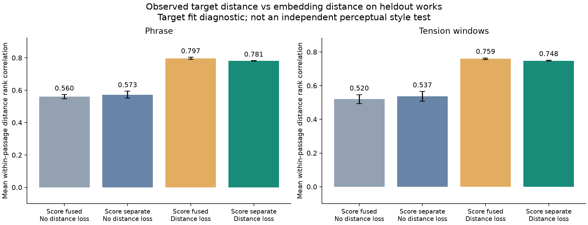
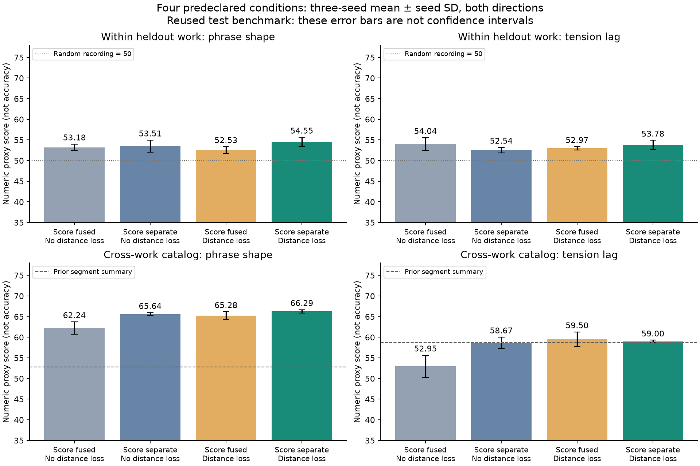
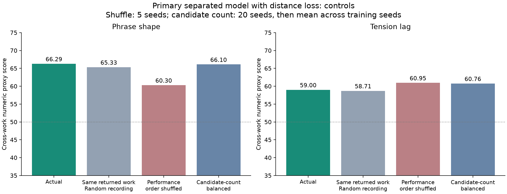
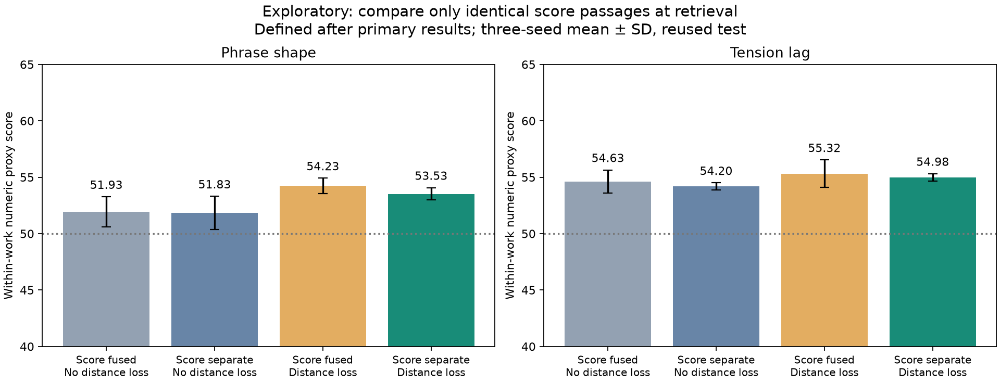
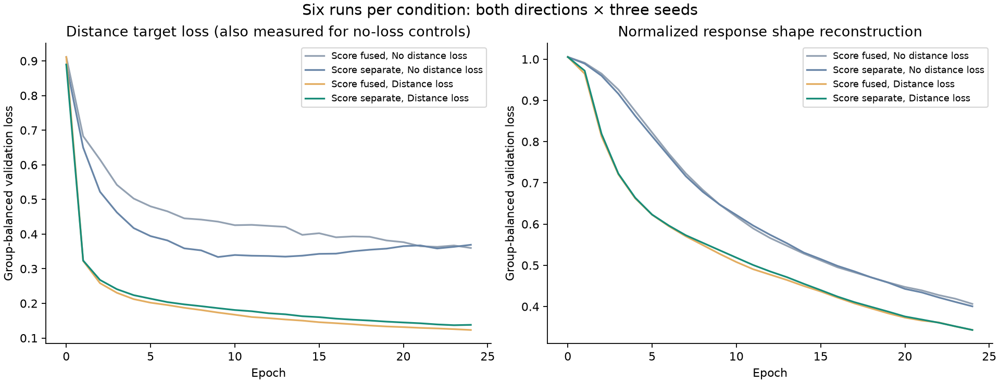

# 같은 구간의 여러 연주를 비교하는 모델: 학습·비교 결과

2026-10-14. **구간별 관측 반응의 차이를 벡터 거리로 표현하는 학습은 효과가 있었다. 실제 연주 검색의 개선 폭은 작았고, 다른 작품 검색에서는 작품 선택의 영향이 여전히 크다.** 악보를 검색 벡터에서 직접 분리했다고 작품 맥락이 완전히 제거된 것은 아니다.

네 조건 × 두 방향 × 세 seed, 총 **24개 모델의 학습과 비교를 완료**했다. 주 조건은 미리 정한 `separate_metric`이며 결과를 보고 모델/seed를 골라 바꾸지 않았다. 이전 [설계서](../conditional_metric_model/DESIGN.md), 완료된 [첫 반응 모델 실험](../response_model/README.md)은 보존했다.

## 학습 조건

| 항목 | 실행 조건 |
|---|---|
| 연주 데이터 | 기존 지원 cohort 329개: train/기존 검색 후보 241, validation 43, 기존 test 45 |
| 방향 | A에서 학습·검색하고 B에서 평가, B에서 학습·검색하고 A에서 평가를 독립 실행 |
| 학습 단위 | 같은 작품/grid/추정 구간의 전체 검증된 악보 좌표가 일치하는 서로 다른 연주 |
| 구간 지원 | A train P 254/H 476그룹, B train P 215/H 454그룹; 그룹당 4~28개 연주 |
| 모델 | 동일한 94,673개 파라미터, CNN 폭32/세 잔차 블록, 순서 보존, 단위 길이 검색 벡터32 |
| 악보 분리 조건 | 검색 encoder는 관측 연주와 mask만 사용. 악보 맥락은 조건부 반응/복원 decoder에 직접 입력 |
| 거리 목표 | 같은 구간의 템포·음량 변화 모양 .6, 변화량 .2, 유효한 H 시차 상관 .2; 결측 블록은 가중치 재정규화 |
| 배치 | 균형 있게 구간 8회 추출, 각 구간에서 서로 다른 연주 최대8개; epoch당64배치 |
| 기타 목표 | 두 가림 입력 일관성, raw 벡터 분산·공분산, 반응 모양·변화량·방향·최대점·시차와 가린 특징 복원 |
| 실행 | seed 20261014/15/16, 최대24 epoch, AdamW lr .001/wd .0001, gradient clip1, CPU2 threads/worker |
| checkpoint 선택 | 전체 validation 그룹의 계층 가중 학습 목적함수가 최소인 시점. 검색 점수/test 미사용 |

24개 모두 최저 validation 목적함수 checkpoint는 epoch24였다. 따라서 학습이 완전히 수렴했다고 단정하지 않는다. 초기화와 구간/연주 선택·가림 stream은 동일한 seed의 네 조건끼리 일치했고 검산했다.

| 조건 이름 | 검색 벡터에 악보 직접 입력 | 같은 구간의 연주 거리 목표 |
|---|---|---|
| `fused_no_metric` | 있음 | 없음 |
| `separate_no_metric` | 없음 | 없음 |
| `fused_metric` | 있음 | 있음 |
| **`separate_metric`: 주 모델** | **없음** | **있음** |

입력/목표 스케일은 train search view만으로 맞췄다. 변화량 스케일은 설계에서 정한 기존 train 곡선 전체로 계산하고, 새 학습 배치는 P/H만 사용한다. 기존 corpus 공통 패턴 정규화에는 후보가 포함된 기준이 남아 있어 전체 전처리를 외부 데이터와 완전히 독립된 것으로 주장하지 않는다.

[protocol.json](protocol.json)은 학습 전에 고정했다. 그 안의 `future_*`와 일부 design-turn 제한 문구는 원래 설계 계약을 복사한 내용이며, 이번 실행 조건은 `training`, 실행 메타데이터와 본 보고서가 기록한다. 모델/목표 정의는 원래 설계 코드 그대로다.

## 1. 구간별 연주 차이를 벡터가 보존하는가

같은 악보 구간의 서로 다른 연주 쌍에 대해 관측 목표 거리와 검색 벡터 거리의 Spearman 순위 상관을 구했다. train에 없던 작품의 **기존 test** 구간 결과이며 두 방향을 먼저 평균하고 세 seed의 평균±SD를 표시했다.

| 조건 | 프레이즈 거리 순위 상관 | 긴장 구간 거리 순위 상관 |
|---|---:|---:|
| 악보 합침, 거리 목표 없음 | .560 ± .013 | .520 ± .026 |
| 악보 분리, 거리 목표 없음 | .573 ± .021 | .537 ± .028 |
| 악보 합침, 거리 목표 있음 | .797 ± .006 | .759 ± .005 |
| **악보 분리, 거리 목표 있음** | **.781 ± .002** | **.748 ± .003** |

주 모델을 악보 분리/거리 목표 없음과 비교하면 프레이즈는 .573→.781, 긴장 구간은 .537→.748이다. 목표 거리 MAE도 프레이즈 .414→.250, 긴장 .533→.181로 내려갔다. 단순히 벡터 거리 크기만 줄어든 것이 아니라 쌍의 가까움/멀어짐 순서도 더 잘 맞는다.

validation의 동일 비교는 프레이즈 상관 .618→.819, 긴장 .590→.767이다. 여기는 checkpoint 선택에 사용한 데이터이므로 독립적인 최종 증거가 아니다.

이 검사는 **모델에 가르친 수치 반응 기준을 새로운 작품의 관측 입력에서도 표현하는지**를 본 것이다. 학습 목표와 같은 개념을 평가하므로 사람의 음악적 스타일 유사성을 독립적으로 검증한 결과가 아니다. 또한 악보 합침+거리 학습도 같은 검사에서 높은 상관을 보여, 이 학습 효과를 악보 분리만의 효과로 해석할 수 없다.



## 2. 같은 작품 안에서 실제 연주를 잘 찾는가

기존 set distance를 적용했다. 한 연주의 구간 벡터를 평균으로 합치지 않고 최근접 구간을 양방향으로 매칭한다. query 자신의 recording은 제외하고, 같은 작품/grid의 다른 연주 가운데 가까운3개를 선택한다. 선택한 연주를 **반대 view**의 기존 평가식으로 평가한다.

기존 평가식의 원래 거리와 train 스케일을 유지하면서 heldout 작품의 후보 열을 확장했다. 원래 241개 후보에서 계산한 14개 방향/평가식 점수 배열이 기존 결과와 일치했다. 작품 안에서 query별 후보 거리를 다시 percentile로 바꾸므로 무작위 연주 선택의 정확한 기대값은 **50**이다. 아래는 정확도나 사람의 만족도가 아닌 **수치 proxy 점수**다.

| 조건 | test 프레이즈 E-PN | test 긴장 E-HL | validation 프레이즈 E-PN | validation 긴장 E-HL |
|---|---:|---:|---:|---:|
| 악보 합침, 거리 목표 없음 | 53.18 ± .83 | 54.04 ± 1.54 | 50.03 | 51.19 |
| 악보 분리, 거리 목표 없음 | 53.51 ± 1.46 | 52.54 ± .66 | 49.60 | 52.16 |
| 악보 합침, 거리 목표 있음 | 52.53 ± .82 | 52.97 ± .42 | 54.01 | 51.81 |
| **악보 분리, 거리 목표 있음** | **54.55 ± 1.11** | **53.78 ± 1.13** | **52.33** | **52.81** |
| 학습 전 악보 분리 encoder | 50.79 ± 1.80 | 53.51 ± 1.12 | 49.76 | 50.04 |
| 이전 반응 모델: seed1개 | 50.72 | 51.38 | 49.24 | 53.22 |
| 기존 구간 요약 | 45.99 | 49.50 | 52.05 | 52.65 |

모든 seed별 값은 [per_seed_summary.csv](per_seed_summary.csv)에 보존한다.

주 모델은 거리 목표 없는 악보 분리 조건보다 test에서 프레이즈 +1.04점, 긴장 +1.24점이다. 모든 seed에서 개선된 것은 아니다. 프레이즈는 seed20261016에서 54.89→53.48로 떨어졌고, 긴장은 seed20261014에서 52.79→52.60으로 떨어졌다. 긴장 주 모델은 학습 전 악보 분리 encoder 53.51보다도 +.27점에 그친다. **구간별 거리 목표를 잘 맞춘 효과에 비해 실제 연주 검색 개선은 작다.**

주 모델의 연주 시점 순서를 섞으면 같은 작품 내 test 점수는 프레이즈 54.55→51.02, 긴장 53.78→49.18로 내려갔다. 이 검색에서는 시간 배열이 도움이 되지만 음악적 해석을 정확히 이해했다고 증명하지는 않는다.

## 3. 기존의 다른 작품 검색 점수와 통제

이전과 동일한 241개 train gallery, 43개 validation/45개 test query와 반대 view의 고정된 7개 평가 배열을 사용했다. 검색은 family 제한 Top5이고 개별 구간 set distance다. 학습한 단위 벡터 좌표를 train SD로 다시 늘이거나 줄이지 않았다. 종류별 train 다른-family 중앙 거리의 스칼라 보정만 적용했다.

| 표현 | test P의 E-PN | validation P의 E-PN | test H의 E-HL | validation H의 E-HL |
|---|---:|---:|---:|---:|
| 기존 구간 요약 | 52.82 | 50.92 | 58.67 | 55.96 |
| 이전 반응 모델: seed1개 | 64.03 | 55.65 | 51.22 | 47.89 |
| 악보 합침, 거리 목표 없음 | 62.24 | 59.93 | 52.95 | 53.88 |
| 악보 분리, 거리 목표 없음 | 65.64 | 62.27 | 58.67 | 56.78 |
| 악보 합침, 거리 목표 있음 | 65.28 | 58.61 | 59.50 | 56.48 |
| **악보 분리, 거리 목표 있음** | **66.29 ± .40** | **59.46 ± .59** | **59.00 ± .30** | **57.30 ± 2.59** |

프레이즈는 기존 모델보다 높지만, 거리 목표를 추가한 효과는 악보 분리 조건 test에서 +.65점이고 validation에서는 −2.81점이다. 긴장은 이전 반응 모델의 낮은 점수를 회복했으나 기존 H 요약을 넘는 폭은 test +.33점이다. 예전 모델과 새 모델 사이에는 decoder/단위 벡터/배치/목표 등 여러 차이가 있으므로 정확한 변경 효과는 새2×2 조건끼리 비교해야 한다.

| 주 모델 다른 작품 검색 통제 | test P E-PN | validation P E-PN | test H E-HL | validation H E-HL |
|---|---:|---:|---:|---:|
| 실제 선택 | 66.29 | 59.46 | 59.00 | 57.30 |
| 반환된 작품/grid 유지, 그 안의 연주 무작위 선택 | 65.33 | 59.04 | 58.71 | 56.16 |
| 시점 순서 섞기: 5 seed 평균 | 60.30 | 57.39 | 60.95 | 59.19 |
| 후보 수 통제: 20 seed 평균 | 66.10 | 59.63 | 60.76 | 59.53 |

반환 작품 안의 무작위 연주보다 실제 선택이 높은 폭은 test에서 P +.96점/H +.29점뿐이다. 작품 선택의 영향이 여전히 크다. 특히 다른 작품 검색의 긴장 점수는 순서를 섞어도 떨어지지 않고 오히려 높아졌다. 따라서 59.00이라는 H 점수만으로 반응 시점을 잘 포착한다고 말할 수 없다. 같은 작품 내 순서 통제 결과와 다른 작품 검색의 순서 통제를 구분해야 한다.





전체 7축 및 P+H/B+P+H 결과는 [summary.csv](summary.csv)에 있다. 주 모델 P의 E-S는 test48.85/validation49.34로 기존 P 요약53.77/55.40보다 낮다. 모든 평가 기준에서 개선된 것은 아니다. 별도 수준 요약 B를 동일한 제곱 거리1/3씩 결합하면 E-L은75.18/68.31, E-T는65.76/62.10이며 E-HL은56.10/53.26이다. 이 결합을 test를 보고 주 모델로 선택하지 않았다.

## 4. 학습과 검색의 구간 대응을 맞춘 추가 진단

주 결과를 본 뒤, 학습은 같은 구간끼리 비교하지만 set 검색은 다른 위치의 구간도 자유롭게 최근접 매칭한다는 차이를 확인했다. 이를 보기 위해 **재학습 없이 한 가지 고정된 탐색 진단**을 추가했다. 이 진단은 원래 주 평가를 대체하지 않는다. [aligned_protocol.json](aligned_protocol.json)에 추가 시점과 정의를 명시했다.

같은 작품/grid의 모든 연주가 공통으로 가진 정확히 같은 구간끼리 단위 벡터 제곱 거리를 계산해 평균했다. H는 세 metric을 동일 비중으로 평균한다. 모든43 validation/45 test 연주를 유지했고 각 heldout 작품/grid에서 모든 종류에 공통 구간이 있었다. 반대 view 평가, 자기 연주 제외, Top3, seed와 모델은 그대로다. test 점수가 높은 구간이나 결합 가중치를 선택하지 않았다.

| 악보 분리 조건 | test P E-PN | test H E-HL | validation P E-PN | validation H E-HL |
|---|---:|---:|---:|---:|
| 거리 목표 없음: 같은 구간끼리 검색 | 51.83 | 54.20 | 51.24 | 50.84 |
| 거리 목표 있음: 같은 구간끼리 검색 | 53.53 | 54.98 | 55.38 | 51.74 |
| 거리 목표 있음: 원래 set 검색 | 54.55 | 53.78 | 52.33 | 52.81 |

같은 구간끼리 매칭해도 test 프레이즈가 크게 좋아지지는 않았다. 긴장은 원래 set 검색보다 +1.20점이지만 validation에서는 낮아졌다. **구간 대응 방식을 바꾸는 것만으로 관측 거리 학습과 실제 검색 사이의 차이가 해결되지는 않았다.**



## 해석과 남은 문제

이번 목표는 주어진 관측 구간의 차이를 표현하게 만든다. 같은 연주의 다른 프레이즈에서도 비슷한 선택을 하는지, 다른 음악적 맥락에서도 그 반응이 공유되는지까지 자동으로 학습시키지는 않는다. 실제 검색은 A에서 표현한 특징이 B에서도 유지되는지를 평가하므로 구간별 관측 목표 검사보다 더 어려운 과제다. 이것은 현재 차이에 대한 가능한 설명이지 원인이 입증된 결론은 아니다.

후속 연구의 우선 질문은 **어떤 반응 특성이 한 연주의 서로 다른 구간에서도 유지되고 검색에 필요한가**이다. 이번 결과는 모델 크기를 늘리는 필요성을 입증하지 않는다. 서로 다른 구간의 반응을 연결하는 학습 목표를 만들 경우, 학습에 쓰지 않은 별도의 관측 구간·녹음 또는 외부 평가로 검증하도록 분할을 다시 설계해야 한다. 해당 후속 학습은 실행하지 않았다.

현재 수치의 해석에는 다음 한계가 남아 있다.

- 기존45개 test 결과를 이미 이전 설계에서 관찰했다. 따라서 이 결과는 **재사용한 개발 benchmark**이며 새로운 최종 test가 아니다. validation은 checkpoint 선택에도 사용했다.
- test와 validation은 각각3개 family다. 세 seed의 SD는 초기화/학습 변동이며 모집단 신뢰구간이 아니다.
- 프레이즈와 H는 기존 추정 구간이다. H는 원래 박±8의 악보 peak 창이며 실제 지각적 긴장 구간/시차 정답이라고 검증된 것은 아니다.
- 잔차에 작품과 해석의 상호작용이 남는다. 검색 encoder가 악보를 직접 받지 않아도 곡선에서 작품을 추측할 수 있다.
- 같은 구간의 쌍만 학습하면 서로 다른 구간의 벡터 방향까지 충분히 정해지지 않는다. 높은 구간 내 순위 상관을 곧바로 다른 작품의 스타일 유사성으로 해석하지 않는다.
- 관측 목표와 평가 proxy가 일부 개념을 공유한다. 최종적인 음악적/취향 유사성은 독립적인 지표와 청취 판단이 필요하다.

## 학습·수치 검증과 재현



전체6개 run 평균 validation 모양 손실은 악보 분리/거리 목표 없음에서1.005→.401, 주 모델에서1.005→.343이다. 같은 두 조건의 거리 목표 손실은 .889→.369와 .889→.138이다. 거리 목표 없는 조건에서도 진단용 거리 손실을 계산했지만 checkpoint 목적에는 넣지 않았다. 전체 목적함수 높이는 서로 다른 조건 사이에서 직접 비교하지 않는다.

설계 불변조건13개와 평가/validation 의미 테스트5개, **총18개 테스트가 통과**했다. 독립 검산 [verification.json](verification.json)은 **701,142개**를 통과했고 최대 스칼라 차이는2.68e−7, checkpoint 재로딩 벡터 차이는1.97e−7이다. 24개 checkpoint/스케일/분할, 동일 초기화·표본/가림 stream, 모든 주 검색순위·점수·무작위 기대값·구간 거리 진단과 seed별 집계를 확인했다. 순서 섞기의 모든 순위를 별도 재실행한 것은 아니며 통제 집계 산술은 검산했다.

추가 대응 검색은 [aligned_verification.json](aligned_verification.json)의 **114,960개** 검산을 통과했다. 전체순위·반대 view 점수·무작위 기대값·집계와 실제 대응 거리 표본을 확인했다. 이것은 구현 검증이지 새로운 음악적 정답 증거가 아니다.

완료 결과를 덮어쓰지 않고 새 형제 디렉터리에서 재현할 수 있다.

```bash
cd /Users/ihun-ui/Desktop/Classicfy/capstone-2026-2-classicfy
.venv/bin/python ../diagnostics/conditional_metric_run01/run.py --out ../diagnostics/conditional_metric_repro01
```

같은 Python 의존 환경과 이전 고정 입력 파일이 필요하다. 세 seed worker를 병렬 실행하며 checkpoint 선택이 모두 끝난 후 평가한다. 새 디렉터리에서 추가 진단도 재현하지만, 원래 실행에서 그것이 결과 관찰 후 추가되었다는 상태는 유지한다.

- 조건·구현: [protocol.json](protocol.json), [data.py](data.py), [model.py](model.py), [train.py](train.py), [evaluate.py](evaluate.py), [run.py](run.py).
- 악보 대응·평가식: [alignment_audit.json](alignment_audit.json), [passages.csv](passages.csv), [judge_verification.json](judge_verification.json), [judge_scales.json](judge_scales.json).
- 검색 결과: [summary.csv](summary.csv), [per_seed_summary.csv](per_seed_summary.csv), [scores.csv](scores.csv), [within_work_scores.csv](within_work_scores.csv), [rankings.csv](rankings.csv), [within_work_rankings.csv](within_work_rankings.csv).
- 구간 차이·통제: [passage_summary.csv](passage_summary.csv), [passage_metrics.csv](passage_metrics.csv), [control_summary.csv](control_summary.csv), [controls.csv](controls.csv).
- 추가 대응 진단: [aligned_summary.csv](aligned_summary.csv), [aligned_scores.csv](aligned_scores.csv), [aligned_support.csv](aligned_support.csv), [aligned.py](aligned.py).
- checkpoint: 각 `seed*_view*_*` 디렉터리의 `initial.pt`, `best.pt`, `history.csv`, `training.json`. 전체 seed/조건의 벡터와 거리도 NPZ로 저장했다.
- 파일 provenance: [manifest.json](manifest.json).

모든 새 파일은 저장소 밖 `Classicfy/diagnostics/conditional_metric_run01`에 있다. 기존 완료 파일과 저장소 추적 파일은 변경하지 않았고 원격 게시 작업도 하지 않았다.
