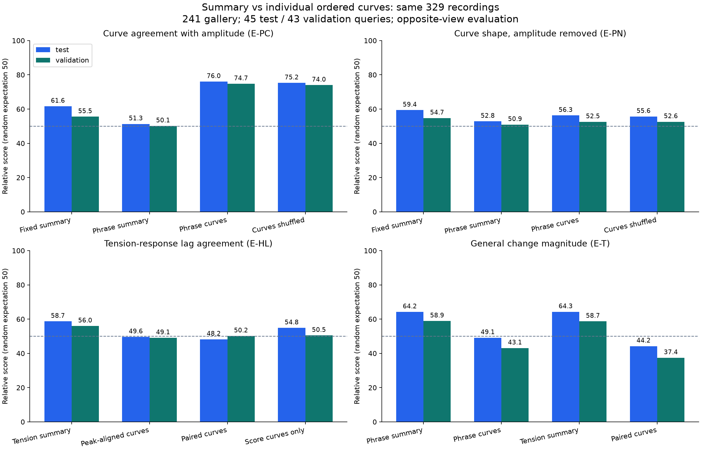
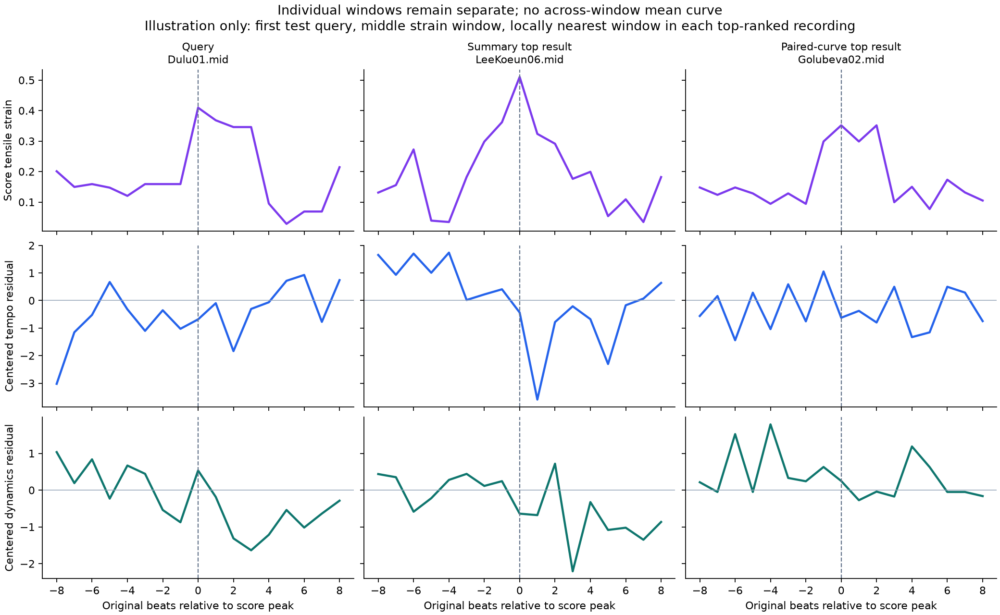

# 통계 요약과 개별 곡선 표현의 비교

2026-10-14 KST. **이번 개별 곡선 비교에서는 기존 요약보다 전반적으로 좋아졌다는
근거를 확보하지 못했다.** 프레이즈 곡선의 일부 점수는 높았지만, 변화 크기를 제거하고
순서를 섞는 대조에서 시간 흐름을 보존한 추가 효과는 일관되지 않았다.
긴장 곡선과 연주 곡선을 함께 비교한 조건도 긴장 반응 시점 평가를 개선하지 못했다.
모든 곡선 표현이나 시계열 모델의 한계를 입증한 결과는 아니다.



## 실제로 바꾼 표현

기존 실험의 335연주에서 두 view에 완전한 곡선이 있는 공통 329연주를 선택했다.
검색 후보는 247→241연주이며, test 45연주·validation 43연주는 전부 유지했다.
같은 공통 표본과 후보를 사용해 기존 요약 조건도 다시 검색·평가했으므로 이전
335표본 표와 숫자가 조금 다르다. 제외/지원 내역은 [coverage.csv](coverage.csv),
원래 index의 포함 목록은 [cohort.json](cohort.json)에 있다.

- **F 곡선:** 완전한 16-original-beat 조각을 따로 유지한다.
- **P 곡선:** 기존 provisional 프레이즈 owner의 완전한 연속 방문을 따로 유지한다.
  4 original beat 이상이고, 모든 beat/pair가 유효하며 한 64-beat view 블록 안에 있어야 한다.
- **H 곡선:** 각 긴장 지표에서 악보 값 상위 1/3에 속하는 국소 봉우리를 찾는다.
  양쪽 8박 위치보다 봉우리가 높아야 하며, 앞뒤 8박을 포함한 17박 창을 만든다.
  창끼리 겹치지 않도록 시간 순서로 고른다. Strain 창은 조성 구간을 넘지 않는다.
  이는 정점 주변 분석 창이지, 검증된 전체 형성→해소 episode가 아니다.
  특히 Momentum 봉우리는 조성 이동의 봉우리이지 긴장 정점이라고 확정할 수 없다.
- **H paired 곡선:** 같은 창의 긴장 곡선과 연주 곡선을 한 쌍으로 유지하고 함께 비교한다.
  긴장과 연주 각각의 표준화된 거리 비중을 1:1로 고정했다.
- **H context only:** 연주 입력 없이 악보 긴장 곡선만으로 검색하는 대조 조건이다.

각 곡선은 17개 순서 있는 점으로 표현한다. P는 쓰인 악보 quarter 중점 좌표,
F/H는 원래 beat index를 사용한다. 여러 문장이나 창을 평균 곡선으로 합치지 않았다.
17점 재표본화는 원래 모든 beat의 무손실 저장과 다르며, 긴 프레이즈의 세부 변화는 줄어들 수 있다.
연주/view/type당 최대 32곡선을 시간 순서에서 균등 선택했다. 값이 잘 맞는 곡선만 고르지 않았다.

거리는 한 연주의 각 곡선에서 다른 연주의 가장 가까운 곡선을 찾은 거리의 평균을
양방향으로 계산한다. 즉 구간 곡선 자체는 개별 유지하고, 마지막 검색 거리에서 집계한다.
DTW나 신경망을 쓴 결과가 아니라, 상대 위치가 대응하는 점들 간의 단순 거리 비교다.
서로 다른 곡의 모든 프레이즈가 동일한 역할이라는 보장은 없다.

raw 곡선과, 동일 연주의 **검색 view 전곡 signed 평균을 뺀 centered 곡선**을 모두 비교했다.
채널 scale은 gallery만으로 fit한다. 긴장 세 지표·P/H 결합은 train 작품군 간 거리 중앙값으로
크기를 맞춘 뒤 동일 가중으로 결합했다. 원래 작품 공통값을 빼는 정규화는 다시 fit하지 않았다.

## 검색과 평가의 분리

기존과 같은 완전한 64-original-beat 블록의 교대 A/B를 사용했다.
A 검색→B 평가 및 B 검색→A 평가를 모두 실행했다. 곡선은 view·결측·구조 pair 경계를 넘지 않는다.
Top 5에는 작품군당 최대 한 연주가 들어간다. query와 gallery의 작품군은 겹치지 않는다.

| 평가 | 무엇을 비교하는가 |
|---|---|
| E-L | 기존 수준·폭의 일치 |
| E-T | 기존 박별 변화 크기 분포의 일치 |
| E-R | 기존 Tempo–Dynamics 공동 변화의 일치 |
| E-S | 기존 프레이즈 3단계의 변화 방향 비율 일치 |
| E-PC | 별도 view의 프레이즈를 24점으로 표현한 뒤 Tempo/Dynamics 인접 차분 곡선을 비교 |
| E-PN | E-PC 곡선의 채널별 변화 RMS를 1로 맞춰 변화 크기 영향을 제거한 모양 비교 |
| E-HL | 별도 view의 긴장 정점 창에서 긴장 차분과 Tempo/Dynamics 차분의 −4~+4박 lag별 상관 일치 |

E-PN은 양 채널의 차분 RMS가 1e-6을 넘는 곡선만 사용한다. 모든 공통 표본에 지원이 있다.
E-PN은 최초 E-PC 결과가 point 순서 섞기에 둔감한 것을 보고 추가한 **사후 진단**이다.
H paired 조건 역시 정점에 연주 곡선만 맞추는 조건의 한계를 확인한 뒤 추가한 조건이다.
각 정의는 해당 결과 계산 전에 [followup_protocol.json](followup_protocol.json),
[coupled_protocol.json](coupled_protocol.json)에 기록했다. 이들을 최초부터 사전 등록한 조건처럼 해석하지 않는다.

모든 점수는 동일 gallery의 평가 거리 백분위를 작품군 균등 가중으로 집계한 0–100 상대 점수다.
무작위 기대값은 50이며 정확도나 사람의 청취 성공률이 아니다.
새 평가는 음악적으로 타당한 구조를 가정한 수치적 일관성 지표이고 독립적인 전문가 정답은 아니다.

## 프레이즈 결과: 모양과 변화 크기 구분

표의 각 셀은 **test / validation** 순서다.

| 검색 표현 | 변화 크기를 포함한 곡선 E-PC | 변화 크기를 제거한 모양 E-PN | 기존 프레이즈 E-S |
|---|---:|---:|---:|
| 고정 구간 요약 F | 61.62 / 55.52 | 59.35 / 54.72 | 52.66 / 53.66 |
| 프레이즈 요약 P | 51.32 / 50.14 | 52.82 / 50.92 | 53.77 / 55.40 |
| 프레이즈 raw 곡선 | 72.75 / 72.51 | 55.47 / 52.36 | 56.77 / 54.49 |
| 프레이즈 centered 곡선 | 76.02 / 74.72 | 56.25 / 52.53 | 56.19 / 53.69 |
| centered 곡선의 검색 point 순서를 섞음, 20-seed 평균 | 75.24 / 73.97 | 55.64 / 52.59 | 전체 CSV 참조 |

곡선의 E-PC 상승만으로 성공이라고 볼 수 없다. 변화 크기를 제거하면 큰 상승은 대부분 줄어든다.
E-PN에서 centered 곡선은 P 요약보다 +3.43 / +1.61점이지만 F 요약보다 낮다.
원래 point 순서를 유지했을 때의 순서 섞기 대비 차이는 +0.61 / −0.06점이다.
따라서 시간적 배치를 활용한 추가 효과가 두 split에서 일관되게 확인됐다고 할 수 없다.
E-S도 test 상승과 validation 하락으로 갈린다.

프레이즈 centered 곡선의 E-PN은 같은 반환 작품 안에서 연주를 무작위로 다시 뽑는 기대값
55.06 / 51.85보다 각각 +1.19 / +0.68점이다. 작은 차이를 확정적 개선으로 해석하지 않는다.
작품/grid당 후보 세 연주로 맞춘 20 seed에서는 P 요약 52.25 / 49.28,
P centered 곡선 52.35 / 50.70이다. F 요약은 57.69 / 53.96으로 더 높다.

## 긴장 결과: 연주 변화의 시점/지연

| 검색 표현 | 긴장 변화·연주 변화 lag 일치 E-HL | 후보 세 연주 대조 E-HL |
|---|---:|---:|
| 긴장 수준별 요약 H | 58.67 / 55.96 | 56.37 / 56.57 |
| 정점 주변 centered 연주 곡선 H | 49.60 / 49.06 | 48.44 / 47.94 |
| 긴장·연주 paired 곡선 H | 48.25 / 50.15 | 48.60 / 49.29 |
| 악보 긴장 곡선만 H context | 54.85 / 50.45 | 54.86 / 51.17 |

정점 주변 연주 곡선이나 paired 곡선이 기존 요약보다 긴장 반응의 lag 패턴을 더 잘 찾지 못했다.
paired 곡선의 연주 point 순서만 섞고 악보 긴장 곡선을 유지한 대조는 48.35 / 49.82로,
실제 48.25 / 50.15와 가깝다. 같은 작품의 무작위 연주 기대값은 47.46 / 46.05이다.
validation의 일부 연주 선택 차이가 있어도 test/일반 무작위 대비/다른 축과 함께 봐야 한다.

기존 E-T에서도 P 요약 64.19 / 58.89에서 P centered 곡선 49.13 / 43.11로 하락했다.
H paired 곡선의 E-T는 44.23 / 37.43이다. 모양 점수만 올리고 다른 표현 성향을 잃는 문제도 남는다.
전체 raw/centered/평균 제거/결합 조건과 모든 축은 [summary.csv](summary.csv),
[coupled_summary.csv](coupled_summary.csv)에 있다.

## 입력 재구성과 수치적 한계

원래 긴장 원시 NPZ가 이 기기에 없어 고정 XML과 검증된 beat map으로 곡선을 재구성했다.
고정 입력 SHA, 긴장 유효 interval 수 및 기존 tertile 경계를 대조했다.
경계 값 최대 차이는 8.33e-17이지만 동점 부근의 소수점 차이로 53 recording/view의
요약 H 일부 좌표는 기존과 달라졌다(좌표 최대 차이 약 0.372).
이 차이를 허용 오차로 숨기거나 원래 요약을 덮어쓰지 않았다.

**기존 H baseline은 원래 검증 CSV에서 저장된 요약을 그대로 사용했다.**
새 정점 탐지와 lag 평가는 긴장 값을 소수점 12자리로 맞춰 평평한 음군에서 소수점 오차만으로
봉우리가 생기는 것을 방지했다. 이는 기존 동점 bin을 완전히 재현했다는 뜻이 아니다.
상세 기록은 [preparation_verification.json](preparation_verification.json)에 있다.

## 무엇을 결론 내릴 수 있는가

이번에는 평균을 없애고 곡선을 유지하는 것만으로 문제가 해결되지 않았다.
현 단계에서 단순 곡선 거리로 기존 요약을 대체하거나 복잡한 모델이 필요하다고 확정할 근거가 없다.
그렇다고 요약을 유지하는 것이 최종 해답이라고 결론 낼 수도 없다.

표현은 순서를 보존했지만 실제 검색이 그 순서를 충분히 활용했다고 보기 어렵다.
다음 실험은 전체 수준·변화 폭·시간적 모양을 분리해 비교하고, 긴장 상황에서는 실제 형성/해소
범위와 반응의 방향·지연·지속을 구분할 필요가 있다. 모든 곡선을 어느 곡선과든 최근접으로
매칭하는 현재 방식의 구간 역할 대응도 검토해야 한다.

실제 프레이즈·국소 조성·긴장 episode의 정답 검증은 아직 하지 않았다.
곡선 수가 많으면 가까운 곡선을 찾을 기회가 늘어나며, 양방향 거리와 32개 cap이 이를 완전히 제거하지는 않는다.
test/validation 각각 세 작품군의 탐색 결과이며 모집단 유의성이나 사람의 취향 적합성을 주장하지 않는다.



이 그림은 첫 test query의 중간 strain 창 하나와 각 방법의 1위 후보 안에서 가까운 창을
선택한 예시다. 전체 검색 품질을 대표하는 성공 사례로 해석하지 않는다.

## 재현·검증·산출물

저장소 루트에서 순서대로 실행한다. 원래 저장소와 실험 출력은 변경하지 않고 이 진단 폴더만 갱신한다.

```bash
.venv/bin/python ../diagnostics/curve_comparison/prepare.py
OPENBLAS_NUM_THREADS=1 OMP_NUM_THREADS=1 .venv/bin/python ../diagnostics/curve_comparison/compare.py
.venv/bin/python ../diagnostics/curve_comparison/test_curves.py
OPENBLAS_NUM_THREADS=1 OMP_NUM_THREADS=1 .venv/bin/python ../diagnostics/curve_comparison/verify.py
OPENBLAS_NUM_THREADS=1 OMP_NUM_THREADS=1 .venv/bin/python ../diagnostics/curve_comparison/coupled.py
OPENBLAS_NUM_THREADS=1 OMP_NUM_THREADS=1 .venv/bin/python ../diagnostics/curve_comparison/verify_coupled.py
MPLCONFIGDIR=/tmp/classicfy-curve-plots XDG_CACHE_HOME=/tmp/classicfy-font-cache .venv/bin/python ../diagnostics/curve_comparison/report.py
```

필요한 외부 입력은 기존 standalone 배열, beat map, nASAP XML 및 저장소 분석 CSV다.
원시 MIDI 연주를 다시 추출하거나 신경망을 학습하지 않는다.

- 순서·중심화·악보 위치 보간·view/결측 차단·지연 부호의 의미 있는 테스트 **5개 통과**.
- 독립 scalar 검산 **649,839개**, 최대 오차 **2.84e-14**.
- paired 비용·거리·점수 독립 검산 **479,448개**, 최대 오차 **2.84e-14**.
- 두 그림을 직접 시각 검토했다.
- 모든 query 점수와 5개 검색 결과: `scores.csv`, `rankings.csv`, `coupled_scores.csv`, `coupled_rankings.csv`.
- 후보 수·순서 섞기 원시/집계: `controls.csv`, `control_summary.csv`, `coupled_controls.csv`, `coupled_control_summary.csv`.
- 순서 정의와 입력/결과 SHA: `protocol.json`, `followup_protocol.json`, `coupled_protocol.json`, `provenance.json`, `coupled_provenance.json`.
- 검산 범위: `verification.json`, `coupled_verification.json`. 계산의 일치는 음악적 정답 검증과 다르다.
