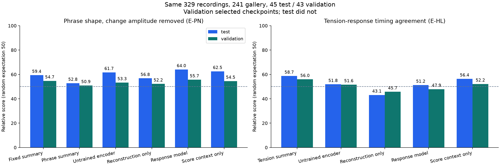
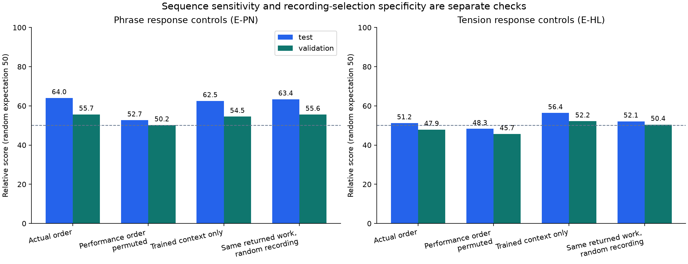
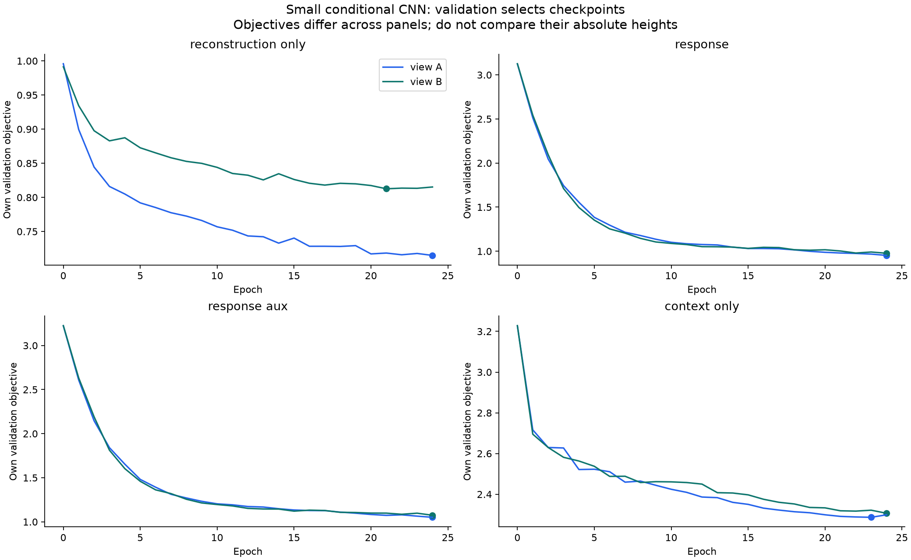
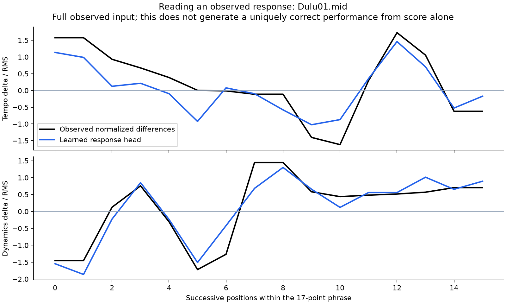

# 관측 연주 반응을 학습하는 모델: 첫 실험

실행일: 2026-10-14. **프레이즈의 시간 순서를 사용하는 근거는 생겼지만, 같은 작품 안에서 연주를 더 잘 구별한다는 근거는 약하다. 긴장 반응 시점의 검색 점수는 개선되지 않았다.** 이 결과로 모델 규모를 늘릴 필요성이 입증된 것은 아니다.

## 무엇을 학습했나

악보만 보고 하나의 정답 연주를 생성하도록 학습하지 않았다. 실제 관측한 연주의 변화 곡선과 해당 위치의 악보 맥락을 함께 입력하고, 그 연주에서 관측한 반응을 작은 벡터에 보존하도록 학습했다.

예를 들어 한 프레이즈에 17개 시점이 있다면, 일부 시점의 연주 값을 가린 두 입력을 만든다. 두 입력의 표현은 비슷하게 만들면서, 그 표현으로 다음 정보를 읽어낼 수 있게 한다.

- 템포·음량 잔차가 어떤 모양으로 변했는지: 차분을 곡선별 크기로 정규화한 목표.
- 차분이 증가·유지·감소 중 어느 방향인지, 관측 잔차의 최대점이 어디인지.
- 긴장 창에서는 악보 긴장 곡선과 템포·음량 잔차 사이의 시차별 상관관계. 원래 박 기준 −4~+4박이며, 프레이즈를 늘이거나 줄인 상대 위치와 섞지 않는다.
- 보조 목표로 가린 원래 특징 값을 복원하는지.

따라서 여기서 학습한 것은 **실제로 주어진 연주의 반응 표현**이다. 정규화한 잔차에는 작품과 해석의 상호작용이 남아 있으며, 순수한 연주자 특성이라고 검증된 것은 아니다. 잔차의 최대점이나 증가 방향 역시 원음의 절대적인 크레셴도·리타르단도 정답과 같지 않다.

## 입력·모델·학습 조건

학습 전에 [protocol.json](protocol.json)에 조건과 주 실험 `response_aux`를 고정했다. 테스트 점수를 보고 모델이나 결합 가중치를 선택하지 않았다.

| 항목 | 실행 조건 |
|---|---|
| 데이터 | 직전 곡선 비교와 동일한 329개 연주: 학습/검색 후보 241, validation 43, test 45 |
| 단위 | 개별 17점 고정 창 F, 프레이즈 P, 긴장 창 H0/H1/H2; 연주·종류별 최대 32개 |
| 연주 입력 | 기존 7개 정규화 잔차 채널에서 해당 연주의 검색 view 평균을 제거한 곡선 |
| 맥락 입력 | 악보 긴장 3개, 유효 여부 3개, 상대 위치, 원래 악보 구간 길이의 로그, 종류 표시 5개 |
| 모델 | 77,167개 파라미터 CNN; 연주와 맥락의 별도 투영, dilation 1/2/4 잔차 블록, 순서를 보존하는 펼침, 구간별 32차원 벡터 |
| 데이터 증강 | 17점 중 2점의 연주 채널을 가림. 악보 맥락과 원래 순서는 유지 |
| 학습 | seed 20261014 한 개, 최대 24 epoch, batch 64, AdamW lr .001, weight decay .0001, gradient clip 1 |
| 표본 가중 | family/work/grid/recording/type/curve의 계층적 균형을 적용한 epoch당 4,096회 복원 추출 |
| 선택 | 같은 검색 view의 validation 학습 목적함수가 최소인 checkpoint; test 미사용 |
| 계산 | Python 3.12, PyTorch 2.14.1, CPU 2 threads |

A의 연주 구간으로 학습·검색하고 B의 고정 평가식으로 평가하는 방향과, B로 학습·검색하고 A로 평가하는 방향을 별도로 실행했다. 각 방향마다 아래 네 모델을 학습해 총 8개 모델이다. A/B는 서로 다른 연주자가 아니라 기존의 두 분리된 관측 view이다.

| 모델 | 목적 |
|---|---|
| `reconstruction_only` | 가린 원래 특징을 복원하는 목표만 학습 |
| `response` | 두 가림 입력의 일관성, 분산·공분산 제약, 관측 반응 목표 학습 |
| `response_aux` | `response`에 원래 특징 복원 손실을 0.1배 추가한 주 실험 |
| `context_only` | `response_aux`와 같은 목표지만 연주 값·유효 정보를 학습과 추론 모두에서 제거 |

같은 연주자의 모든 연주를 정답 쌍으로 묶거나 다른 연주자를 전부 오답으로 취급하지 않았다. 분산·공분산 제약은 [VICReg](https://arxiv.org/abs/2105.04906)의 아이디어를 사용한 변형이다. 원 논문의 완전한 재현 실험은 아니다. CNN과 옵티마이저는 PyTorch의 [Conv1d](https://docs.pytorch.org/docs/2.14/generated/torch.nn.Conv1d.html), [AdamW](https://docs.pytorch.org/docs/2.14/generated/torch.optim.AdamW.html)를 사용했다.

새 입력 정규화, 목표 시차 정규화, 검색 벡터 축별 스케일과 거리 보정은 학습 연주만으로 맞췄다. 다만 기존 데이터의 공통 패턴 정규화는 후보 연주가 포함된 기존 기준을 그대로 물려받았다. 따라서 전체 전처리까지 완전히 독립적인 외부 데이터 검증으로 해석하면 안 된다.

## 검색 결과

구간별 벡터를 유지한 뒤 기존과 같은 양방향 최근접 구간 거리로 연주 간 거리를 계산했다. 한 연주의 모든 구간을 하나의 평균 벡터로 합치지 않았다. 기존 7개 반대 view 평가식, 후보 목록, 쿼리 목록, family 제한 Top5와 집계 가중치를 그대로 사용했다.

점수는 **0~100의 상대적인 수치 평가 점수이며 정확도가 아니다.** 무작위 기준의 기대값은 50이다. 아래는 A→B와 B→A를 기존 방식으로 집계한 값이다. validation은 checkpoint 선택에도 사용했으므로 독립적인 최종 검증 결과가 아니다.

프레이즈 모양 평가 **E-PN**은 변화 크기를 정규화한 템포·음량의 변화 모양을 비교한다.

| 프레이즈 검색 표현 | test E-PN | validation E-PN |
|---|---:|---:|
| 기존 고정 창 요약 F | 59.35 | 54.72 |
| 기존 프레이즈 요약 P | 52.82 | 50.92 |
| 기존 평균 제거 프레이즈 곡선 | 56.25 | 52.53 |
| 학습 전 동일 초기화 encoder P | 61.69 | 53.31 |
| 복원만 학습 P | 56.79 | 52.22 |
| 반응 학습 P, 보조 복원 없음 | 61.69 | 55.20 |
| **반응 학습 P + 보조 복원** | **64.03** | **55.65** |
| 악보 맥락만 학습 P | 62.51 | 54.52 |

주 모델은 프레이즈 요약보다 11.21/4.73점 높지만, 학습 전 encoder와의 차이는 2.34/2.34점이다. 따라서 요약을 순서 있는 표현으로 바꾼 효과와 추가 학습의 효과를 구분해야 한다.

긴장 반응 평가 **E-HL**은 악보 긴장과 템포·음량 변화 사이의 시차 관계를 비교한다.

| 긴장 검색 표현 | test E-HL | validation E-HL |
|---|---:|---:|
| **기존 긴장 요약 H** | **58.67** | **55.96** |
| 기존 평균 제거 긴장 곡선 | 49.60 | 49.06 |
| 학습 전 동일 초기화 encoder H | 51.85 | 51.64 |
| 복원만 학습 H | 43.13 | 45.73 |
| 반응 학습 H, 보조 복원 없음 | 50.46 | 48.04 |
| 반응 학습 H + 보조 복원 | 51.22 | 47.89 |
| 악보 맥락만 학습 H | 56.36 | 52.16 |

긴장 모델은 기존 요약을 넘지 못했고, 학습 전 encoder보다도 개선되지 않았다. 프레이즈와 긴장 모델이 모두 성공했다고 말할 수 없다.



## 무엇 때문에 점수가 올라갔나

주 프레이즈 모델에 세 종류의 통제를 적용했다.

| 프레이즈 E-PN 통제 | test | validation |
|---|---:|---:|
| 실제 주 모델 검색 | 64.03 | 55.65 |
| 연주 시점 순서를 무작위로 섞음: 5 seed 평균 | 52.68 | 50.16 |
| 반환된 작품/grid는 유지하고 그 안의 연주만 무작위 선택: 정확한 기대값 | 63.37 | 55.58 |
| 기존 후보 수 통제: 20 seed 평균, 주 모델 | 62.38 | 54.32 |
| 같은 후보 수 통제, 악보 맥락만 사용 | 62.86 | 54.84 |

**순서 섞기:** 연주 입력의 시점 순서를 섞고 악보 맥락은 고정했다. 실제 검색에 사용한 스케일과 거리 보정도 고정했다. 점수가 11.35/5.49점 내려가므로 모델이 연주 값의 시간 배열 또는 악보와의 대응 관계에 민감하다는 근거가 있다. 자연스러운 순서를 음악적으로 정확하게 이해한다는 증명은 아니다.

**같은 작품 안의 연주 교체:** 모델이 반환한 작품/grid를 유지하면서 그 작품 안의 연주를 임의로 바꾸어도 63.37/55.58점이다. 실제 모델과 차이는 0.66/0.07점뿐이다. 높은 점수의 상당 부분은 어느 작품/악보 맥락을 골랐는지에 의해 설명될 수 있고, 그 안에서 특정 연주를 정확하게 골랐다는 근거는 약하다.

**후보 수 통제:** 기존의 후보 수를 맞춘 20개 표본에서도 주 모델은 악보 맥락만 사용하는 모델을 넘지 못했다. 악보 입력을 넣는 것이 반응을 설명하는 데 유용하더라도, 검색 벡터가 그 맥락에 지나치게 의존할 수 있다.

긴장 주 모델도 같은 작품 안의 무작위 연주 기대값 52.11/50.45보다 실제 점수 51.22/47.89가 낮았다. 긴장 반응의 연주별 구별력을 확인하지 못했다.



## 학습 자체는 되었나

주 모델의 validation 정규화 변화 모양 손실은 view A에서 1.006→0.263, B에서 1.007→0.268로 감소했다. 시차 목표 손실은 A에서 .588→.498, B에서 .592→.563으로 감소했다. 복원만 학습한 모델의 원래 특징 복원 손실도 A에서 .996→.715, B에서 .991→.813으로 감소했다.

악보 맥락만 사용하는 모델은 관측 연주의 정규화 변화 모양 손실이 약 1.01에 머물렀다. 그런데 검색 점수는 높았다. **관측 반응을 표현에서 읽어낼 수 있는지, 순서에 민감한지, 같은 작품 안의 특정 연주를 잘 검색하는지는 서로 다른 검증**임을 보여 준다. 반응 목표를 잘 맞추더라도 벡터 사이의 거리가 연주 스타일의 유사성을 잘 나타낸다고 자동으로 보장되지 않는다.



아래 예시는 미리 정한 첫 test 연주의 중간 프레이즈에 전체 관측 입력을 넣었을 때 반응 head가 읽어낸 변화 모양이다. 실제 곡선을 관측한 상태의 출력이며, 악보만 보고 새로운 연주를 생성한 결과가 아니다. 예시 선택 정보는 [example.json](example.json)에 있다.



## 다른 평가와 해석의 한계

기존의 프레이즈 평가 E-S는 P 요약 53.77/55.40에서 주 모델 P 46.66/48.36으로 떨어졌다. 새 모양 평가 E-PN 상승이 모든 프레이즈 평가의 개선을 뜻하지 않는다.

전체 수준·폭 요약 B를 P/H와 제곱 거리 기준으로 각각 1/3씩 결합하면 일반 특징 일부는 유지된다. 주 모델 B+P+H의 E-L은 70.82/70.43, E-T는 65.05/61.47이지만 E-HL은 52.14/51.24이다. 전체 수준을 따로 남기는 것은 도움이 될 수 있으나 긴장 반응 시점 문제를 해결하지 않았다. 전체 7축 결과와 family별 결과는 [summary.csv](summary.csv), [per_family.csv](per_family.csv)에 있다.

- 학습 seed는 한 개이며 test와 validation에는 각각 3개 family뿐이다. 이번 차이를 통계적으로 확정된 개선이라고 주장하지 않는다.
- 반응 학습 목표와 반대 view의 수치 평가가 일부 같은 개념을 공유한다. 서로 다른 view를 사용했지만 독립적인 사람의 음악 해석 평가를 대체하지 않는다.
- 프레이즈는 기존 추정 구간이고, 긴장 창은 악보 지표의 국소 최고점 주변 원래 박 기준 ±8박이다. 실제 프레이즈 경계나 지각적 긴장 구간이 맞는지 이번 학습으로 검증하지 않았다.
- 악보 긴장은 XML과 검증한 beat map으로 복원한 직전 곡선 실험의 값을 사용했다. 부동소수점 최고점 흔들림을 막기 위해 12자리 반올림한다. 복원한 구간 경계의 작은 오차 때문에 기존 H 요약 bin이 일부 달라질 수 있어, 이전 요약과 평가 배열은 수정하지 않고 고정된 것을 그대로 비교했다.
- 처음 335개에서 직전 곡선 실험에 지원되지 않은 학습 연주 6개가 빠진 329개를 그대로 사용했다. 이번 학습 때문에 validation/test를 추가로 제외하지 않았다.

다음 설계에서는 **같은 악보 맥락 안에서 관측 반응의 차이가 검색 거리에 반영되는지**를 우선 확인하는 것이 타당하다. 맥락과 반응의 표현을 분리하거나 맥락이 비슷한 구간끼리 반응 차이를 학습하는 방향, 긴장 창·시차 목표 자체의 유효성 검토, 여러 seed 반복이 후속 후보이다. 이번 결과만으로 더 큰 모델을 쓰는 쪽으로 결론 내리지 않는다. 이 후속 실험들은 아직 실행하지 않았다.

## 검증·재현·산출물

의미 있는 단위 테스트 8개가 통과했다: 가린 정답의 encoder 유입 방지, 악보 전용 모델의 연주 입력 격리, 순서 보존, 상수 표현 방지, 시차 부호·누락 유효성, 모양 목표의 크기 불변성, 학습 데이터만 사용하는 스케일, 네 목적함수의 유한한 gradient.

[verification.json](verification.json)의 독립 검산 **60,499개가 통과**했다. 입력/코드 해시, 분할, 계층 가중 스케일, checkpoint 선택, 초기화 일치, checkpoint 재로딩, 전체 Top5·쿼리 점수·집계와 거리 표본을 확인했다. 최대 스칼라 검산 오차는 2.84e−14, 재로딩 벡터의 배치 계산 차이는 2.86e−6이다. 이는 수치 구현의 검증이지 음악 구조·스타일의 정답 검증은 아니다.

재실행은 기존 결과를 보존하는 새 형제 디렉터리에서 한다. 프로젝트 저장소에서 다음 명령을 실행한다. 이번 완료 디렉터리의 `examples.npz`를 다시 생성하면 파일 해시가 바뀌어 기존 checkpoint 참조 검증이 실패할 수 있으므로 덮어쓰지 않는다.

```bash
cd /Users/ihun-ui/Desktop/Classicfy/capstone-2026-2-classicfy
.venv/bin/python ../diagnostics/response_model/run.py --out ../diagnostics/response_model_repro01
```

재현은 동일한 이전 입력 파일과 Python 의존 환경을 전제로 한다. 초기 한 모델의 저장 메타데이터에서 NumPy 정수의 JSON 직렬화 오류를 수정했으며 학습 tensor는 변경하지 않았다. 해당 모델의 실제 학습 시점 소스는 `view0_reconstruction_only/training_source.py`에 보존했고 검산에 포함했다.

- 입력과 근거: [examples.npz](examples.npz), [data_manifest.json](data_manifest.json), [protocol.json](protocol.json).
- 구현: [data.py](data.py), [model.py](model.py), [train.py](train.py), [evaluate.py](evaluate.py), [verify.py](verify.py), [test_model.py](test_model.py), [report.py](report.py), [run.py](run.py).
- 결과: [scores.csv](scores.csv), [rankings.csv](rankings.csv), [summary.csv](summary.csv), [controls.csv](controls.csv), [control_summary.csv](control_summary.csv), [test_head_metrics.csv](test_head_metrics.csv).
- 주 모델 checkpoint: [view0_response_aux/best.pt](view0_response_aux/best.pt), [view1_response_aux/best.pt](view1_response_aux/best.pt). 각 모델 폴더에 초기/선택 checkpoint, 학습 이력, 메타데이터, 벡터가 있다.
- 전체 완료 파일의 SHA-256: [manifest.json](manifest.json).

모든 실험 파일은 저장소 밖 `Classicfy/diagnostics/response_model`에 있다. 저장소의 추적 파일 변경, commit, push는 수행하지 않았다.
