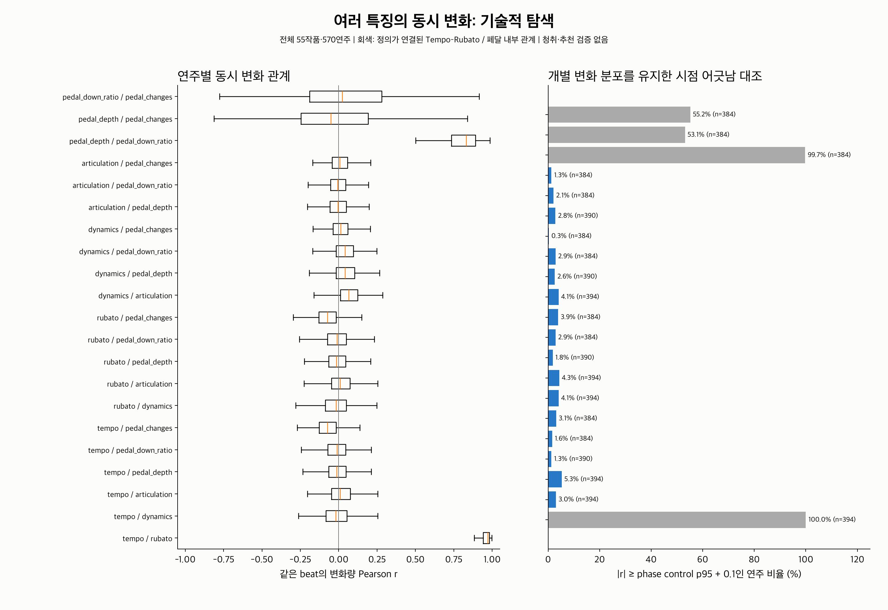
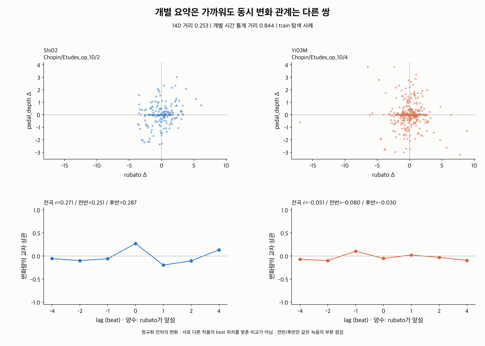

# 둘 이상 feature의 공동 시간 변화: 추가 설명 탐색

**개별 feature의 평균·폭과 시간 통계가 가까워도, 두 feature가 같이 움직이는
관계는 다를 수 있었다. 공동 변화 정보를 비교 baseline에 추가할 근거가 생겼다.**
실제 train 연주의 matched 1,018쌍 중 104쌍(10.2%)에서 한 가지 이상의 관계 차이가
전반·후반에도 유지됐다. 시점을 어긋나게 한 대조 기준까지 만족한 쌍은
55쌍(5.4%)이다. 아래의 탐색 조건에 한정된 기술적 집계이며 청취/추천 성공률이 아니다.

이번에 encoder나 추천 가중치를 수정하지 않았다. 2·3번의 개별 변화 형태·지속·반복에
이어, **여러 특징 사이의 관계가 기존 설명에 무엇을 더하는가**를 검사했다.
관계 통계가 사람의 스타일 판단이나 추천을 개선하는지는 아직 평가하지 않았다.

## 무엇을 시간 정보에 추가했나

입력은 기존 작품 공통 패턴 제거·MAD/SD 정규화 잔차다. 55작품·570연주의
원래 beat 축과 shared mask를 그대로 쓴다. 원본의 절대적인 crescendo/accelerando가
아니라 **자기 작품의 공통 패턴에 비해 잔차가 어떻게 같이 변하는가**를 기술한다.

| 정보 | 계산 | 설명 가능한 질문 |
|---|---|---|
| 동시 변화 | `corr(Δa[t], Δb[t])` | 한 특징의 편차가 커질 때 다른 특징도 같은 방향 또는 반대 방향으로 움직이는가? |
| 시차 관계 | `corr(Δa[t], Δb[t+lag])` | a의 변화와 몇 beat 뒤 b의 변화가 연결되는가? |
| 공동 방향 상태 | 두 특징의 상승/유지/하강 9상태 비율 | 둘 다 상승하거나 한쪽 상승/한쪽 하강하는 조합이 얼마나 나타나는가? |
| 세 특징 공동 상태 | 세 특징의 상승/유지/하강 27상태 비율 | 세 요소를 함께 조절하는 조합이 있는가? |
| 세 특징의 중심화 방향 곱 | `mean((s1−mean(s1))*(s2−mean(s2))*(s3−mean(s3)))` | 쌍별 상관만으로 정해지지 않는 특정 3자 방향 관계를 기술할 수 있는가? |

`Δx[t]=x[t+1]−x[t]`. 기본 lag는 −4/−2/−1/0/1/2/4다.
양수 lag는 a가 b보다 앞서는 좌표 정의이며 인과관계를 뜻하지 않는다.
두 채널 모두 시차 사이의 모든 원래 beat가 유효해야 한다. 결측을 건너 연결하지 않는다.
Pearson은 유효 쌍 32개 이상·양쪽 SD>1e−12일 때만 정의하고, 상수/지원 부족은
NaN과 명시적 status로 저장한다. 상관 0과 측정 불가능을 구별한다.

공동 방향은 정규화 단위 ±1e−6 안을 유지로 처리한다. 음악적 감지 기준은 아니다.
독립 방향 분포는 각 채널의 상승/유지/하강 비율을 곱한 분포다.
이 분포와 관측 분포의 total variation distance(TV)를 저장한다.
단순 “같은 방향 비율”이 높아도 두 채널이 각각 상승을 많이 하면 당연한 결과일 수
있으므로 주변 비율을 함께 비교한다. TV는 표본 크기에 영향받으며 검정 p-value가 아니다.

7채널의 21가지 pair를 측정했다. Tempo–Rubato와 페달 내부 3pair는 정의/원자료가
연결되어 있으므로 표시하되 **추가 설명 사례의 17가지 관계 탐색에서는 제외**했다.
세 특징은 Tempo/Rubato/Dynamics/Articulation/Pedal depth 중 조합하되
Tempo와 Rubato가 함께 있는 조합을 제외한 7가지다. 페달 대표 채널 선택의 최적성은 미검증이다.

## 개별 시간 구조를 유지한 시점 어긋남 대조



각 pair의 유효 delta가 연속 64개 이상인 구간만 사용한다. 오른쪽 채널의 delta 배열을
각 구간 안에서 **최소 8 step 이상 원형 이동**하고, 199개 이동 대조를 계산한다.
왼쪽 채널은 고정한다. 같은 데이터 집합에서 다음이 보존된다.

- 구간별 delta의 값 집합·분포와 방향 비율은 정확히 동일하다.
- 각 delta 구간의 원형 자기상관은 유지된다. 선형 자기상관/연속 run은 이동 경계
  한 곳에서 달라질 수 있으므로 모든 개별 시간 구조가 완전히 같다고 주장하지 않는다.
- 결측을 가로질러 옮기지 않는다. 제외된 짧은 구간이 있어 대조는 원래 전곡과 support가
  다를 수 있다. 관측 r도 **같은 긴 구간 support에서 재계산**한다.

사례 선정에는 대조 support가 원래 유효 delta의 80% 이상이고,
`|관측 r| ≥ 이동 대조 |r|의 p95 + 0.1`인 연주가 최소 한쪽에 있어야 한다.
임계값은 탐색 설정이다. 주기적/장기 의존 신호는 이동 뒤에도 상관이 남을 수 있으며,
이 대조는 우연·작품·정렬 영향을 완전히 분리하는 유의성 검정이 아니다.

전체적으로 서로 다른 음악 요소의 동시 delta 상관 중앙값은 −0.073~0.065로 작았다.
충분한 대조 support를 가진 연주 중 위의 excess 조건을 만족한 비율은 pair별
0.3~5.3%였다. 반면 Tempo–Rubato 중앙값 r=0.971, 페달 깊이–on 비율 r=0.830이었다.
**높은 상관 대부분을 새로운 독립 해석 축으로 간주하면 중복 정보를 크게 늘릴 수 있다.**
이는 전체 split의 기술통계이고 연주별 동일 비중이다. 긴 구간 조건으로 대조에 포함된
연주는 pair별 384~394개로 전체 570개보다 적다. 그림의 n을 함께 읽는다.

## 기존 설명에 무엇이 더해지는가

추가 설명 사례는 기존 split의 **train만** 탐색했다. 원래 기준을 재사용했다.

1. shared coverage≥90%인 33작품·342연주에서 다른 작품·beat 길이 비율≤2인 34,293쌍을 비교.
2. 기존 14D 평균/Rubato 절댓값 중앙값·p95−p5 거리의 하위 5%인 1,715쌍을 가까운 후보로 선택.
3. 개별 시간 통계까지 가까운지 추가 검사. 모든 train 연주에서 좌표별 IQR/1.349를
   fit하고 퇴화 시 SD로 fallback한다. 상수 좌표는 제외하며 결측 대입은 하지 않는다.
4. 비교하는 7채널마다 active 좌표의 80% 이상이 양쪽에서 정의되어야 한다.
   다섯 음악 요소를 동일 가중하고 페달 세 채널은 묶음 평균으로 계산한다.
5. 지원 가능한 30,170쌍의 개별 시간 통계 거리 하위 25%까지 만족하는 **1,018쌍**을 비교.

개별 통계는 채널마다 큰 변화 비율, 폭으로 나눈 RMS 변화량, 상승 비율, 방향 반전 비율,
양·음 수준 run 평균의 log1p, 값과 delta의 lag1/lag8 자기상관이다. 수준 run 평균은
각 상태 run≥20일 때만 포함한다. 큰 변화 기준은 기존 train p95를 그대로 확인·재사용했다.
**선택한 개별 요약들이 가깝다는 조건이지 모든 원래 곡선이 같다는 조건은 아니다.**

공동 관계 차이는 전곡 r 차이≥0.3이고, 각 녹음의 전반/후반 모두 전곡과 같은 방향으로
차이≥0.15인 경우로 정의했다. 17관계 전체에서 다음이 관측됐다.

| 조건 | relation-pair 행 수 | 중복 제거한 연주 쌍 수 / 1,018쌍 |
|---|---:|---:|
| 전곡·양쪽 반의 공동 관계 차이가 유지됨 | 175 | 104 (10.2%) |
| 위 조건 + 최소 한 연주의 phase excess 기준 통과 | 85 | 55 (5.4%) |

같은 연주 쌍이 여러 관계에 포함될 수 있어 행 수를 성능 분모로 사용하지 않았다.
개별 관계별 분모/결과는 [additional_information.csv](additional_information.csv)에 있다.
예를 들어 Tempo–Articulation 18쌍, Rubato–Dynamics 11쌍,
Rubato–Pedal depth 5쌍이 두 번째 조건을 만족했다.
pair들은 서로 의존하며 17개 관계를 탐색했다. 통계적 유의성이나 일반화 비율은 주장하지 않는다.

## 사례: 개별 요약은 가깝지만 Rubato–페달 깊이 관계가 다름



- A: `Chopin/Etudes_op_10/2/Shi02.mid`
- B: `Chopin/Etudes_op_10/4/Yi03M.mid`

14D 거리 0.252732, 개별 시간 통계 거리 0.844162로 각각의 close 기준
0.490876 / 1.256229 이하다. 개별 통계 70좌표 중 67좌표가 양쪽에서 지원됐다.
17관계의 적격 후보 85행 중 **14D 거리가 가장 작은 경우**를 골랐으며
상관 차이가 최대인 사례를 고른 것은 아니다. 서로 다른 작품이지만 같은 작곡가다.

| Rubato delta–Pedal depth delta | A | B |
|---|---:|---:|
| 전곡 r | 0.271 | −0.051 |
| 전반 r | 0.251 | −0.080 |
| 후반 r | 0.287 | −0.030 |
| 전곡 유효 delta 쌍 | 191 | 321 |
| phase 대조에서 같은 support의 관측 r | 0.271 | −0.076 |
| 이동 대조의 절댓값 r p95 | 0.140 | 0.129 |
| 각 작품 연주들의 평균 r | 0.006 (11연주) | −0.023 (22연주) |

A는 두 잔차의 변화가 같은 방향으로 연결되는 약한 양의 관계가 있고,
B는 전곡 선형 관계가 거의 없다. 원래 작품의 평균 관계 차이는 0.029로,
선택한 연주 쌍의 차이 0.323보다 작다. 작품 내부 상대 위치에서도 A가 더 높다.
작품 효과를 완전히 제거한 검증이나 두 채널이 항상 함께 상승한다는 해석은 아니다.

사례를 바꾸지 않고 사후 민감도도 확인했다. 각 delta 절댓값의 상위 1%를
진단용으로 제외한 Pearson은 **0.232 / 0.048**, 평균 rank 상관은 **0.201 / 0.031**이다.
차이는 남지만 원래 0.323보다 작아, Pearson의 크기에 tail 영향이 있음을 보여준다.
delta 하나씩 제외했을 때 최대 r 변화는 A 0.025, B 0.038이다.
이 진단은 원본을 수정하거나 새로운 사례 선정에 쓰지 않았다.
[case_sensitivity.csv](case_sensitivity.csv)에 모든 수치를 저장했다.

[일치 대조 사례](consistent_case.png)는 Rubato–Dynamics 관계의 전곡 차이가 0.016,
양쪽 반 차이도 각각 0.048/0.060인 쌍이다. 두 연주 모두 관계가 약한 경우이므로
강한 공동 패턴이 일치한다는 사례로 해석하지 않는다. close 조건과 전곡 차이≤0.05,
양쪽 반≤0.1을 만족하는 3,684행 중 14D 거리가 가장 작은 경우를 선택했다.

## 셋 이상의 특징에 대해서는 어디까지 확인했나

7가지 triple·570연주에서 27방향 상태와 중심화 방향 곱을 계산해 3,990행을 저장했다.
실제 triple의 product-marginal TV 중앙값은 조합별 0.064~0.071이었다.
표본 오차나 두 특징 사이의 관계만으로도 이 값이 생길 수 있다.
**이번 실험으로 세 특징의 결합이 pair 통계보다 추가로 유용하다고 결론내리지는 않는다.**

수작업 검증에는 세 방향 `c=a*b`인 균형 신호를 사용했다. 모든 pair 상관은 0이지만
중심화 세 방향 곱은 1이다. 따라서 수학적으로 pair 상관이 놓치는 3자 정보가 존재할
수 있음은 확인했다. 실제 연주에서 이 정보가 필요하다는 증거와 구분한다.
셋 이상을 최종 표현에 추가하려면 pair 정보까지 통제한 대조 및 청취/추천 비교가 더 필요하다.

## 현재 활용 판단

먼저 기존 개별 요약에 **선택한 공동 변화/시차 관계**를 추가한 설명 가능한 baseline을
비교하는 것이 타당하다. 21pair나 7triple을 모두 동일 가중으로 붙이는 정책은 검증하지 않았다.
특히 Tempo/Rubato·페달 내부 관계의 중복과 결측 support를 고려해야 한다.

새 정보의 수치적 추가 설명은 일부 실제 쌍에서 확인됐지만 음악적으로 유용한 유사도와는
구분한다. 검증 단계에서는 개별 시간 통계만 / +pair 관계 / +triple 관계를 비교하고,
독립 청취 유사성 또는 선호를 정답으로 평가해야 한다. 기존 CNN이 이미 이 공동 관계를
얼마나 보존하는지, 이 특징을 추가하면 CNN 검색이 좋아지는지도 이번 범위에 포함하지 않았다.

공통값/scale에 후보가 포함되고 beat 정의·악보 밀도·페달 counts의 박 길이 영향과
정렬 오차가 남는다. 서로 다른 작품의 같은 악구를 맞추지 않았다. 원형 이동과
half 비교는 같은 녹음에 대한 진단이며 별도 녹음의 재현성 평가가 아니다.

## 재현과 검증

저장소 루트에서 실행한다. 기본 입력은 이 작업 환경의 cluster 명칭을 사용한다.
기존 run01/raw 명칭을 쓰는 환경에서는 경로를 명시한다. 모델을 학습하지 않는다.

```bash
MPLCONFIGDIR=/tmp/classicfy-matplotlib \
  .venv/bin/python classicfy-ai/scripts/analyze_temporal_coupling.py

MPLCONFIGDIR=/tmp/classicfy-matplotlib \
  .venv/bin/python classicfy-ai/scripts/analyze_temporal_coupling.py \
  --cache ../datasets/feature_normalization_raw.npz \
  --reference ../datasets/temporal_embedding_run01/dataset.json \
  --out /tmp/classicfy-coupling

MPLCONFIGDIR=/tmp/classicfy-matplotlib PYTHONPATH=classicfy-ai/src \
  .venv/bin/python -m unittest discover \
  -s classicfy-ai/tests/unit/features -p 'test_temporal_*.py' -v
```

원래 데이터 수집 기준 commit `20a4168`의 모든 원 feature/preprocessing Python 파일을
byte 비교하고, raw cache SHA256·ASAP/nASAP revision·원래 scale·train threshold가
기준 manifest와 동일한지 검사했다. 기존 extractor/정규화/캐시를 바꾸지 않았다.

원래 index를 직접 순회하는 별도 support 계산 **19,152개**, NumPy `corrcoef`
대조 **18,936개**가 일치했다(최대 절대 오차 8.88e−16). 신규 13개를 포함한
시간 특징 테스트 **44개 통과**. 다른 출력 경로에 재실행해 기존 10개 CSV hash가 일치했다.
대표 사례의 원래 delta CSV로 12개 phase 수치, 36개 공동 방향 count, 4개 rank 상관을
독립 재계산했다(phase 최대 오차 5.55e−17). 3개 그림의 시각 검토를 마쳤다.

| 파일 | 내용 |
|---|---|
| [pair_metrics.csv](pair_metrics.csv) | 11,970개 연주×pair의 시차/half 상관, 공동 방향, support/status, phase 대조 |
| [relation_summary.csv](relation_summary.csv) | pair별 분포, phase 지원 수, 작품 η² |
| [triple_directions.csv](triple_directions.csv) | 3,990개 연주×triple의 27방향 상태와 중심화 방향 곱 |
| [single_temporal_metrics.csv](single_temporal_metrics.csv), [descriptor_scales.csv](descriptor_scales.csv) | 기존 개별 시간 지표와 train에서 추정한 비교 scale |
| [additional_information.csv](additional_information.csv), [close_pairs.csv](close_pairs.csv) | 가까운 후보의 추가 설명과 전체 분모 |
| [selected.json](selected.json), [profiles.csv](profiles.csv) | 사례 선정과 기존 14D 비교값 |
| [case_metrics.csv](case_metrics.csv), [case_values.csv](case_values.csv), [case_sensitivity.csv](case_sensitivity.csv) | 사례의 원래 index별 delta, 수치, 민감도 |
| [protocol.json](protocol.json), [verification.json](verification.json) | 설정·출처·제한 사항·코드/결과 hash와 검증 기록 |

그림은 같은 이름의 PNG/SVG/PDF로 제공한다. `--shift-samples`, `--seed`는 대조의 탐색
설정이다. 설정을 바꾸면 별도 `--out`을 사용해 기존 결과와 구분한다.
