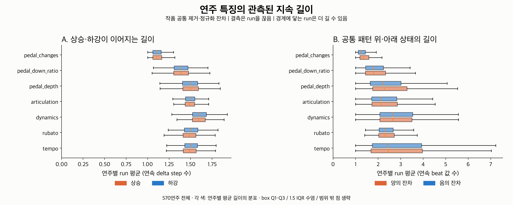
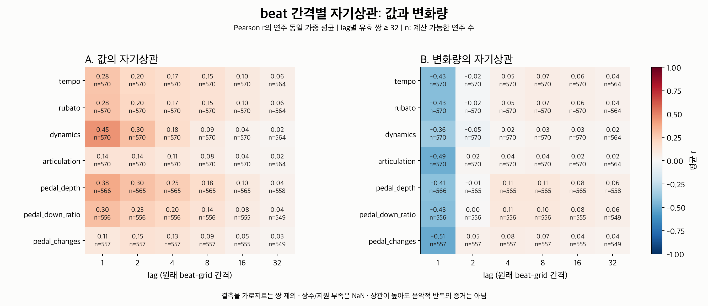

# 지속 길이·반복: 신경망 없는 baseline

2번 변화 형태에 이어 **한 방향·상태가 얼마나 이어지고, 일정 beat 간격에서 값이나
변화가 얼마나 비슷하게 나타나는가**를 측정한다. 작품 간 같은 위치나 같은 악구를
가정하지 않는다. 55작품·570연주, 다섯 feature의 7개 채널에 적용했다.

## 1. 관측된 지속 길이



| 구분 | 상태 | 길이 단위 |
|---|---|---|
| 변화 방향 run | 상승 / 유지 / 하강 | 연속된 인접 delta step 수 |
| 상대 수준 run | 양의 잔차 / 거의 0 / 음의 잔차 | 연속된 beat feature 값 수 |

예를 들어 `[0, 1, 2, 3, 4]`는 상승 변화 4개가 이어진 **상승 run 길이 4**다.
양의 잔차 `[1, 2, 3, 4]`도 **양의 수준 run 길이 4**다. 전자는 변화 횟수이고
후자는 값 개수다. 방향 run 길이 R은 R+1개의 연속된 beat 값을 포함한다.
초 단위 지속 시간이나 다른 작품의 동등한 악구 길이를 뜻하지 않는다.

입력은 기존 **작품 공통 패턴을 제거하고 MAD/SD로 정규화한 잔차**다.
양의 Dynamics run은 공통 패턴보다 높은 잔차가 이어지는 것으로,
원래 MIDI에서 강한 음량이 이어진다는 의미와 구분해야 한다.
상승·하강도 원래 곡선이 아닌 잔차 변화의 방향이다.

각 연주·채널·상태에 run count, 포함된 entry 수, 평균·중앙값·p95·최대 길이를
저장했다. 평균과 분위수는 **run별 동일 가중**이다. 해당 상태가 없으면 count는 0,
길이 통계는 NaN이다. 유지 상태도 실제 run으로 보존한다.
방향·수준 tolerance 기본값은 정규화 단위 `1e-6`이며 음악적 감지 한계는 아니다.

mask=False / NaN / ±inf는 run을 끊는다. `[1, 2, 결측, 3, 4]`는 양의 수준 run
길이 2짜리 두 개로 관측된다. 곡의 경계나 결측에 닿으면 원래 run이 더 길 수도
있으므로 좌·우 경계별 `censored_count`를 함께 기록했다. 둘 다 닿는 run은 두
count에 각각 포함된다. 실제로 관측된 상태 변화는 censored boundary로 세지 않는다.

그림은 **각 연주의 run 평균 길이**의 분포다. 상자는 Q1–Q3, 선은 중앙값,
수염은 1.5 IQR 안이며 범위 밖 점은 생략했다. 초기 점검에서 방향 run의 중앙값이
대부분 1에 몰렸다(상승 run 중앙값=1: Tempo 550/570, Dynamics 526/570,
Pedal changes 557/557개 정의 가능한 연주). 그래서 이 탐색 그림은 평균을 표시했다.
중앙값·p95도 CSV에 보존했고, 평균이 추천에 더 유용하다는 검증은 하지 않았다.

## 2. beat 간격별 자기상관



원래 beat-grid에서 lag **1 / 2 / 4 / 8 / 16 / 32**를 고정하고 두 신호를 측정한다.

- **값**: `corr(x[t], x[t+lag])`. 상대 수준이 얼마나 유지되거나 다시 비슷해지는가.
- **변화량**: `corr(delta[t], delta[t+lag])`. 상승·하강 변화가 해당 간격에서 비슷하게 나타나는가.

각 lag의 모든 유효 쌍을 모은 **Pearson 상관계수**다. lag마다 쌍의 평균과 SD를
따로 계산하므로, 전체 평균·분산을 고정한 ACF estimator와 수식이 같지는 않다.
양 끝뿐 아니라 **그 사이 모든 entry도 유효**해야 한다. 값의 lag L은 L+1개,
변화량의 lag L은 원래 beat 값 L+2개가 연속으로 유효해야 한다.
서로 다른 유효 구간의 쌍들을 합쳐 계산하지만 gap을 가로지르는 쌍은 넣지 않는다.

비교 가능한 쌍이 기본 **32개 이상**이어야 한다. 쌍 양쪽 어느 하나의 SD가
정규화 단위 `1e-12` 이하이면 상수로 처리한다. 계산 상태는 다음과 같다.

| 상태 | 저장값 | 뜻 |
|---|---|---|
| `ok` | −1~1 | 필요한 support와 변동이 있음 |
| `insufficient_pairs` | NaN | 유효 쌍이 최소 개수 미만 |
| `constant_pairs` | NaN | 한쪽 또는 양쪽에 변동이 거의 없어 상관 미정의 |

상수 시퀀스의 상관을 0이나 1로 임의 채우지 않는다. valid/possible pair count와
coverage도 함께 저장한다. lag·최소 쌍 수·tolerance는 탐색 설정이며 최적성은
검증하지 않았다. 이번 지표에는 추가로 fit한 threshold나 학습 모델이 없다.

47,880개 측정 중 **47,400개 정의됨**, **396개 상수**, **84개 지원 부족**이다.
그림의 각 칸은 정의 가능한 연주들의 동일 가중 평균 r이며 n을 함께 표시했다.
lag가 커지면 비교에 포함된 연주가 달라질 수 있다. 전체 split의 기술 통계다.

높은 자기상관만으로 음악적 반복을 확정할 수 없다. 직선처럼 계속 상승하는 신호도
값의 자기상관은 1이지만 변화량은 상수여서 상관이 정의되지 않는다. 짧은 lag의
양의 상관은 완만함·지속, 음의 상관은 교대 변화, 특정 lag의 양의 상관은 반복
후보를 기술할 수 있다. 악구·형식에 따른 반복인지 확인하려면 별도 분석이 필요하다.

## 결과·재현

- [performance_durations.csv](performance_durations.csv): 연주·채널별 지속 통계 3,990행.
- [lag_correlations.csv](lag_correlations.csv): 3,990행의 넓은 형식. 예: `delta_lag8_correlation`, `delta_lag8_valid_pairs`, `delta_lag8_status`.
- [protocol.json](protocol.json): 입력/코드 hash, 기존 작품 split, 설정·단위·제한 사항.
- [verification.json](verification.json): 원래 index로 나눈 연속 구간의 독립 재계산 및 CSV hash.

PNG와 같은 그림의 SVG/PDF도 제공한다. 개별 run 원시 목록은 저장하지 않고 요약만
CSV에 담았다. 코드의 `observed_runs`는 필요할 때 원래 start/stop과 경계 정보를 반환한다.

저장소 루트에서 실행한다.

```bash
MPLCONFIGDIR=/tmp/classicfy-matplotlib \
  .venv/bin/python classicfy-ai/scripts/analyze_temporal_duration.py

MPLCONFIGDIR=/tmp/classicfy-matplotlib PYTHONPATH=classicfy-ai/src \
  .venv/bin/python -m unittest discover \
  -s classicfy-ai/tests/unit/features -p 'test_temporal_*.py' -v
```

입력은 2번과 같은 저장소 밖 `Classicfy/datasets/`의 ASAP, nASAP, raw cache,
`temporal_embedding_run01/dataset.json`이다. 기존 수집 기준 commit `20a4168`의
원래 feature/preprocessing 소스를 byte 비교하고, cache hash·dataset revision·
정규화 scale도 검증한다. 새 정규화나 임베딩 학습은 실행하지 않는다.
출처 확인 방식은 [2번 보고서](../temporal_shape/README.md)에 있다.

`--lags`, `--min-pairs`, `--direction-tolerance`, `--level-tolerance`,
`--std-tolerance`로 탐색 설정을 지정한다. 기존과 동일하게 `--asap-root`,
`--nasap-root`, `--cache`, `--reference`, `--out`도 지원한다.
같은 out에서 재실행하면 결과를 다시 생성한다. CSV가 바뀌면 이전
`verification.json`을 제거해 예전 검증 기록이 새 결과에 남지 않도록 한다.

검증: 원래 index로 유효 구간을 나누고 `groupby`로 run을 별도 계산한 뒤,
쌍 배열의 NumPy Pearson/SD로 자기상관을 다시 계산했다. **391,020개 수치와
47,880개 상태**가 일치했다(최대 절대 오차 5.55e-16). 결측 간격이 있는 38개
작품/grid도 포함했다. 3번 신규 14개와 2번 13개를 합쳐 **27개 테스트 통과**.
수작업 run·경계·상수/빈 입력·원래 gap·주기/교대 신호·Pearson 독립 계산을 확인했다.
기존 전체 feature 테스트의 ATEPP 항목은 환경의 `scipy` 누락 때문에 2번 작업 당시
import 실패했으며 이번 전체 suite는 재실행하지 않았다.

## 제품 목표와의 관계

이제 전반적 평균·폭에 더해 “짧게 교대하는가”, “한 방향·상대 수준이 오래 이어지는가”,
“특정 beat 간격에서 비슷한 변화가 관측되는가”를 수치로 비교할 수 있다.
이 지표가 사람에게 느껴지는 스타일이나 추천의 적합성과 일치하는지는 아직 미검증이다.

작품 공통 제거 후에도 beat 정의·악보 구조·음표 밀도·페달 counts의 시간 길이 영향이
남을 수 있다. 관측 run은 결측으로 짧아질 수 있고, shared mask는 일부 유효 beat도
제외한다. 작품별 scale은 해당 cohort에서 추정했다. 이번 결과는 서로 다른 작품의
연주를 기술할 baseline이며, 시계열 인코더가 필요하다는 결론은 아니다.
