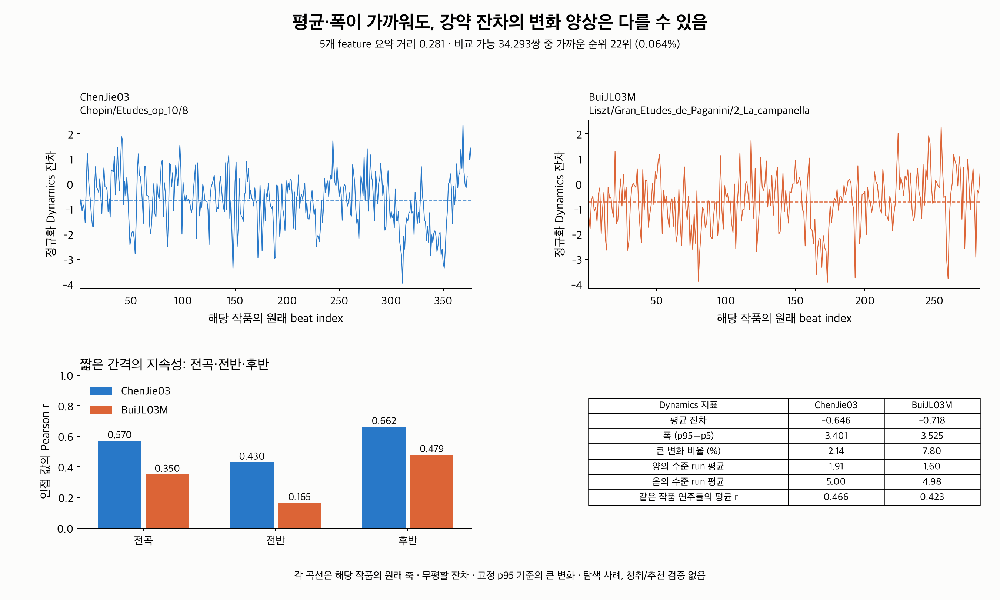
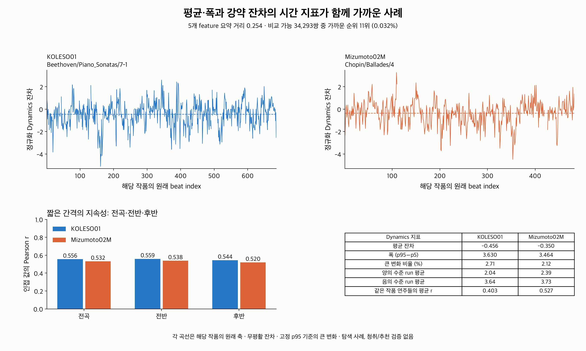

# 평균·폭이 가까운 다른 작품의 연주: 시간 특징의 추가 설명

**평균·폭만으로 놓치는 변화 차이가 실제 cross-work 쌍에서도 확인됐다.**
2·3번 통계로 그 차이를 설명할 수 있었다. 현재 판단은 시간 특징을 baseline에
추가할 근거가 생겼다는 것이다. 시계열 신경망의 필요성이나 추천 성공은 평가하지 않았다.

## 비교 기준과 전체 결과

기존 split의 train 39작품·395연주에서 탐색했다. 원래 공통 제거·정규화·mask와
raw cache 출처를 검증하고, 2·3번 전곡 CSV의 측정값도 원본 배열에서 재계산해 대조했다.
이후 shared coverage ≥90%인 **33작품·342연주**를 포함했다.
서로 다른 작품이며 원래 beat 값 수의 비율 ≤2인 **34,293쌍**을 비교했다.
이 제한이 beat 정의·악구·작품 구조를 동등하게 만드는 것은 아니다.

가까움은 기존 **14D 대표값·p95−p5 거리의 하위 5%**로 정했다.
Tempo/Rubato/Dynamics/Articulation/Pedaling에 동일한 비중을 주며, Pedaling의 세
하위 채널은 묶음 안에서 평균한다. Rubato 대표값은 기존대로 절댓값 중앙값이다.
거리 ≤0.490876인 **1,715쌍**이 가까운 후보가 됐다.

이 후보에서 Dynamics의 인접 값 자기상관 차이 ≥0.2인 쌍은 **269개(15.7%)**였다.
그중 **229개(전체 후보의 13.4%)**는 전반·후반에서도 전곡과 같은 방향으로
차이 ≥0.1을 유지했다. 각 연주를 자기 길이의 절반에서 나눴으며, 두 작품의
전반·후반이 같은 악구라는 가정은 하지 않는다.
이 수치는 의존적인 pair들의 탐색 집계이며 통계적 유의성·청취 감지 기준은 아니다.

7채널 모두에 큰 변화 비율, 폭으로 나눈 RMS 변화량, 양·음 수준 run 평균,
값의 lag1/lag8 자기상관을 비교했다. 정의되지 않은 값은 제외하고 분모를 기록했다.
run 비교는 각 연주에서 해당 상태의 run ≥20개일 때 포함했다.

[additional_information.csv](additional_information.csv)는 각 지표에서 후보쌍의
차이를 전체 비교 쌍과 대조한다. 예를 들어 Dynamics lag1 차이가 전체 쌍의
p90(0.260750)을 넘은 후보는 108/1,715쌍(6.3%)이다. 후보 대부분은 시간 지표도
전반적으로 더 가깝지만, 큰 차이가 남는 일부가 있다. 모든 연주에 시간 특징이
필수라는 결론은 아니다.

## 사례 1: 평균·폭은 가까워도 급격한 변화의 빈도는 다름



- A: `Chopin/Etudes_op_10/8/ChenJie03.mid`
- B: `Liszt/Gran_Etudes_de_Paganini/2_La_campanella/BuiJL03M.mid`

작품명·연주명은 데이터셋 경로와 파일 식별자를 사용했다.
5개 feature 종합 요약 거리는 **0.280725**, 비교 가능한 34,293쌍 중 **22번째로
가까운 쌍(0.064%)**이다. 그림에서는 각 작품의 원래 beat 축에 무평활 곡선을 따로 표시했다.
coverage는 A 99.73%, B 100%; 길이는 A 377, B 283개의 beat 값이다.

| Dynamics 지표 | A: ChenJie03 | B: BuiJL03M |
|---|---:|---:|
| 평균 잔차 | −0.646 | −0.718 |
| 폭 p95−p5 | 3.401 | 3.525 |
| 큰 변화 비율 | 2.14% | 7.80% |
| 인접 값의 상관, 전곡 | 0.570 | 0.350 |
| 인접 값의 상관, 각 연주의 전반 | 0.430 | 0.165 |
| 인접 값의 상관, 각 연주의 후반 | 0.662 | 0.479 |
| 음의 수준 run 평균 | 5.00 | 4.98 |

평균 차이는 평균 폭의 2.08%, 폭 차이는 더 큰 폭의 3.50%다.
그럼에도 B는 고정 threshold를 넘는 인접 변화가 약 3.65배 많다.
A의 짧은 간격 지속성이 더 높은 차이도 양쪽 반에서 유지된다.
음의 수준을 이어가는 평균 길이는 거의 같으므로, 시간 지표들 사이에도 구별되는
설명이 있다. 현재 기준은 “유지 길이는 비슷하지만 B의 급격한 변화가 더 잦다”다.

작품의 차이만으로 설명되는지도 점검했다. 같은 작품의 다른 연주들을 포함한
평균 lag1은 A 작품 0.466(28연주), B 작품 0.423(29연주)이다.
A는 그 집단 평균보다 +0.104, B는 −0.073이다. 두 집단의 평균 차이 0.043보다
선택한 쌍의 차이 0.220이 크다. 작품 내 상대적 위치에서도 반대 성향이 확인된다.
이는 이 사례의 차이를 전부 작품 집단 평균 차이로 설명하기 어렵다는 점검이지,
정렬·beat 정의·연주 해석의 원인을 완전히 분리한 검증은 아니다.

이 쌍을 평균·폭만으로 가까이 연결하는 것은 기존 기준에 맞다. “시간에 따른
강약 편차의 변화도 비슷하다”까지 설명하려면 추가 특징을 확인해야 한다.

## 사례 2: 평균·폭과 시간 특징이 함께 가까움



- A: `Beethoven/Piano_Sonatas/7-1/KOLESO01.mid`
- B: `Chopin/Ballades/4/Mizumoto02M.mid`

요약 거리 **0.254226**, 34,293쌍 중 **11번째로 가까움(0.032%)**이다.

| Dynamics 지표 | A: KOLESO01 | B: Mizumoto02M |
|---|---:|---:|
| 평균 잔차 | −0.456 | −0.350 |
| 폭 p95−p5 | 3.630 | 3.464 |
| 큰 변화 비율 | 2.71% | 2.12% |
| 인접 값의 상관, 전곡 | 0.556 | 0.532 |
| 인접 값의 상관, 전반 | 0.559 | 0.538 |
| 인접 값의 상관, 후반 | 0.544 | 0.520 |
| 양의 수준 run 평균 | 2.04 | 2.39 |
| 음의 수준 run 평균 | 3.64 | 3.73 |

이 사례에서는 전반적인 편차·폭뿐 아니라 큰 변화 빈도와 짧은 간격 지속성도
가까워, 연결 이유를 여러 구체적인 축으로 설명할 수 있다. 전체 스타일·선호의
유사성을 증명한 것은 아니다. 다른 6채널도 모두 같다는 의미가 아니다.

## 사례 선택과 판단의 범위

사례 조건은 탐색 전에 정의했다. 가까운 후보 중 Dynamics 평균 차이 ≤평균 폭의
5%, 폭 차이 ≤더 큰 폭의 5%인 쌍은 144개다. 이 안에서 서로 다른 작곡가이며
앞서 정의한 전곡·양쪽 반의 상관 차이를 유지하는 13쌍 중 **요약 거리가 가장 작은
쌍**을 사례 1로 골랐다. 차이가 최대인 쌍을 고른 것은 아니다.

사례 2는 같은 요약 조건과 다른 작곡가 조건에 더해 lag1 차이 ≤0.05(전곡),
≤0.1(양쪽 반), 큰 변화 비율 차이 ≤1%p, 양·음 수준 run 평균 비율 ≤1.2인
7쌍 중 요약 거리가 가장 작은 쌍이다. 기준값은 초기 탐색 설정이며 음악적
감지·추천의 최적 threshold는 아니다. Dynamics 그림은 앞선 train 순서 섞기
점검에서 시간 의존성이 분명했던 축을 사용했다. feature 중요도 순위는 검증하지 않았다.

[piece_effects.csv](piece_effects.csv)에서는 작품별 평균 차이의 설명 비율 η²도 계산했다.
Dynamics lag1의 η²는 **0.368**, 큰 변화 비율은 **0.506**이다.
작품별 차이가 남는다는 뜻이며, 남은 분산을 모두 해석의 차이로 볼 수도 없다.
beat 정의·악보 밀도·정렬 오차·잔차 정규화·공통 mask와 관측 경계의 영향이 남는다.
따라서 “작품이 달라도 같은 연주 해석”이라는 검증된 설명으로 확대하면 안 된다.

현재 선택은 **기존 평균·폭 + 선택한 2·3번 통계를 설명 가능한 baseline으로
비교하는 것**이다. 실제 쌍의 추가 차이를 이미 이 통계로 기술할 수 있었으므로,
신경망은 이 baseline이 놓치는 구체적인 차이나 추가 추천 이점을 확인한 뒤 평가한다.

## 재현·파일

```bash
MPLCONFIGDIR=/tmp/classicfy-matplotlib \
  .venv/bin/python classicfy-ai/scripts/analyze_temporal_pair_explanations.py
```

기존 ASAP/nASAP, raw cache와 `temporal_embedding_run01/dataset.json`, 2·3번 CSV가
필요하다. `--out`으로 출력 위치를 변경할 수 있다. 모든 분석 기준은 script와
[protocol.json](protocol.json)에 고정했고, 별도 학습이나 모델 변경은 하지 않는다.

- [profiles.csv](profiles.csv): 포함된 342연주의 14D 요약·coverage·길이.
- [close_pairs.csv](close_pairs.csv): 1,715 후보쌍의 거리·순위·전곡/반쪽 대비와 조건.
- [additional_information.csv](additional_information.csv), [piece_effects.csv](piece_effects.csv): 7채널 전체 비교.
- [selected.json](selected.json), [case_metrics.csv](case_metrics.csv), [case_values.csv](case_values.csv): 두 사례의 식별자·원래 index별 Dynamics·수치.
- [verification.json](verification.json): 별도 계산 및 출력 hash 검증 기록.

검증: 비교 거리·순위와 원래 index별 사례 수치 총 **3,590개**를 별도 계산으로
대조했다(최대 절대 오차 8.88e-16). 4개 신규 테스트가 통과했다.
PNG와 같은 그림의 SVG/PDF도 저장했다. 테스트는 사례 분류의 결측·반대 방향 반쪽,
평균/폭 두 조건과 퇴화 입력을 다룬다. 사람의 청취·추천 평가와 새로운 모델 학습은 미실행이다.
