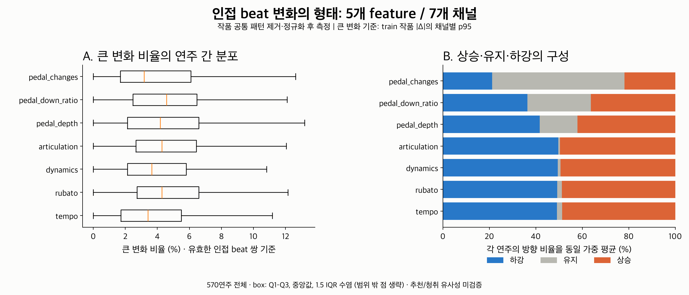

# 변화의 형태: 인접 beat 통계

기존 평균·폭에 더해 **얼마나 급격히 변하는가, 어떤 방향으로 변하는가,
바로 다음 beat에서 방향을 바꾸는가**를 계산한다. 서로 다른 작품의 같은 위치를
맞추지 않고, 각 연주의 유효한 인접 beat 변화들을 요약하는 첫 baseline이다.
이번 범위는 2번 변화 형태다. 3번 지속 길이·반복은 [지속·반복 baseline](../temporal_duration/README.md)에서 이어진다.

55작품·570연주에서 다섯 feature의 7개 채널을 계산해 **3,990행**을 저장했다.
Pedaling은 depth / down ratio / changes를 각각 측정한다.



그림 A는 연주별 큰 변화 비율의 분포다. 상자는 Q1–Q3, 선은 중앙값,
수염은 1.5 IQR 안의 극단값이며 범위 밖 점은 생략했다. 그림 B는 각 연주의
상승·유지·하강 비율을 동일 가중 평균했다. 전체 split을 함께 표시한 기술 통계다.
PDF와 SVG도 같은 폴더에 저장했다.

## 측정 정의

입력 `x[t]`는 기존 **작품 공통 패턴을 제거하고 작품별 MAD/SD로 나눈 잔차**다.
따라서 Dynamics의 상승은 원래 MIDI velocity의 crescendo와 같지 않다.
해당 작품의 공통 변화에 비해 상대적인 값이 상승한다는 뜻이다.
Tempo·Rubato·Articulation·Pedaling도 기존 채널 정의와 잔차 단위를 유지한다.

| 지표 | 계산 | 해석 |
|---|---|---|
| 인접 변화 | `delta[t] = x[t+1] - x[t]` | 한 beat에서 다음 beat로 이동한 잔차 차이 |
| 변화량 분포 | signed delta와 abs(delta)의 p5/p25/p50/p75/p95 | 방향 및 변화 크기의 분포 요약 |
| 평균 변화 크기·RMS | mean(abs(delta)), sqrt(mean(delta²)) | 전반적 변화 크기; RMS는 큰 변화에 더 민감 |
| 큰 변화 비율 | count(abs(delta) > channel threshold) / valid pairs | 고정된 기준을 넘는 변화의 빈도 |
| 상승·하강·유지 | delta > ε / delta < −ε / 나머지 | 각각의 count와 valid pairs 기준 ratio |
| 방향 전이 | 하강/유지/상승 → 하강/유지/상승의 9가지 | 원래 연속된 3개 beat에서 count와 valid triplets 기준 ratio |
| 방향 반전 | 상승→하강 또는 하강→상승 | 두 변화 모두 유지가 아닌 moving triplets 중 비율 |

`ε = 1e-6`은 정규화 단위에서 수치적으로 거의 같은 변화를 유지로 처리하는
초기 tolerance다. 음악적으로 감지 가능한 최소 변화라는 근거는 없다.
유지는 반전 연결을 끊는다. 상승→유지→하강을 바로 반전으로 세지 않는다.

mask=False, NaN, ±inf beat를 건너서 잇지 않는다. 예를 들어 원래 index
`[0, 1, 3]`이 남아 있으면 0→1만 유효한 인접 변화다. 배열을 압축한 뒤 1→3을
인접 beat처럼 처리하지 않는다. 모든 비율에는 분모 count를 함께 저장하며,
분모가 없으면 0 대신 NaN이다. 상수 시퀀스는 유효한 변화 0 / 유지 100%지만
움직이는 방향 반전 비율은 정의되지 않는다.

## 큰 변화 기준

기존 작품 split을 유지하고 **train 39작품·395연주의 유효 인접 쌍 179,326개**를
채널별로 모아 abs(delta)의 p95를 한 번 구했다. validation/test 작품은 임계값
fit에 포함하지 않는다. 이 기준을 모든 연주에 고정 적용한다.
연주마다 자기 p95를 쓰면 큰 변화 비율이 거의 5%로 고정돼 비교 정보가 사라진다.

| 채널 | 고정 임계값 (정규화 잔차 단위) |
|---|---:|
| Tempo | 2.781032 |
| Rubato | 3.408943 |
| Dynamics | 2.360718 |
| Articulation | 3.469019 |
| Pedal depth | 2.122546 |
| Pedal down ratio | 2.419538 |
| Pedal changes | 2.801727 |

p95는 초기 탐색 설정이며 최적 기준은 검증하지 않았다. 정확한 값과 support는
[thresholds.csv](thresholds.csv)에 있다. 임계값 fit은 beat 쌍 단위 가중이어서
긴 연주·연주 수가 많은 작품이 더 많이 기여한다. 모두 0인 기준 집합이면 임계값도
0이며, 이 경우 비율은 엄밀히 “0보다 큰 변화 비율”로 해석해야 한다.

## 결과와 재현

- [performance_channels.csv](performance_channels.csv): 연주·채널별 전체 지표, count, coverage, split.
- [cohort_audit.csv](cohort_audit.csv): 포함·제외 작품/grid와 유효 beat 수·coverage.
- [protocol.json](protocol.json): 데이터/코드 hash, split, 정규화, 임계값, 제한 사항.
- [verification.json](verification.json): 원래 index 기반 별도 재계산 및 CSV hash 검사 기록.

저장소 루트에서 실행한다. NumPy·pandas·Matplotlib과 기존 feature 추출 환경이 필요하다.

```bash
MPLCONFIGDIR=/tmp/classicfy-matplotlib \
  .venv/bin/python classicfy-ai/scripts/analyze_temporal_shape.py

MPLCONFIGDIR=/tmp/classicfy-matplotlib PYTHONPATH=classicfy-ai/src \
  .venv/bin/python -m unittest discover \
  -s classicfy-ai/tests/unit/features -p 'test_temporal_shape*.py' -v
```

기본 입력은 저장소 밖 `Classicfy/datasets/`의 ASAP, nASAP,
`feature_normalization_raw.npz`, `temporal_embedding_run01/dataset.json`이다.
`--asap-root`, `--nasap-root`, `--cache`, `--reference`, `--out`, `--quantile`,
`--direction-tolerance`로 지정할 수 있다. 출력 파일은 같은 `--out`에서 재생성된다.

기존 raw cache는 collector가 features/preprocessing의 모든 Python 파일을 hash한
형식이다. 현재 develop에는 그 수집과 무관한 정렬 코드가 추가됐다. 분석기는
수집 기준 commit `20a4168`의 **기존 모든 feature·전처리 파일을 byte 비교**한 뒤,
당시 hash에 포함된 파일 목록으로 출처를 재검증한다. raw cache hash·dataset revision·
정규화 scale도 기준 manifest와 일치해야 한다. 원래 파일 변경은 오류로 중단한다.
cache 출처 검사를 생략하거나 기존 cache를 덮어쓰지 않는다.

## 현재 판단할 수 있는 범위

같은 값들의 순서만 바꿔 평균·p95−p5가 같아도 변화량·방향 전이는 달라질 수 있다.
신경망 없이 이 차이를 기술하는 수치 baseline을 사용할 수 있게 됐다.
이 수치가 청취자가 느끼는 연주 스타일과 일치하거나 추천을 개선한다는 결과는 아니다.

작품 내 모든 연주·채널의 shared mask를 사용해 보수적으로 비교했으므로 연주별로
유효한 일부 beat도 제외될 수 있다. 기존 작품별 공통값·scale은 해당 작품 cohort에서
추정했으며 단일 새 연주 추론이나 독립 train-only 정규화 실험을 구현한 것은 아니다.
작품의 구조·beat 정의·음표 밀도·페달 counts의 beat 길이 영향도 남을 수 있다.

분포와 1단계 방향 전이는 긴 흐름을 모두 보존하지 않는다. 지속 길이·반복 baseline을
기존 평균·폭과 합쳤을 때 실제 비교·설명에 어떤 정보가 늘어나는지
확인해야 시계열 인코더의 추가 이점을 평가할 수 있다.

검증: 실제 원본 cohort에서 별도 계산한 183,540개 수치와 7개 임계값이 일치했다
(최대 절대 오차 4.44e-16). 결측 간격이 있는 38개 group도 포함했다. 재실행 CSV
hash 일치와 그림 시각 검토를 마쳤다. 신규 13개 테스트 통과. feature 테스트 전체 실행에서는 122개 통과,
기존 ATEPP 테스트 1개는 환경의 `scipy` 누락으로 import 실패했다.
