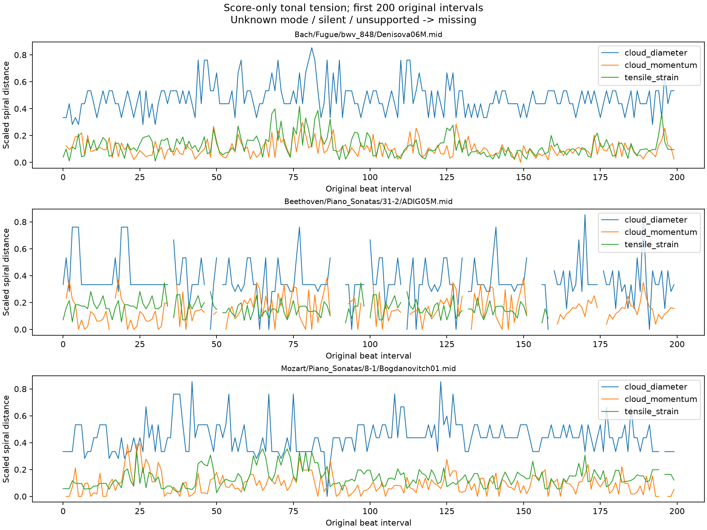

# 악보 기반 조성 긴장도와 연주 반응

2026-10-14. 같은 55악보·570연주의 쓰인 quarter 위치에 cloud diameter,
cloud momentum, tensile strain을 계산하고 기존 7채널 잔차 반응과 결합했다.
실제 연주 velocity·연주 초·검색 결과로 긴장도를 정의하지 않았다.

| 항목 | 결과 |
|---|---:|
| 악보 / 연주 | 55 / 570 |
| 서로 다른 쓰인 구간의 note cloud | 26,349 |
| 조표 구간 | 122 |
| XML 명시 mode / 음높이 분포 추정 / 미확정 | 28 / 82 / 12 |
| 확정 또는 추정 major / minor | 71 / 39 |
| feature와 함께 쓸 diameter interval | 266,264 |
| feature와 함께 쓸 momentum interval | 256,436 |
| feature와 함께 쓸 strain interval | 239,595 |

## 수학적 정의

음 이름과 alteration을 5도 순서의 위치로 옮겨 3차원 helix에 배치한다.
enharmonic 표기를 합치지 않고 octave는 무시한다. cloud는 **원래 score interval의
쓰인 half-open 구간에 양의 길이로 겹치는 악보 음**이며, 겹친 표기 길이로 중심을 가중한다.
grace·cue는 제외하고 fractional alteration은 해당 cloud를 미지원으로 남긴다.

- **Diameter:** cloud의 음 사이 최대 거리. 한 음은 0이고 쉼만 있는 구간은 결측이다.
- **Momentum:** 바로 앞 cloud 중심과 현재 중심의 거리. 첫 구간·쉼·구조 점프·미지원 연결 후에는 결측이다.
- **Strain:** cloud 중심에서 조성 중심까지의 거리. 조성이나 mode가 미확정이면 결측이다.

수학적 좌표와 chord/key 중심의 가중치 및 C–B♯ 기준 scale은
[Partitura 공식 구현 문서](https://partitura.readthedocs.io/en/latest/_modules/partitura/musicanalysis/tonal_tension.html)를 참고했다.
이번 구현은 원래 ASAP interval window, 엄격한 쉼/미확정 mask를 사용한다.
Partitura의 기본 centered one-beat window나 첫 momentum=0 처리와 같은 결과라고 주장하지 않는다.
[protocol](protocol.json)에 상수·window·reset·가중치·출처를 고정했다.

## 조성의 출처와 불확실성

모든 part/staff의 현재 조표가 일치해야 조성 후보를 사용한다. 명시 mode는 그대로 쓰고,
mode가 없으면 해당 조표 구간의 duration-weighted pitch-class histogram을
조표와 호환되는 장조·관계단조 profile 각각과 비교한다.
[Partitura의 key-profile 방법](https://partitura.readthedocs.io/en/latest/_modules/partitura/musicanalysis/key_identification.html)을 바탕으로
이번 baseline에서는 두 상관의 차이가 0.1 이상일 때만 추정 mode를 사용한다.
그 미만은 `ambiguous_mode`이며 strain은 NaN이다. 이 차이는 정답 확률이 아니다.

전조를 악보 조표 변화 없이 자동 감지하지 않는다. 긴 조표 구간 하나에도 여러 국소 조성이
있을 수 있으므로 strain은 **명시 또는 추정한 조표 구간의 조성 중심 대비 거리**다.
해당 구간의 전체 악보를 조성 가설에 쓰지만 연주 feature를 입력하지 않는다.
major/minor strain 대안은 외부 배열에 모두 보존한다. 결과에 맞춰 mode를 선택하지 않는다.

## 시간적 연주 반응

각 긴장 지표의 악보 값으로 저·중·고 tertile을 나눈다. 같은 값은 같은 bin에 둔다.
각 bin에서 [프레이즈 단계](../phrase_response/README.md)와 같은 22개 잔차 반응을 계산한다.
지표 3개 전체는 198D다. 같은 bin 안에서도 반복/결측/bR/블록 경계 pair는 제외하고,
strain의 조표 구간 변화도 가로지르지 않는다.
beat 8개·pair 4개 미만이면 지원 부족으로 남긴다. 저·중·고 수준별 반응 요약은
긴장의 상승·완화에 대한 인과 반응이나 청취상 감정 강도를 뜻하지 않는다.
연속적인 긴장 곡선은 별도로 보존해 이후 상승/완화 구간을 정의할 수 있다.

전곡에서 66D를 모두 계산한 연주는 diameter 509, momentum 546, strain 564개다.
A/B 양쪽 모두와 다른 비교 조건이 유효한 공통 cohort를 다음 단계에서 고정한다.
지원이 부족하다고 tertile 경계·minimum을 결과에 맞춰 바꾸지 않는다.



## 검증과 재현

7개 단위 테스트가 spelling·C–B♯ scale·half-open overlap·중심·쉼/점프 reset·미확정 mode·
조표 충돌·fractional alteration·동점 tertile을 확인한다. 독립 verifier는 production tension
함수를 호출하지 않고 원본 XML을 읽어 scalar helix/chord/key 계산, duration histogram,
cloud 및 원래 진행의 momentum을 대조한다. 수치 결과는 [verification](verification.json)에 있다.
이 검증은 구현 계산 검증이며 실제 국소 조성·사람의 긴장감 정답 검증과 다르다.

```bash
MPLCONFIGDIR=/tmp/classicfy-matplotlib .venv/bin/python \
  classicfy-ai/scripts/calculate_tonal_tension.py \
  --out /tmp/tension-new --artifacts /tmp/tension-arrays-new
.venv/bin/python classicfy-ai/scripts/verify_tonal_tension.py \
  --out /tmp/tension-new --artifacts /tmp/tension-arrays-new
```

입력은 프레이즈 단계의 검증된 배열과 고정 XML이다. 외부 데이터는
`datasets/tonal_tension_run01/`에 `tension.npz`, `clouds.csv.gz`로 저장했다.
원본 raw cache와 정규화·프레이즈 배열은 변경하지 않았다.
[조성 가설](key_contexts.csv), [coverage](coverage.csv), [반응 압축 CSV](responses.csv.gz), [요약](summary.json),
[provenance](provenance.json)를 제공한다. 다음은 같은 표본의 분리 구간 검색 비교다.
